# KlipPocket Dashboard — see the phone, the printers and the logs from a browser (port 4400)

**Languages: [English](dashboard.md) · [Português (BR)](pt-br/dashboard.md) · [简体中文](zh-Hans/dashboard.md)**

The app serves a web page called **KlipPocket Dashboard** on **port 4400**. From
the browser of a PC or another phone on the same network you can watch how the
phone running Klipper is doing, see the printers and MCUs, read (and clear) the
same logs as the app's **Logs** screen, and use the [Firmware](firmware-web.md)
tools. It has the app's own look, light and dark, and works on a phone screen too.

The dashboard is **always available while the app is open** (it does not need a
printer to be running), and a small notification keeps it reachable while the app
is in the background.

## Open the dashboard

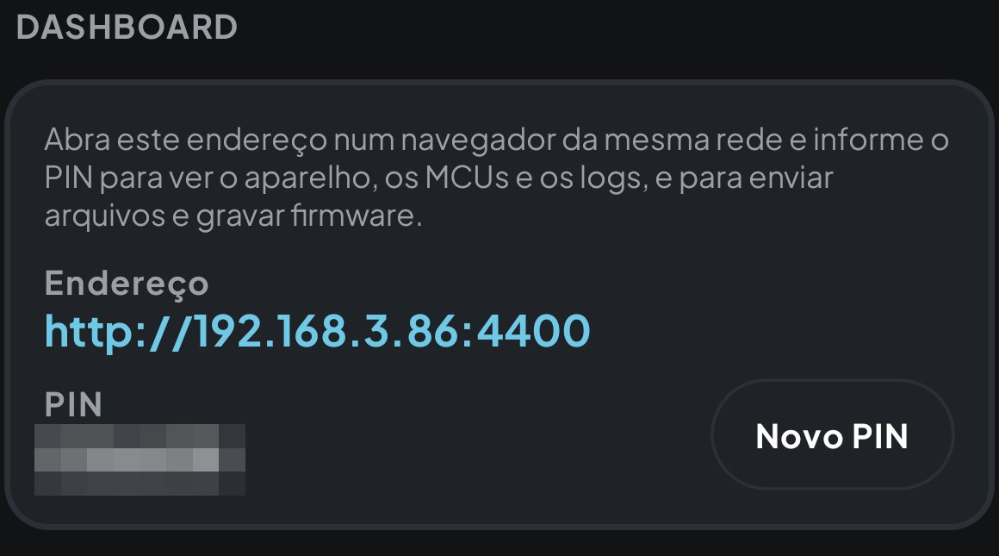
*The address and PIN, at the end of the app's home screen (the app of this capture is in Portuguese; the PIN is hidden).*

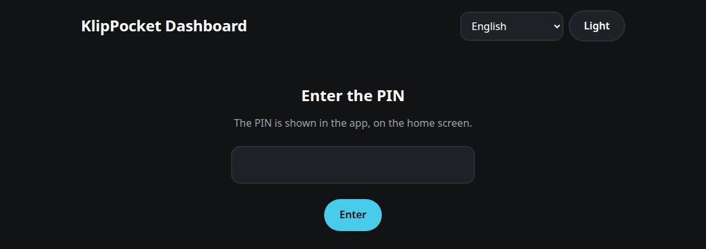
*The PIN screen of the page.*

In the app, scroll the **home screen** to the end, to **Dashboard**: it shows the
address (`http://<phone IP>:4400`) and a six-digit **PIN**. Open the address in a
browser on the same network and type the PIN. **New PIN** in the app replaces it
and closes every open page.

> **Why a PIN?** The page shows information about the phone and can flash a board
> plugged into it, so everything except the page's own files needs the PIN; after
> five wrong tries the address is locked for a minute. The page uses plain HTTP,
> like the other pages of the app: use it on a network you trust.

The page has four tabs, shown as icons under the title (hover one to see its name): **Dashboard**, **Camera**, **Firmware** (see the [firmware web page](firmware-web.md)) and, last, **Settings**. The **Logs** section is at the bottom of the Dashboard tab. Language and theme follow the app the first time; what you choose on the
page is remembered by the browser.

## Live usage

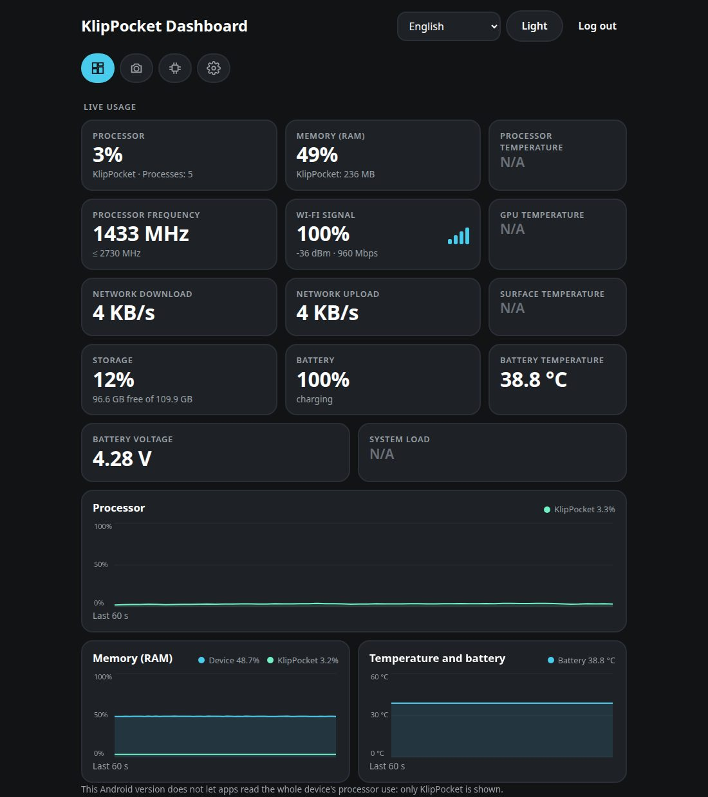
*Live usage on a Galaxy S10+ (Android 12): cards and charts. What this phone does not let the app read shows **N/A**.*

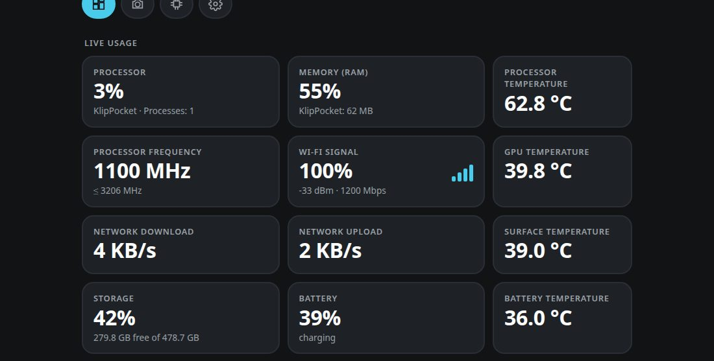
*The same cards on a POCO F7 (Android 16), which exposes more sensors: processor, GPU and surface temperatures.*

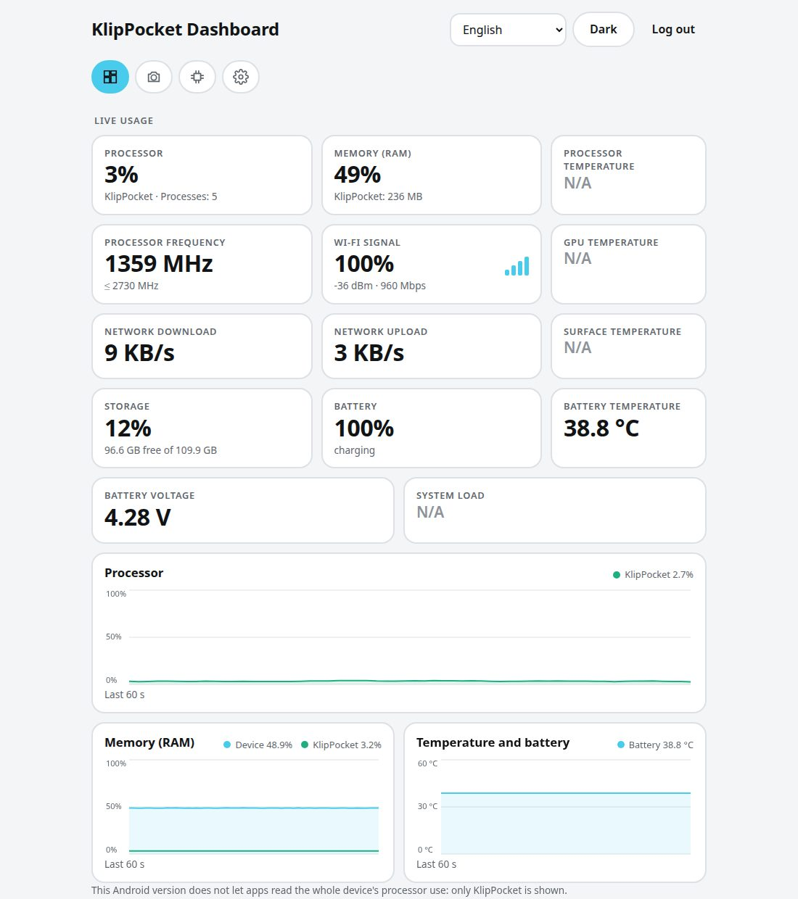
*The light theme (the **Light** / **Dark** button at the top).*

At the top there are **cards**, updated every second, with **at most three per row**: the cards with more to say (processor, memory, frequency, Wi-Fi, network, storage) are wider, the small ones (temperatures, battery, voltage, load) are narrower, and every row fills the line (a card alone takes the whole row, two share it equally, in three the two wider cards get more room).

| Card | What it shows |
|---|---|
| **Processor** | Use of the whole device and, below, the use of KlipPocket. Android only lets an app read its own main process, so the KlipPocket value is that of the app itself, not of the Klipper and Moonraker processes. |
| **Memory (RAM)** | Memory in use by the device and the memory used by all the processes of KlipPocket (app, Klipper, Moonraker, camera…). |
| **Processor, GPU, surface and battery temperature**, **Processor frequency**, **System load**, **Wi-Fi signal** (a percentage with four signal bars, plus the dBm and the link speed below), **Network download / upload**, **Storage** (used and free), **Battery** (level and charging) and **Battery voltage** | Each one of them is always on the page. A value the phone does not let the app read shows **N/A** instead of the number: phones differ a lot in what they expose. |

Under them, **charts** show the **last 60 seconds**, one point per second: the processor on a full line, and memory next to temperature (the temperature chart is hidden when the phone exposes no temperature). Each chart has its legend with the current
values. Charts only move while the page is visible in the browser.

> **The device's processor use is not available on every phone.** Since Android 8
> apps cannot read the use of the whole device, so on many phones only the
> **KlipPocket** line is drawn, with a note saying so. The memory, battery and
> KlipPocket numbers are always available.

## Host device and memory

- **Host device** — model, chip, CPU cores and top frequency, architecture,
  Android version, kernel, how long the phone has been on, its network address
  and the KlipPocket version.
- **Memory (RAM)** — total, in use, available and swap; and **Storage** — free
  and total space of the internal storage and, when there is one, the SD card.

## Printers and MCUs

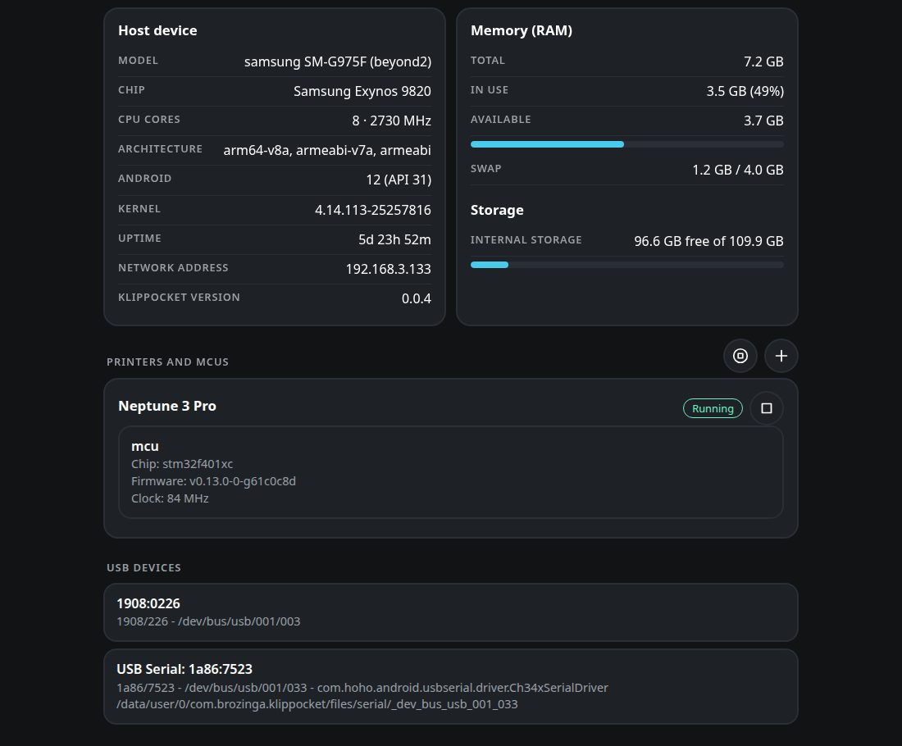
*Host device, memory and storage, the printers with their MCU and the start/stop icons, and the USB devices.*

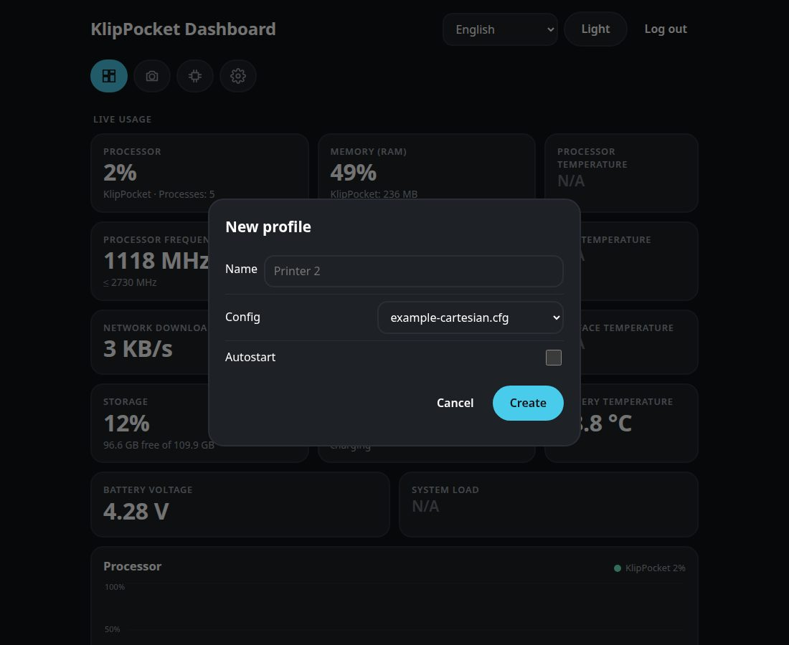
*The **+** icon opens the form of a new printer.*

One card per printer profile, with its state (**Running**, **Stopped**…). When
the printer is running and Klipper is connected, each **MCU** is listed with its
**chip** (for example `stm32f401xc` or `rp2040`), its **firmware version** and
its **clock**. The data comes from the printer's own Moonraker on the phone, so
the main board and the extra boards of a [multi-MCU](multi-mcu.md) setup all show
up. While the printer is stopped the card says the data appears when it runs.

**Start / Stop.** Each printer card has a **play** or **stop** icon and the section header has **start all** / **stop all** icons, the same as the app's play button: the Klipper and Moonraker servers of that printer start or stop. If there is no free slot to start another printer, the page says so.

**Add a printer.** The **+** icon in the section header opens the same form as the app's **New profile** sheet: the name (empty = "Printer N"), the starter `printer.cfg` to copy and **Autostart**. The new printer shows up in the list at once; if there is no free slot the page says so.

**USB devices** lists everything the phone sees on its USB port — name, `VID:PID`,
bus path and, for serial boards, the port used by `printer.cfg` — the same list as
*List USB devices* in the app.

## Settings

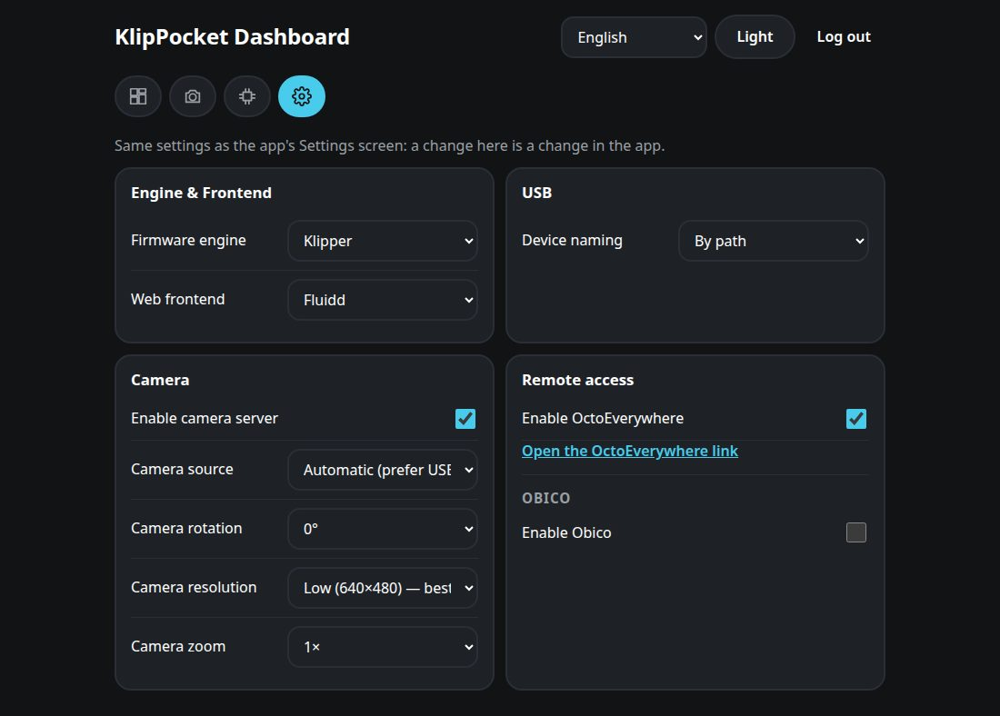
*The Settings tab.*

The **Settings** tab has the same settings as the app's Settings screen; a change here is a change in the app (and is saved at once):

| Section | What you can do |
|---|---|
| **Engine and front end** | Klipper or Kalico (Kalico only when it is installed) and the web front end (Fluidd, Mainsail, Voyager UI). |
| **USB** | How USB devices are named (by path or by VID/PID). |
| **Camera** | Turn the camera on or off, choose the source, rotation, resolution and zoom (the zoom steps depend on the camera). Android asks for the camera permission **on the phone** the first time. |
| **Remote access** | **OctoEverywhere:** turn it on and open its link; the link shows up a few seconds after enabling. **Obico**, in the same card: turn it on, choose Obico Cloud or a self-hosted server (and save it), see if the printer is linked, read the code Obico generates (with its link) or type a code from the Obico app to link, and unlink. |

## Camera

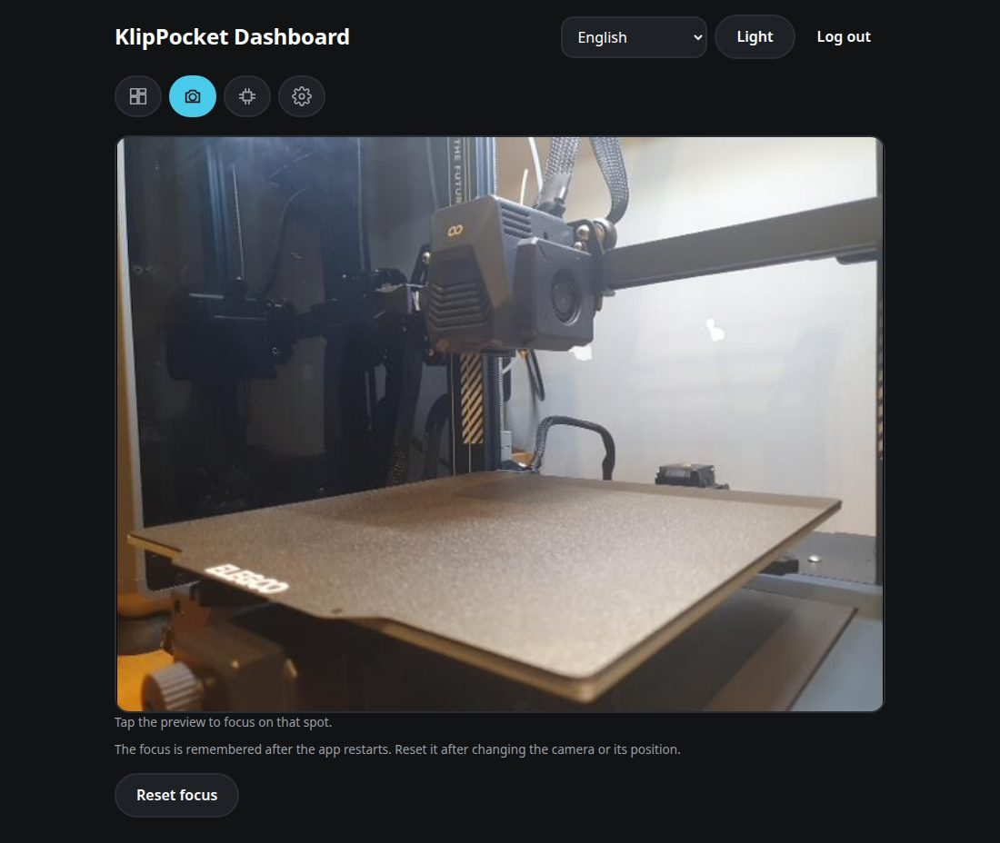
*The camera tab: tap the picture to focus.*

The **Camera** tab shows the live picture of the phone's camera, the same stream Fluidd and Mainsail use (with the rotation, resolution and zoom you chose). **Tap the picture to focus** on that point, like in the app: the focus is kept until you press **Reset focus**. The picture appears when the camera is on and a printer is running (the camera starts with it); if it is off, the tab offers to turn it on. Leaving the tab closes the connection, so the phone does not encode pictures for nobody.

## Logs

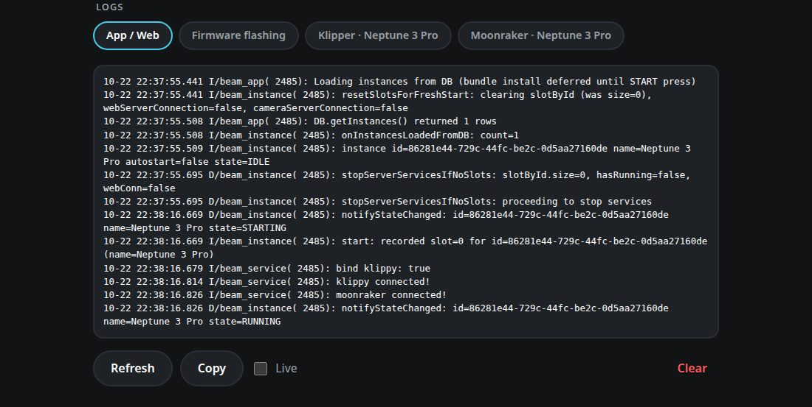
*The logs, with one tab per source and the Refresh, Copy, Live and Clear buttons.*

At the bottom, one tab per log, the same as the app's **Logs** screen: **App / Web**,
**Firmware** (the log of firmware writes), **Klipper**, **Moonraker**,
**OctoEverywhere** and **Obico** of each printer, and **Last crash** when there is one.

| Button | What it does |
|---|---|
| **Refresh** | Reads the log again. |
| **Copy** | Copies the text shown to the clipboard. |
| **Live** | Reads the log again every 3 seconds. |
| **Clear** | After a confirmation, **clears the logs**: the Klipper, Moonraker, OctoEverywhere, Obico and firmware files are emptied, the last-crash report is deleted and the older lines of the app log are hidden. The view empties and from then on only new messages are written — the same as **Clear** in the app. |

The **Logs** section is only on the **Dashboard** tab. The log of firmware writes is the **Firmware flashing** tab of the list; the **Firmware** page shows the log of the last write with its own **Log** button.

The **Firmware** tab (see the [firmware page guide](firmware-web.md)). On a phone screen the page rearranges itself:

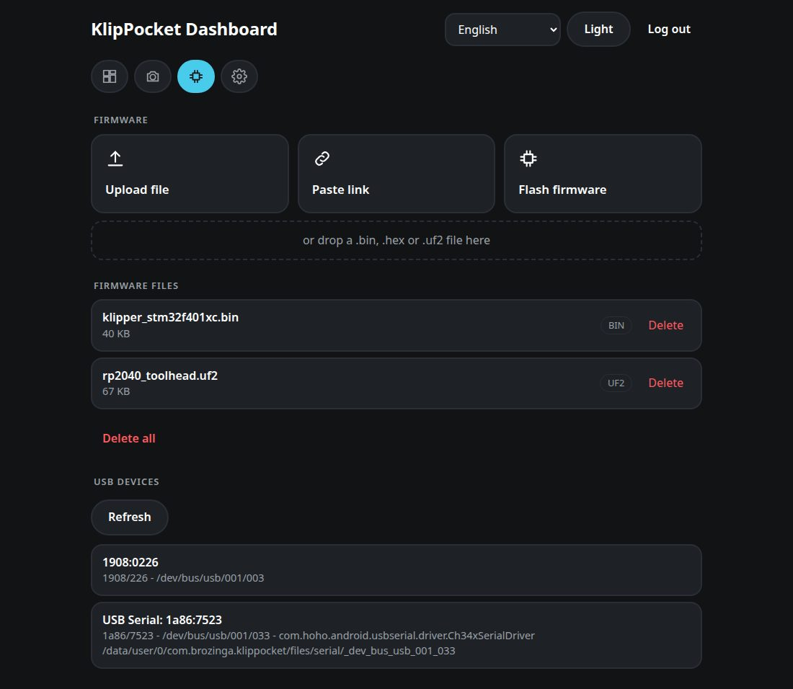

| | |
|---|---|
| 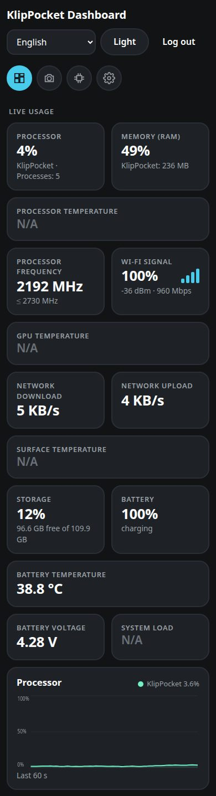 | 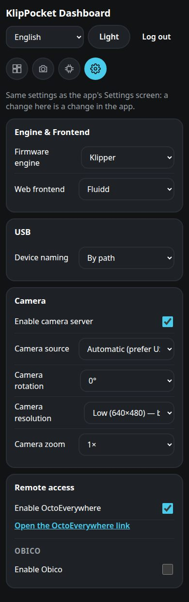 |

## If something goes wrong

| What you see | What to do |
|---|---|
| The page does not open | Phone and computer must be on the same Wi-Fi without *client isolation*; use the address shown in the app. If port 4400 is used by another app, the card on the home screen says the page is not running. |
| *Too many attempts* | Wait the shown seconds, or use **New PIN** in the app. |
| *Connection to the app lost* | The app was closed or the phone went to sleep: open the app again. |
| Only the KlipPocket line in the processor chart | Normal on Android 8+: see the note above. |
| A printer card has no MCUs | The printer is stopped or Klipper has not connected to the board yet. |

## For developers

Everything under `/api` needs the session cookie of the PIN login and, when it
changes something, the header `X-KlipPocket: 1`. Dashboard routes:
`GET /api/dashboard` (device, storage, printers, MCUs, USB; changes slowly),
`GET /api/metrics` (live numbers; the answer is shared if asked more than once a
second), `GET /api/logs` (sources), `GET /api/logs/read?id=…` and
`POST /api/logs/clear`; `GET`/`POST /api/settings` (the setting is `{"key": …, "value": …}`), `POST /api/control` (`{"id": …, "action": "start"|"stop"}`, no `id` = all printers), `GET /api/printers/new` and `POST /api/printers` (`{"name", "config", "autostart"}`), `GET /api/camera`, `GET /api/camera/stream` (multipart MJPEG), `POST /api/camera/focus` (`{"x": 0..1, "y": 0..1}`) and `POST /api/camera/focus/reset`. The firmware routes are in the
[firmware page guide](firmware-web.md#for-developers). The code is in
`app/src/main/java/ru/ytkab0bp/beamklipper/firmwareweb/` (`DashboardCollector`
reads the numbers, `DashboardRules` has the parts that are tested on the JVM) and
the page in `app/src/main/assets/firmware_web/`; its texts are generated from the
app's strings with `scripts/gen_firmware_web_i18n.py`.
