# Compilar el firmware del MCU

**Idiomas: [English](../build-firmware.md) · [Português (BR)](../pt-br/build-firmware.md) · [Español](build-firmware.md) · [简体中文](../zh-Hans/build-firmware.md)**

KlipPocket ejecuta el host de Klipper/Kalico en Android. La placa base de la
impresora sigue necesitando firmware de MCU, compilado y flasheado una vez en un
PC (Android no puede compilar).

**La forma recomendada es el menú interactivo** que se describe en esta página.
Pregunta por Klipper o Kalico, muestra la pantalla *Firmware Configuration* de
ese motor, compila en Docker, valida el resultado, flashea la placa y comprueba
que el firmware nuevo es realmente el que se está ejecutando. Las demás formas
(imágenes precompiladas, los scripts de Docker/Local) están al [final de la
página](#otras-formas-de-obtener-el-firmware).

> El menú del PC y sus capturas están en inglés; aquí se nombran sus opciones
> tal como aparecen en pantalla.

- [Requisitos](#requisitos)
- [Inicio rápido](#inicio-rápido)
- [Paso a paso: un ejemplo completo](#paso-a-paso-un-ejemplo-completo)
- [Flashear la placa](#flashear-la-placa)
- [Qué comprueba la validación](#qué-comprueba-la-validación)
- [Otras formas de obtener el firmware](#otras-formas-de-obtener-el-firmware)

---

## Requisitos

| Qué | Por qué |
|---|---|
| **El repositorio**, descargado o clonado (`git clone https://github.com/Brozinga/KlipPocket.git`, o *Code → Download ZIP* en GitHub) | El menú, el Dockerfile y todos los scripts auxiliares viven en `scripts/` y `firmware/`. No hay que descargar nada más a mano. |
| **Docker** — Docker Desktop en Windows y macOS, Docker Engine en Linux | Todo se ejecuta dentro: los compiladores (ARM, AVR), las fuentes de Klipper y Kalico y las herramientas de flasheo. |
| **Una shell para iniciar el menú** — **Bash** en Linux y macOS; **PowerShell** (5.1 o 7) o **Git Bash** en Windows | `scripts/firmware_menu.sh` (Bash / Git Bash) o `scripts/firmware_menu.ps1` (PowerShell). |
| **Internet, la primera vez** | Docker construye su imagen una vez (unos 400 MB: compiladores y fuentes de ambos motores); después queda en caché. |

## Inicio rápido

Desde la carpeta del repositorio:

```bash
./scripts/firmware_menu.sh        # Linux, macOS, WSL, Git Bash
```
```powershell
.\scripts\firmware_menu.ps1       # Windows PowerShell / Windows Terminal
```

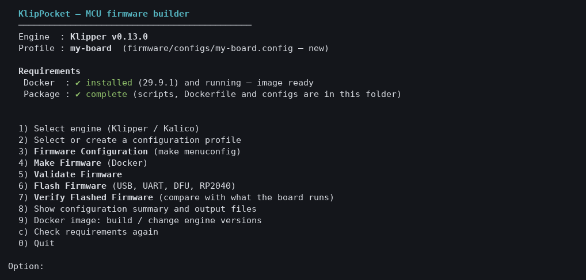

La parte superior muestra el motor y el perfil en uso y los **requisitos**
(Docker instalado y en marcha, descarga completa). Las opciones:

| Opción | Qué hace |
|---|---|
| **1 Select engine** | Klipper (v0.14.0) o Kalico (v2026.11.00). |
| **2 Select or create a profile** | Un perfil es una configuración guardada: `firmware/configs/<perfil>.config`. |
| **3 Firmware Configuration** | El `make menuconfig` real del motor. |
| **4 Make Firmware** | Compila en Docker y valida el resultado. |
| **5 Validate Firmware** | Vuelve a comprobar la salida; una comprobación profunda opcional recompila desde cero y compara los hashes. |
| **6 Flash Firmware** | Lista lo que hay conectado y escribe la placa (modo USB, UART, DFU o RP2040). |
| **7 Verify Flashed Firmware** | Se conecta a la placa y comprueba que ejecuta exactamente el firmware que compilaste. |
| **8 Show summary** | Las opciones clave del perfil y los archivos de la última compilación. |
| **9 Docker image** | Construye la imagen, o cambia las versiones de Klipper/Kalico que contiene. |
| **c** | Vuelve a comprobar los requisitos (tras instalar o iniciar Docker). |

Los resultados van a `firmware/output/` como `<perfil>-<motor>.*`: la imagen
(`.bin`, `.hex` para AVR, `.uf2` para RP2040), el `.dict` que lee el host, la
configuración realmente usada (`.config.used`) y un `.manifest.json` con tamaños
y hashes SHA-256.

---

## Paso a paso: un ejemplo completo

Esto compila firmware para una placa STM32F401 con un bootloader de 32 KiB que
habla con el host por su puerto serie (UART) — el tipo de placa que usan la
mayoría de las impresoras OEM.

### ¿Dónde encuentro los ajustes de mi impresora?

Las respuestas correctas para `make menuconfig` (chip, offset del bootloader,
cómo habla la placa con el host) dependen de tu placa base. El proyecto Klipper
mantiene un `printer-*.cfg` para muchas impresoras aquí:

**<https://github.com/Klipper3d/klipper/tree/master/config>**

Abre el de tu impresora: **los comentarios de la parte superior explican cómo
generar su firmware.** Para la placa de este ejemplo dice:

```ini
# To use this config, during "make menuconfig" select the STM32F401 with a
# "32KiB bootloader" and serial (on USART1 PA10/PA9) communication.

# Note that the "make flash" command does not work with this board.
# After running "make", rename the out/klipper.bin file to out/<file name>.bin
# Copy the file out/<file name>.bin to an SD card formatted to FAT32
# and then restart the printer with the SD card inserted.
```

Eso te dice tres cosas: **qué seleccionar en el menú** (STM32F401, bootloader de
32 KiB, serie en USART1 PA10/PA9), **cómo llega el firmware a la placa** (aquí:
tarjeta SD, no USB) y **cómo debe llamarse el archivo** para ese bootloader. Ten
esas notas a mano para los pasos siguientes.

> ¿No sabes qué chip tiene tu placa? Consulta [Identifica el chip de la placa base](#1-identifica-el-chip-de-la-placa-base).

### 1. Abre el menú

Ejecuta el script como en el [inicio rápido](#inicio-rápido). Si arriba aparece
Docker como instalado y en marcha y el paquete como completo, estás listo.

### 2. Elige el motor (opción 1)

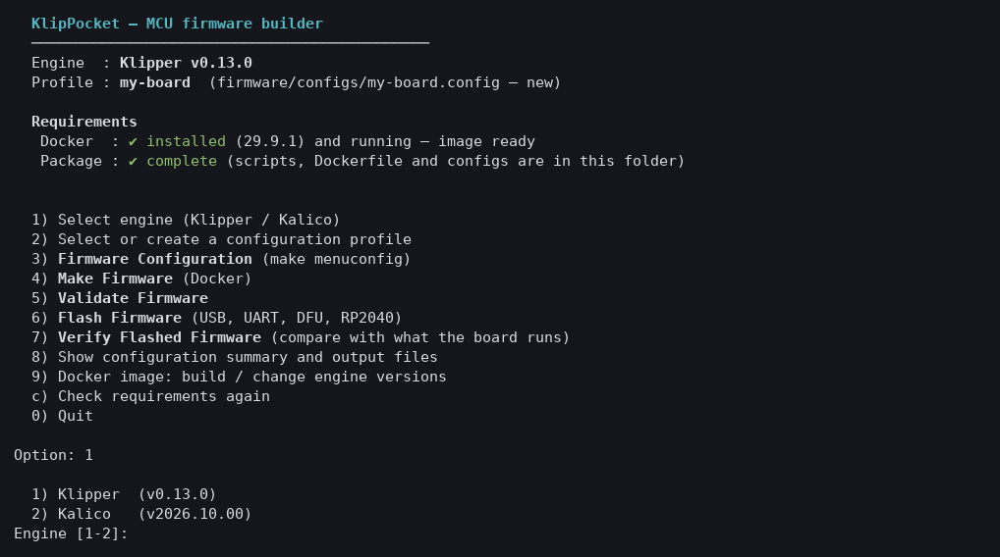

Escribe `1` para Klipper o `2` para Kalico. Kalico se compila exactamente igual
que Klipper y muestra las mismas pantallas de configuración.

### 3. Crea un perfil (opción 2)

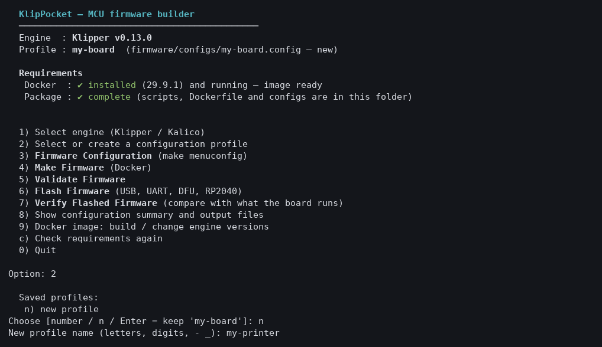

Elige `n` y dale un nombre al perfil (letras, dígitos, `-` y `_`). Se guarda como
`firmware/configs/<nombre>.config`, así puedes tener un perfil por placa y volver
a él más adelante.

### 4. Firmware Configuration (opción 3)

Esto abre la propia pantalla de configuración del motor, dentro de Docker.
Muévete con las **teclas de flecha**, pulsa **Espacio/Intro** para activar o
abrir un elemento, **Esc** para retroceder, **Q** para salir (te pide guardar:
pulsa **Y**).

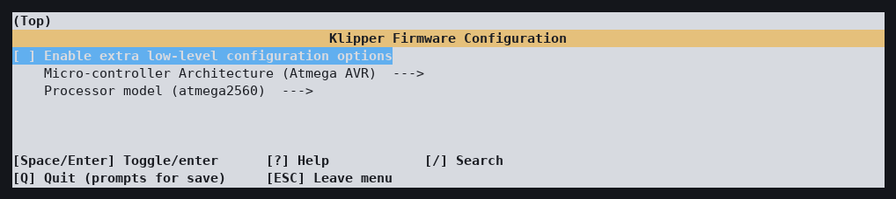

La primera pantalla solo muestra los valores por defecto de un Atmega2560. Marca
**Enable extra low-level configuration options** (Espacio): aparecen las
opciones de tu chip.

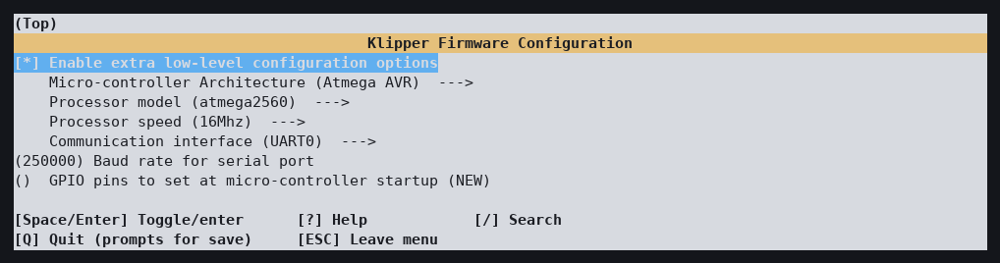

**Micro-controller Architecture** — elige la familia del chip, aquí
*STMicroelectronics STM32*:

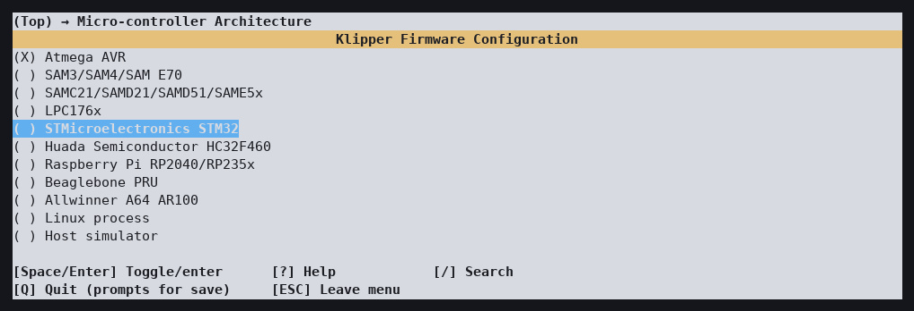

**Processor model** — el chip exacto, aquí *STM32F401*:

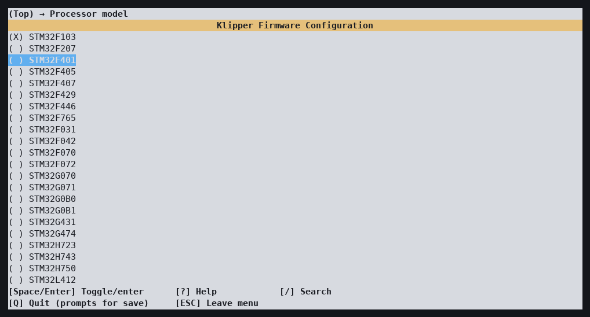

**Bootloader offset** — cuánta flash usa el propio bootloader de la placa y que
no debe sobrescribirse, aquí *32KiB bootloader*. Es el ajuste más importante que
acertar:

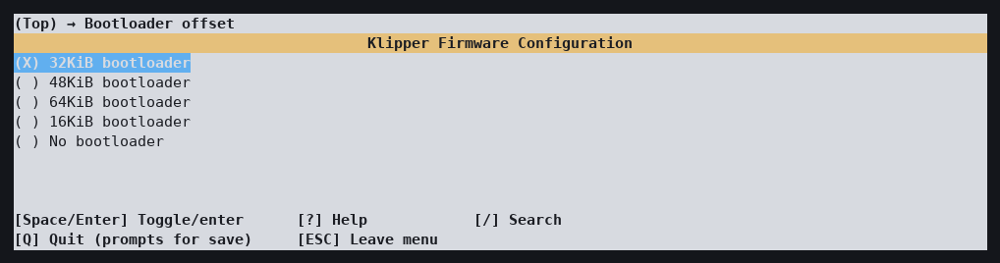

**Clock Reference** mantiene el valor por defecto (*8 MHz crystal*).
**Communication interface** es cómo habla la placa con el host, aquí *Serial (on
USART1 PA10/PA9)*; la velocidad en baudios se queda en 250000, el valor por
defecto de KlipPocket (otra velocidad funciona si configuras la misma para la
placa en la app):

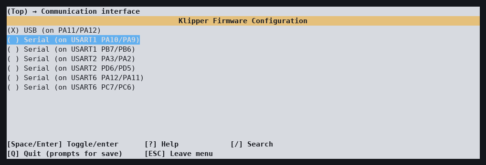

La pantalla terminada:

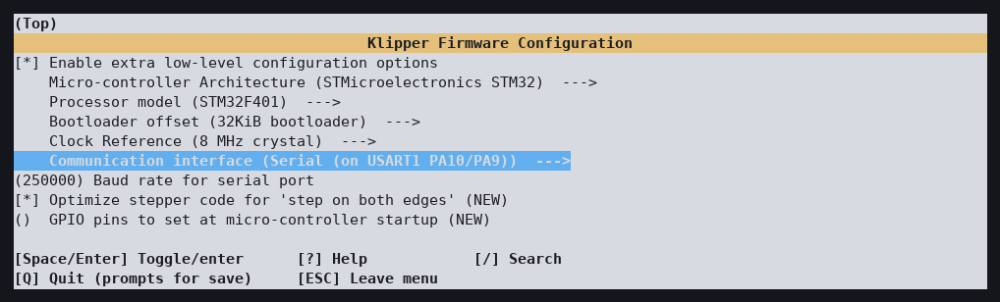

Pulsa **Q** y luego **Y** para guardar el perfil:

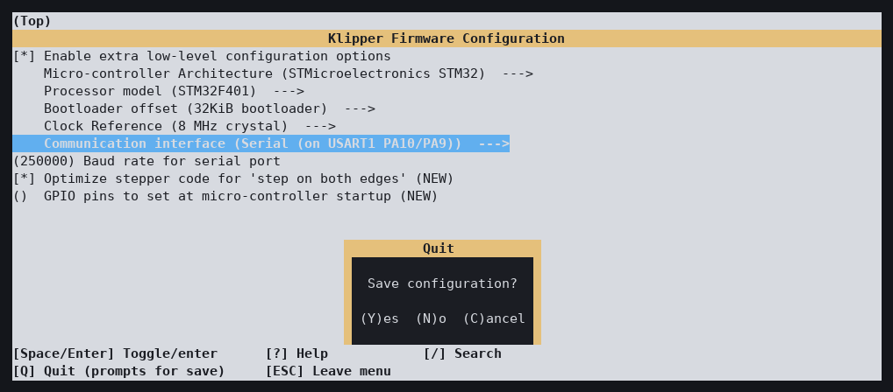

Las placas con USB en el propio MCU (por ejemplo muchas placas STM32 y RP2040)
usan *USB* como interfaz de comunicación en lugar de serie; las demás pantallas
funcionan igual.

### 5. Make Firmware (opción 4)

El menú compila dentro de Docker y valida lo que salió:

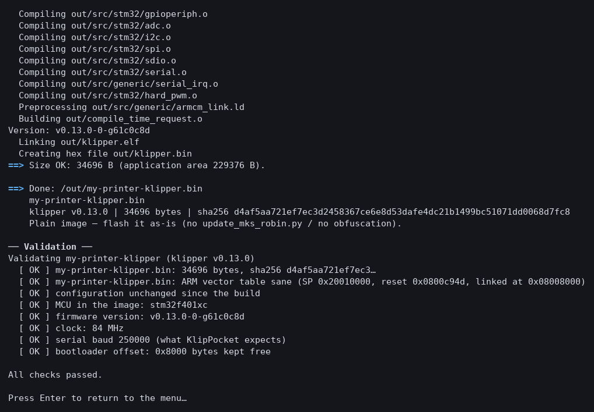

`All checks passed` significa que la imagen es sana: chip correcto, reloj
correcto, tabla de vectores en el offset del bootloader, velocidad 250000 (consulta
[qué comprueba la validación](#qué-comprueba-la-validación)). La opción **8**
lista las opciones clave y los archivos:

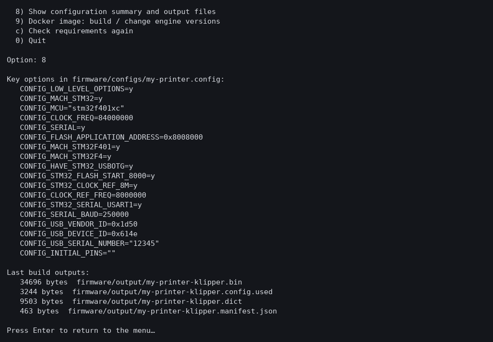

La imagen es `firmware/output/<perfil>-<motor>.bin`.

### 6. Ponlo en la placa

**Esta placa de ejemplo carga su firmware desde una tarjeta SD**, así que no se
flashea desde el menú: renombra el `.bin` al nombre que pedía la cabecera,
cópialo a una tarjeta SD FAT32, inserta la tarjeta y apaga y enciende la placa
(detalles en [Flashear la placa](#flashear-la-placa)).

Las placas que se pueden flashear por USB usan la opción **6 Flash Firmware**,
que se muestra a continuación con una Raspberry Pi Pico.

---

## Flashear la placa

> **¿Lejos del PC?** La [pestaña Firmware](firmware-tab.md) de la app descarga un firmware (o importa el que compilaste aquí) y flashea la placa directamente desde el teléfono: RP2040 / RP2350, USB, STM32 DFU, UART, Katapult, HID-Flash, SAM-BA y CAN. Solo el RP2040 está completamente probado; los demás modos están marcados como experimentales. Lo mismo se puede hacer desde el navegador de un ordenador con la [página web de firmware](firmware-web.md) (puerto 4400).

*Flash Firmware* (opción **6**) tiene su propio menú. La primera mitad **lista lo
que hay conectado** sin escribir nada, para que compruebes que la placa se
reconoce antes de flashear; la segunda mitad flashea. Ambas vienen en cuatro
modos:

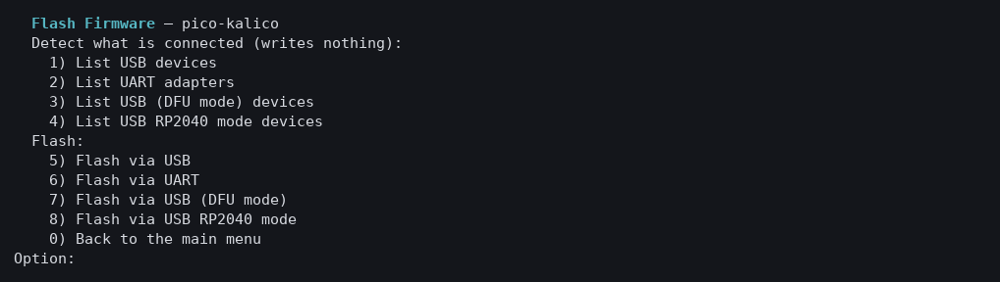

| Modo | Para | Lista |
|---|---|---|
| **USB** | Una placa que ejecuta Klipper (o Katapult) por USB, o una placa USB estilo Arduino | Puertos `/dev/serial/by-id/usb-…` (CDC/ACM) |
| **UART** | Un adaptador USB-serie (CH340, FTDI, CP210x) conectado al bootloader UART de la placa; las placas STM32 usan `stm32flash`, las AVR `avrdude` | Adaptadores USB-serie |
| **USB (DFU mode)** | Un STM32 en modo DFU (BOOT0, luego reset: `0483:df11`) | Dispositivos DFU |
| **USB RP2040 mode** | Una Raspberry Pi Pico / RP2040 mantenida en BOOTSEL (`2e8a:0003`) | Dispositivos BOOTSEL |

### Ejemplo: una Raspberry Pi Pico

Compila el perfil de la Pico como antes (arquitectura *Raspberry Pi
RP2040/RP235x*, comunicación *USB*). Después mantén pulsado **BOOTSEL** mientras
conectas la Pico.

**1. Lista primero.** Las opciones 1–4 solo miran; no escriben nada. Con la Pico
en BOOTSEL, *USB RP2040 mode* la encuentra, mientras que *USB* aún no tiene nada
que mostrar (la indicación dice cómo es una placa de ese tipo):

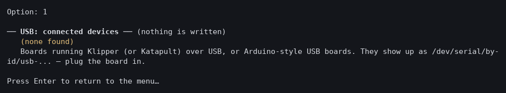
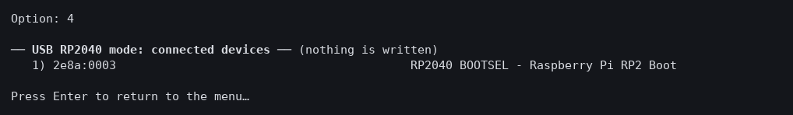

**2. Flashea.** La opción 8 (*Flash via USB RP2040 mode*) muestra los
dispositivos de ese tipo, pregunta cuál y pide confirmación:

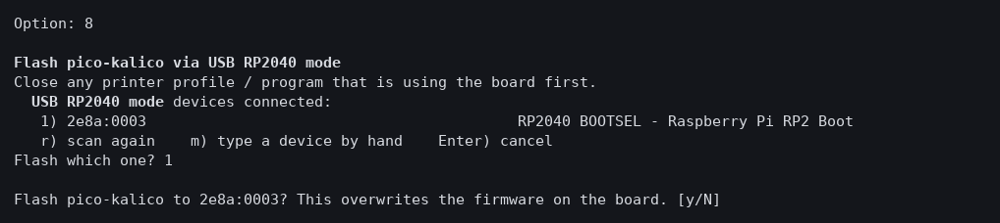

Antes de escribir, el menú valida la compilación otra vez, la recompila y
comprueba que es **idéntica byte a byte** a la imagen validada, y después ejecuta
la regla de flasheo de Klipper. Si todo va bien lo dice y ofrece comprobar lo que
ejecuta la placa:

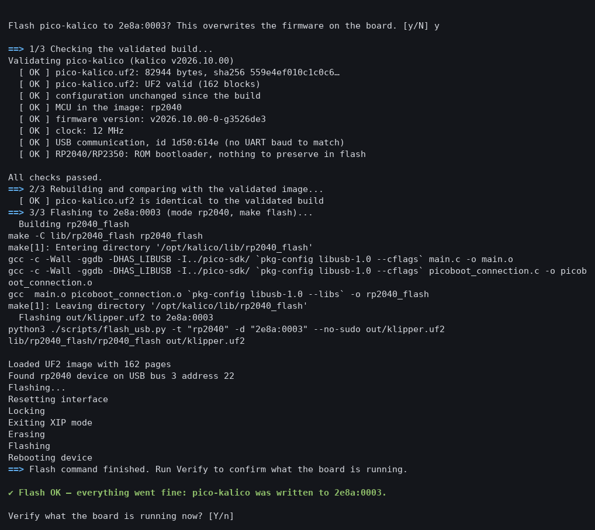

**3. Verifica.** *Verify Flashed Firmware* (se ofrece justo tras el flasheo, o la
opción **7** del menú principal) abre el puerto serie de la placa, pide su
diccionario de datos como hace Klipper al conectar y lo compara con tu
compilación:

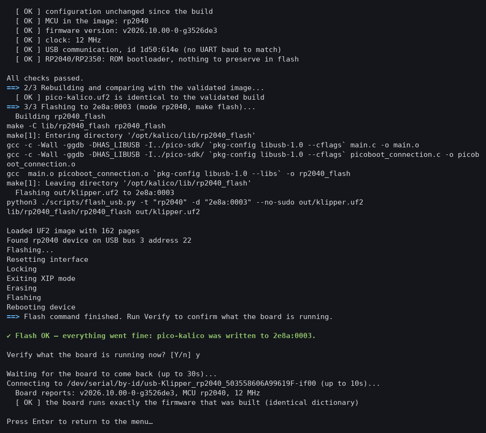

`the board runs exactly the firmware that was built` es la prueba real; una
versión o un chip distintos se informa como un fallo, lo que también detecta un
flasheo que no surtió efecto. La Pico ahora ejecuta Klipper por USB, así que
*USB* la lista:

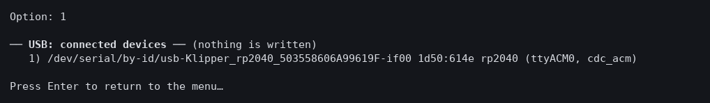

(En modo USB puedes flashearla otra vez sin tocar BOOTSEL: el menú pide al
firmware en ejecución que se reinicie en su bootloader.)

### Cuando algo sale mal

Si el flasheo falla, el menú lo dice y muestra el error, y luego espera a Intro.
Por ejemplo, un firmware de RP2040 ofrecido a una placa en modo STM32 DFU se
rechaza antes de escribir nada:

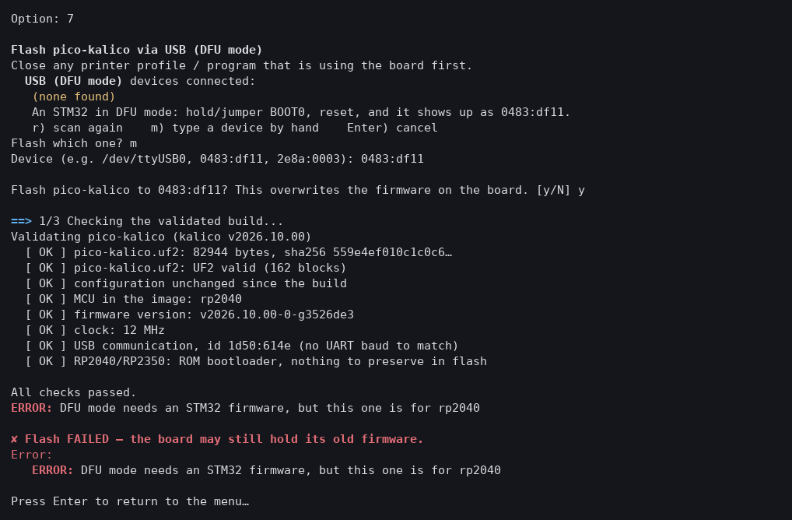

Comprobaciones de seguridad antes de escribir nada:

1. La compilación se valida otra vez (hashes, formato, configuración).
2. El modo debe encajar con el firmware: DFU necesita una compilación de STM32,
   el modo RP2040 una de RP2040/RP2350 (una imagen incorrecta puede dejar una
   placa inservible).
3. El firmware se recompila y debe ser **idéntico byte a byte** a la imagen
   validada.
4. El dispositivo debe existir; la escritura expira a los cuatro minutos en
   lugar de colgarse.

Las herramientas de flasheo verifican mientras escriben donde pueden (`avrdude` y
`stm32flash -v` leen de vuelta). Usa la propia regla de flasheo de Klipper
(`make flash`) con las herramientas que ya están en la imagen (`dfu-util`,
`stm32flash`, `avrdude`, los flasheadores de RP2040 y SAM).

### Límites

- **Linux** funciona de fábrica (el contenedor se inicia con acceso a `/dev`).
  En **Windows**, conecta la placa a WSL2 con
  [usbipd-win](https://learn.microsoft.com/windows/wsl/connect-usb); Docker
  Desktop en **macOS** no puede acceder a USB, así que flashea `firmware/output/`
  con las herramientas de tu sistema.
- Cierra la app o cualquier perfil que esté usando la placa.
- Las placas cuyo bootloader lee el firmware desde una **tarjeta SD** no se
  flashean aquí: copia la imagen de `firmware/output/` a la tarjeta (renombrada
  como indican las notas de la placa). *Verify Flashed Firmware* sigue
  funcionando después.
- Comprobado en una Raspberry Pi Pico (modo BOOTSEL y modo Klipper por USB). Los
  demás modos usan las mismas reglas de flasheo pero no se han ejecutado en
  hardware.

---

## Qué comprueba la validación

La ejecutan *Make Firmware* y la opción **5**:

- Los archivos existen, no están vacíos y coinciden con los hashes registrados en
  la compilación.
- El formato de la imagen: sumas de comprobación Intel HEX (AVR), bloques UF2
  (RP2040) y, para los `.bin` de ARM, una tabla de vectores sana enlazada en el
  offset de bootloader configurado.
- La imagen se compiló para el MCU y el reloj de la configuración, y su versión
  es la del motor.
- La velocidad en baudios es 250000 (el valor por defecto de KlipPocket; para
  otra, configura la misma velocidad para la placa en la app) o la placa usa USB.
- El offset del bootloader deja espacio y la imagen cabe en el área de
  aplicación.
- El perfil guardado no se modificó después de la compilación.

La imagen incluye los compiladores ARM (gcc 10.3 fijado), AVR y del host, así que
se compilan los chips ARM Cortex-M (STM32, RP2040, LPC176x, SAM, HC32), AVR y el
proceso de Linux. Los objetivos AR100 y PRU necesitan otros compiladores y no
están incluidos.

---

## Solución de problemas

### Falta Docker

Si Docker no está instalado, no está en marcha, o tu usuario no puede usarlo, el
menú lo dice arriba y desactiva lo que depende de él. Elegir el motor/perfil y
el resumen siguen funcionando. Instala o inicia Docker y pulsa `c`.

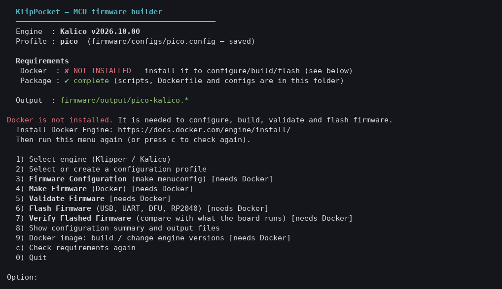

### PowerShell

El menú de PowerShell es el mismo; solo los símbolos son más simples.

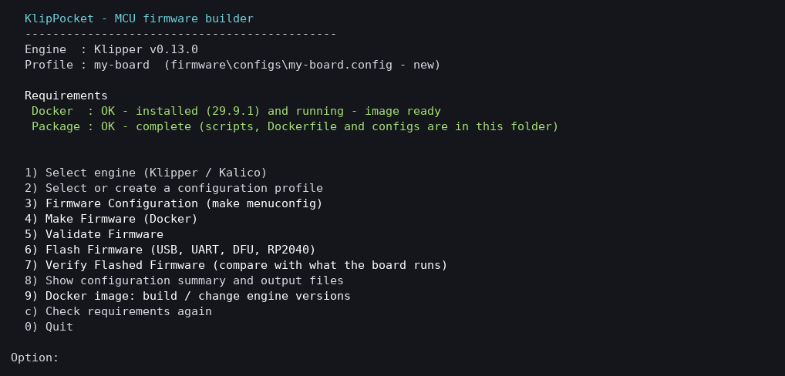

### Otras preguntas

- *¿Qué chip tiene mi placa?* Consulta [Identifica el chip de la placa base](#1-identifica-el-chip-de-la-placa-base).
- *¿Puedo usar una configuración ya hecha?* Copia un `.config` en
  `firmware/configs/`: aparece en la opción 2. Consulta [Añadir una placa](#añadir-una-placa).

---

## Otras formas de obtener el firmware

El menú de arriba es el camino a seguir. Estas alternativas quedan para casos
especiales.

Ambos constructores del proyecto emiten un `klipper.bin` simple, renombrado al
nombre de archivo que espera el bootloader de la placa. **No** ejecutan
`update_mks_robin.py` (ese paso XOR es solo para las placas STM32F103 MKS Robin
cuyo bootloader descifra el archivo de la SD; corrompe la imagen en las placas
que la flashean tal cual). También se niegan a emitir una imagen que se solape
con el bootloader, y comprueban el tamaño compilado frente al área de aplicación
de la flash.

Klipper no tiene bloqueo de versión MCU↔host — el MCU envía su diccionario de
comandos al host al conectar y el host se adapta. El firmware no tiene que
coincidir exactamente con el Klipper incluido en la app.

| Método | Notas |
|---|---|
| **Imagen precompilada** | El proyecto Beam Klipper publica firmware para muchas placas: <https://github.com/utkabobr/klipper/releases>. Las imágenes antiguas funcionan con esta app; se recomienda Klipper **0.13**. |
| **Docker (línea de comandos)** | Un comando por cada placa que tiene una configuración en `firmware/configs/`. |
| **Script local** | Un comando. Descarga su propia cadena de herramientas fijada. |

### Docker (línea de comandos)

Ejecuta desde la raíz del repositorio:

```bash
# construye la imagen una vez (fija Klipper v0.14.0 + Kalico v2026.11.00 + ARM gcc 10.3-2021.07)
docker compose -f firmware/docker-compose.yml build

# compila el firmware de una placa que tiene configuración en firmware/configs/
docker compose -f firmware/docker-compose.yml run --rm fw <placa>

# lista las configuraciones de placa disponibles
docker compose -f firmware/docker-compose.yml run --rm fw
```

La salida va a `firmware/output/`. Usa otra versión de Klipper con
`--build-arg KLIPPER_TAG=vX.Y.Z` en `docker compose ... build`.

### Script local

```bash
./scripts/build_firmware.sh <placa | ruta/a/.config> [nombre-de-salida] [etiqueta-de-klipper]
```

`<placa>` se resuelve a `firmware/configs/<placa>.config`, o pasa la ruta
completa de cualquier `.config` guardado con `make menuconfig`. La primera
ejecución descarga `gcc-arm-none-eabi 10.3-2021.07` en `firmware/toolchain/` y
clona Klipper en `firmware/.klipper-build/` (ambos en git-ignore).

Funciona en **Linux** y **macOS** (necesita `make`, `git`, `curl`, `tar`). En
**Windows** usa `scripts\build_firmware.ps1 <placa>` (envuelve la imagen de
Docker), o ejecuta el `.sh` dentro de WSL / Git Bash.

### Añadir una placa

#### 1. Identifica el chip de la placa base

El modelo de la impresora no basta — el mismo modelo a menudo se vendió con
placas base distintas (STM32F103 / F401 / GD32 / …), cada una con un mapa de
memoria diferente. Flashear el firmware del chip equivocado con un método que
pueda escribir el bootloader puede dejar la placa inservible. Mira la
serigrafía de la placa, la etiqueta o el nombre del archivo de firmware del
fabricante.

#### 2. Genera un `.config`

Usa el menú (opción 3), o en un PC con un checkout de Klipper
(o `docker compose ... run --rm --entrypoint bash fw`):

```bash
cd /opt/klipper        # o tu clon de Klipper
make menuconfig
```

Ajustes que importan para KlipPocket:

- **Processor model** — que coincida exactamente con el chip.
- **Bootloader offset** — la mayoría de las placas OEM tienen un bootloader de
  8–32 KiB que hay que conservar (p. ej. `CONFIG_FLASH_START_8000`). Es el
  principal riesgo de dejar la placa inservible.
- **Communication interface** — KlipPocket usa **serie por USB** a través del
  puerto OTG del dispositivo. En la mayoría de las placas OEM es un puente
  USB-serie integrado conectado a una UART, no el USB nativo del MCU. Selecciona
  la UART a la que está conectado el puerto USB.
- **Baud** — **250000** es el valor por defecto de KlipPocket y funciona con la
  mayoría de las placas. Si el firmware de tu placa usa otra velocidad (por
  ejemplo 115200), elige la misma para esa placa en **Ajustes → USB → Listar
  dispositivos USB**.

Una configuración «buena conocida» de la comunidad para la placa es un buen punto
de partida: cárgala, ejecuta `make menuconfig` una vez para reconciliarla y
guarda.

**Dónde encontrar archivos `.config` de placa ya hechos:**

| Fuente | Notas |
|---|---|
| [`utkabobr/klipper` → `bin-templates/`](https://github.com/utkabobr/klipper/tree/master/bin-templates) | Los archivos `.config` de Kconfig a partir de los que se genera el firmware precompilado de Beam Klipper (~90 placas OEM). La coincidencia más cercana a esta app; un archivo `.json` acompañante marca las placas con tarjeta SD («robin»). |
| [`Klipper3d/klipper` → `config/`](https://github.com/Klipper3d/klipper/tree/master/config) | `printer-*.cfg` / `generic-*.cfg` — son plantillas de **printer.cfg**, no `.config` de firmware, pero sus comentarios de cabecera indican el chip, el offset del bootloader y el cableado de comunicación que necesitas para `make menuconfig`. |
| [Klipper Community Discourse](https://klipper.discourse.group/) | Configuraciones de firmware compartidas por placa. |
| Documentación de los fabricantes de placas (BigTreeTech, MKS, Fysetc, TeamGloomy para STM32) | Respuestas de `make menuconfig` por placa. |

#### 3. Añádelo a `firmware/configs/`

Guárdalo como `firmware/configs/<placa>.config`. Una cabecera opcional de
directivas permite al constructor nombrar la salida y proteger las líneas
críticas para no dejar la placa inservible:

```ini
#! board_name:      <nombre legible>
#! flash_filename:  <nombre que busca el bootloader, p. ej. firmware.bin>
#! klipper_tag:     v0.13.0
#! assert: CONFIG_MCU="<chip>"
#! assert: <cualquier línea CONFIG_ que deba sobrevivir a `make olddefconfig`>
#! assert: CONFIG_SERIAL_BAUD=250000
```

Las líneas `#! assert:` se vuelven a comprobar tras `make olddefconfig`; la
compilación se detiene si falta alguna. `#! expect_sha256: <hash>` además hace
fallar la compilación a menos que la salida coincida — útil para fijar una
imagen de Klipper verificada (se omite en las compilaciones de Kalico).
`#! flash_filename:` nombra la salida exactamente como la espera el bootloader de
una placa con tarjeta SD, así que no hay nada que renombrar.

#### 4. Flashea

- **Placas con tarjeta SD** — copia la salida a una tarjeta FAT32, renombrada a lo
  que busca el bootloader, y apaga y enciende. El bootloader renombra o elimina
  el archivo como confirmación y nunca se escribe a sí mismo; el peor caso es
  «no arranca», que se recupera flasheando una imagen buena conocida del mismo
  modo.
- **Placas DFU / `make flash`** — usa el *Flash Firmware* del menú, o sigue el
  procedimiento normal de Klipper en el PC.

#### 5. Conecta

Conecta la impresora al dispositivo (OTG). KlipPocket detecta automáticamente el
puerto serie; la línea `[mcu] serial:` de `printer.cfg` se ignora (mantén una
válida por portabilidad). Si la ruta del dispositivo cambia cuando el firmware se
reinicia, usa el nombrado por VID/PID.

### Reproducibilidad

Una etiqueta limpia de Klipper + la cadena de herramientas fijada + el mismo
`.config` producen un binario idéntico byte a byte (Klipper omite la hora de
compilación y el nombre del equipo en las compilaciones de árbol limpio). La
configuración de ejemplo incluida usa `#! expect_sha256` para que la compilación
falle si el resultado se desvía. La comprobación profunda del menú (opción 5)
recompila desde cero y compara los hashes del mismo modo.

### Directorios temporales

`firmware/output/`, `firmware/toolchain/` y `firmware/.klipper-build/` son
temporales de compilación en git-ignore. Sube al repositorio solo un `.bin`
verificado en `firmware/<identificador-de-placa>/`.
