# KlipPocket Dashboard — mira el teléfono, las impresoras y los registros desde un navegador (puerto 4400)

**Idiomas: [English](../dashboard.md) · [Português (BR)](../pt-br/dashboard.md) · [Español](dashboard.md) · [简体中文](../zh-Hans/dashboard.md)**

La app sirve una página web llamada **KlipPocket Dashboard** en el **puerto
4400**. Desde el navegador de un PC u otro teléfono de la misma red puedes ver
cómo va el teléfono que ejecuta Klipper, ver las impresoras y los MCU, leer (y
borrar) los mismos registros que la pantalla **Registros** de la app, y usar las
herramientas de [Firmware](firmware-web.md). Tiene el aspecto propio de la app,
claro y oscuro, y también funciona en la pantalla de un teléfono.

> **Nota:** la página aún no está traducida al español, así que sus textos
> (botones, pestañas, mensajes) se muestran en inglés. Esta guía los nombra tal
> como aparecen en la página.

El panel está **siempre disponible mientras la app está abierta** (no necesita
que haya una impresora en ejecución), y una pequeña notificación lo mantiene
accesible mientras la app está en segundo plano.

## Abrir el panel

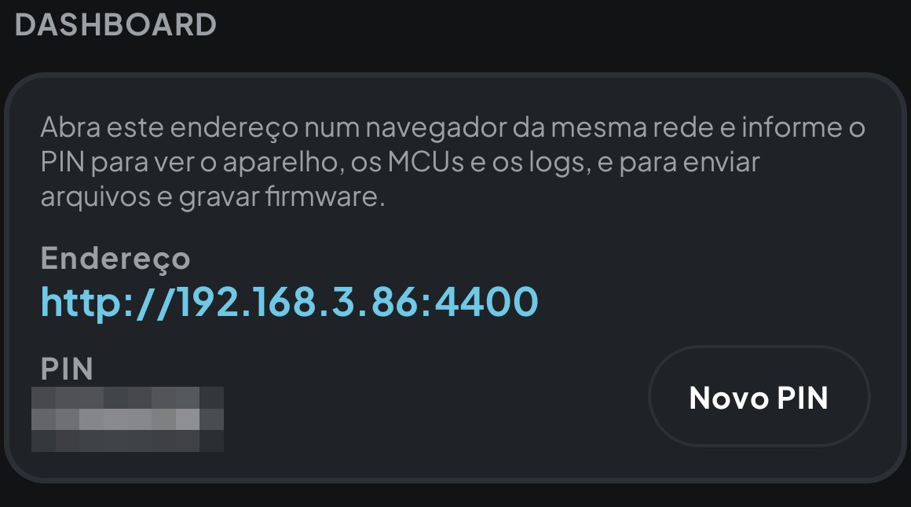
*La dirección y el PIN, al final de la pantalla de inicio de la app (la app de esta captura está en portugués; el PIN está oculto).*

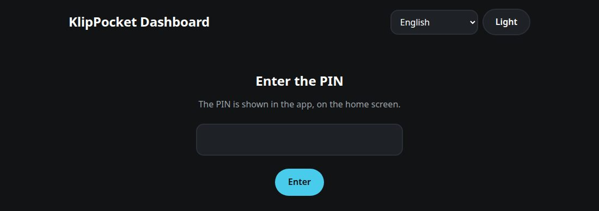
*La pantalla del PIN de la página.*

En la app, desplaza la **pantalla de inicio** hasta el final, hasta **Panel**:
muestra la dirección (`http://<IP del teléfono>:4400`) y un **PIN** de seis
dígitos. Abre la dirección en un navegador de la misma red e introduce el PIN.
**Nuevo PIN** en la app lo sustituye y cierra todas las páginas abiertas.

> **¿Por qué un PIN?** La página muestra información del teléfono y puede
> flashear una placa conectada a él, así que todo excepto los archivos propios de
> la página necesita el PIN; tras cinco intentos fallidos la dirección se
> bloquea durante un minuto. La página usa HTTP simple, como las demás páginas de
> la app: úsala en una red de confianza.

La página tiene cinco pestañas, mostradas como iconos bajo el título (pasa el
cursor sobre una para ver su nombre): **Dashboard**, **Camera**, **Firmware**
(consulta la [página web de firmware](firmware-web.md)), **Happy Hare** (consulta
[Happy Hare](happy-hare.md#configurar-en-el-panel)) y, la última, **Settings**.
La sección **Logs** está al final de la pestaña Dashboard. El idioma y el tema
siguen a la app la primera vez; lo que elijas en la página lo recuerda el
navegador.

## Uso en vivo

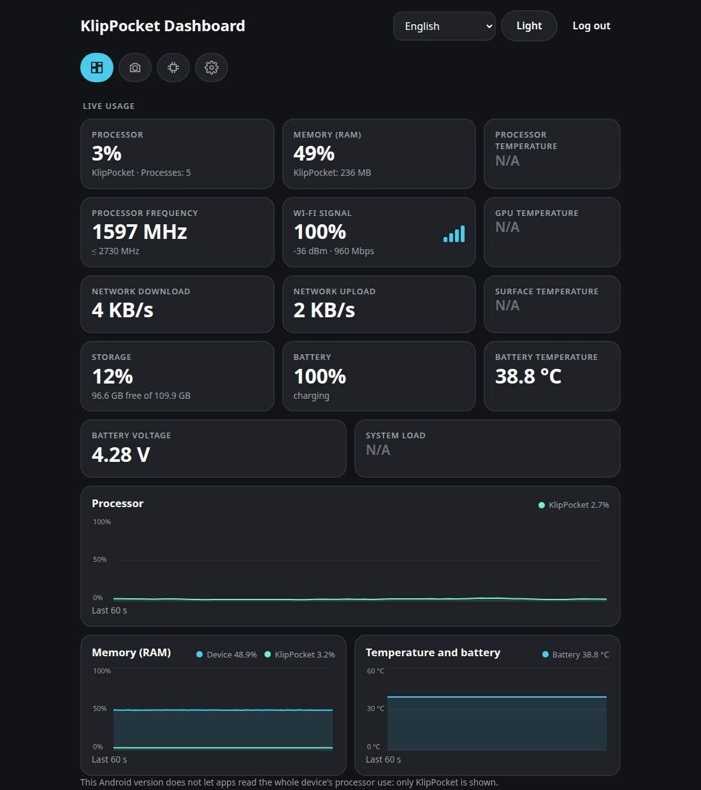
*Uso en vivo en un Galaxy S10+ (Android 12): tarjetas y gráficos. Lo que este teléfono no deja leer a la app muestra **N/A**.*

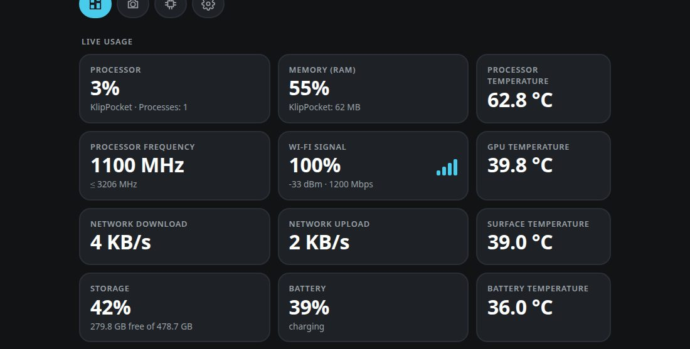
*Las mismas tarjetas en un POCO F7 (Android 16), que expone más sensores: temperaturas del procesador, de la GPU y de la superficie.*

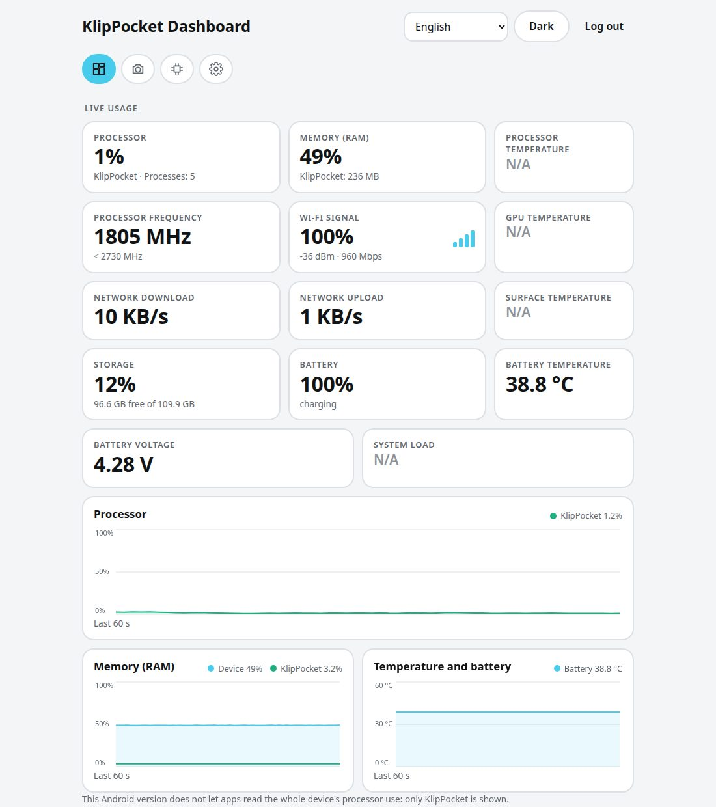
*El tema claro (el botón **Light** / **Dark** de arriba).*

Arriba hay **tarjetas**, actualizadas cada segundo, con **como máximo tres por
fila**: las tarjetas con más que decir (procesador, memoria, frecuencia, Wi-Fi,
red, almacenamiento) son más anchas, las pequeñas (temperaturas, batería,
voltaje, carga) son más estrechas, y cada fila llena la línea (una tarjeta sola
ocupa toda la fila, dos la comparten a partes iguales, y en tres las dos más
anchas reciben más espacio).

| Tarjeta | Qué muestra |
|---|---|
| **Processor** | El uso de todo el dispositivo y, debajo, el uso de KlipPocket. Android solo deja que una app lea su propio proceso principal, así que el valor de KlipPocket es el de la propia app, no el de los procesos de Klipper y Moonraker. |
| **Memory (RAM)** | La memoria en uso por el dispositivo y la memoria usada por todos los procesos de KlipPocket (app, Klipper, Moonraker, cámara…). |
| **Temperatura del procesador, de la GPU, de la superficie y de la batería**, **Frecuencia del procesador**, **Carga del sistema**, **Señal Wi-Fi** (un porcentaje con cuatro barras de señal, más los dBm y la velocidad del enlace debajo), **Descarga / subida de red**, **Almacenamiento** (usado y libre), **Batería** (nivel y carga) y **Voltaje de la batería** | Cada una está siempre en la página. Un valor que el teléfono no deja leer a la app muestra **N/A** en lugar del número: los teléfonos difieren mucho en lo que exponen. |

Debajo, los **gráficos** muestran los **últimos 60 segundos**, un punto por
segundo: el procesador con una línea completa, y la memoria junto a la
temperatura (el gráfico de temperatura se oculta cuando el teléfono no expone
ninguna temperatura). Cada gráfico tiene su leyenda con los valores actuales.
Los gráficos solo se mueven mientras la página es visible en el navegador.

> **El uso del procesador del dispositivo no está disponible en todos los
> teléfonos.** Desde Android 8 las apps no pueden leer el uso de todo el
> dispositivo, así que en muchos teléfonos solo se dibuja la línea de
> **KlipPocket**, con una nota que lo indica. Las cifras de memoria, batería y
> KlipPocket siempre están disponibles.

## Almacenamiento y dispositivo anfitrión

- **Storage** — espacio libre y total del almacenamiento interno y, cuando lo
  hay, de la tarjeta SD, en una línea propia.
- **Host device** — en la línea siguiente, en dos columnas (una en una pantalla
  estrecha): modelo, chip, núcleos de CPU y frecuencia máxima, arquitectura,
  versión de Android, kernel, cuánto tiempo lleva encendido el teléfono, su
  dirección de red y la versión de KlipPocket. La memoria está en las tarjetas
  en vivo y en el gráfico de arriba.

## Impresoras y MCU

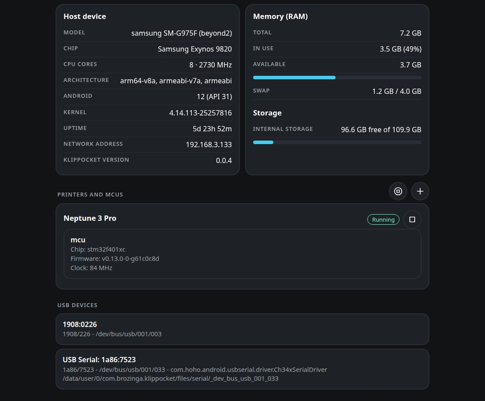
*Almacenamiento, dispositivo anfitrión, las impresoras con su MCU y los iconos de iniciar/detener, y los dispositivos USB.*

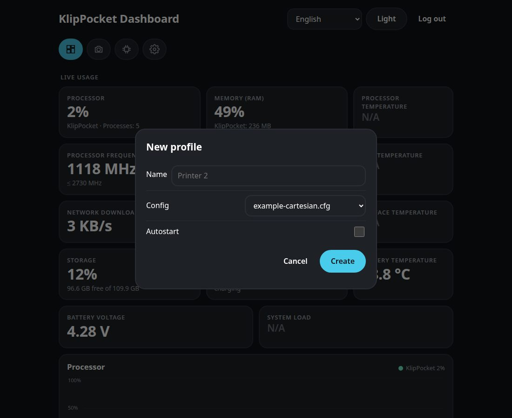
*El icono **+** abre el formulario de una impresora nueva.*

Una tarjeta por perfil de impresora, con su estado (**Running**, **Stopped**…).
Cuando la impresora está en marcha y Klipper está conectado, cada **MCU** se
lista con su **chip** (por ejemplo `stm32f401xc` o `rp2040`), su **versión de
firmware** y su **reloj**. Los datos provienen del propio Moonraker de la
impresora en el teléfono, así que la placa principal y las placas extra de una
configuración [multi-MCU](multi-mcu.md) aparecen todas. Mientras la impresora
está detenida, la tarjeta dice que los datos aparecen cuando se ejecuta.

**Iniciar / Detener.** Cada tarjeta de impresora tiene un icono de **play** o de
**stop** y el encabezado de la sección tiene iconos de **start all** / **stop
all**, igual que el botón de play de la app: los servidores de Klipper y
Moonraker de esa impresora se inician o se detienen. Si no hay un hueco libre
para iniciar otra impresora, la página lo dice.

**Añadir una impresora.** El icono **+** del encabezado de la sección abre el
mismo formulario que la hoja **Nuevo perfil** de la app: el nombre (vacío =
«Impresora N»), el `printer.cfg` inicial que copiar y **Autostart**. La nueva
impresora aparece en la lista al instante; si no hay un hueco libre, la página
lo dice.

**USB devices** lista todo lo que el teléfono ve en su puerto USB — nombre,
`VID:PID`, ruta de bus y, para las placas serie, el puerto que usa
`printer.cfg` — la misma lista que *Listar dispositivos USB* en la app.

## Ajustes

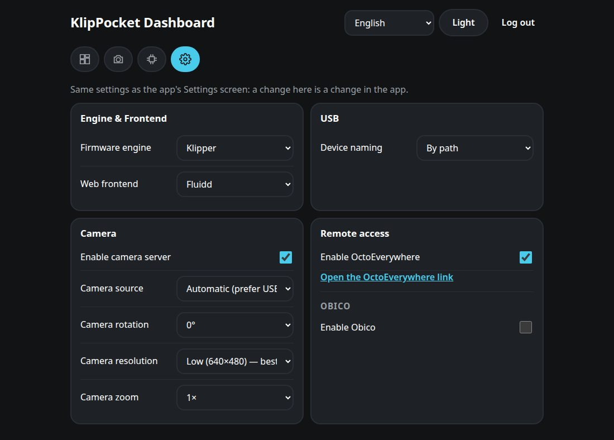
*La pestaña Settings.*

La pestaña **Settings** tiene los mismos ajustes que la pantalla de Ajustes de
la app; un cambio aquí es un cambio en la app (y se guarda al instante):

| Sección | Qué puedes hacer |
|---|---|
| **Engine and front end** | Klipper o Kalico (Kalico solo cuando está instalado) y la interfaz web (Fluidd, Mainsail, Voyager UI). |
| **USB** | Cómo se nombran los dispositivos USB (por ruta o por VID/PID). |
| **Camera** | Activar o desactivar la cámara, elegir la fuente, la rotación, la resolución y el zoom (los pasos de zoom dependen de la cámara). Android pide el permiso de cámara **en el teléfono** la primera vez. |
| **Remote access** | **OctoEverywhere:** actívalo y abre su enlace; el enlace aparece unos segundos después de activarlo. **Obico**, en la misma tarjeta: actívalo, elige Obico Cloud o un servidor autoalojado (y guárdalo), mira si la impresora está vinculada, lee el código que genera Obico (con su enlace) o escribe un código de la app de Obico para vincular, y desvincula. |

## Camera

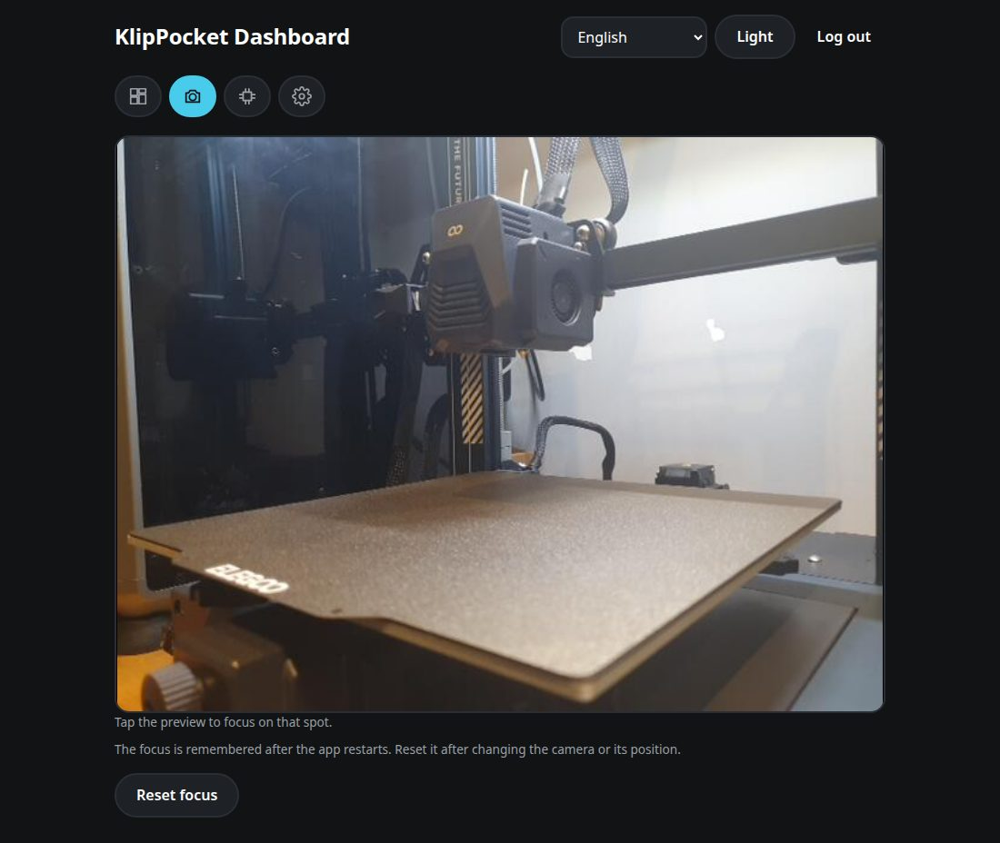
*La pestaña de cámara: toca la imagen para enfocar.*

La pestaña **Camera** muestra la imagen en vivo de la cámara del teléfono, la
misma transmisión que usan Fluidd y Mainsail (con la rotación, la resolución y
el zoom que elegiste). **Toca la imagen para enfocar** en ese punto, como en la
app: el enfoque se mantiene hasta que pulses **Reset focus**. La imagen aparece
cuando la cámara está encendida y hay una impresora en marcha (la cámara arranca
con ella); si está apagada, la pestaña ofrece encenderla. Salir de la pestaña
cierra la conexión, para que el teléfono no codifique imágenes para nadie.

## Logs

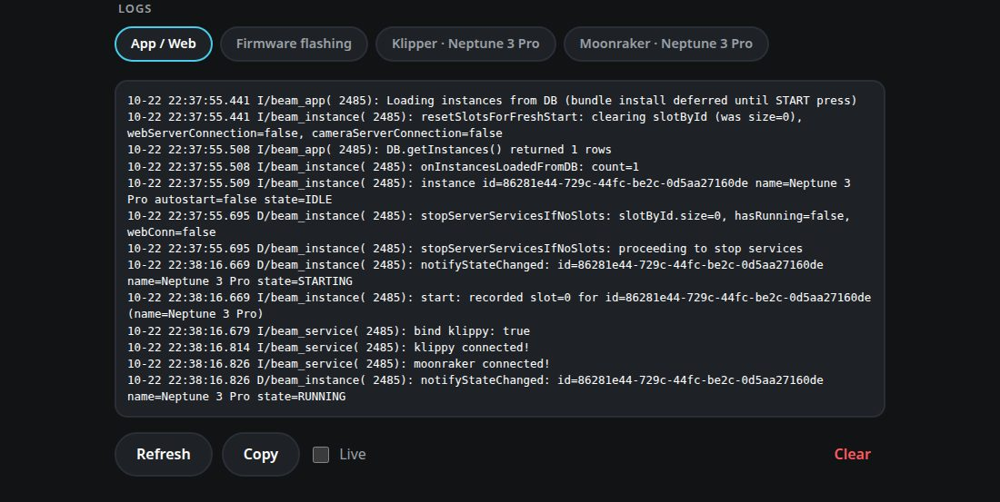
*Los registros, con una pestaña por fuente y los botones Refresh, Copy, Live y Clear.*

Al final, una pestaña por registro, igual que la pantalla **Registros** de la
app: **App / Web**, **Firmware** (el registro de las escrituras de firmware),
**Klipper**, **Moonraker**, **OctoEverywhere** y **Obico** de cada impresora, y
**Last crash** cuando lo hay.

| Botón | Qué hace |
|---|---|
| **Refresh** | Vuelve a leer el registro. |
| **Copy** | Copia el texto mostrado al portapapeles. |
| **Live** | Vuelve a leer el registro cada 3 segundos. |
| **Clear** | Tras una confirmación, **borra los registros**: se vacían los archivos de Klipper, Moonraker, OctoEverywhere, Obico y firmware, se elimina el informe del último fallo y se ocultan las líneas más antiguas del registro de la app. La vista se vacía y a partir de entonces solo se escriben mensajes nuevos — igual que **Borrar** en la app. |

La sección **Logs** solo está en la pestaña **Dashboard**. El registro de las
escrituras de firmware es la pestaña **Firmware flashing** de la lista; la página
**Firmware** muestra el registro de la última escritura con su propio botón
**Log**.

La pestaña **Firmware** (consulta la [guía de la página de firmware](firmware-web.md)).
En la pantalla de un teléfono la página se reorganiza:

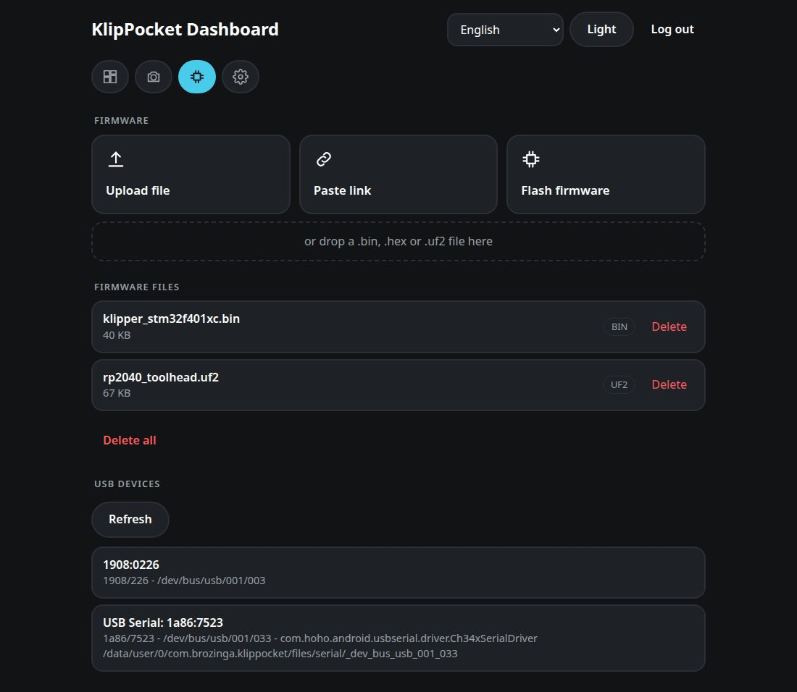

| | |
|---|---|
| 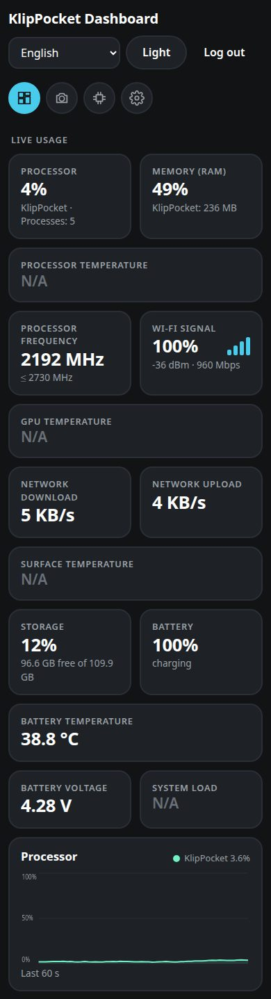 | 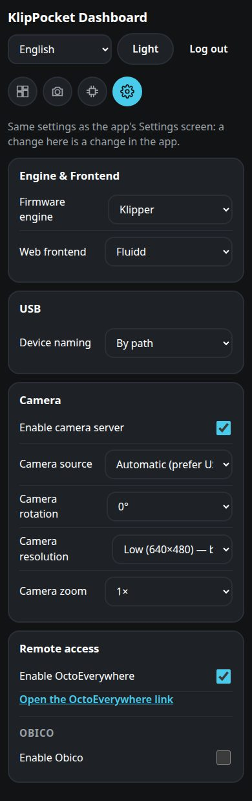 |

## Si algo sale mal

| Lo que ves | Qué hacer |
|---|---|
| La página no abre | El teléfono y el ordenador deben estar en la misma red Wi-Fi sin *aislamiento de clientes*; usa la dirección que muestra la app. Si otra app usa el puerto 4400, la tarjeta de la pantalla de inicio dice que la página no se está ejecutando. |
| *Too many attempts* | Espera los segundos indicados, o usa **Nuevo PIN** en la app. |
| *Connection to the app lost* | Se cerró la app o el teléfono entró en suspensión: abre la app de nuevo. |
| Solo la línea de KlipPocket en el gráfico del procesador | Normal en Android 8+: consulta la nota de arriba. |
| La tarjeta de una impresora no tiene MCU | La impresora está detenida o Klipper aún no se ha conectado a la placa. |

## Para desarrolladores

Todo lo que cuelga de `/api` necesita la cookie de sesión del inicio de sesión
con PIN y, cuando cambia algo, la cabecera `X-KlipPocket: 1`. Rutas del
panel: `GET /api/dashboard` (dispositivo, almacenamiento, impresoras, MCU, USB;
cambia despacio), `GET /api/metrics` (números en vivo; la respuesta se comparte
si se pide más de una vez por segundo), `GET /api/logs` (fuentes),
`GET /api/logs/read?id=…` y `POST /api/logs/clear`; `GET`/`POST /api/settings`
(el ajuste es `{"key": …, "value": …}`), `POST /api/control`
(`{"id": …, "action": "start"|"stop"}`, sin `id` = todas las impresoras),
`GET /api/printers/new` y `POST /api/printers`
(`{"name", "config", "autostart"}`), `GET /api/camera`,
`GET /api/camera/stream` (MJPEG multipart), `POST /api/camera/focus`
(`{"x": 0..1, "y": 0..1}`) y `POST /api/camera/focus/reset`. Las rutas de
firmware están en la [guía de la página de firmware](firmware-web.md#para-desarrolladores).
El código está en `app/src/main/java/ru/ytkab0bp/beamklipper/firmwareweb/`
(`DashboardCollector` lee los números, `DashboardRules` tiene las partes que se
prueban en la JVM) y la página en `app/src/main/assets/firmware_web/`; sus textos
se generan a partir de las cadenas de la app con
`scripts/gen_firmware_web_i18n.py`.
