# Pestaña Firmware — descarga e instala firmware del MCU desde la app

**Idiomas: [English](../firmware-tab.md) · [Português (BR)](../pt-br/firmware-tab.md) · [Español](firmware-tab.md) · [简体中文](../zh-Hans/firmware-tab.md)**

La pestaña **Firmware** (el icono de chip en la barra superior) te permite
obtener un archivo de firmware y escribirlo en una placa conectada al
teléfono/tablet, sin PC. Es el equivalente en el dispositivo de la opción **6
Flash Firmware** del [menú del PC](build-firmware.md#flashear-la-placa): el
firmware en sí se sigue **compilando en un PC** (Android no puede compilar),
aquí solo lo obtienes y lo flasheas.

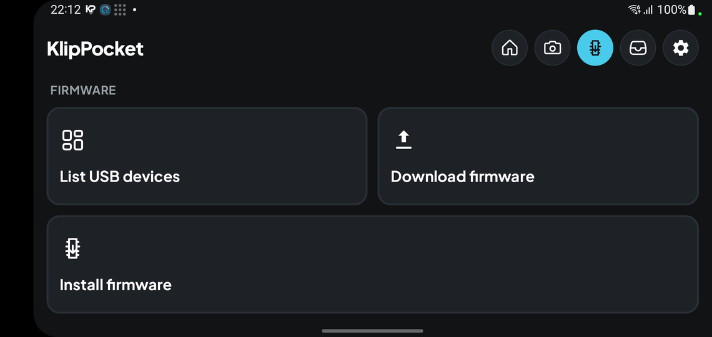

> **¿Desde un ordenador?** La app también sirve la [página web de firmware](firmware-web.md) en el puerto 4400: subir, pegar un enlace y flashear desde un navegador. Su dirección y su PIN están al final de la pantalla de inicio.

## Modos: qué funciona y qué es experimental

| Modo | Placa | Estado |
|---|---|---|
| **RP2040 / RP2350** | Raspberry Pi Pico / Pico 2 ya en BOOTSEL (`2e8a:0003` / `2e8a:000f`) | **Probado** en una Pico (RP2040). El **RP2350 es experimental** (no hay una Pico 2 con la que probar) |
| **USB** | Una placa que ejecuta Klipper por USB. La app envía la petición de bootloader a 1200 bps (como hace `make flash` de Klipper) y flashea a través del bootloader que aparece: RP2040 BOOTSEL, STM32 DFU o AVR109 (ATmega32U4 / Caterina) | **Probado** para el RP2040 con un `.uf2`; los demás bootloaders (y el RP2350) son **experimentales** |
| **DFU** | STM32 en modo DFU (`0483:df11`), protocolo DfuSe: borrar sectores, escribir, leer de vuelta, salir | **Experimental** |
| **UART** | Adaptador USB-serie conectado al bootloader serie de la placa: STM32 (ST AN3155, se borra toda la flash) o AVR (STK500v1 «arduino», STK500v2 «wiring») | **Experimental** |
| **Katapult** | El bootloader [Katapult](https://github.com/Arksine/katapult) de Klipper (`1d50:6177`) por USB, o por un adaptador USB-serie conectado a su UART (250000 baudios). A una placa Klipper por USB se le envía primero a Katapult (1200 bps). `.bin` sin formato | **Experimental** |
| **HID-Flash** | STM32F1/F4 con el bootloader HID (`1209:beba`), el protocolo de `hid-flash` de Klipper. A una placa Klipper por USB se le envía primero a él (1200 bps). `.bin` sin formato | **Experimental** |
| **SAM-BA** | Atmel SAM3 / SAM4 / SAME70 (Arduino Due, placas SAM4E…) en el bootloader ROM (`03eb:6124`): borra toda la flash, escribe, lee de vuelta, arranca desde la flash y reinicia, como `bossac`. A una placa Klipper por USB se le envía primero a él (1200 bps). `.bin` sin formato | **Experimental** |
| **CAN** | Katapult por un bus CAN, a través de un adaptador gs_usb / candlelight o del puente USB-CAN de Klipper (`1d50:606f`). Indicas el **UUID** del nodo (`canbus_query.py`) y la velocidad del bus; la app envía el nodo a Katapult, le da un id y lo flashea, como `flash_can.py`. `.bin` sin formato | **Experimental** |

> Los **modos experimentales** están completamente implementados, pero **no
> tienen pruebas concluyentes en placas reales** (solo pruebas unitarias contra
> bootloaders simulados). La app los marca en la lista de modos y vuelve a
> avisar antes de escribir. **Úsalos bajo tu propio riesgo.**

**No** se cubren además: las placas que cargan su firmware desde una tarjeta SD
(por ejemplo la Neptune 3 Pro: copia el `.bin` a la tarjeta), las placas SAMD /
SAME5x de la familia SAM-BA (otro controlador de flash) y los bootloaders
distintos de los anteriores. La app rechaza un archivo o un dispositivo que no
encaja con el modo: un `.uf2` debe estar compilado para el chip, un `.bin` sin
formato para una Pico debe empezar con un bloque boot2 válido de RP2040 (o un
bloque IMAGE_DEF de RP2350), de modo que un `.bin` de STM32 nunca se escribe en
una Pico, DFU / UART necesitan un `.bin` o `.hex`, y Katapult / HID-Flash /
SAM-BA / CAN necesitan un `.bin`. Klipper escribe el mismo id de familia UF2
para el RP2040 y el RP2350, así que la app los distingue mirando dentro de la
imagen; un archivo del otro chip se rechaza antes de escribir nada.

> **Escribir firmware puede dejar una placa inutilizable.** Flashea solo un
> archivo compilado para esa placa exacta, mantén el cable conectado y la
> pantalla abierta, y recuerda que Klipper pierde la conexión con la placa
> mientras se escribe.

## Los tres botones

- **Listar dispositivos USB** — la misma lista que *Ajustes → USB → Listar
  dispositivos USB*.

  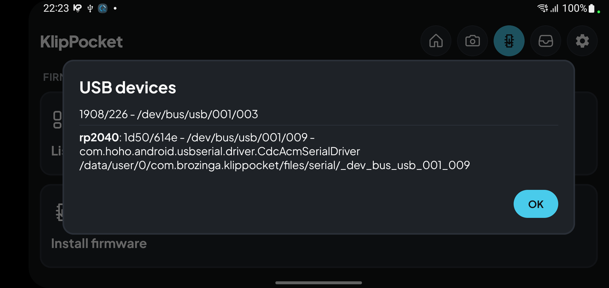

- **Descargar firmware** — pega un enlace y la app guarda el archivo.
- **Instalar firmware** — el asistente paso a paso de más abajo.

Debajo de los botones, **Archivos de firmware** lista lo que hay almacenado en
la app (nombre, tipo, tamaño) con **Eliminar**, e **Importar desde el
dispositivo** copia un archivo que ya tengas (por ejemplo uno que compilaste en
un PC) con el selector de archivos del sistema. Archivos aceptados: `.bin`,
`.hex`, `.uf2` y `.zip` (se extraen los archivos de firmware que contiene).

### Eliminar archivos

Toca un archivo de la lista para seleccionarlo: aparece un **icono de papelera**
junto a *Archivos de firmware* y elimina ese archivo. **Eliminar todo** borra
todos los firmwares almacenados. Ambos piden confirmación antes.

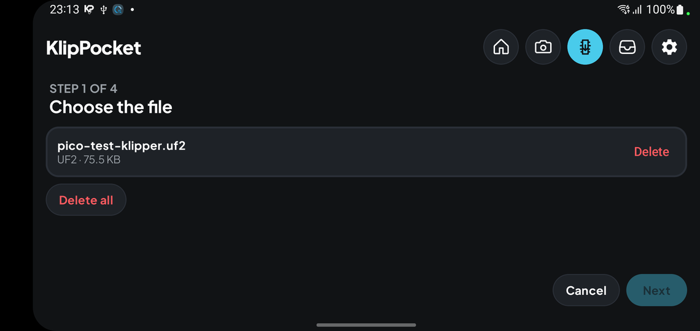

## Descargar un firmware

Toca **Descargar firmware**, pega un enlace **https** y toca **Descargar**, por
ejemplo
`https://github.com/utkabobr/klipper/releases/download/prebuilt-v0.12.0/stm32f401.bin`.
Límite: 16 MB.

| | |
|---|---|
| 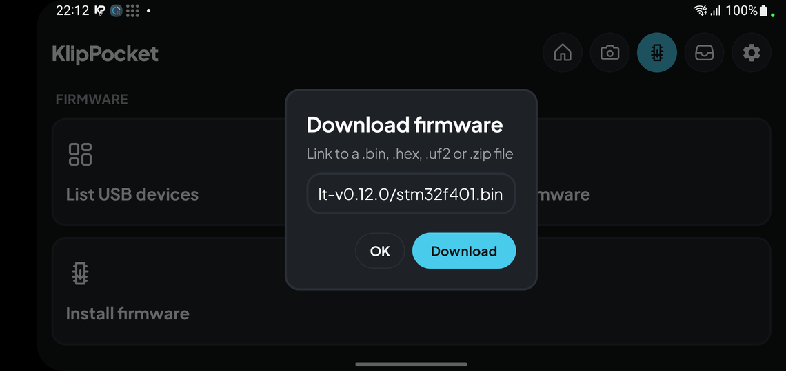 | 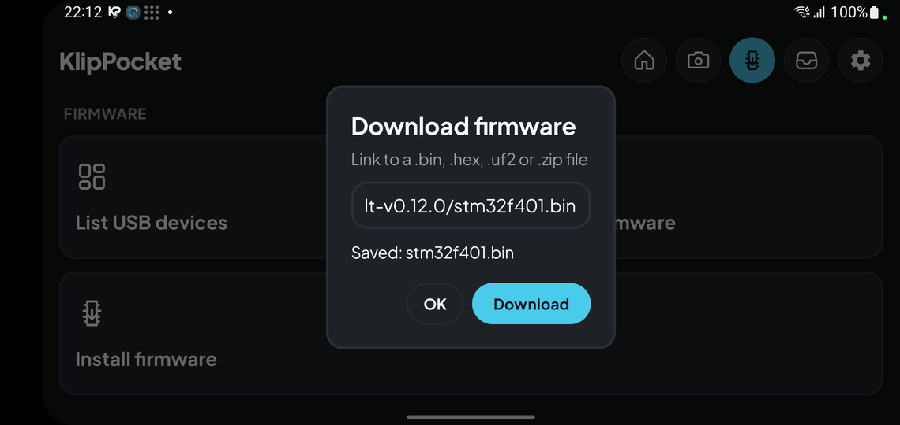 |

## Instalar un firmware

Toca **Instalar firmware**. Cada paso tiene **Siguiente** / **Atrás**; el botón
atrás del teléfono también retrocede un paso.

**1 — Elige el archivo.** Elige uno de los archivos almacenados.

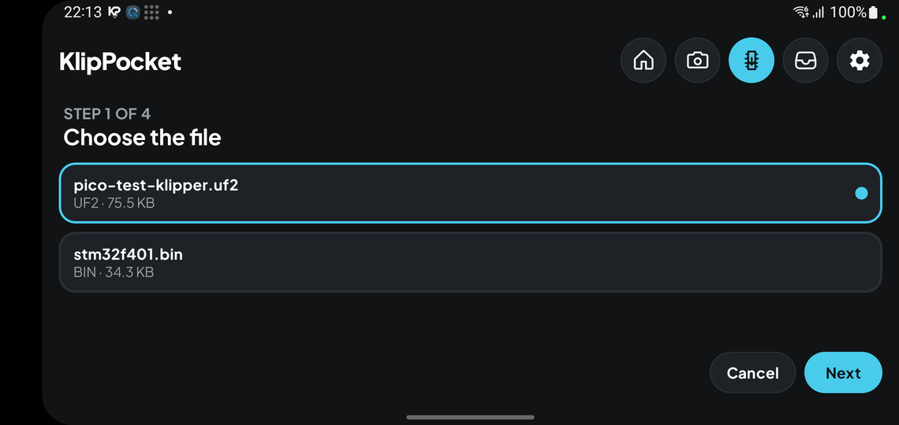

**2 — Elige el dispositivo.** Se listan todos los dispositivos USB que ve el
teléfono; **Actualizar** refresca la lista (también se refresca sola). Una placa
en BOOTSEL aparece como *RP2 Boot · 2e8a:0003*, una Pico ejecutando Klipper como
*rp2040 · 1d50:614e*. Android pide permiso USB cuando hace falta.

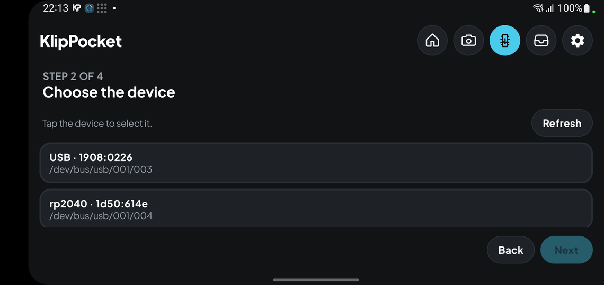

**3 — Elige el modo de escritura.** La app sugiere uno a partir del dispositivo
(*USB* para una placa Klipper, *RP2040* para BOOTSEL, *DFU* para `0483:df11`).
Los modos sin pruebas concluyentes muestran una nota **Experimental**.

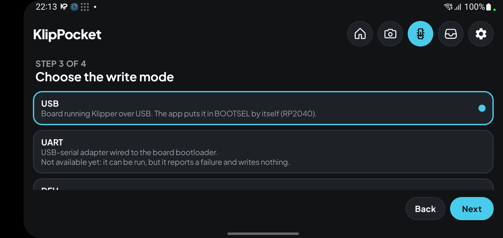

Para un **`.bin`** sin formato escrito en un **STM32** (modo DFU, UART o USB)
aparece un campo **Dirección de inicio de la flash**: dónde va el archivo
(`0x08000000` salvo que debajo haya un bootloader tuyo; el *Bootloader offset*
de Klipper es ese tamaño). Los archivos `.hex` llevan sus propias direcciones y
los `.uf2` también.

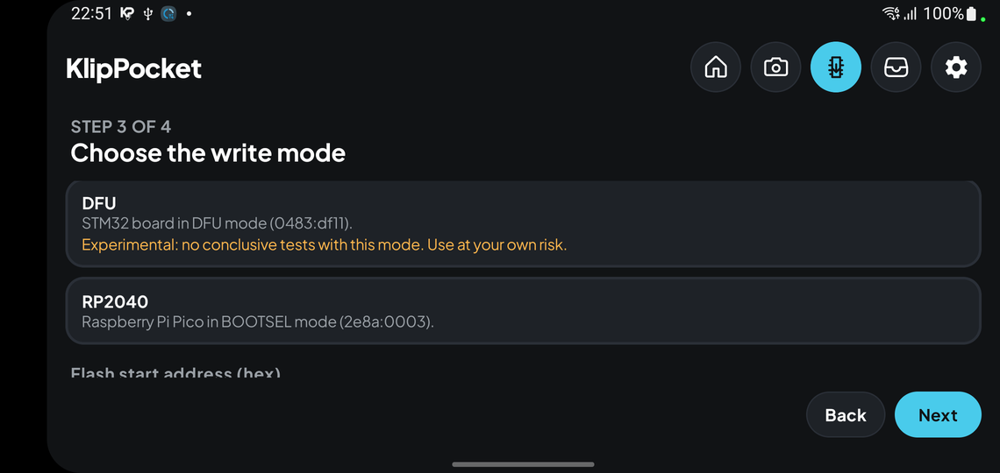

En modo **CAN** aparecen en su lugar dos campos: el **UUID CAN** del nodo (12
dígitos hexadecimales, como lo imprime `canbus_query.py`) y la **velocidad del
bus** en bit/s (1000000 por defecto, el mismo `canbus_frequency` de la
configuración de Klipper). En el paso 2 elige el propio adaptador (el
dispositivo gs_usb), no la placa que hay detrás.

**4 — Confirma.** Un aviso muestra el archivo, el dispositivo y el modo y, para
los modos experimentales, un segundo aviso de que continúas bajo tu propio
riesgo. **Cancelar/Atrás** no cambia nada; **Confirmar** inicia.

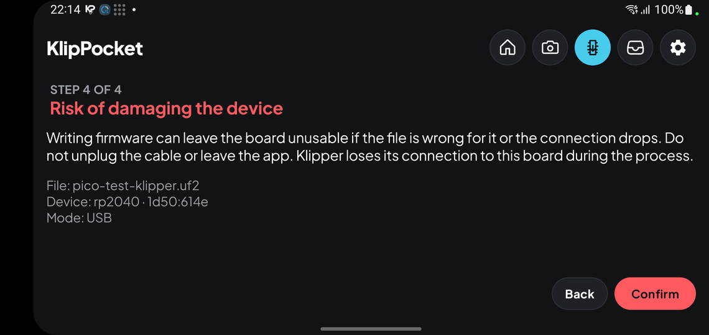

**Progreso.** La pantalla se mantiene encendida. Una barra cubre toda la
ejecución (etapa por etapa, nunca hacia atrás) y se llena suavemente con un
destello que la recorre mientras la app trabaja; debajo, la etapa actual y el
porcentaje total: preparando, poniendo la placa en BOOTSEL, esperando, permiso
USB, comunicándose con el bootloader, borrando, escribiendo, verificando (leído
de vuelta y comparado), reiniciando y esperando a la placa. Si algo falla, la
barra desaparece y se muestra el error.

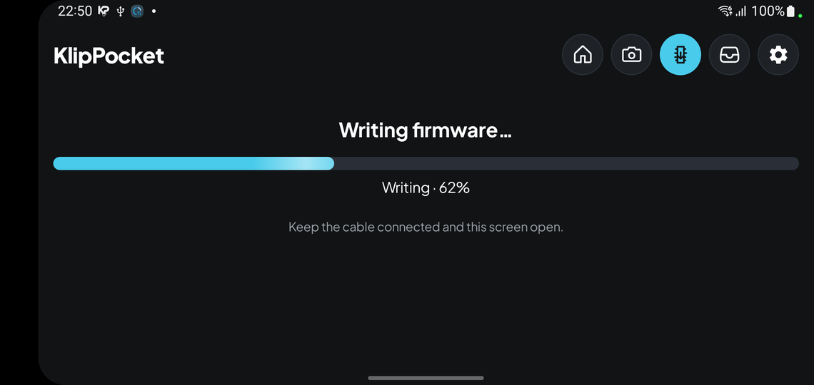

**Resultado.** Si todo va bien (la barra está llena) la placa queda flasheada,
verificada y (cuando usa USB) de vuelta en el bus como dispositivo Klipper. Si
los datos se verificaron pero la placa no reapareció en USB, la app lo dice. Si
falla, explica por qué en tu idioma.

| | |
|---|---|
| 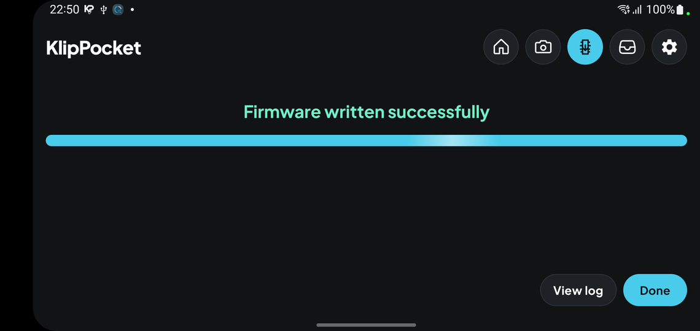 | 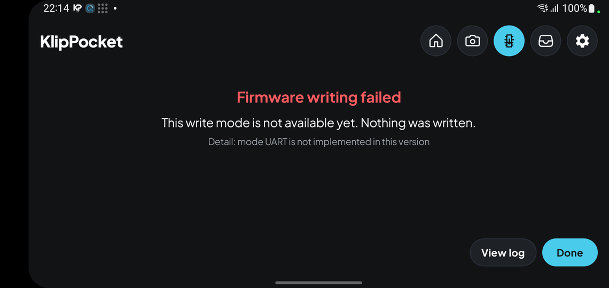 |
| 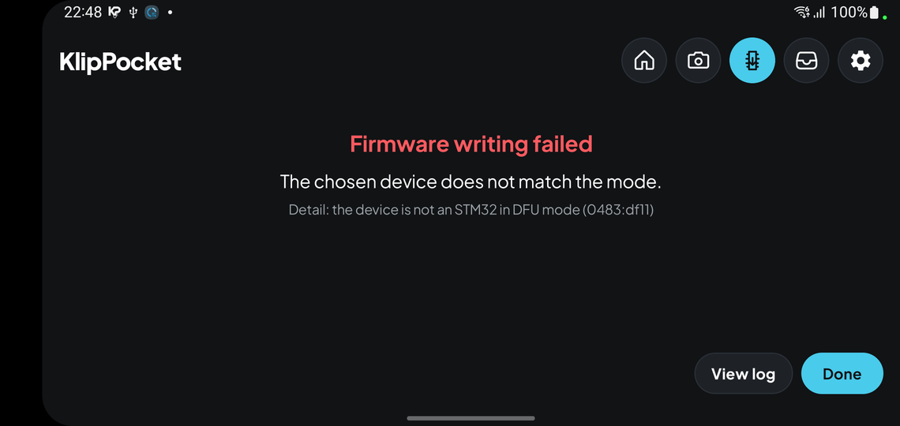 | |

**Ver registro** abre la pestaña Registros en la nueva fuente **Escritura de
firmware**.

## El registro

Cada flasheo queda registrado (archivo, sha256, dispositivo, modo, cada etapa,
resultado):

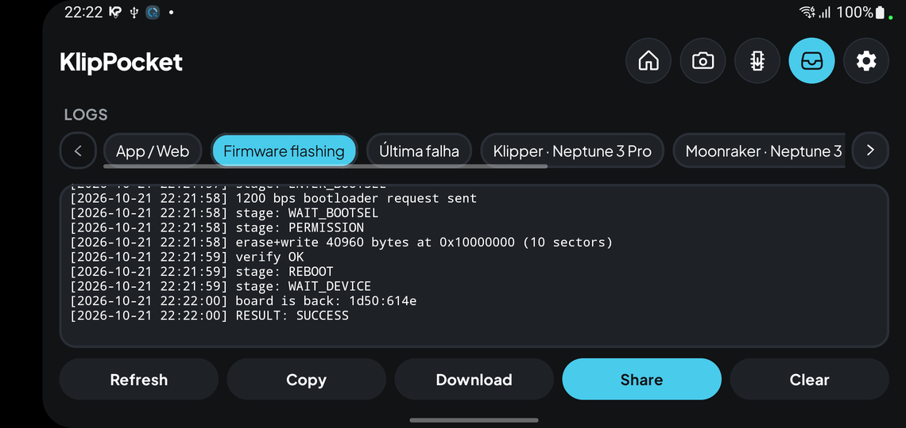

## Tema e idioma

La pestaña sigue el tema y el idioma de la app (English, Português, Español,
简体中文, 繁體中文, Русский).

| | |
|---|---|
| 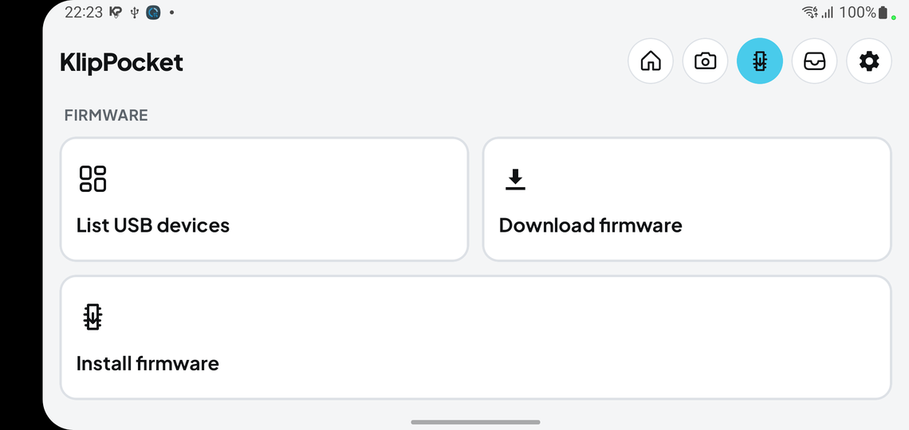 | 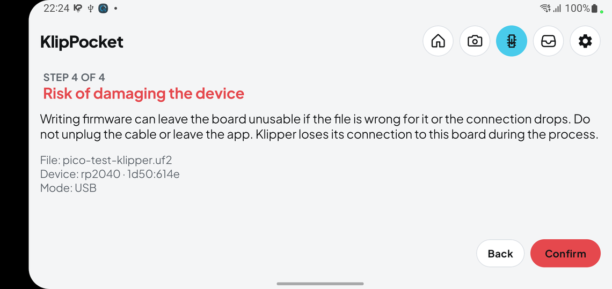 |
| 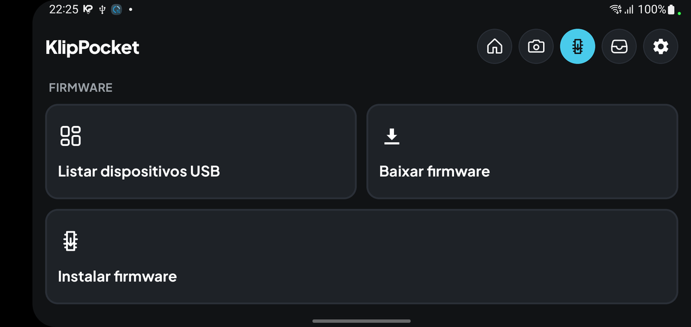 | 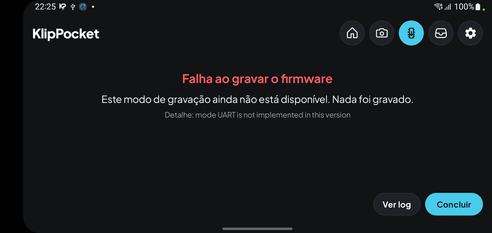 |

## Si algo sale mal

| Mensaje | Qué hacer |
|---|---|
| No apareció ningún bootloader compatible | La placa no entró en RP2040 BOOTSEL, STM32 DFU, Katapult, HID, SAM-BA ni AVR109 tras la petición a 1200 bps. Ponla en el bootloader a mano (BOOTSEL / BOOT0 / el botón del bootloader) y usa el modo de ese bootloader. |
| El dispositivo elegido no coincide con el modo | Elige el dispositivo adecuado para el modo (*DFU* necesita `0483:df11`, *RP2040* necesita `2e8a:0003`). No se escribió nada. |
| El bootloader no respondió | UART: revisa BOOT0 y reset (STM32) o la línea de reset (AVR), el cableado y la velocidad en baudios. No se escribió nada. |
| El dispositivo no es un adaptador USB-serie | El modo UART necesita un adaptador CDC / CH34x / CP210x / FTDI. |
| Este tipo de archivo no es compatible con el modo elegido | RP2040: `.uf2` o `.bin`; STM32 / AVR: `.bin` o `.hex`; Katapult, HID-Flash, SAM-BA y CAN: `.bin`. |
| Falta el UUID CAN o no es válido | 12 dígitos hexadecimales, exactamente como los muestra `canbus_query.py`. |
| El dispositivo no es un adaptador CAN | En modo CAN elige en el paso 2 el adaptador gs_usb / candlelight (o el puente USB-CAN de Klipper). |
| La dirección de inicio de la flash no es válida | Los archivos `.bin` de STM32 van entre `0x08000000` y `0x0FFFFFFF`. |
| No se concedió el permiso USB | Inténtalo de nuevo y acepta la petición de Android. |
| El archivo no es para este chip | El RP2040 y el RP2350 necesitan cada uno su propio firmware: compílalo para el chip que tengas (consulta [build-firmware.md](build-firmware.md)). |
| La flash no coincide con el archivo | No desconectes; ejecútalo de nuevo. Un RP2040 se queda en BOOTSEL y siempre se puede volver a flashear. |

## Cómo se probaron los modos experimentales sin una placa

El autor solo tiene una Raspberry Pi Pico, así que todos los demás modos se
comprobaron contra **placas simuladas que a su vez se contrastan con las
herramientas reales**:

- Los simuladores están en [`app/src/test/python/fake_bootloaders.py`](../../app/src/test/python/fake_bootloaders.py):
  un nodo Katapult (USB/UART y bus CAN), un bootloader HID de STM32 (páginas de
  1 KiB y 2 KiB), y un SAM3X8E / SAM4E8E en su ROM SAM-BA con el controlador de
  flash EEFC.
- `test_bootloader_fakes.py` ejecuta contra ellos las herramientas **propias** de
  Klipper: `flash_can.py` (rutas serie y CAN), `hid-flash` y `bossac` (compilado
  a partir de las fuentes del árbol). Si la herramienta real termina con un
  flasheo correcto, el simulador habla como la placa.
- Las pruebas de Kotlin (`OtherBootloadersTest`) ejecutan después el código de la
  app contra los mismos simuladores, incluidas respuestas erróneas, silencio,
  escrituras defectuosas y una lectura de vuelta fallida. Una comprobación por
  mutación (omitir el borrado de SAM-BA) las hace fallar, como debe ser.
- Lo que esto **no** puede demostrar: la temporización USB, el lado eléctrico, una
  versión de bootloader distinta de la de referencia y el encuadre `gs_usb` de un
  adaptador CAN real (sigue el controlador `gs_usb` de Linux pero no ha visto
  ninguno). Por eso estos modos siguen marcados como **experimentales**.

Una Pico siempre conserva su cargador BOOTSEL, así que un flasheo defectuoso se
arregla manteniendo pulsado BOOTSEL y flasheando de nuevo.
