# Página web de firmware — flashear firmware desde un navegador (puerto 4400)

**Idiomas: [English](../firmware-web.md) · [Português (BR)](../pt-br/firmware-web.md) · [Español](firmware-web.md) · [简体中文](../zh-Hans/firmware-web.md)**

La pestaña **Firmware** del [KlipPocket Dashboard](dashboard.md) — la página web
que la app sirve en el **puerto 4400** — hace lo mismo que la
[pestaña Firmware](firmware-tab.md), pero desde el navegador de un PC u otro
teléfono de la misma red: enviar un archivo de firmware, pegar un enlace de
descarga, ver los dispositivos USB conectados al teléfono y flashear una placa.
La página solo habla con la app: la subida, la descarga y la escritura las hace
el mismo código que la pestaña, así que ambas siempre coinciden.

La página está **siempre disponible mientras la app está abierta** (no necesita
que haya una impresora en ejecución), y una pequeña notificación la mantiene
accesible mientras la app está en segundo plano.

## Abrir la página

En la app, desplaza la **pantalla de inicio** hasta el final, hasta **Panel**:
muestra la dirección (`http://<IP del teléfono>:4400`) y un **PIN** de seis
dígitos.

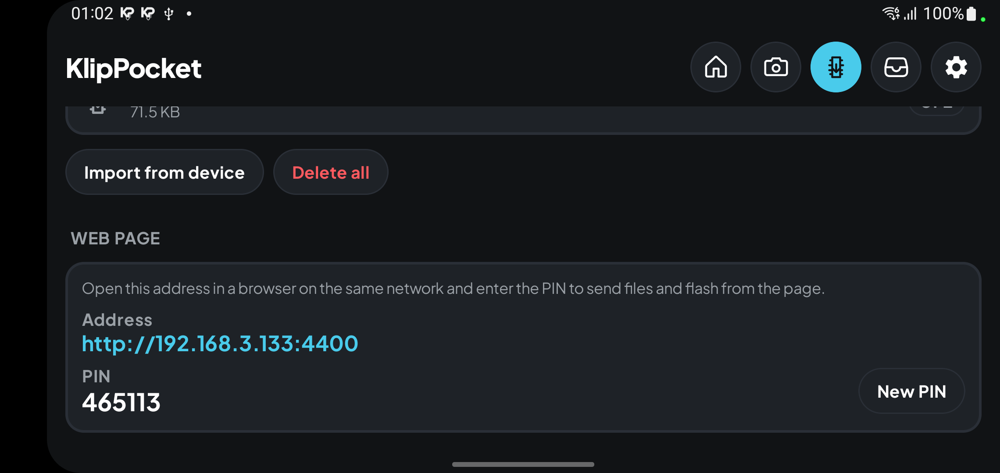

Abre la dirección en cualquier navegador de la misma red e introduce el PIN.
**Nuevo PIN** en la app lo sustituye y cierra todas las páginas abiertas.

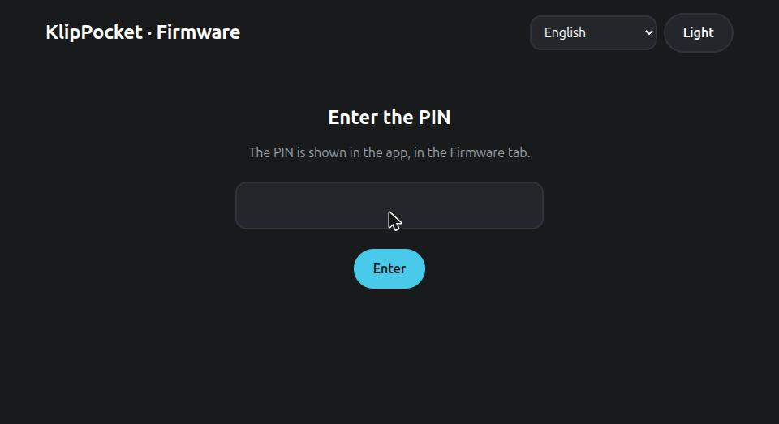

> **¿Por qué un PIN?** Quien llegue a la página puede flashear una placa
> conectada al teléfono. Todo excepto los archivos propios de la página necesita
> el PIN; tras cinco intentos fallidos la dirección se bloquea durante un
> minuto. La página usa HTTP simple, como las demás páginas de la app, así que
> úsala en una red de confianza.

## La pantalla de inicio

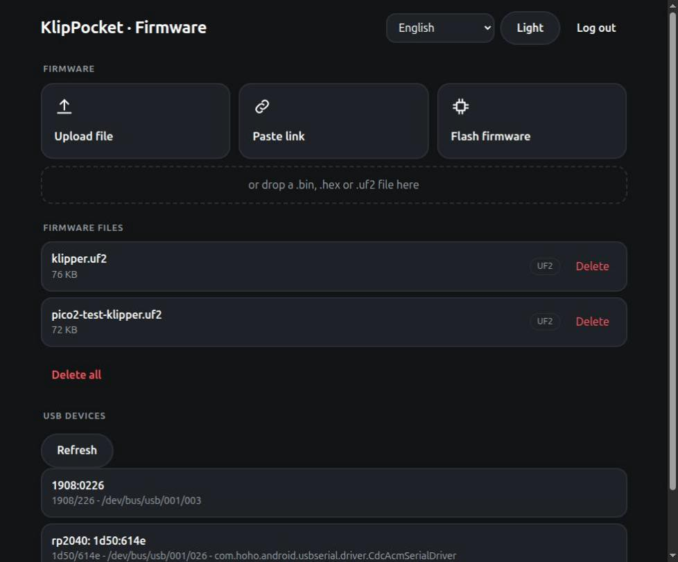

- **Upload file** — elige un archivo o suéltalo sobre el área de puntos. `.bin`,
  `.hex` y `.uf2`, hasta 16 MB. Se guarda en la carpeta de firmware de la app
  (la misma lista que la pestaña). Una pantalla de carga muestra el progreso.

  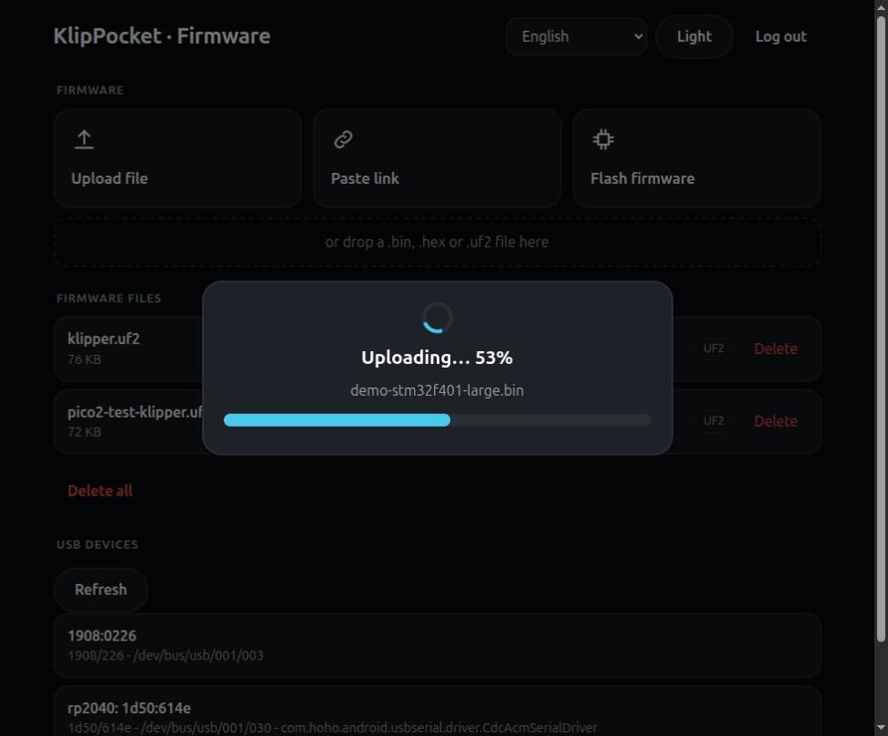

- **Paste link** — pega el enlace de un archivo de firmware (solo https), por
  ejemplo
  `https://github.com/utkabobr/klipper/releases/download/prebuilt-v0.12.0/stm32f401.bin`,
  y pulsa **Download**. La app lo descarga ella misma, así que el teléfono
  necesita internet.

  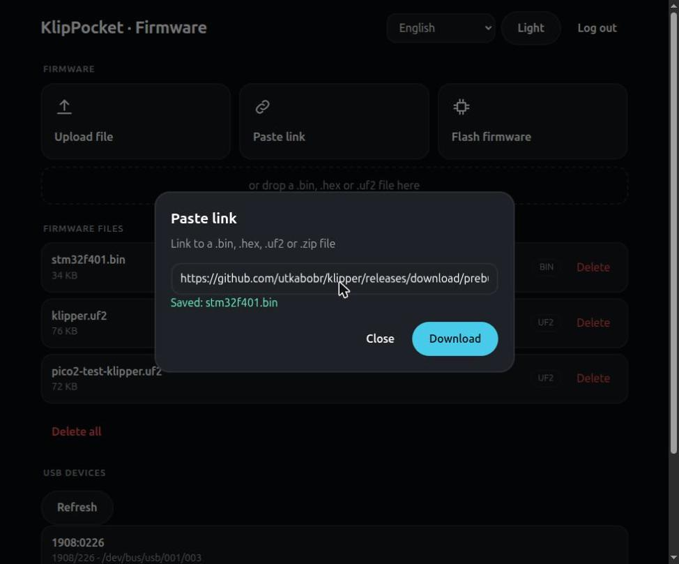

- **Firmware files** — lo que hay almacenado, con **Delete** y **Delete all**.
- **USB devices** — todos los dispositivos que ve el teléfono, con nombre,
  `VID/PID`, ruta de bus y, para las placas serie, el puerto que usa
  `printer.cfg`: la misma lista que *Listar dispositivos USB* en la app.
  **Refresh** la vuelve a leer tras conectar o desconectar una placa (también se
  actualiza sola).
- **Flash firmware** — el asistente de abajo.

## Flashear un firmware

**Flash firmware** primero avisa de que la función es **experimental** y puede
causar problemas; **Continue** inicia los cuatro pasos.

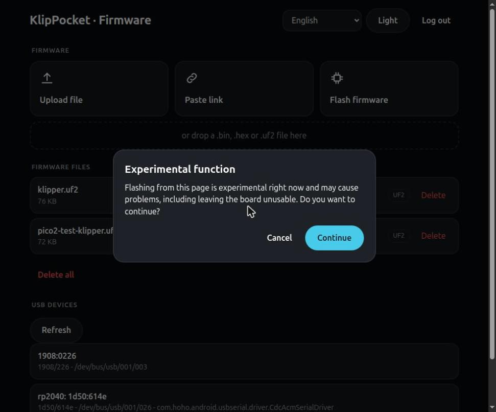

| 1 — Archivo | 2 — Dispositivo |
|---|---|
| 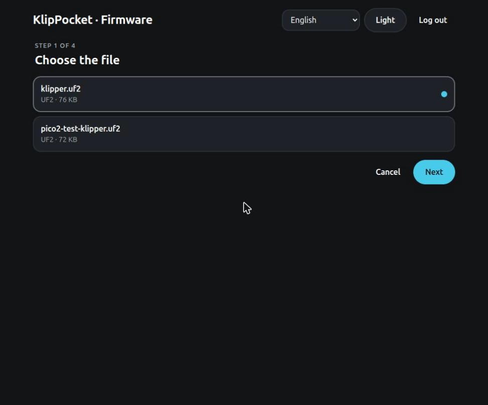 | 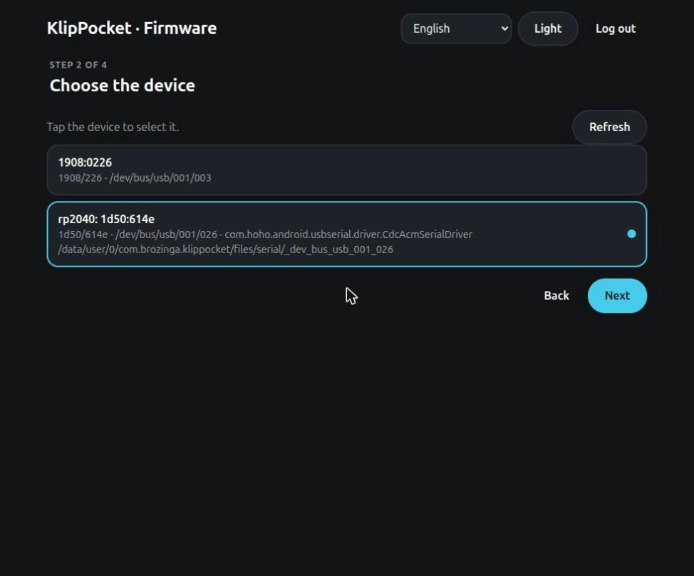 |

**1** elige el archivo; **2** elige el dispositivo (con **Refresh**); **3**
elige el modo.

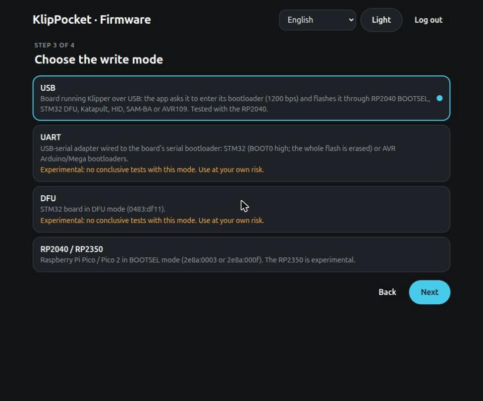

Los modos son **USB**, **UART**, **DFU** y **RP2040 / RP2350**, con las mismas
reglas, notas y marcas de *experimental* que la
[pestaña](firmware-tab.md#modos-qué-funciona-y-qué-es-experimental). Para un
`.bin` sin formato en un STM32 aparece un campo de **dirección de inicio**. (Los
modos Katapult, HID-Flash, SAM-BA y CAN de la app aún no están en la página:
usa la pestaña.)

**4** un aviso de que el proceso puede dañar la placa: **Confirm** lo inicia,
**Cancel** no cambia nada.

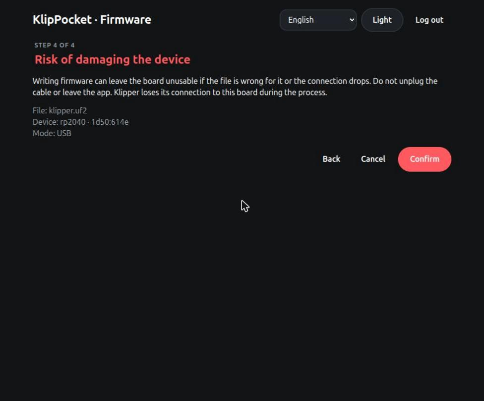

Después, una pantalla de carga muestra la etapa y el porcentaje (Android puede
pedir permiso USB **en el teléfono**: acéptalo ahí). Al final la página dice si
funcionó y, si no, **por qué**:

| | |
|---|---|
| 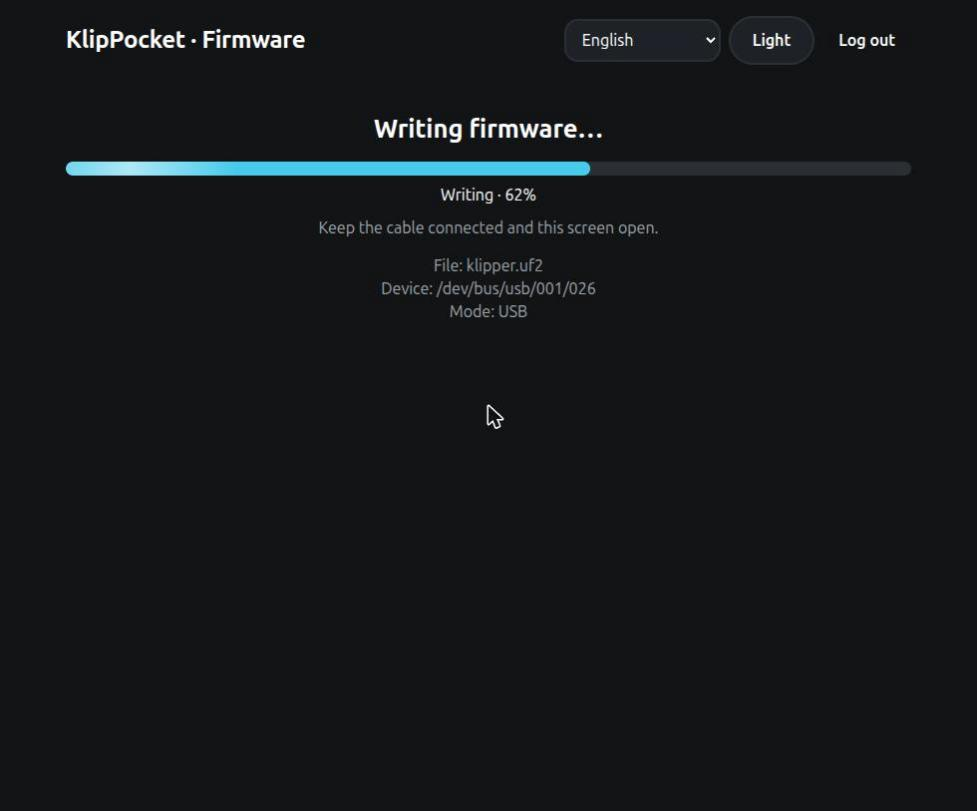 | 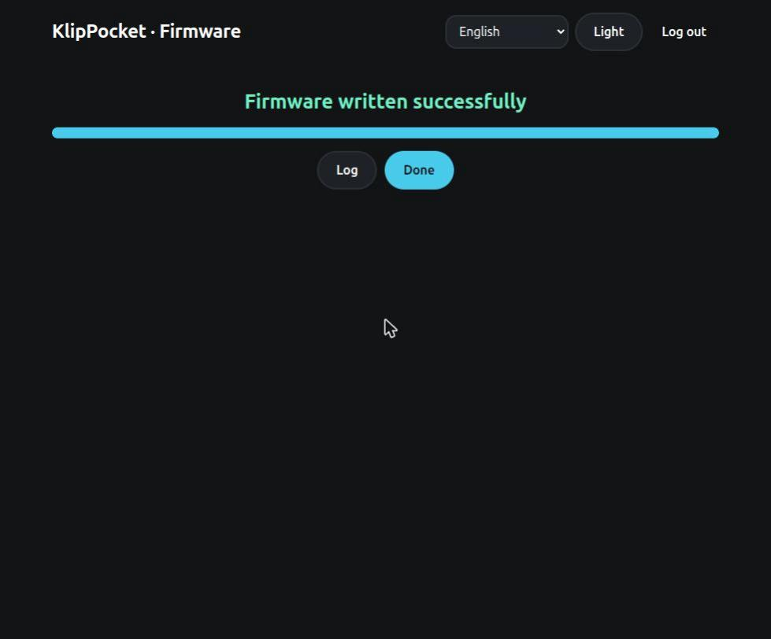 |
| 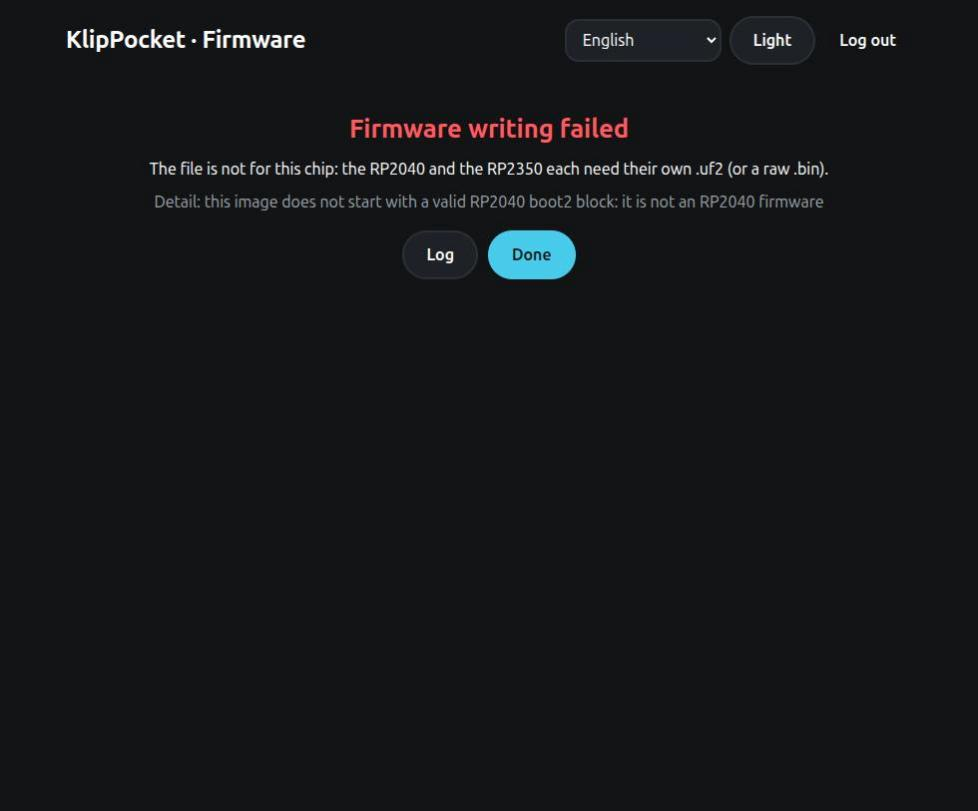 | |

**Log** muestra el final del registro *Escritura de firmware* de la app;
**Done** cierra el resultado.

### Si recargas o cierras la página

La escritura se ejecuta dentro de la app, no en la página. Recarga la página,
cierra la pestaña, ábrela en otro dispositivo: vuelve directamente a la pantalla
de progreso (o al resultado, si la escritura ha terminado y nadie lo cerró
todavía). El paso en el que estabas (archivo, dispositivo, modo) se recuerda en
el navegador hasta que confirmes.

## Idioma y tema

La página ofrece cinco idiomas (de momento sin español) y la primera vez sigue
el idioma y el tema claro/oscuro de la app; la elección que hagas en la página
la recuerda el navegador.

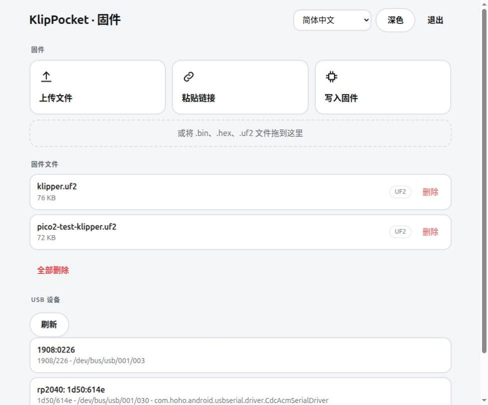

## Si algo sale mal

| Lo que ves | Qué hacer |
|---|---|
| La página no abre | El teléfono y el ordenador deben estar en la misma red Wi-Fi sin *aislamiento de clientes*; usa la dirección que muestra la app. Si otra app usa el puerto 4400, la tarjeta de la pantalla de inicio dice que la página no se está ejecutando. |
| *Too many attempts* | Espera los segundos indicados, o usa **Nuevo PIN** en la app. |
| *Connection to the app lost* | Se cerró la app o el teléfono entró en suspensión: abre la app de nuevo. Una escritura en curso no se pierde mientras la app siga viva. |
| Un fallo de escritura | Los mensajes son los de la [pestaña](firmware-tab.md#si-algo-sale-mal). |

## Para desarrolladores

Todo lo que cuelga de `/api` necesita la cookie de sesión del inicio de sesión
con PIN y, cuando cambia algo, la cabecera `X-KlipPocket: 1`. Rutas
principales: `GET /api/state`, `PUT /api/upload?name=…`, `POST /api/download`,
`GET /api/devices`, `POST /api/flash`, `GET /api/flash`,
`POST /api/flash/reset`. El código está en
`app/src/main/java/ru/ytkab0bp/beamklipper/firmwareweb/` y la página en
`app/src/main/assets/firmware_web/`; sus textos se generan a partir de las
cadenas de la app con `scripts/gen_firmware_web_i18n.py`.
