# Usar Happy Hare (multifilamento / MMU)

**Idiomas: [English](../happy-hare.md) · [Português (BR)](../pt-br/happy-hare.md) · [Español](happy-hare.md) · [简体中文](../zh-Hans/happy-hare.md)**

[Happy Hare](https://github.com/moggieuk/Happy-Hare) es el controlador de
Klipper para unidades multimaterial (MMU): ERCF, Tradrack, BoxTurtle, 3MS, 3D
Chameleon, HTLF, KMS, MMX y muchas otras. KlipPocket incluye **Happy Hare
v4.1.0** y su componente de Moonraker, tanto para Klipper como para
[Kalico](kalico.md). No se activa nada hasta que tu configuración lo pide, así
que las impresoras sin MMU no se ven afectadas.

Configuras Happy Hare **en la app** (o en el [panel](dashboard.md)): respondes
las mismas preguntas que el menú de instalación del propio Happy Hare y
KlipPocket escribe los archivos, así que no hace falta ningún ordenador.

## Qué necesitas

- Una placa MMU flasheada con firmware **USB** de Klipper, conectada al
  teléfono/tablet (preferiblemente a través de un hub con alimentación). Los
  motores y servos necesitan su propia fuente de alimentación.
- Un perfil de impresora ya creado en KlipPocket.

## Configurar en la app

1. Abre **Ajustes → Happy Hare** y elige la impresora (con una sola impresora se
   abre directamente). Toca **Configurar Happy Hare**.

   <p align="center">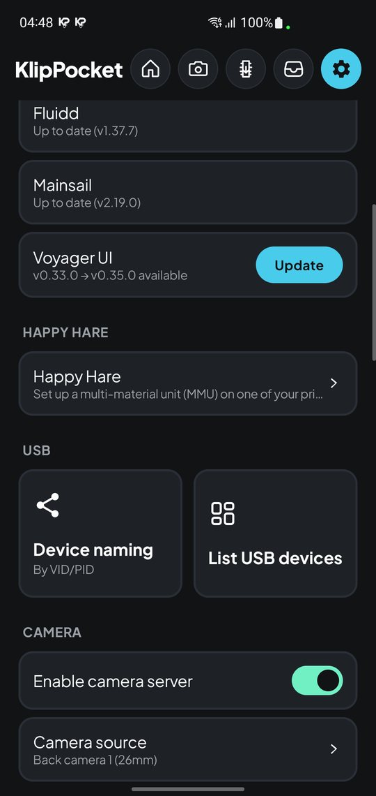 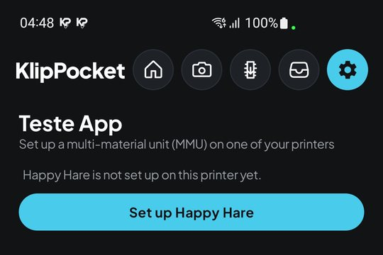</p>

2. Elige tu MMU. Happy Hare rellena los valores por defecto que su diseñador
   recomienda para ella.

   <p align="center">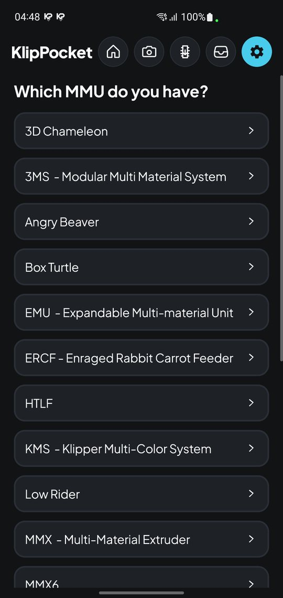</p>

3. Recorre las preguntas. Son el propio menú de Happy Hare, así que se muestran
   en inglés. Abre una sección para ver sus preguntas; toca una para cambiarla y
   usa **Restaurar el valor predeterminado** en su ventana para deshacer un
   cambio. Un interruptor en gris queda fijado por tus otras respuestas. Las
   preguntas que dependen de una respuesta aparecen justo debajo de ella (por
   ejemplo la versión de Turtle Neck bajo el tipo de MMU).

   <p align="center">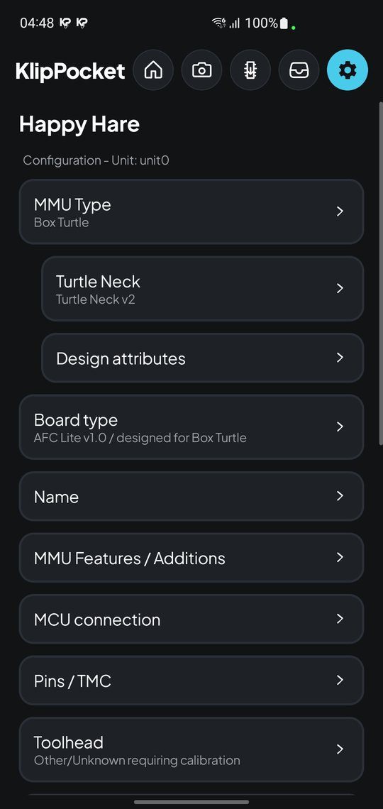</p>

4. Abre **MCU connection** y establece el dispositivo de la placa MMU. En
   **Enter serial device path**, elige la placa conectada de la lista o escribe
   su ruta (consulta **Ajustes → USB → Listar dispositivos USB**).

   <p align="center">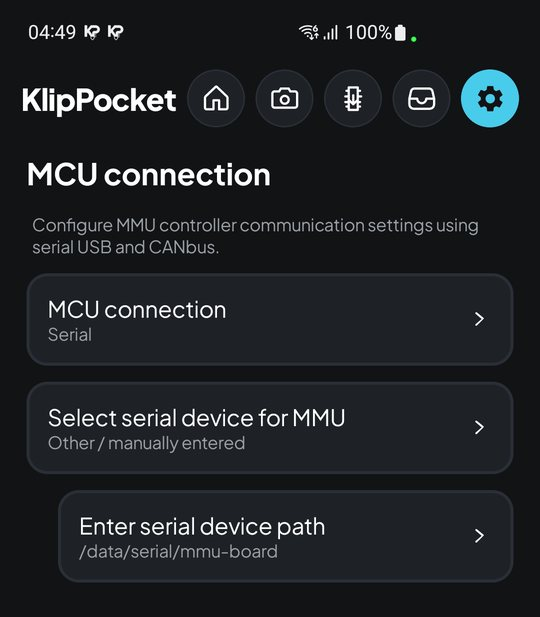 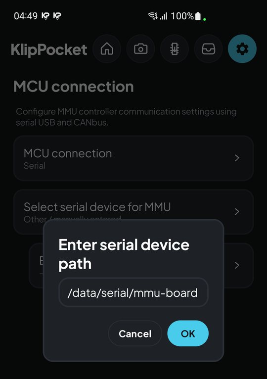</p>

5. De vuelta en la primera página, toca **Revisar y crear**. Si aparece
   **Faltan respuestas**, vuelve atrás y complétalas. Después elige:

   - **Añadir Happy Hare a printer.cfg y moonraker.conf**: activado, KlipPocket
     añade las líneas por ti (se conserva una copia de seguridad de cada
     archivo). Desactivado, las añades tú mismo, consulta
     [Añadir las líneas tú mismo](#añadir-las-líneas-tú-mismo).
   - **Restablecer también la calibración y el estado de las puertas**:
     actívalo cuando hayas elegido otra MMU. Déjalo desactivado cuando solo
     hayas cambiado ajustes, para conservar la calibración en
     `mmu/mmu_vars.cfg`.

   La carpeta `mmu` de la impresora se elimina y se vuelve a crear, así que se
   pierden los cambios hechos a mano dentro de ella. Toca **Crear la
   configuración**.

   <p align="center">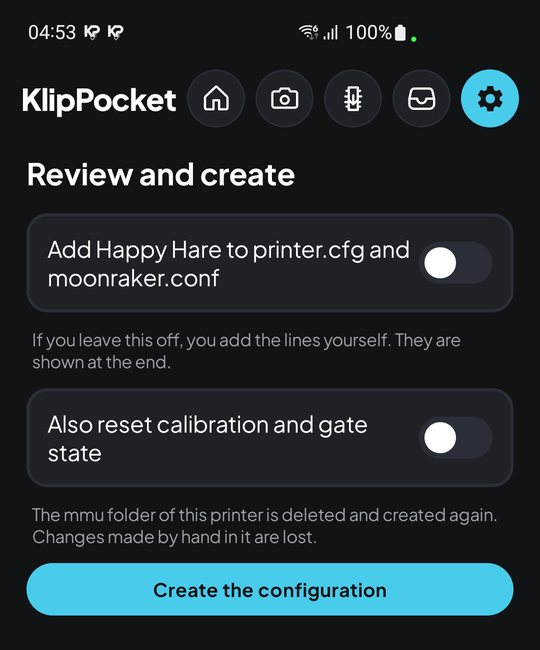 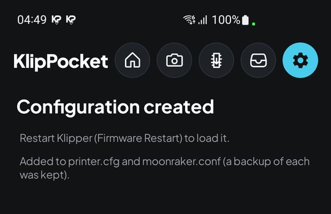</p>

6. Reinicia el perfil de impresora (o envía **Firmware Restart**) para que
   Klipper cargue Happy Hare.

## Configurar en el panel

El [panel](dashboard.md) tiene los mismos pasos en su pestaña **Happy Hare**,
junto a Ajustes: elige la impresora, **Configurar Happy Hare**, tu MMU, las
preguntas, **Revisar y crear**. En **MCU connection** una lista ofrece los
dispositivos USB que ve el teléfono.

<p align="center">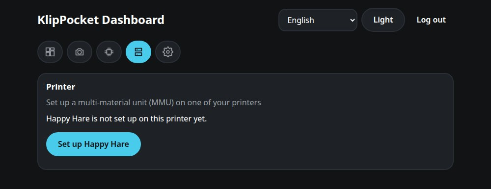 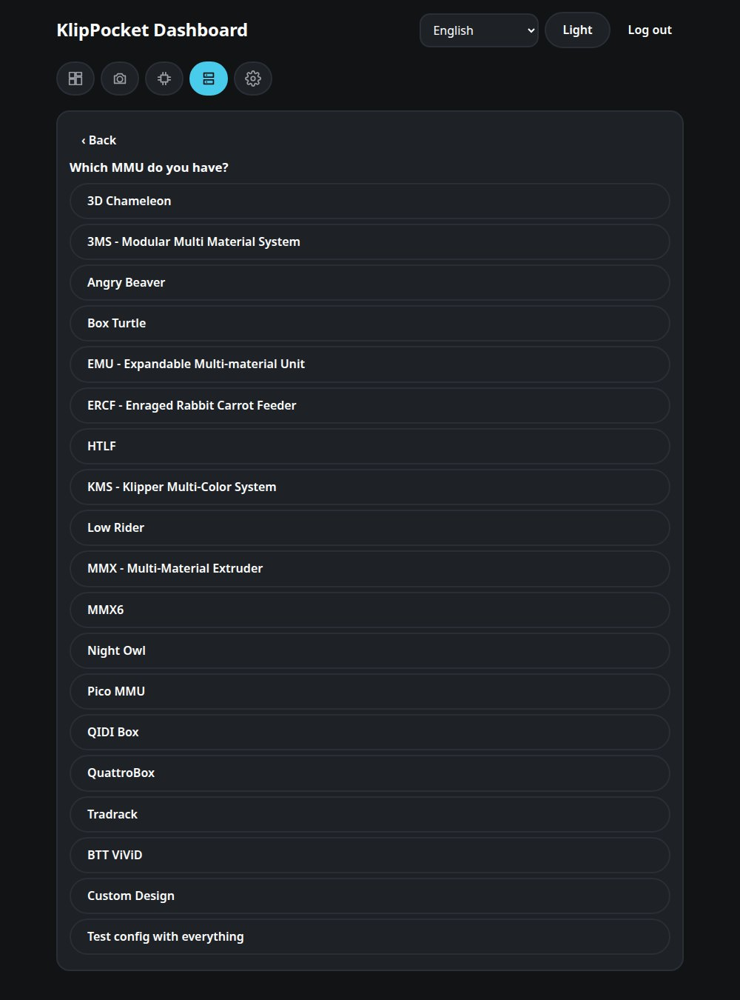</p>
<p align="center">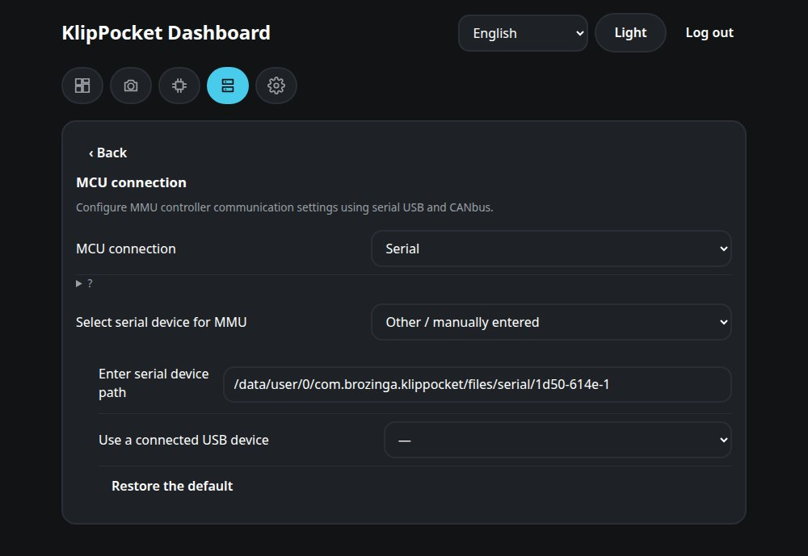 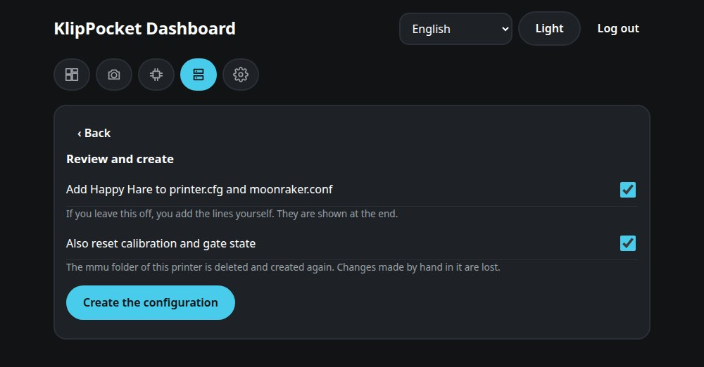</p>

## Añadir las líneas tú mismo

Si dejaste desactivado **Añadir Happy Hare a printer.cfg y moonraker.conf**, la
última pantalla muestra las líneas que hay que añadir (o toca **Añadirlas
ahora** para que lo haga KlipPocket).

<p align="center">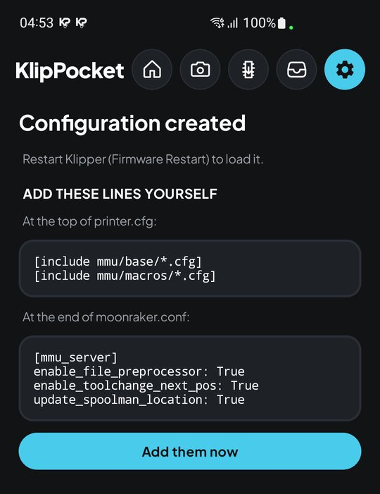 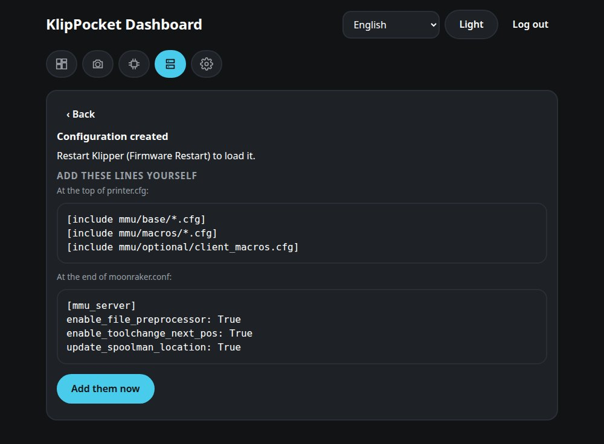</p>

Abre la carpeta de configuración del perfil de impresora, la que contiene
`printer.cfg` (el administrador de archivos de configuración de Fluidd/Mainsail,
o la entrada de KlipPocket en la app Archivos de Android), y:

1. Añade las líneas `[include …]` indicadas **al principio** de `printer.cfg`.
   Normalmente son:

   ```ini
   [include mmu/base/*.cfg]
   [include mmu/macros/*.cfg]
   ```

   más `[include mmu/optional/client_macros.cfg]` (y `mmu_menu.cfg`) cuando esas
   opciones están activadas; la pantalla muestra exactamente cuáles.
2. Añade esto **al final** de `moonraker.conf`:

   ```ini
   [mmu_server]
   enable_file_preprocessor: True
   enable_toolchange_next_pos: True
   update_spoolman_location: True
   ```

   No añadas una sección `[update_manager happy-hare]`: la app actualiza Happy
   Hare junto con la app.
3. Asegúrate de que `printer.cfg` tenga una sección `[pause_resume]` y no defina
   sus propios `PAUSE`, `RESUME` o `CANCEL_PRINT` (los proporciona Happy Hare).
   Un duplicado detiene Klipper con `gcode command … already registered`.
4. Reinicia el perfil de impresora.

## Cambiar la MMU o los ajustes más adelante

Abre de nuevo **Ajustes → Happy Hare** y la impresora.

<p align="center">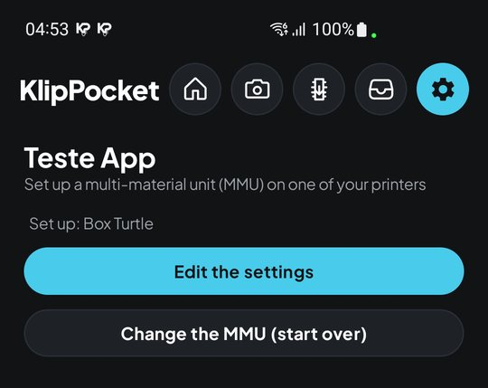</p>

- **Editar los ajustes** abre las respuestas que guardaste; cambia lo que
  necesites y crea la configuración de nuevo.
- **Cambiar la MMU (empezar de nuevo)** parte de los valores por defecto de la
  MMU que elijas. Crear la configuración elimina la carpeta `mmu` anterior y
  escribe una nueva (deja activado **Restablecer también la calibración y el
  estado de las puertas**). La placa USB que usaste antes se vuelve a ofrecer,
  así que no tienes que elegirla dos veces.

## Ver la MMU en las interfaces web

Una vez que Klipper ha cargado Happy Hare, los Fluidd y Mainsail que vienen con
la app muestran la MMU en su página **Dashboard**, sin nada que activar: Fluidd
tiene una tarjeta **MMU** y Mainsail un panel **MMU**, con las puertas, la
herramienta seleccionada, el estado del filamento y los botones para precargar,
expulsar y recuperar. Muévelos u ocúltalos con las opciones de diseño del panel
de cada interfaz.

En la consola de Fluidd o Mainsail, `MMU_STATUS` imprime el resumen de la MMU y
`MMU_HELP` lista todos los comandos. El registro propio de Happy Hare se escribe
junto a `klippy.log`, como `mmu.log`.

[KlipperScreen para Happy Hare](https://github.com/moggieuk/KlipperScreen-Happy-Hare-Edition)
es un proyecto aparte para pantallas táctiles.

## Solución rápida de problemas

| Mensaje | Causa probable |
|---|---|
| `MMU_STATUS` responde `Unknown command` | Falta la línea `[include mmu/base/*.cfg]` en `printer.cfg`, o no está la carpeta `mmu`. |
| `gcode command … already registered` | Una macro de `printer.cfg` duplica una que proporciona Happy Hare (por ejemplo `PAUSE`, `RESUME` o `CANCEL_PRINT`). Elimina la tuya. |
| `mcu 'unit0': Unable to connect` / `Unable to open serial port` | La placa no tiene firmware USB, o su ruta cambió tras volver a flashear: elígela otra vez en **MCU connection** y crea la configuración de nuevo. |
| `Happy Hare's Klipper modules failed to load` | Infórmalo. El consejo de `install.sh` de ese mensaje no se aplica a la app. |
