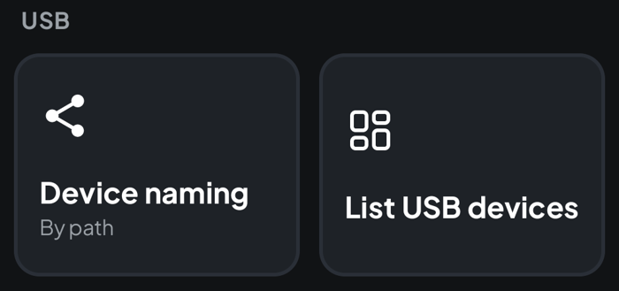
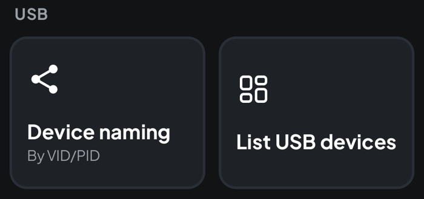
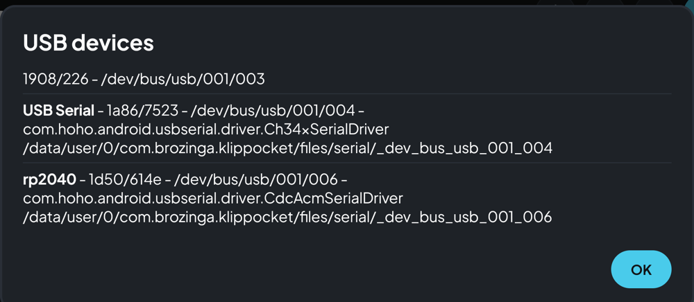
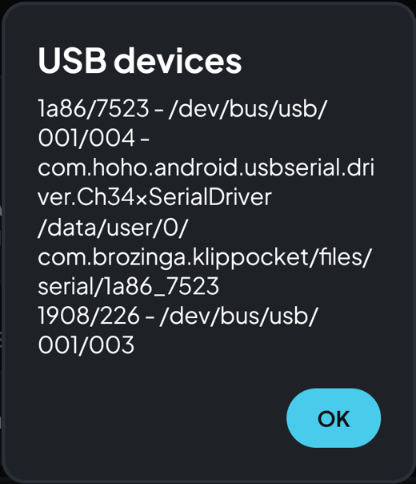

# Usar más de un MCU (multi-MCU)

**Idiomas: [English](../multi-mcu.md) · [Português (BR)](../pt-br/multi-mcu.md) · [Español](multi-mcu.md) · [简体中文](../zh-Hans/multi-mcu.md)**

Algunas impresoras usan una segunda placa junto a la principal: una placa del
cabezal, una placa que añade puertos (drivers de motores, endstops,
ventiladores) o una placa pequeña que solo lleva un sensor (acelerómetro, sonda
de corrientes de Foucault). En Klipper cada una es una sección extra
`[mcu nombre]`.

KlipPocket **no tiene una pantalla específica para multi-MCU**. Aun así puede
funcionar a mano, porque la app da a cada placa USB su propio puerto serie
virtual, y tú escribes ese puerto en `printer.cfg`. Esta página muestra cómo.

> **Aún sin probar con dos placas.** Los pasos de abajo siguen cómo trata hoy la
> app los dispositivos USB. Si lo pruebas, cuéntanos cómo te fue.

## Qué funciona y qué no

| Configuración | En la app |
|---|---|
| Placa extra flasheada con firmware **USB** (Klipper USB / CDC) | Posible, como se describe aquí |
| Placa extra en **bus CAN** (incluido un adaptador USB-CAN) | **No compatible** — Android no da a las apps ninguna interfaz CAN |
| Placas que solo ofrecen pines **UART** | No compatible — la app solo habla USB |

Por tanto, la placa extra debe compilarse con interfaz **USB** en la
[compilación del firmware](build-firmware.md) y flashearse en ella. Muchas
placas vienen con firmware CAN o pueden flashearse de ambas maneras, así que
comprueba cuál tiene la tuya.

## Qué necesitas

- Todas las placas accesibles por USB desde el teléfono/tablet: se recomienda
  encarecidamente un **hub USB con alimentación propia**, ya que el dispositivo
  no puede alimentar varias placas.
- Los motores y calentadores de la placa extra siguen necesitando su propia
  alimentación: el USB solo alimenta la lógica de la placa.
- Cada placa flasheada con firmware de Klipper (interfaz USB).

## Paso 1 — Elige cómo se nombran los dispositivos

Abre **Ajustes → USB**. **Nombre del dispositivo** decide el nombre de cada
puerto serie virtual. Al tocarlo se alterna entre los dos modos:

| Por ruta | Por VID/PID |
|---|---|
|  |  |

- **Por VID/PID** — se nombra según el id de fabricante/producto USB, p. ej.
  `1a86_7523`. Conserva el mismo nombre si mueves el cable a otro puerto. Úsalo
  cuando tus placas tengan ids **distintos** (por ejemplo, una placa principal
  con CH340 y una placa con otro chip).
- **Por ruta** — se nombra según la ruta del bus USB, p. ej.
  `_dev_bus_usb_001_003`. Úsalo cuando dos placas tengan el **mismo** id. Todas
  las placas que ejecutan el firmware USB propio de Klipper muestran el mismo id
  (`1d50:614e`), así que dos de ellas compartirían un nombre con *Por VID/PID*.
  La contrapartida es que la ruta puede cambiar al desconectar y volver a
  conectar, o al usar otro puerto del hub, y entonces hay que actualizar
  `printer.cfg`.

Cambiar el nombrado cambia las rutas, así que decídelo antes de editar
`printer.cfg` y reinicia el perfil después de cambiarlo.

## Paso 2 — Encuentra la ruta de cada placa

1. Conecta todas las placas (a través del hub) y acepta la petición de permiso
   USB de cada una.
2. Abre **Ajustes → USB → Listar dispositivos USB**.

Cada placa reconocida aparece empezando por **su nombre**, en negrita (el que
informa el dispositivo, como `rp2040` — el mismo nombre que muestra la petición
de permiso USB), luego su `vid/pid`, el nombre del dispositivo, el controlador y,
en la línea siguiente, **la ruta serie que hay que usar en `printer.cfg`**. Si
dos dispositivos informan del mismo nombre, se numeran en el orden de su ruta de
bus: `rp2040 (1)`, `rp2040 (2)`. Un dispositivo que no informa de ningún nombre
empieza directamente con su `vid/pid`. Ejemplo real:

En el ejemplo, la primera entrada (`1908/226`, sin nombre) es una webcam: no
tiene línea de ruta porque no es una placa de Klipper. `USB Serial`
(`1a86/7523`) es una placa con CH340 y `rp2040` (`1d50/614e`) es una Raspberry
Pi Pico ejecutando Klipper. La misma placa recibe una ruta distinta según el
modo de nombrado:

| Por ruta | Por VID/PID |
|---|---|
|  |  |

Copia la ruta completa de cada placa de Klipper (la línea que empieza por
`/data/user/0/…`).

## Paso 3 — Escríbelas en `printer.cfg`

Usa la ruta de la placa principal en `[mcu]` y una sección extra `[mcu nombre]`
para cada placa adicional. Edita `printer.cfg` desde Fluidd/Mainsail como de
costumbre.

```ini
[mcu]
serial: /data/user/0/com.brozinga.klippocket/files/serial/1a86_7523

[mcu toolhead]
serial: /data/user/0/com.brozinga.klippocket/files/serial/1d50_614e
```

Los pines de la placa extra llevan el nombre como prefijo, `nombre:PIN`:

```ini
# Un ventilador y un endstop en la placa extra
[fan_generic part_fan]
pin: toolhead:PA0

[stepper_z]
endstop_pin: toolhead:PB6

# Un acelerómetro en una placa solo de sensor
[adxl345]
cs_pin: toolhead:gpio9
spi_bus: spi1a

[resonance_tester]
accel_chip: adxl345
probe_points: 100, 100, 20
```

Los nombres de los pines dependen de la placa; usa los de su propia
documentación. Una sección como `[mcu toolhead]` no necesita nada más aparte de
`serial:`; no hay línea `baud:` que configurar (la app gestiona la conexión por
sí misma). La velocidad serie se elige por placa en **Ajustes → USB → Listar
dispositivos USB**; el valor por defecto, 250000, funciona con la mayoría de
las placas, así que cámbialo solo si una placa no se conecta.

Guarda y reinicia. En Fluidd/Mainsail el panel **System** lista ambos MCU, y
`Klipper` debería llegar a **Ready**.

## Cosas que conviene saber

- **Empieza con la placa extra conectada.** Si falta un MCU configurado, Klipper
  no termina de arrancar y informa de *Unable to connect*.
- **Volver a flashear o reconectar** puede cambiar la ruta con *Por ruta*. Si
  Klipper se detiene con *Unable to open serial port*, vuelve a ejecutar
  **Listar dispositivos USB** y actualiza la ruta.
- **Mismo chip, mismo id:** si dos placas comparten un id y usas *Por VID/PID*,
  compiten por un único nombre. Cambia a *Por ruta*.
- Funciona con ambos motores, [Klipper y Kalico](kalico.md).
- Una placa MMU que ejecuta Happy Hare es una placa USB más aquí; consulta
  [Happy Hare](happy-hare.md) para el resto de su configuración.

## Solución rápida de problemas

| Mensaje | Causa probable |
|---|---|
| `Unable to open serial port` | La ruta de `printer.cfg` ya no existe. Vuelve a listar los dispositivos. |
| `mcu 'toolhead': Unable to connect` | La placa no está conectada, no tiene firmware USB o no recibe alimentación. |
| La placa no aparece en **Listar dispositivos USB** | No se aceptó la petición de permiso, el cable es solo de carga, o el hub no tiene alimentación. |
