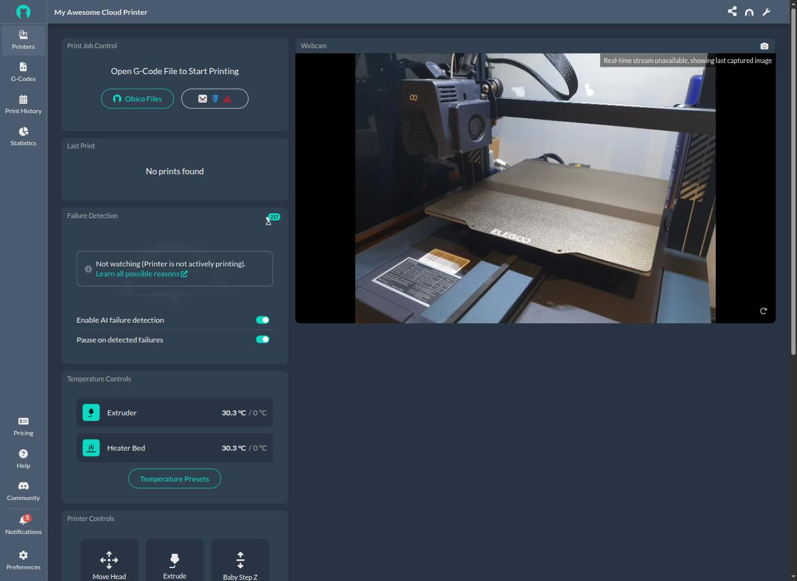
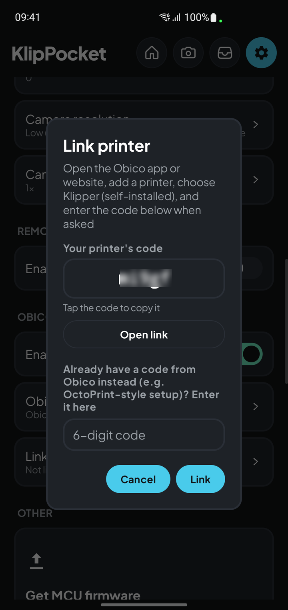

# Usar Obico

**Idiomas: [English](../obico.md) · [Português (BR)](../pt-br/obico.md) · [Español](obico.md) · [简体中文](../zh-Hans/obico.md)**

[Obico](https://www.obico.io) es una plataforma de impresión 3D inteligente,
de código abierto y creada por la comunidad: supervisión remota, detección de
fallos de impresión y control remoto, desde Obico Cloud o desde tu propio
Obico Server autoalojado. KlipPocket ejecuta el complemento real
`moonraker-obico` (incluido desde
[TheSpaghettiDetective/moonraker-obico](https://github.com/TheSpaghettiDetective/moonraker-obico)),
adaptado para funcionar dentro del dispositivo en lugar del servicio systemd
que normalmente instala.

## Activarlo

1. Inicia un perfil de impresora (tiene que estar **en ejecución** — Obico se
   conecta al perfil que esté activo en ese momento).
2. Ve a **Ajustes → Acceso remoto → Obico** y activa **Enable Obico**.
3. Toca **Servidor de Obico** para elegir a dónde se conecta:
   - **Obico Cloud** (`app.obico.io`) — la opción por defecto, sin necesidad de
     alojar nada tú mismo.
   - **Autoalojado** — introduce la URL de tu propia instancia de
     [Obico Server](https://www.obico.io/docs/server-guides/).
   - Cambiar de servidor borra cualquier vinculación existente, ya que una
     vinculación solo es válida para el servidor que la emitió.
4. Toca **Vincular impresora**. KlipPocket genera su propio código y lo muestra
   ahí mismo (puede tardar unos segundos tras activar Obico a que el
   complemento arranque y genere uno). En la app o en el sitio web de Obico,
   añade una impresora, elige **Klipper (self-installed)** e introduce ese
   código cuando te lo pidan — o toca **Abrir enlace** en el diálogo, que abre
   directamente la página de vinculación de Obico con el código ya rellenado.
   - Esto replica exactamente lo que hace el script de instalación de Obico en
     una instalación real de Klipper (`./install.sh` →
     `python3 -m moonraker_obico.link`): consulta el servidor de Obico cada
     par de segundos informando de una impresora sin vincular y de un código de
     un solo uso, hasta que introduces ese código del lado de Obico, o hasta que
     la app de Obico lo encuentra automáticamente porque estás en la misma
     cuenta. No interviene ninguna difusión en la red local, así que funciona
     igual por WiFi que por una VPN o con los datos móviles del teléfono.
   - ¿Ya tienes un código en sentido *contrario* — uno que te dio Obico, por
     ejemplo en una configuración manual al estilo OctoPrint? El mismo diálogo
     tiene un campo para introducirlo.

5. Una vez vinculada, tu impresora aparece en la app o el sitio web de Obico.
   Para desvincularla, abre **Vincular impresora** de nuevo — el diálogo muestra
   una opción **Desvincular** una vez vinculada. La vinculación también se
   completa automáticamente si la app o el sitio de Obico encuentra la
   impresora por sí solo (misma cuenta) — no hay ningún botón que pulsar en
   KlipPocket para eso, el diálogo simplemente se cierra solo cuando ocurre.

## Webcam

Obico obtiene una instantánea de la imagen de la webcam del mismo modo que
Fluidd/Mainsail: a través de la propia lista de webcams de Moonraker. Activa el
servidor de cámara y añádelo una vez a Fluidd o Mainsail (la configuración se
comparte entre ambos) y Obico lo detectará automáticamente — guía completa con
capturas: [`webcam.md`](webcam.md).

La vista previa en tiempo real por WebRTC de Obico (mediante un proceso
`janus-gateway` incluido y `ffmpeg`) **no** está disponible aquí — ambos son
binarios nativos compilados para Linux de escritorio/Raspberry Pi en el
proyecto original, no para Android, y no se incluyen. Es una opción de
configuración documentada y compatible (`disable_video_streaming`), no un
parche al código del complemento. Obico sigue recibiendo una instantánea nueva
periódicamente (cada ~10 s) para la supervisión de la impresión y la detección
de fallos, con independencia de esa opción.

## Notas y limitaciones

- Solo se puede vincular **un** perfil de impresora a la vez, aunque ejecutes
  varios al mismo tiempo — Obico sigue al perfil que llegó primero a «en
  ejecución».
- La telemetría de fallos propia de Obico (Sentry) está desactivada por defecto;
  la conexión real con el servidor que elijas no se ve afectada. Además, el
  propio complemento la desactiva automáticamente para cualquier servidor
  autoalojado, sea cual sea este ajuste.
- **Confirmado de principio a fin con hardware real**: el complemento se
  conecta a Moonraker, genera un código real de un solo uso desde los servidores
  reales de Obico Cloud, y la impresora llegó a vincularse con ese flujo. La
  vía del código manual también se verificó contra los servidores reales (un
  código incorrecto a propósito vuelve correctamente como «inválido»).

## Solución de problemas

- **Registros**: `obico.log` está junto a `klippy.log`/`moonraker.log` en la
  carpeta `logs` de ese perfil — llega hasta él con una app de administración de
  archivos a través de la entrada de almacenamiento propia de KlipPocket (la app
  Archivos de Android → «KlipPocket»), el mismo lugar donde ya buscarías los
  registros de Klipper/Moonraker/OctoEverywhere.
- **«No vinculada» no cambia nunca tras introducir un código**: comprueba que el
  código no haya caducado (los códigos de Obico duran poco) y que elegiste el
  servidor correcto (Cloud o autoalojado) — un código de uno no sirve en el
  otro.
- **Servidor autoalojado inaccesible**: el mensaje de error que muestra el
  diálogo de vinculación es el error de red real (p. ej. «unable to resolve
  host») — revisa primero la URL, incluido `http://` frente a `https://`.
