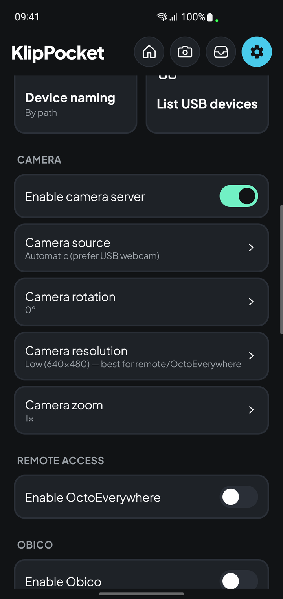
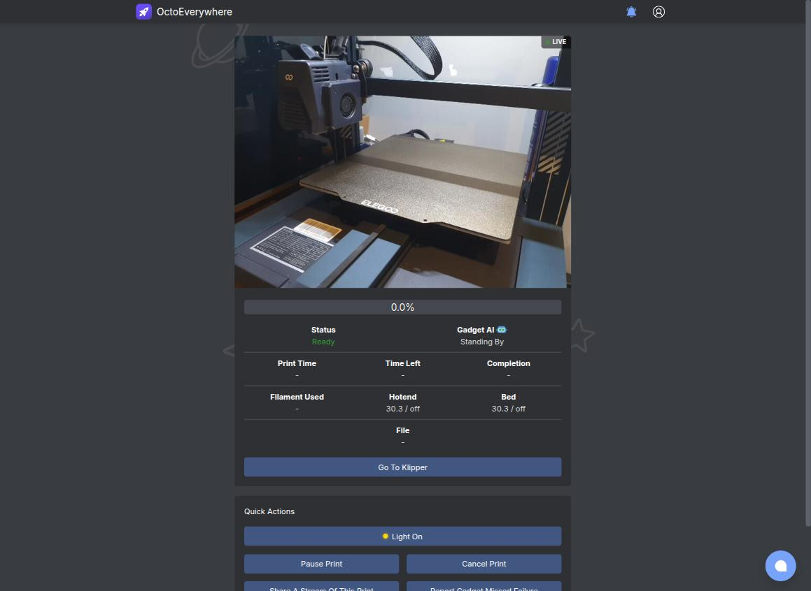

# Usar OctoEverywhere

**Idiomas: [English](../octoeverywhere.md) · [Português (BR)](../pt-br/octoeverywhere.md) · [Español](octoeverywhere.md) · [简体中文](../zh-Hans/octoeverywhere.md)**

[OctoEverywhere](https://octoeverywhere.com) te da acceso remoto a tu impresora
(webcam, estado, control) desde octoeverywhere.com o su app móvil, sin abrir
puertos en tu router. KlipPocket ejecuta el complemento real de OctoEverywhere
para Klipper/Moonraker, adaptado para funcionar dentro del dispositivo en lugar
del servicio systemd que normalmente instala.

## Activarlo

1. Inicia un perfil de impresora (tiene que estar **en ejecución** —
   OctoEverywhere se vincula al perfil que esté activo en ese momento).
2. Ve a **Ajustes → Acceso remoto** y activa **Enable OctoEverywhere**.
3. Espera unos segundos a que genere un ID de impresora y toca **Vincular
   impresora**. Aparece un código QR — escanéalo con la cámara del móvil (o
   abre el enlace en el propio dispositivo) para terminar de vincularla a tu
   cuenta de OctoEverywhere, igual que en cualquier otra instalación de
   OctoEverywhere.
   - Si ves «Not ready yet», solo significa que el complemento aún no ha
     terminado de arrancar — espera un momento y toca **Vincular impresora**
     de nuevo.
4. Una vez vinculada, tu impresora aparece en octoeverywhere.com y en la app
   móvil de OctoEverywhere.
   - El complemento solo comprueba si está vinculado una vez, al conectarse —
     no recibe una actualización en vivo para una sesión ya abierta. Si
     «Go to Klipper» en octoeverywhere.com sigue diciendo que la impresora no
     está conectada justo después de terminar la vinculación, desactiva
     **Enable OctoEverywhere** y vuelve a activarlo una vez para forzar una
     reconexión.

## Webcam

OctoEverywhere encuentra la imagen de la webcam del mismo modo que
Fluidd/Mainsail: a través de la propia lista de webcams de Moonraker, no de
algo que KlipPocket registre automáticamente. Activa el servidor de cámara y
añádelo una vez a Fluidd o Mainsail (la configuración se comparte entre ambos)
y OctoEverywhere lo detectará automáticamente — guía completa con capturas:
[`webcam.md`](webcam.md).

## Notas y limitaciones

- Solo se puede vincular **un** perfil de impresora a la vez, aunque ejecutes
  varios al mismo tiempo — OctoEverywhere sigue al perfil que llegó primero a
  «en ejecución». Desactívalo y vuelve a activarlo tras cambiar de perfil para
  moverlo.
- La telemetría de fallos propia de OctoEverywhere (Sentry) está desactivada por
  defecto; la conexión de acceso remoto con octoeverywhere.com no se ve
  afectada.
- No se ha probado de principio a fin con hardware real (es decir, con una
  cuenta realmente vinculada y manejada desde octoeverywhere.com) — el
  complemento se ejecuta y habla correctamente con Moonraker, pero informa de
  cualquier problema que encuentres al vincularlo o usarlo de forma remota.

## Solución de problemas

- **Registros**: `octoeverywhere.log` está junto a `klippy.log`/`moonraker.log`
  en la carpeta `logs` de ese perfil — llega hasta él con una app de
  administración de archivos a través de la entrada de almacenamiento propia de
  KlipPocket (la app Archivos de Android → «KlipPocket»), el mismo lugar donde
  ya buscarías los registros de Klipper/Moonraker.
- **Volver a vincular desde cero**: desactiva OctoEverywhere, elimina la carpeta
  `octoeverywhere` de ese perfil en el almacenamiento privado de la app (no el
  público de arriba — para esto hace falta un administrador de archivos con
  root o `adb shell run-as`) y vuelve a activarlo para generar un ID de
  impresora nuevo y vincularla otra vez. También puedes simplemente
  desvincular/volver a vincular la impresora directamente desde los ajustes de
  tu cuenta de octoeverywhere.com.
