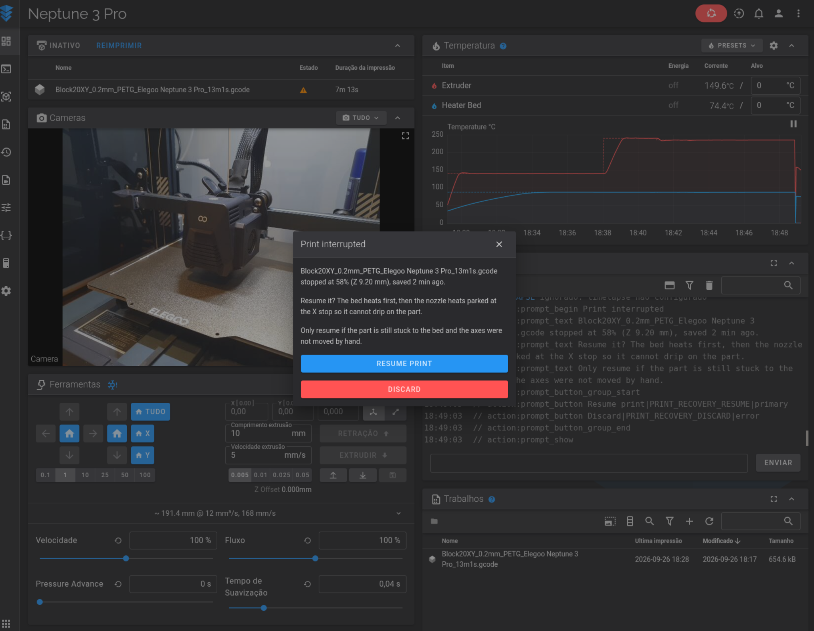

# Recuperación de impresión — reanudar una impresión tras un corte de energía

**Idiomas: [English](../print-recovery.md) · [Português (BR)](../pt-br/print-recovery.md) · [Español](print-recovery.md) · [简体中文](../zh-Hans/print-recovery.md)**

Si la impresora pierde la energía, el cable USB se suelta o Klipper se apaga en
mitad de una impresión, KlipPocket puede ofrecerte **continuar esa impresión
desde donde se detuvo**. Es una función de mejor esfuerzo: funciona mejor con
piezas que siguen firmemente pegadas a la cama.

El teléfono sigue funcionando (tiene batería), así que la posición de la
impresión está a salvo incluso con la impresora apagada.

<p align="center"></p>

## Cómo funciona

1. Mientras imprime, la posición en el archivo G-code, la posición de la
   boquilla, las temperaturas, el ventilador, la velocidad/flujo, el Z offset y
   la malla de la cama se guardan en un pequeño archivo cada **2 segundos**
   (configurable).
2. Cuando la impresora vuelve y Klipper está listo, Fluidd y Mainsail muestran
   una ventana **«Print interrupted»** preguntando si se reanuda.
3. Si tocas **Resume print**, la impresora:
   1. calienta la cama;
   2. levanta la boquilla, hace home **solo de X e Y**, y se mueve al **tope de
      X** (lejos de la pieza) — opcional, consulta `park_enable_x` /
      `park_enable_y`;
   3. calienta ahí la boquilla, para que nada gotee sobre la impresión;
   4. opcionalmente purga un poco de filamento — consulta `purge`;
   5. vuelve a la posición guardada y sigue imprimiendo desde el byte guardado
      del archivo.

**Discard** olvida la impresión, luego levanta la boquilla lejos de la pieza
abandonada (**50 mm** por defecto) y hace home de X e Y — ambos configurables,
consulta `discard_lift_z`, `discard_home_x` y `discard_home_y`. Si cerraste la
ventana, ejecuta `PRINT_RECOVERY_STATUS` en la consola para verla de nuevo
(también reaparece cada minuto mientras hay una impresión en espera).

## Actívalo

Añade esto a `printer.cfg` (en cualquier lugar fuera de otra sección) y
reinicia:

```ini
[print_recovery]
```

Todo lo que sigue es opcional; los valores mostrados son los predeterminados.
Un ajuste que no necesites cambiar se puede dejar fuera sin más. Una línea sin
valor no debe escribirse en absoluto (`park_x`, `park_y` y `state_file` solo se
añaden cuando realmente los configuras).

```ini
[print_recovery]
snapshot_interval: 2
park_enable_x: True
park_enable_y: True
park_speed: 100
lift_z: 10
discard_lift_z: 50
discard_home_x: True
discard_home_y: True
purge: True
purge_length: 20
purge_speed: 5
purge_retract: 2
min_extruded: 5
macro_variables: *
prompt: True
prompt_repeat: 60
```

## Ajustes, línea por línea

Los números son decimales simples (`2`, `0.5`, `-6`). `True`/`False` también
aceptan `1`/`0`, `yes`/`no` y `on`/`off`.

| Ajuste | Qué hace | Valores aceptados |
|---|---|---|
| `snapshot_interval: 2` | Segundos entre guardados de la posición de impresión. Menos = una reanudación más exacta, pero más escrituras. | Número de `0.5` a `300` |
| `park_enable_x: True` | Al reanudar, hace home de X y se mueve al tope de X para calentar la boquilla lejos de la pieza. `False`: X **no** se lleva a home ni se mueve y se supone que está exactamente donde estaba. | `True` / `False` |
| `park_enable_y: True` | Lo mismo para Y. Con ambos en `False` la boquilla solo se levanta `lift_z` y calienta en el sitio encima de la pieza, y se omite la purga (dejaría caer filamento sobre la impresión). Úsalo solo si estás seguro de que nada se movió. | `True` / `False` |
| `park_x: -6` | Posición X que se usa para calentar y purgar una vez hecho el home de X. **Deja la línea fuera** para usar el mínimo de X de la máquina, es decir, el tope de X (p. ej. `-6`, a la izquierda de la cama, en algunas máquinas). | Número dentro del rango de X |
| `park_y: 0` | Lo mismo para Y. **Deja la línea fuera** para quedarte donde el home de Y dejó la boquilla (normalmente el frente de la cama). | Número dentro del rango de Y |
| `park_speed: 100` | Velocidad de desplazamiento al aparcar, en mm/s. | Número mayor que `0` |
| `lift_z: 10` | Milímetros que se levanta la boquilla antes del home de X/Y, para librar la pieza. | Número `0` o más |
| `discard_lift_z: 50` | Milímetros que sube la boquilla al pulsar **Discard**, para librar la pieza abandonada. | Número `0` o más (`0` = no levantar) |
| `discard_home_x: True` | Hace home de X tras **Discard**. | `True` / `False` |
| `discard_home_y: True` | Hace home de Y tras **Discard**. | `True` / `False` |
| `purge: True` | Purga un poco de filamento antes de volver a la impresión. Solo ocurre cuando X o Y están aparcados. | `True` / `False` |
| `purge_length: 20` | Milímetros de filamento a purgar. | Número `0` o más |
| `purge_speed: 5` | Velocidad de purga en mm/s. | Número mayor que `0` |
| `purge_retract: 2` | Milímetros que se retraen tras purgar, para evitar un hilo de filamento. | Número `0` o más |
| `min_extruded: 5` | Milímetros que deben extruirse antes del primer guardado, para que no se guarde nada de una impresión que aún no ha empezado de verdad. | Número `0` o más |
| `macro_variables: *` | De qué macros se guardan y restauran los valores `variable_xxx`. | `*` (todas las macros que no empiecen por `_`), `none` (ninguna macro), o una lista como `PRINT_START, MY_MACRO` |
| `prompt: True` | Muestra la ventana «Print interrupted» en Fluidd/Mainsail. `False`: solo el mensaje en la consola y los comandos de abajo. | `True` / `False` |
| `prompt_repeat: 60` | Segundos entre recordatorios mientras hay una impresión en espera. | Número `0` o más (`0` = mostrar una vez) |
| `state_file: ~/recovery.json` | Dónde se guarda la instantánea. **Deja la línea fuera** para guardarla junto a `printer.cfg`. | Una ruta de archivo (se acepta `~`) |

### Sobrescribir valores al reanudar a mano

`PRINT_RECOVERY_RESUME` acepta los mismos ajustes como parámetros, solo para esa
reanudación:

```gcode
PRINT_RECOVERY_RESUME PARK_ENABLE_X=1 PARK_ENABLE_Y=0 PARK_X=-6 PURGE=0 PURGE_LENGTH=10 LIFT_Z=5
```

| Parámetro | Equivale a | Valores aceptados |
|---|---|---|
| `PARK_ENABLE_X` | `park_enable_x` | `1`/`0`, `True`/`False`, `yes`/`no`, `on`/`off` |
| `PARK_ENABLE_Y` | `park_enable_y` | igual que arriba |
| `PARK_X` | `park_x` | número |
| `PARK_Y` | `park_y` | número |
| `PURGE` | `purge` | igual que arriba |
| `PURGE_LENGTH` | `purge_length` | número `0` o más |
| `LIFT_Z` | `lift_z` | número `0` o más |

`PRINT_RECOVERY_DISCARD` acepta `LIFT_Z` (número `0` o más), `HOME_X` y `HOME_Y`
(los mismos valores de activado/desactivado que arriba). Lo que dejes fuera usa
el valor de `printer.cfg`, o el predeterminado.

## Variables de macros

Si tus macros guardan estado en variables (`variable_xxx:` en su sección, por
ejemplo una macro de inicio o un contador de capas), los valores de la última
instantánea se guardan y se restauran antes de reabrir el archivo. Solo se
conservan los valores simples (números, texto, `True`/`False`, listas). Esto no
deshace lo que una macro hizo fuera de sus variables. Usa `macro_variables` para
guardar solo algunas macros o ninguna.

## Happy Hare (MMU)

Con [Happy Hare](happy-hare.md) en marcha, la instantánea también guarda la
herramienta que usaba la impresión (la que se estaba cargando, si se fue la luz
en mitad de un cambio de herramienta), el mapa de herramientas del slicer y el
número de cambios de herramienta. El propio Happy Hare guarda la puerta, la
herramienta y dónde está el filamento, y lo vuelve a calcular cuando arranca
Klipper.

Al pulsar **Resume**, una vez que la boquilla está caliente y antes de la purga:

1. Si Happy Hare no está seguro de dónde está el filamento, ejecuta
   `MMU_RECOVER STRICT=1` (la boquilla está caliente, así que puede probar el
   filamento moviéndolo).
2. Si la herramienta guardada no es la cargada, o no hay nada cargado, ejecuta
   `T<n>` para descargar lo que haya y cargar la herramienta correcta. Si esa
   herramienta no acaba cargada, la reanudación se detiene con un error y se
   conserva la impresión interrumpida, para que puedas arreglar la MMU e
   intentarlo de nuevo.
3. Ejecuta `MMU_PRINT_START`, de modo que Happy Hare esté en su estado de
   impresión y el engranaje esté sincronizado con el extrusor, y restaura el
   mapa de herramientas del slicer y el contador de cambios de herramienta.

Un filamento en bypass se deja como está. Si Happy Hare está desactivado al
reanudar, se muestra un aviso y la reanudación continúa sin comprobar el
filamento. Aún no probado con una MMU física.

## Comandos

| Comando | Qué hace |
|---|---|
| `PRINT_RECOVERY_STATUS` | Muestra de nuevo la impresión interrumpida y la ventana |
| `PRINT_RECOVERY_RESUME` | La reanuda |
| `PRINT_RECOVERY_DISCARD` | La olvida |

## Cuando la impresora vuelve

- Si Klipper muestra un error como *«Lost communication with MCU»*, pulsa
  **Firmware Restart**. La ventana aparece cuando Klipper está listo.
- **No** muevas los ejes a mano: la reanudación supone que Z no cambió.

## Límites — léelos, por favor

- **Se supone que Z no cambió.** Sin energía los motores se sueltan. Si el
  pórtico bajó o se movió, la boquilla puede tocar la pieza. Por eso la boquilla
  se levanta (`lift_z`) antes de que nada se mueva.
- **La pieza se enfría.** Puede despegarse o deformarse, y normalmente queda una
  línea visible a la altura de la reanudación. Reanuda pronto y solo si la pieza
  sigue pegada.
- Unos segundos de impresión antes de la interrupción se vuelven a imprimir (el
  G-code se lee por adelantado respecto al movimiento); como mucho deja un
  pequeño bulto.
- No hay detector de pérdida de energía en la placa de la impresora, así que la
  boquilla no puede aparcar ni retraerse en el momento del corte.
- Si el archivo G-code se elimina o se modifica, se rechaza la reanudación.
- **Las impresoras delta no son compatibles:** no pueden hacer home de X e Y por
  separado.
- **`G28` personalizado:** si tu configuración sobrescribe el homing (por
  ejemplo un `homing_override` que también hace home de Z), el paso de homing de
  X/Y de la reanudación puede comportarse mal. Comprueba que `G28 X Y` solo haga
  home de X e Y.
- **Las configuraciones multiherramienta** (IDEX, cambiadores de herramienta) no
  se gestionan: solo se guarda y restaura el extrusor activo. **Happy Hare
  (MMU)** sí se gestiona, ver arriba.
- **Ventiladores:** solo se restaura el ventilador de la pieza (`[fan]`). Los
  demás ventiladores (`fan_generic`, de controlador o auxiliares) vuelven a lo
  que establezcan tu configuración o tus macros.
- **Cámara:** los calentadores de cámara y sus temperaturas no se guardan ni se
  restauran.
- El timelapse conserva los fotogramas tomados antes de la interrupción.
  Moonraker registra la reanudación como un trabajo nuevo en el historial.
