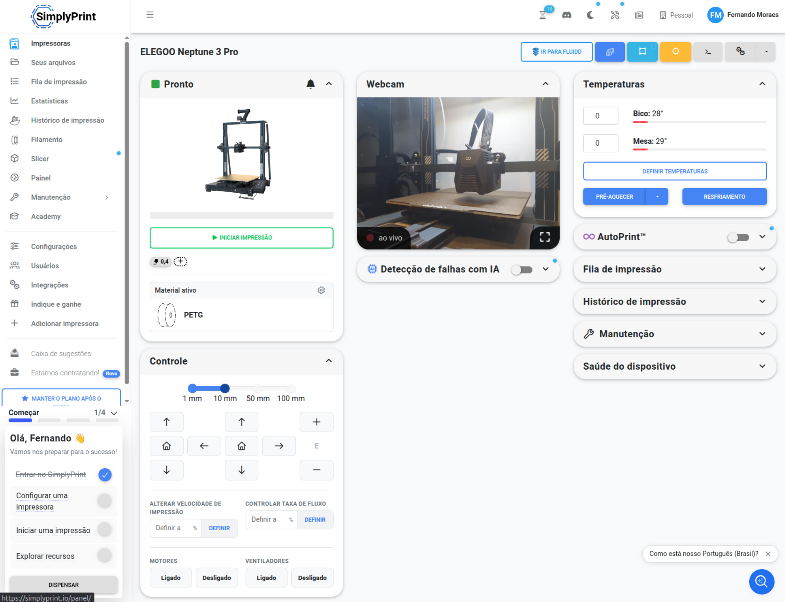

# Usar SimplyPrint

**Idiomas: [English](../simplyprint.md) · [Português (BR)](../pt-br/simplyprint.md) · [Español](simplyprint.md) · [简体中文](../zh-Hans/simplyprint.md)**

[SimplyPrint](https://simplyprint.io) es una plataforma de impresión 3D con
supervisión remota, gestión de impresiones y detección de fallos con IA. El
Moonraker incluido en KlipPocket ya trae la conexión con SimplyPrint, así que
no hay nada que instalar: solo tienes que activarlo en la configuración de
Moonraker y vincular la impresora a tu cuenta de SimplyPrint.

<p align="center"></p>

## Qué necesitas

- Un perfil de impresora **en ejecución** en KlipPocket, con Fluidd o Mainsail
  abierto en tu navegador — consulta [`getting-started.md`](getting-started.md).
- Una cuenta gratuita en [simplyprint.io](https://simplyprint.io).

## 1. Actívalo en `moonraker.conf`

1. Abre `moonraker.conf` en el editor de Fluidd/Mainsail
   (Fluidd: **{…} Configuration**, Mainsail: **Machine**).
2. Añade esta línea al final del todo, si aún no está:

   ```ini
   [simplyprint]
   ```

   > Comprueba antes que el archivo no tenga ya una sección `[simplyprint]`.
   > Una sección duplicada hace que Moonraker se niegue a arrancar.

3. Haz clic en **Save & Restart**.

## 2. Obtén el código de configuración

1. Espera unos segundos a que Moonraker vuelva y haz clic en el icono de la
   **campana** en la barra superior de Fluidd/Mainsail.
2. Abre la notificación **SimplyPrint Setup Request** y copia el código de
   configuración que muestra.

## 3. Vincula la impresora

1. Ve a [simplyprint.io](https://simplyprint.io) e inicia sesión.
2. Elige **Add Printer** y pega el código de configuración.
3. Confirma la conexión. La impresora aparecerá ahora en tu panel de
   SimplyPrint.

Si la impresora ya aparece en **Pending Printers** en SimplyPrint, puedes
añadirla desde ahí sin escribir el código.

## Webcam

SimplyPrint obtiene la cámara del mismo modo que Fluidd/Mainsail: a través de
la propia lista de webcams de Moonraker. Activa el servidor de cámara y añádelo
una vez a Fluidd o Mainsail (la configuración se comparte entre ambos) y
SimplyPrint lo detectará — guía completa con capturas:
[`webcam.md`](webcam.md).

## Notas

- Cada perfil de impresora tiene su propio `moonraker.conf`, así que repite los
  pasos con cada perfil que quieras en SimplyPrint.
- SimplyPrint necesita Moonraker v0.8.0 o posterior; el incluido aquí es más
  reciente.

## Guía oficial

Las instrucciones de SimplyPrint para impresoras con Klipper:
<https://simplyprint.io/setup-guide/methods/klipper-powered>
