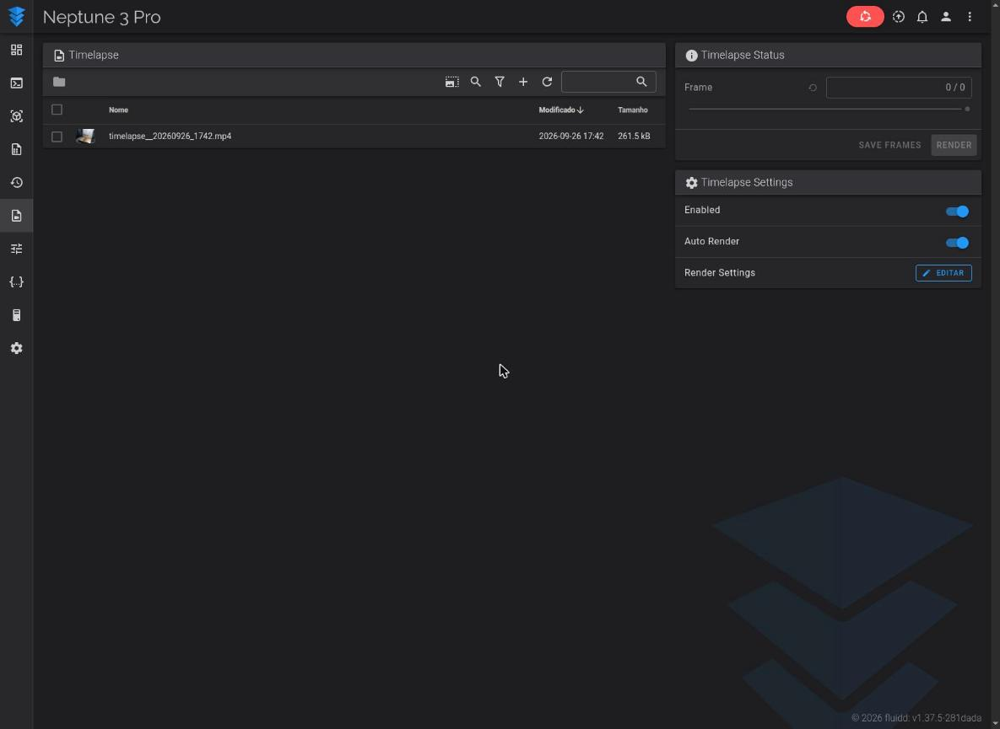

# Timelapse

**Idiomas: [English](../timelapse.md) · [Português (BR)](../pt-br/timelapse.md) · [Español](timelapse.md) · [简体中文](../zh-Hans/timelapse.md)**

KlipPocket incluye el componente Moonraker-timelapse. Durante una impresión
toma una foto de la impresora en cada capa y, cuando la impresión termina,
convierte esas fotos en un vídeo — todo en el teléfono, sin ordenador ni nube.
Lo controlas desde la página **Timelapse** de Fluidd o Mainsail.

## Qué necesitas

- El **servidor de cámara activado** (Ajustes → Cámara → *Activar servidor de
  cámara*), con una cámara apuntando a la impresora — la propia cámara del
  teléfono o una webcam USB. Consulta [webcam.md](webcam.md). Las fotos del
  timelapse vienen de la dirección de instantáneas del servidor de cámara
  `http://127.0.0.1:8889/snapshot`, así que no hay que configurar nada más para
  ello. (Si registraste una webcam en Fluidd/Mainsail, su *Snapshot URL* también
  tiene que funcionar; `http://<IP-del-teléfono>:8889/snapshot` sirve.)
- La impresora ya en marcha en Fluidd/Mainsail — consulta
  [getting-started.md](getting-started.md).

## 1. Activa las macros de timelapse

El archivo de macros `timelapse.cfg` ya está en la carpeta de configuración de
tu impresora, pero la impresora no lo carga hasta que lo incluyas.

1. Abre `printer.cfg` en el editor de Fluidd/Mainsail
   (Fluidd: **{…} Configuration**, Mainsail: **Machine**).
2. Añade esta línea al principio del todo:

   ```ini
   [include timelapse.cfg]
   ```

3. Si tu `printer.cfg` ya tiene un esbozo de `[gcode_macro HYPERLAPSE]` (algunas
   plantillas de impresora incluyen uno — un marcador de posición que solo
   imprime «timelapse not configured»), **elimina esa macro** para que no
   choque con la real de `timelapse.cfg`.
4. Haz clic en **Save & Restart**.

Tras el reinicio existen `TIMELAPSE_TAKE_FRAME`, `TIMELAPSE_RENDER` y
`HYPERLAPSE`, y la página **Timelapse** muestra los interruptores *Enabled* y
*Auto Render*.

<p align="center"></p>

## 2. Haz que cada capa tome una foto

El modo por defecto es **layermacro**: el slicer llama a `TIMELAPSE_TAKE_FRAME`
una vez por capa. Pon ese comando en el G-code de *cambio de capa* de tu slicer:

| Slicer | Dónde |
|---|---|
| PrusaSlicer / SuperSlicer | Printer Settings → Custom G-code → **Before layer change G-code** |
| OrcaSlicer | Printer settings → Machine G-code → **Before layer change G-code** (o el campo *Time lapse G-code*) |
| Cura | Extensions → Post Processing → Modify G-Code → **Insert at layer change** |

Valor a insertar: `TIMELAPSE_TAKE_FRAME`. (Los nombres de los menús cambian un
poco entre versiones.)

**¿Prefieres no tocar el slicer?** Cambia el modo a **hyperlapse** en los
ajustes de timelapse: se toma una foto cada 30 segundos (configurable) durante
toda la impresión, haga lo que haga el slicer.

## 3. Imprime

No hay nada más que hacer. Los fotogramas se recopilan mientras se imprime.
Cuando termina la impresión, **Auto Render** construye el vídeo solo; también
puedes pulsar **Render** en la página Timelapse en cualquier momento, o **Save
Frames** para conservar las fotos originales en un zip.

## Dónde está el vídeo

Los vídeos renderizados aparecen en la página **Timelapse** de Fluidd (menú
izquierdo, *Timelapse*) y de Mainsail (**TIMELAPSE**), junto a una imagen de
vista previa. Abre un archivo ahí para verlo, o usa el menú del archivo para
descargarlo a tu ordenador.

Físicamente los archivos están en el almacenamiento privado de la app, en una
carpeta por impresora:

| Qué | Ruta (dentro del almacenamiento de la app) |
|---|---|
| Vídeos terminados (`timelapse_<archivo>_<fecha>.mp4` + vista previa `.jpg`) | `files/instance/<id-de-impresora>/public/timelapses/` |
| Fotos que se están recopilando para el próximo vídeo | `files/instance/<id-de-impresora>/timelapse_frames/` |

En el teléfono eso es `/data/data/com.brozinga.klippocket/files/…`. Android no
deja que los administradores de archivos ni la galería abran esa carpeta, así
que **usa la página web para sacar tus vídeos**. También puedes descargar uno
directamente desde un navegador de la misma red:

```
http://<IP-del-teléfono>:4408/server/files/timelapse/<nombre-del-vídeo>.mp4     (Fluidd)
http://<IP-del-teléfono>:4409/server/files/timelapse/<nombre-del-vídeo>.mp4     (Mainsail)
```

> ⚠️ Los vídeos se guardan junto con el perfil de impresora. **Eliminar la
> impresora en la app, o desinstalar la app, elimina sus vídeos.** Descarga
> antes los que quieras conservar.

## Sobre el vídeo

- Se codifica en el teléfono con el codificador H.264 por hardware de Android,
  así que no necesita software adicional y es rápido. La imagen se escala para
  caber en **1280×720**.
- La tasa de fotogramas de salida, la calidad y la rotación/volteo se pueden
  cambiar en **Render Settings** en la página Timelapse.
- Las fotos se eliminan automáticamente cuando empieza la siguiente impresión.

## Probarlo sin imprimir

Puedes comprobar toda la cadena en la mesa, con la impresora inactiva:

1. En la consola, ejecuta `_TIMELAPSE_NEW_FRAME HYPERLAPSE=FALSE` cinco o más
   veces (una foto cada vez, sin movimiento del cabezal).
2. En la página Timelapse, pulsa **Render**.
3. Aparece un nuevo `.mp4` en la lista en unos segundos.

## Solución de problemas

| Síntoma | Causa probable |
|---|---|
| `Unknown command: TIMELAPSE_TAKE_FRAME` | Falta `[include timelapse.cfg]`, o no se reinició Klipper. |
| Klipper informa de un problema con `HYPERLAPSE` | Elimina el antiguo esbozo de `[gcode_macro HYPERLAPSE]` (paso 1.3). |
| El contador de fotogramas se queda en 0 | El servidor de cámara está apagado, o la dirección de instantáneas no es accesible. Abre `http://<IP-del-teléfono>:8889/snapshot` en un navegador: debería mostrar una imagen. |
| El renderizado falla enseguida | Usa una versión de la app que incluya la corrección del timelapse — las compilaciones anteriores no podían renderizar en absoluto. |
| No hay nada en la lista tras la impresión | Activa **Auto Render**, o pulsa **Render**; comprueba que el G-code de cambio de capa realmente contiene `TIMELAPSE_TAKE_FRAME`. |
