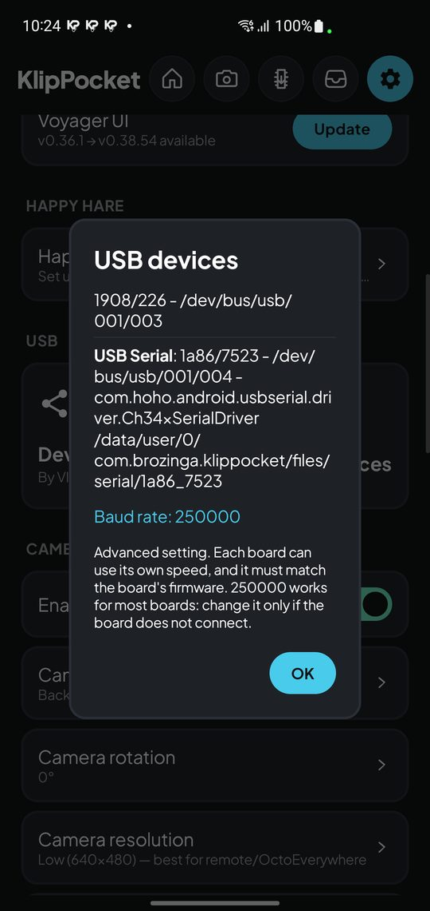
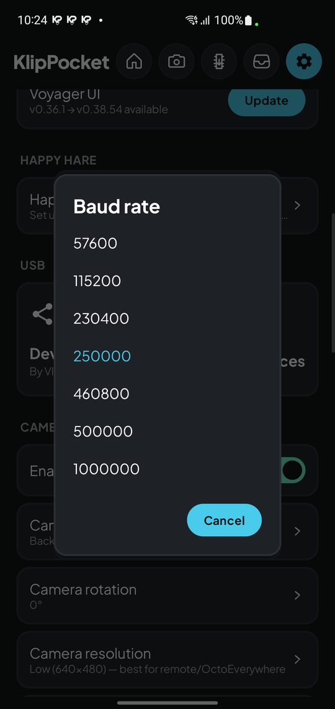
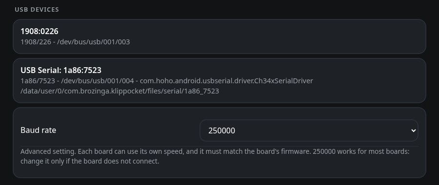

# Cambiar la velocidad en baudios del USB

**Idiomas: [English](../usb-baud-rate.md) · [Português (BR)](../pt-br/usb-baud-rate.md) · [Español](usb-baud-rate.md) · [简体中文](../zh-Hans/usb-baud-rate.md)**

La **velocidad en baudios** (baud rate) es la velocidad del enlace serie entre
KlipPocket y el microcontrolador (MCU) de una placa. Es un **ajuste avanzado**,
elegido **por placa**, y **en la mayoría de los casos el valor por defecto,
250000, ya funciona**. Cámbialo solo si KlipPocket no consigue conectarse al
MCU.

## Por qué cada placa usa una velocidad distinta

La mayoría de las placas llegan al teléfono mediante un pequeño **adaptador
USB-serie** (un chip CH340, CP210x o FTDI, por ejemplo) conectado a una UART
del MCU. Una UART no tiene línea de reloj: cada lado simplemente cuenta el
tiempo, así que **ambos extremos deben configurarse de antemano a la misma
velocidad**, o lo que envía uno le parece ruido al otro. No hay negociación
automática.

La velocidad del lado del MCU queda fijada al compilar su firmware
(`CONFIG_SERIAL_BAUD`, «Baud rate for serial port» en el `make menuconfig` de
Klipper):

- **250000** es el valor por defecto de Klipper: más rápido que el clásico
  115200, así que hay más margen para los datos que envía una impresora (muchos
  motores paso a paso, sensores, input shaping), y es una velocidad que la
  mayoría de los chips pueden generar con precisión.
- **115200** es el valor tradicional de muchos otros firmwares y bootloaders,
  así que algunas placas (o firmwares compilados con otras herramientas) lo
  usan.
- Las velocidades **más bajas** (57600) pueden ayudar con cables largos o con
  ruido; las **más altas** (460800, 500000, 1000000) dan más margen cuando
  circulan muchos datos.

Las placas que se conectan con el **USB nativo del propio MCU** no usan
velocidad en baudios en absoluto: el ajuste no les afecta. Como cada placa
puede compilarse de forma distinta, la velocidad se elige **para cada placa**
(cada MCU puede usar una diferente, incluso con varias conectadas a la vez).

> Manda el firmware. El valor de la app debe ser **el mismo que el del
> firmware**. Comprueba el que usa tu placa (`CONFIG_SERIAL_BAUD`, o el valor
> `SERIAL_BAUD=` en la línea `MCU 'mcu' config:` del registro de Klipper) antes
> de cambiar nada.

## Cuándo cambiarla

Deja 250000 a menos que la placa no se conecte, por ejemplo cuando Klipper
nunca sale de *Iniciando* y el registro termina en `Unable to connect`,
`Timeout on connect` o `Lost communication with MCU`, y el cable, el permiso y
el nombre del puerto están bien.

## En la app

1. Abre **Ajustes → USB → Listar dispositivos USB**.
2. Cada placa que la app puede abrir como puerto serie muestra su **Velocidad
   en baudios**. Tócala y elige la velocidad del firmware de tu placa.

 

La nueva velocidad se guarda para esa placa y se **aplica al instante**, sin
desconectar nada.

## En el Dashboard

En la lista **USB devices** del [Dashboard](dashboard.md), cada placa que la app
abre como puerto serie tiene un selector **Baud rate**. Elegir un valor hace lo
mismo que en la app.

## Conviene saber

- **No cambia nada hasta que lo cambies.** Cada placa empieza en 250000; solo se
  guarda una velocidad para las placas que cambies, y elegir 250000 otra vez la
  olvida.
- **Es por placa**, identificada por el mismo nombre que su puerto serie. Con
  **Nombre del dispositivo** en *Por ruta*, una placa que se conecta a otro
  puerto o que se reinicia obtiene una ruta nueva y vuelve a 250000; usa **Por
  VID/PID** para conservar la elección (dos placas con el mismo VID/PID
  comparten nombre y, por tanto, velocidad).
- **Las demás funciones USB no se ven afectadas**: flashear firmware desde la
  app tiene sus propias velocidades.
- **Cámbiala con la impresora inactiva.** Una velocidad equivocada hace que
  Klipper pierda el MCU, lo que interrumpe una impresión. Si pasa, vuelve a
  poner la velocidad correcta y envía `FIRMWARE_RESTART` (una o dos veces); si
  el MCU se queda en *shutdown*, apaga y enciende la impresora.
