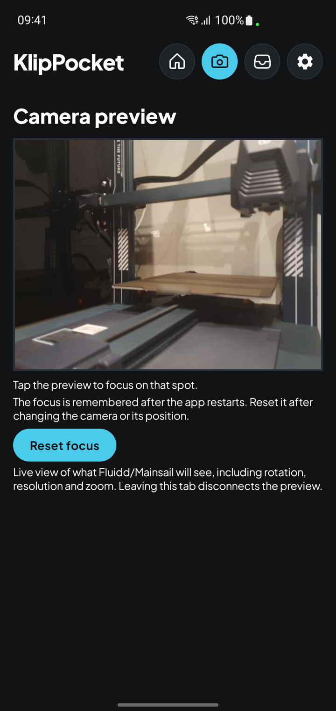
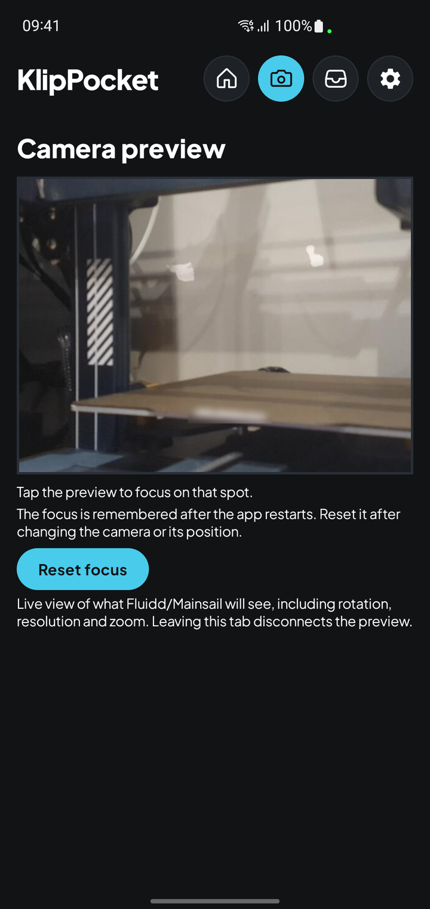
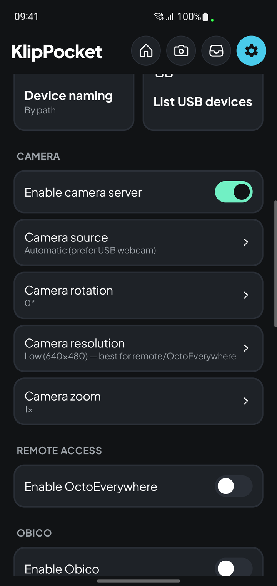
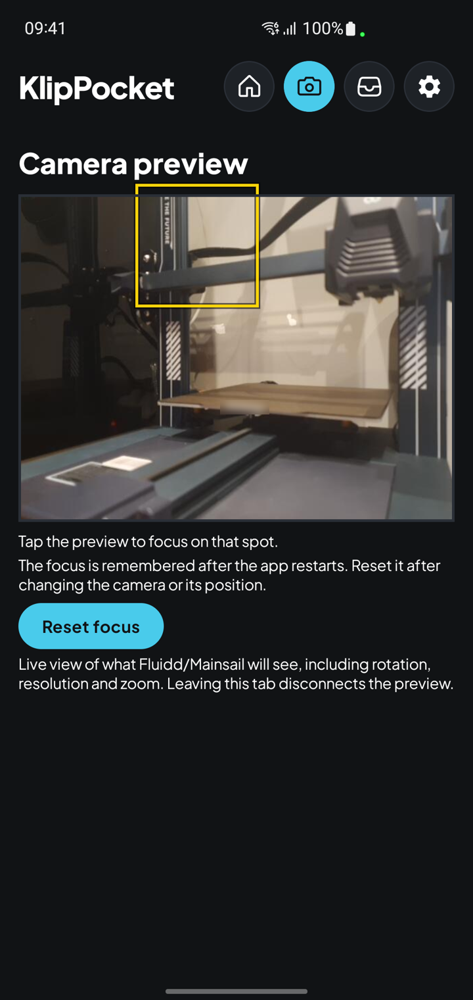
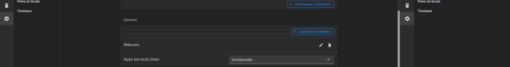
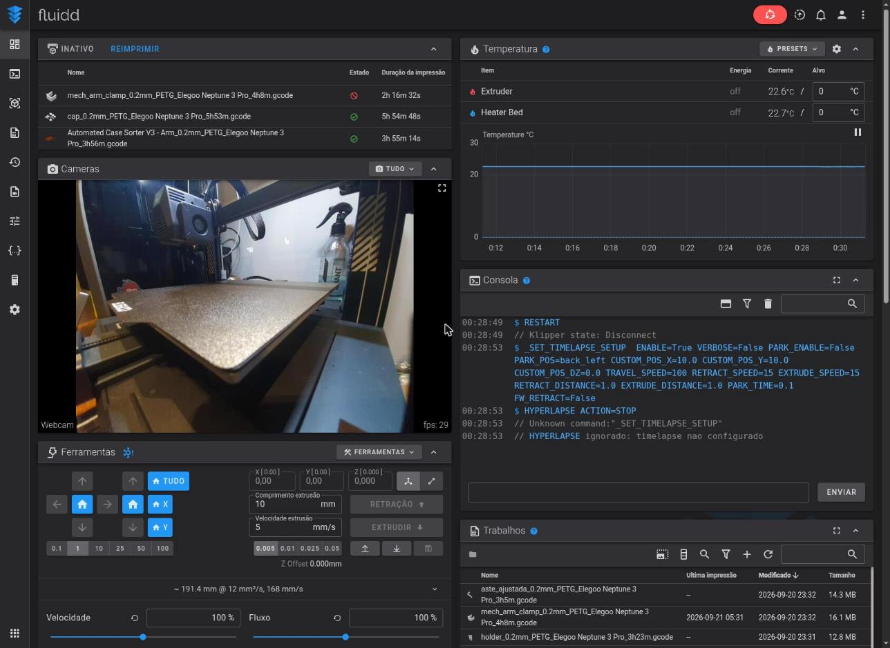
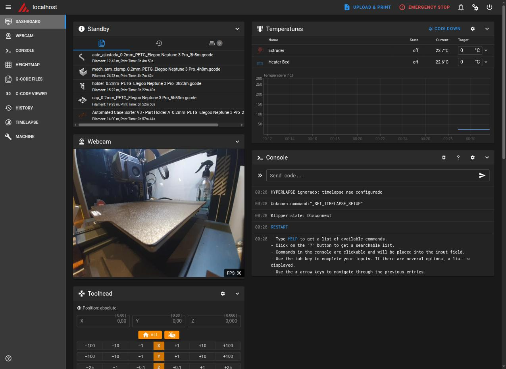

# Usar la cámara / webcam USB

**Idiomas: [English](../webcam.md) · [Português (BR)](../pt-br/webcam.md) · [Español](webcam.md) · [简体中文](../zh-Hans/webcam.md)**

KlipPocket puede transmitir una imagen de cámara en vivo para supervisar la
impresión — ya sea la propia cámara integrada del dispositivo o una webcam USB
UVC conectada mediante OTG o un hub.

<p align="center"></p>

## Activarla

1. **Ajustes → Cámara → Activar servidor de cámara.**
2. **Fuente de cámara** te permite elegir qué cámara usar:
   - **Automática** (por defecto) — prefiere una webcam USB conectada antes que
     la cámara integrada, y cambia en vivo si conectas/desconectas una mientras
     el servidor está en marcha.
   - O fija una cámara concreta. En dispositivos con varias lentes por cara
     (principal/ultra gran angular/teleobjetivo atrás, a veces dos delante),
     cada una se lista por separado con su distancia focal equivalente en 35 mm
     — p. ej. «Cámara trasera 1 (26mm)» frente a «Cámara trasera 2 (14mm)» — el
     mismo número con el que se anuncia tu teléfono, así que de verdad se pueden
     distinguir.
3. **Rotación de la cámara** recorre 0°/90°/180°/270°, para un teléfono montado
   de lado o al revés.

La imagen se sirve en `http://<IP-del-dispositivo>:8889/` (transmisión) y
`http://<IP-del-dispositivo>:8889/snapshot` (un solo JPEG), con independencia del
puerto en el que estén funcionando Fluidd/Mainsail. Las direcciones al estilo
webcam `http://<IP-del-dispositivo>:8889/webcam/?action=stream` y
`http://<IP-del-dispositivo>:8889/webcam/?action=snapshot` responden con la misma
transmisión e instantánea, para las herramientas que las esperan.

### Pestaña de vista previa en vivo

Mientras el servidor de cámara está activado, aparece una **pestaña de cámara**
en la barra superior junto a Registros. Muestra la transmisión en vivo — justo
lo que reciben Fluidd/Mainsail, incluidas la rotación, la resolución y el zoom
— para que puedas comprobar el encuadre sin abrir un navegador. La primera vez,
la app pide el **permiso de cámara** (también se pide al activar el servidor).
Salir de la pestaña desconecta la vista previa, así que no cuesta nada cuando
no se usa. El servidor de cámara sigue al interruptor **Activar servidor de
cámara**, no a las impresoras: la vista previa funciona aunque no haya ninguna
impresora en marcha.

<p align="center"> </p>

### Zoom

**Ajustes → Cámara → Zoom de la cámara** recorre los niveles de zoom (1×, 1.5×,
2×, 3× … hasta 10×). Solo se ofrecen los niveles que la **cámara seleccionada
realmente admite** — el ultra gran angular de un teléfono, el teleobjetivo y una
webcam USB informan cada uno de límites distintos — y la lista se actualiza al
cambiar la fuente de cámara. Si una cámara no tiene zoom, la fila muestra «No
compatible con esta cámara». Cambiar el zoom reinicia brevemente el servidor de
cámara.

<p align="center"></p>

### Tocar para enfocar

En la **pestaña de vista previa de la cámara**, toca en cualquier punto de la
imagen para enfocar en ese lugar. Un cuadrado amarillo muestra dónde se pidió el
enfoque, se cierra sobre el punto y se desvanece. La lente enfoca una vez en esa
zona y lo mantiene, y Fluidd/Mainsail también ven el nuevo enfoque porque
reciben la misma transmisión.

<p align="center"></p>

- Funciona en cámaras cuyo hardware admite enfocar en una zona elegida (la
  mayoría de las cámaras de teléfono). Si la cámara seleccionada no puede — muchas
  webcams USB solo tienen un enfoque fijo o continuo — la indicación bajo la vista
  previa dice «Esta cámara no admite enfoque táctil.» y los toques no hacen
  nada, así que nada se rompe.
- El toque cae en el punto correcto incluso con **rotación** y **zoom**
  configurados.
- **El enfoque se recuerda.** Una vez que la lente ha enfocado, la app lo
  guarda, así que reiniciar la app o el teléfono no lo pierde. No hay que hacer
  nada si el enfoque ya es bueno.
- Cambiar a **otra cámara** olvida el enfoque guardado (enfocas la nueva de
  nuevo). Toca **Restablecer enfoque**, bajo la vista previa, para olvidarlo tú
  mismo — por ejemplo tras mover la cámara.
- Cambiar el enfoque con el ajuste de enfoque manual también sustituye al
  guardado.
- También funciona en teléfonos antiguos (Android 5.0+): usa solo los controles
  de enfoque estándar de Camera2 y comprueba lo que informa la cámara antes de
  activarse.

### Flash (luz del teléfono)

Con una cámara que tenga flash (normalmente la trasera), la **pestaña de
cámara** — en la app y en el Dashboard — muestra un botón **Flash encendido /
Flash apagado** que ilumina la impresión. El estado se recuerda. Las cámaras sin
flash (frontal, webcams USB) muestran en su lugar «Esta cámara no tiene flash.».

Para activarlo desde **Fluidd/Mainsail**, añádelo al `moonraker.conf` de la
impresora como dispositivo de energía; entonces aparece junto a los demás
dispositivos y se puede alternar desde ahí:

```ini
[power phone_flash]
type: http
on_url: http://127.0.0.1:8889/torch/on
off_url: http://127.0.0.1:8889/torch/off
status_url: http://127.0.0.1:8889/torch/status
response_template:
  
  {resp["state"]}
```

El flash solo se enciende mientras el servidor de cámara está activado. Las
direcciones `/torch/on`, `/torch/off`, `/torch/toggle` y `/torch/status` solo
responden al propio teléfono (el Moonraker de la impresora), nunca a otros
dispositivos de la red.

#### Macros (opcional)

El G-code no puede llamar a HTTP por sí solo, pero Klipper puede pedir a
Moonraker que cambie un dispositivo de energía. Añade esto a `printer.cfg` y
ejecuta `RESTART`:

```ini
[gcode_macro FLASH_ON]
gcode:
  {action_call_remote_method("set_device_power", device="phone_flash", state="on")}

[gcode_macro FLASH_OFF]
gcode:
  {action_call_remote_method("set_device_power", device="phone_flash", state="off")}

[gcode_macro FLASH_TOGGLE]
gcode:
  {action_call_remote_method("set_device_power", device="phone_flash", state="toggle")}
```

Aparecen como botones en el panel de macros de Fluidd/Mainsail, y puedes llamar a
`FLASH_ON` en `PRINT_START` y a `FLASH_OFF` en `PRINT_END` para iluminar la
impresión solo mientras se ejecuta. El nombre de `device=` debe coincidir con la
sección `[power phone_flash]` de arriba (sin espacios en el nombre).

Dónde aparece el interruptor: en **Fluidd** está en el menú de energía de la
barra superior; en **Mainsail** está en el menú de energía del encabezado y en el
panel **Power** del dashboard (cuando se activa en los ajustes de la interfaz).
Tras editar `moonraker.conf`, reinicia Moonraker.

### Compatibilidad con webcams USB

Depende de que el dispositivo exponga la webcam USB a través de la API estándar
Camera2 de Android como cámara externa (`LENS_FACING_EXTERNAL`), algo que la
mayoría de los dispositivos basados en AOSP admiten desde Android 9 pero que
algunas pilas de cámara de fabricantes no. En dispositivos cuyo HAL de cámara no
implementa el proveedor de cámara externa, una webcam USB UVC puede detectarse a
nivel de SO/USB pero no exponerse a través de Camera2. En ese caso la app recurre
sin problemas a la cámara integrada; los dispositivos más cercanos a AOSP puro
(algunas cajas/tablets con Android TV) tienen más probabilidades de exponer la
webcam.

## Añadirla a Fluidd o Mainsail

Fluidd y Mainsail leen su lista de webcams del mismo sitio — la propia
configuración de webcams de Moonraker para esa instancia de impresora — así que
solo tienes que añadirla **una vez**, en cualquiera de las dos interfaces, y
aparece en ambas.

**En Fluidd:** icono de engranaje (Settings) → **Cameras** → **+ Add Camera**:

<p align="center"></p>

| Campo | Valor |
|---|---|
| Name | lo que quieras, p. ej. «USB Cam» |
| Service | `MJPEG-Streamer` |
| Stream URL | `http://<IP-del-dispositivo>:8889/` (o `http://<IP-del-dispositivo>:8889/webcam/?action=stream`) |
| Snapshot URL | `http://<IP-del-dispositivo>:8889/snapshot` (o `http://<IP-del-dispositivo>:8889/webcam/?action=snapshot`) |

Usa `127.0.0.1` solo si estás viendo Fluidd en un navegador del propio teléfono;
desde otro dispositivo, usa la IP LAN del teléfono (la misma que ya está en tu
URL de Fluidd/Mainsail).

<p align="center"></p>

**En Mainsail:** el formulario equivalente para añadir una cámara está en
**Machine → Webcams**. Usa el tipo de servicio `UV4L-MJPEG` con las mismas URL
de transmisión/instantánea de arriba. Como la configuración se comparte,
añadirla en Fluidd basta — aquí está la misma webcam ya mostrándose en vivo en
el dashboard de Mainsail tras añadirla una vez en Fluidd:

<p align="center"></p>

OctoEverywhere también detecta automáticamente esta misma webcam una vez
configurada aquí — consulta [`octoeverywhere.md`](octoeverywhere.md).

## Solución de problemas

- **Fluidd/Mainsail rechaza la webcam / muestra un error, pero la URL de la
  transmisión funciona bien en una pestaña normal del navegador o con `curl`:**
  era un fallo real (ya corregido) en el que `/snapshot` enviaba un
  `Content-Type` incorrecto. Asegúrate de usar una versión que lo incluya — la
  respuesta debe ser `Content-Type: image/jpeg`, no
  `multipart/x-mixed-replace`.
- **La imagen va entrecortada o lenta al verla a través de OctoEverywhere en
  concreto (pero bien en local):** la resolución/calidad/tasa de fotogramas por
  defecto ya están ajustadas para esto (se midieron ~117 KB/s a 640×480/~14 fps,
  frente a ~1,25 MB/s con el antiguo valor de 720p) — una conexión retransmitida
  por la nube tiene mucho menos ancho de banda que tu LAN. Si sigue siendo
  demasiado lento para tu subida, o quieres más, el tope de FPS y la resolución
  se pueden ajustar (`CameraService`/`Prefs.cameraWidth`/`cameraHeight` en el
  código fuente) — aún no hay un control en la interfaz para esto.
