# Firmware web page — flash firmware from a browser (port 4400)

**Languages: [English](firmware-web.md) · [Português (BR)](pt-br/firmware-web.md) · [简体中文](zh-Hans/firmware-web.md)**

The app serves a small web page on **port 4400** that does what the
[Firmware tab](firmware-tab.md) does, but from the browser of a PC or another
phone on the same network: send a firmware file, paste a download link, see the
USB devices connected to the phone and flash a board. The page only talks to the
app: the upload, the download and the writing are done by the same code as the
tab, so both always agree.

The page is **always available while the app is open** (it does not need a printer to be
running), and a small notification keeps it reachable while the app is in the
background.

## Open the page

In the app, open the **Firmware** tab and scroll to **Web page**: it shows the
address (`http://<phone IP>:4400`) and a six-digit **PIN**.

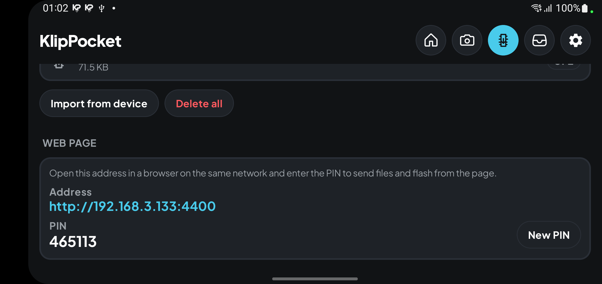

Open the address in any browser on the same network and type the PIN. **New PIN**
in the app replaces it and closes every open page.

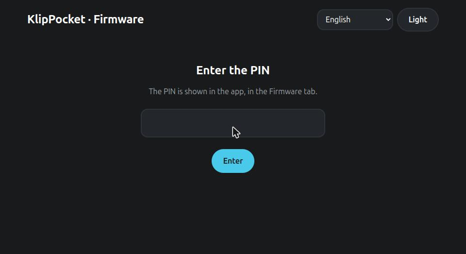

> **Why a PIN?** Whoever reaches the page can flash a board plugged into the
> phone. Everything except the page's own files needs the PIN; after five wrong
> tries the address is locked for a minute. The page uses plain HTTP, like the
> other pages of the app, so use it on a network you trust.

## The home screen

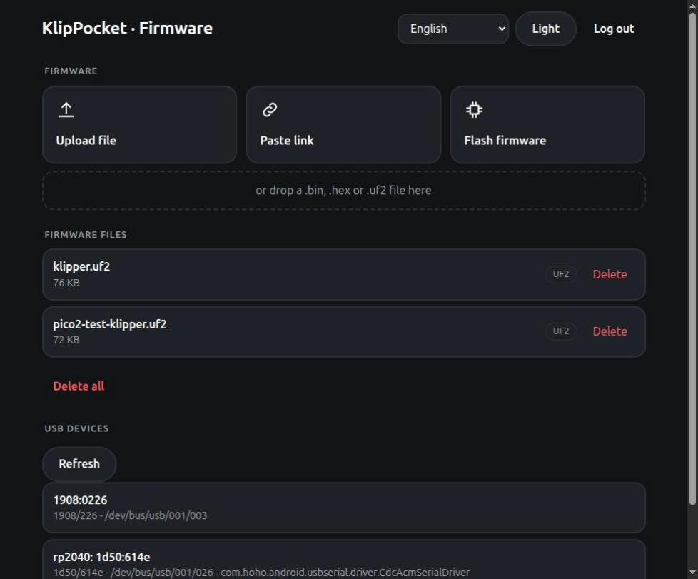

- **Upload file** — pick a file or drop it on the dashed area. `.bin`, `.hex`
  and `.uf2`, up to 16 MB. It is saved in the app's firmware folder (the same
  list as the tab). A loading screen shows the progress.

  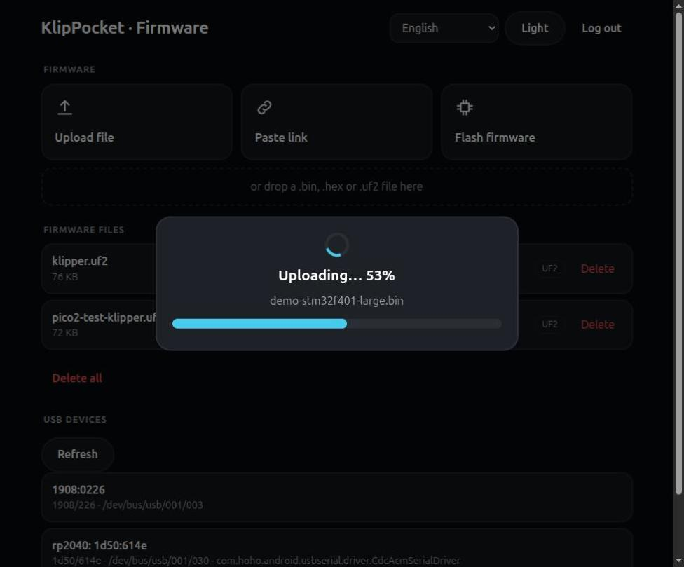

- **Paste link** — paste the link of a firmware file (https only), for example
  `https://github.com/utkabobr/klipper/releases/download/prebuilt-v0.12.0/stm32f401.bin`,
  and **Download**. The app downloads it itself, so the phone needs internet.

  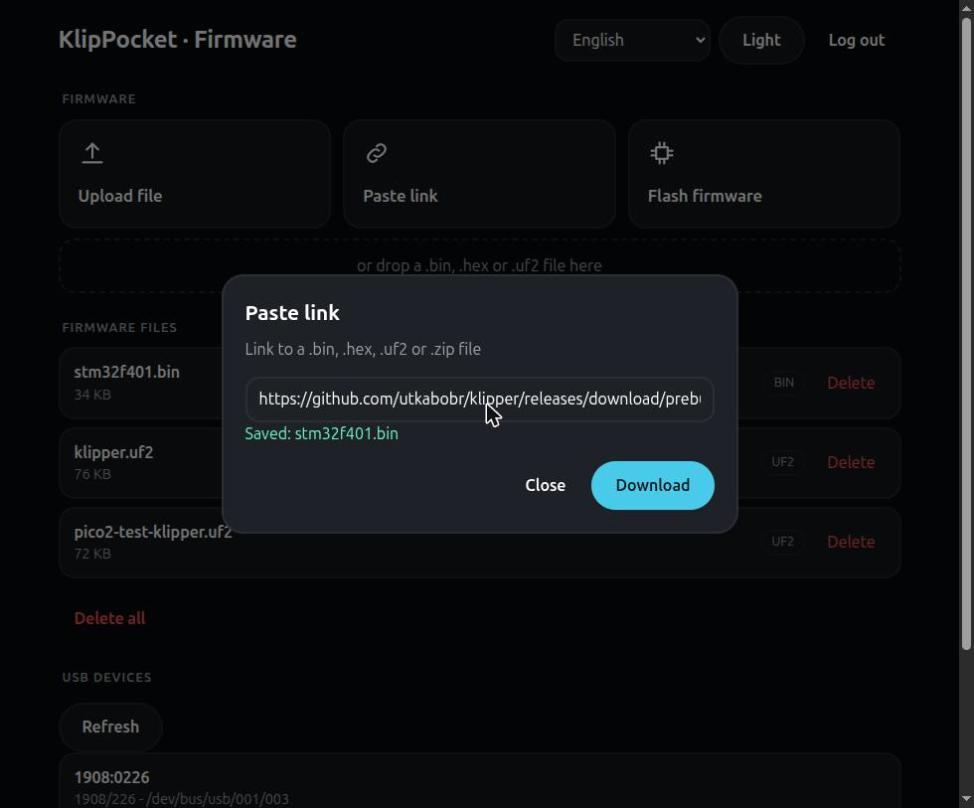

- **Firmware files** — what is stored, with **Delete** and **Delete all**.
- **USB devices** — every device the phone sees, with name, `VID/PID`, bus path
  and, for serial boards, the port used by `printer.cfg`: the same list as
  *List USB devices* in the app. **Refresh** reads it again after you plug or
  unplug a board (it also refreshes by itself).
- **Flash firmware** — the assistant below.

## Flash a firmware

**Flash firmware** first warns that the function is **experimental** and may
cause problems; **Continue** starts the four steps.

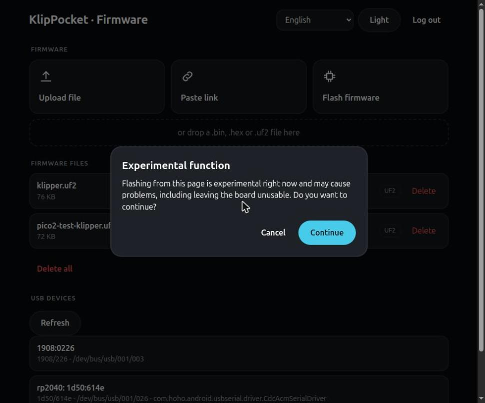

| 1 — File | 2 — Device |
|---|---|
| 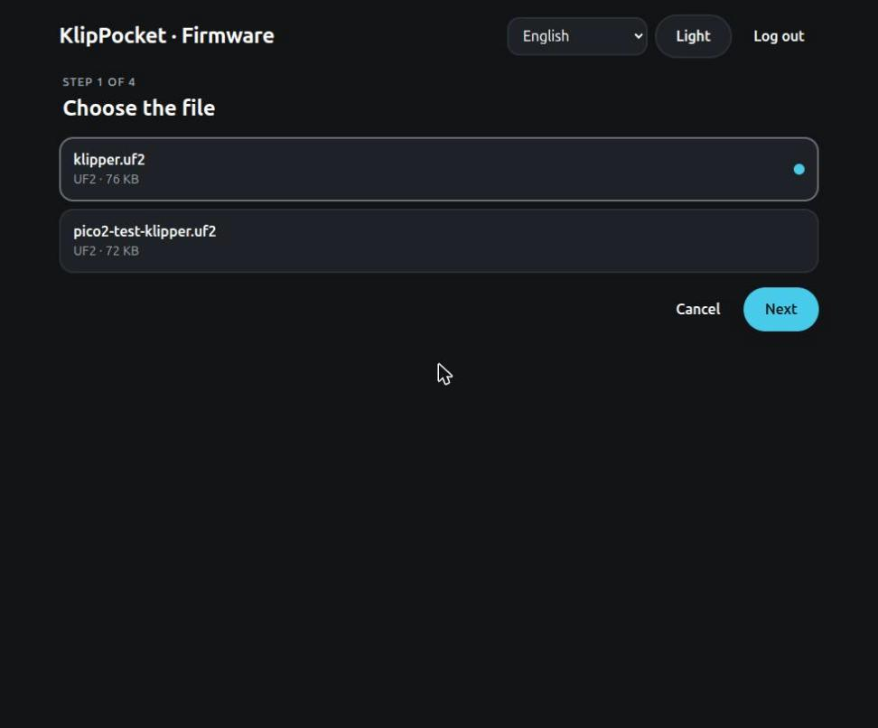 | 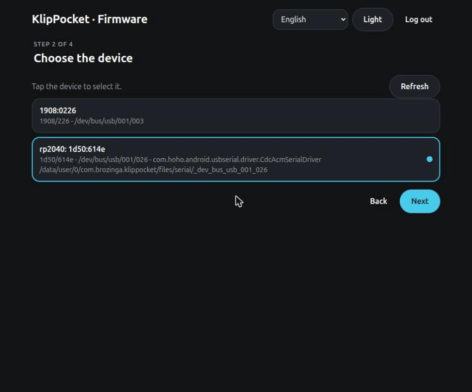 |

**1** pick the file; **2** pick the device (with **Refresh**); **3** pick the mode.

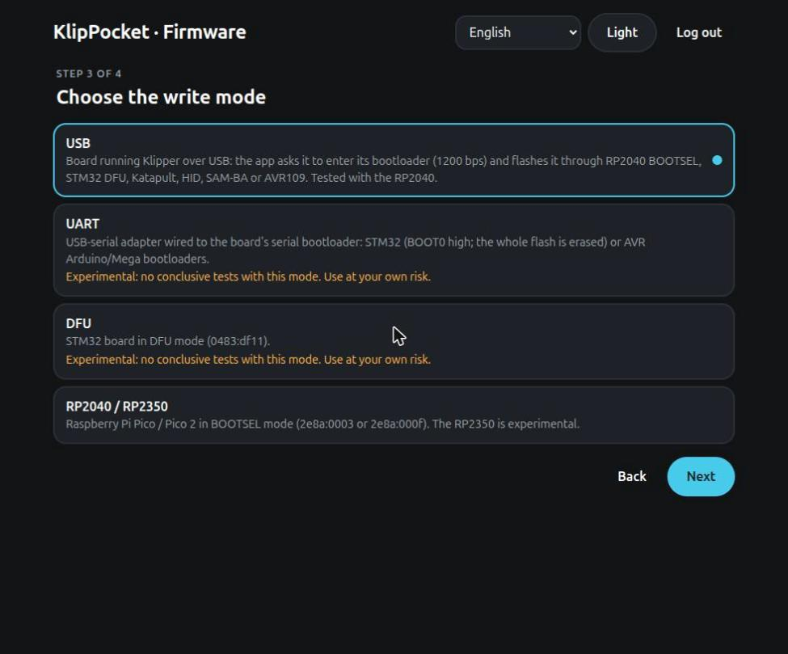

The modes are **USB**, **UART**, **DFU** and **RP2040 / RP2350**, with the same
rules, notes and *experimental* marks as the [tab](firmware-tab.md#modes-what-works-and-what-is-experimental).
For a raw `.bin` on an STM32 a **start address** field appears. (The Katapult,
HID-Flash, SAM-BA and CAN modes of the app are not on the page yet: use the tab.)

**4** a warning that the process can damage the board: **Confirm** starts it,
**Cancel** changes nothing.

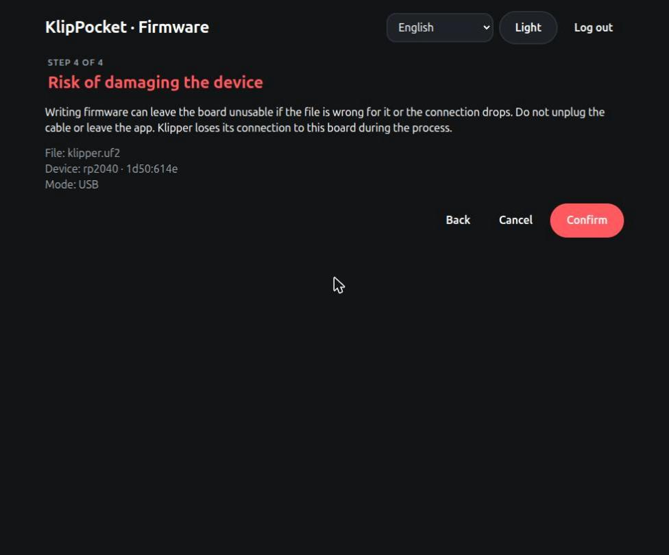

Then a loading screen shows the stage and the percentage (Android may ask for
USB permission **on the phone**: accept it there). At the end the page says if it
worked, and if not, **why**:

| | |
|---|---|
| 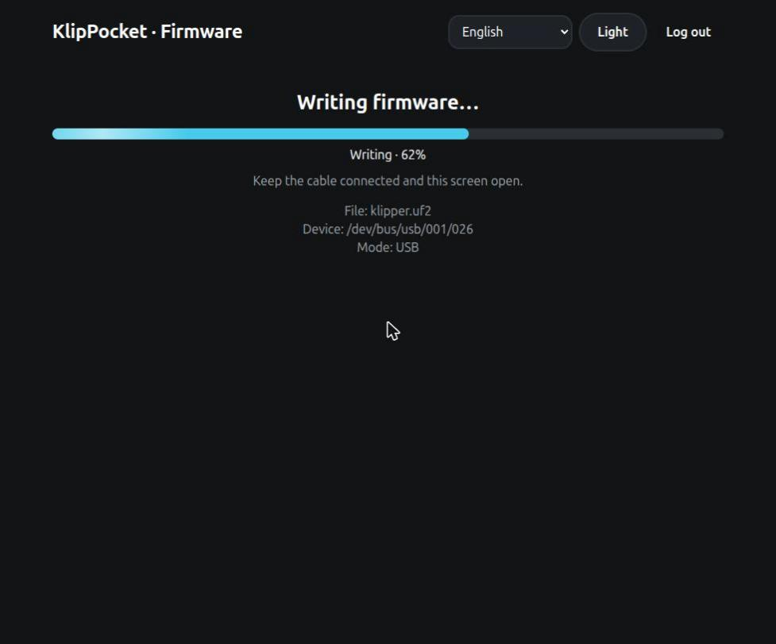 | 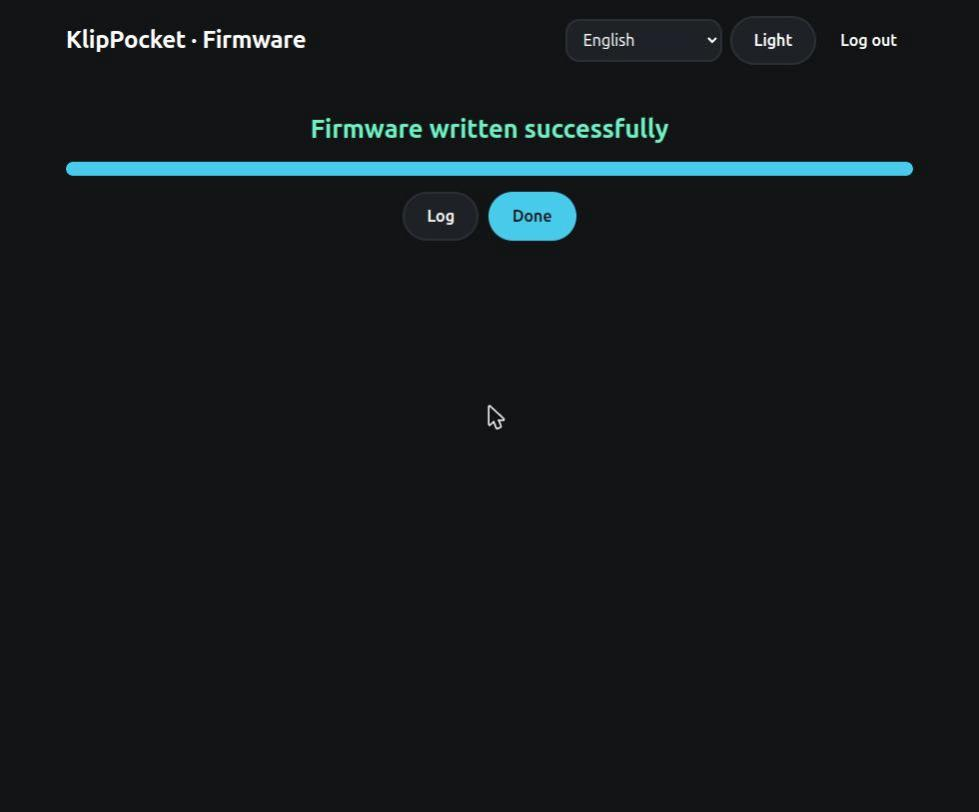 |
| 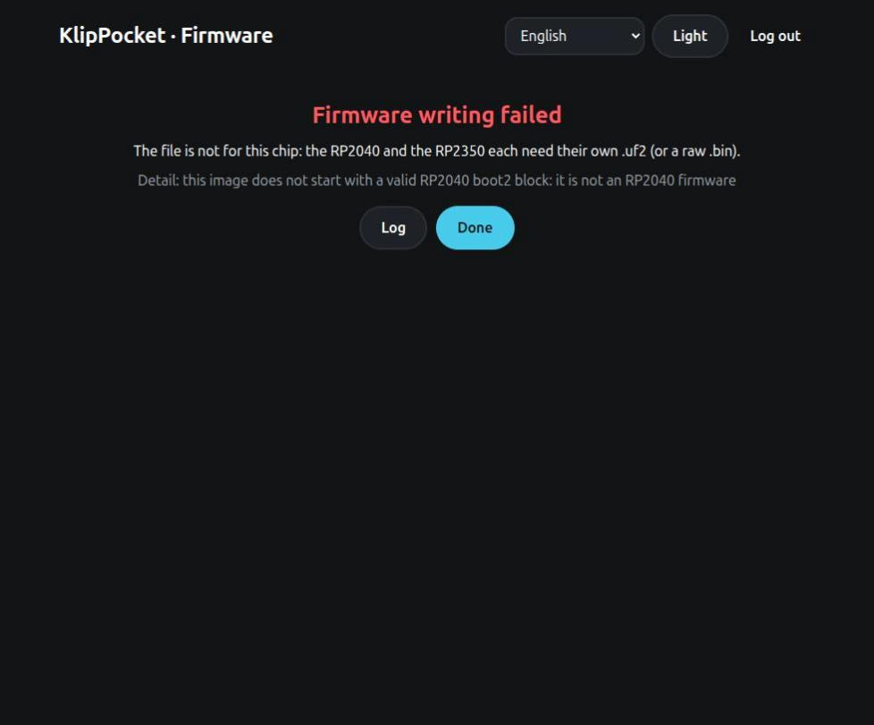 | |

**Log** shows the end of the *Firmware flashing* log of the app; **Done** closes the result.

### If you reload or close the page

The write runs inside the app, not in the page. Reload the page, close the tab,
open it on another device: it goes straight back to the progress screen (or to the
result, if the write has ended and nobody closed it yet). The step you were on
(file, device, mode) is remembered in the browser until you confirm.

## Language and theme

The page offers the five languages of the app and follows the app's language and
light/dark theme the first time; the choice you make on the page is remembered
by the browser.

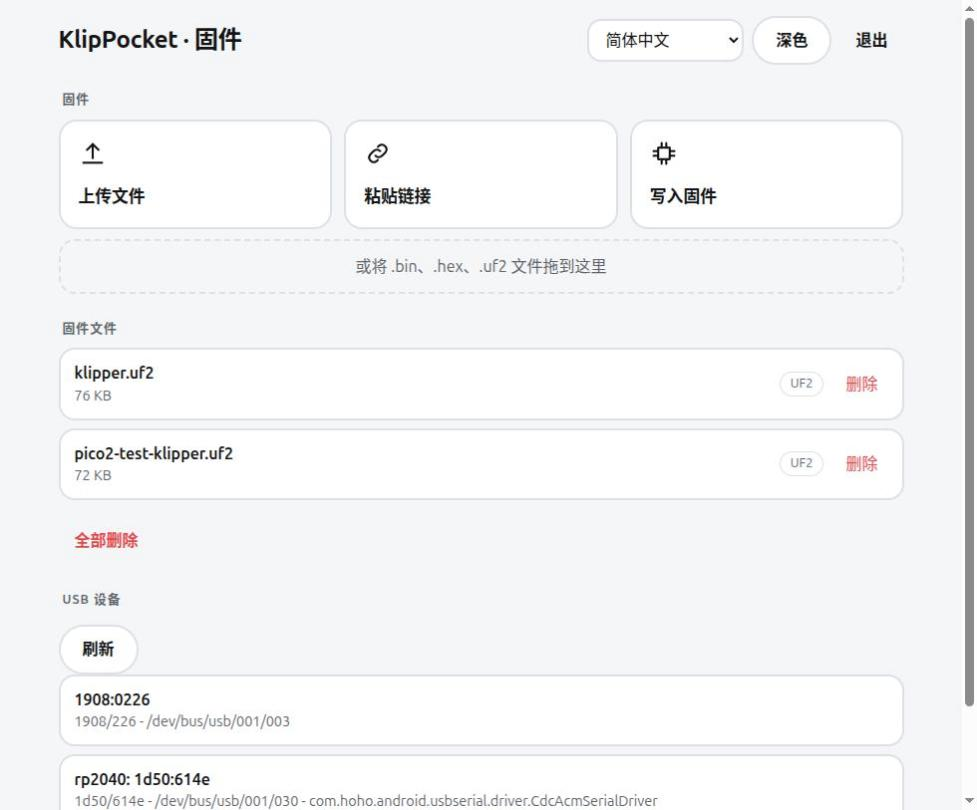

## If something goes wrong

| What you see | What to do |
|---|---|
| The page does not open | Phone and computer must be on the same Wi-Fi without *client isolation*; use the address shown in the app. If port 4400 is used by another app, the card in the Firmware tab says the page is not running. |
| *Too many attempts* | Wait the shown seconds, or use **New PIN** in the app. |
| *Connection to the app lost* | The app was closed or the phone went to sleep: open the app again. A write in progress is not lost while the app is alive. |
| A write failure | The messages are the ones of the [tab](firmware-tab.md#if-something-goes-wrong). |

## For developers

Everything under `/api` needs the session cookie of the PIN login and, when it
changes something, the header `X-KlipPocket: 1`. Main routes: `GET /api/state`,
`PUT /api/upload?name=…`, `POST /api/download`, `GET /api/devices`,
`POST /api/flash`, `GET /api/flash`, `POST /api/flash/reset`. The code is in
`app/src/main/java/ru/ytkab0bp/beamklipper/firmwareweb/` and the page in
`app/src/main/assets/firmware_web/`; its texts are generated from the app's
strings with `scripts/gen_firmware_web_i18n.py`.
