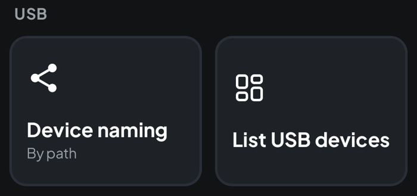
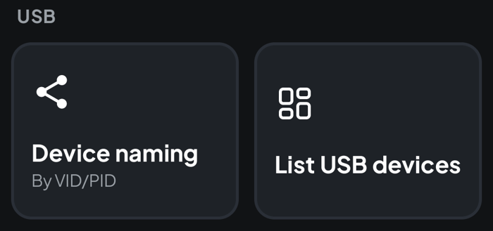
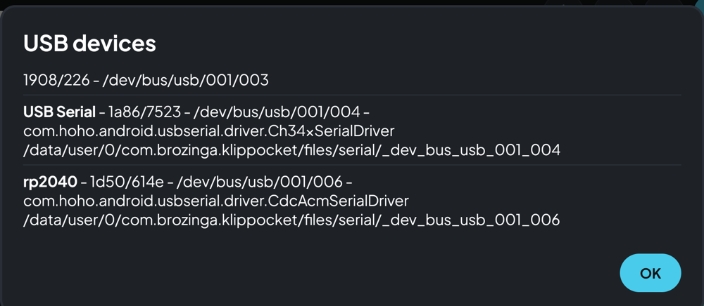
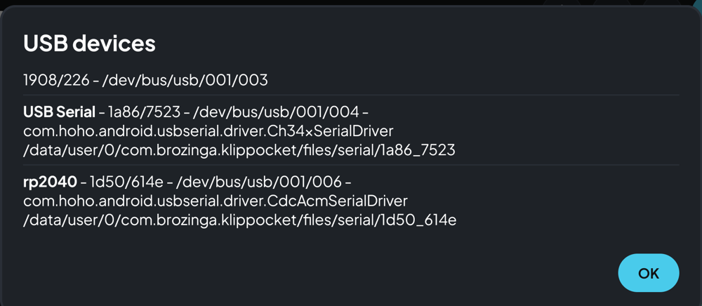

# Using more than one MCU (multi-MCU)

**Languages: [English](multi-mcu.md) · [Português (BR)](pt-br/multi-mcu.md) · [简体中文](zh-Hans/multi-mcu.md)**

Some printers use a second board next to the main one: a toolhead board, a
board that adds ports (stepper drivers, endstops, fans), or a small board that
only carries a sensor (accelerometer, eddy-current probe). In Klipper each one
is an extra `[mcu name]` section.

KlipPocket has **no dedicated multi-MCU screen**. It can still work by hand,
because the app gives every USB board its own virtual serial port, and you write
that port in `printer.cfg`. This page shows how.

> **Not tested with two boards yet.** The steps below follow how the app
> handles USB devices today. If you try it, please report how it went.

## What works and what does not

| Setup | In the app |
|---|---|
| Extra board flashed with **USB** firmware (Klipper USB / CDC) | Possible, as described here |
| Extra board on **CAN bus** (including a USB-to-CAN adapter) | **Not supported** — Android gives apps no CAN interface |
| Boards that only provide **UART** pins | Not supported — the app speaks USB only |

So the extra board has to be built with a **USB** interface in the
[firmware build](build-firmware.md) and flashed to it. Many boards ship with
CAN firmware or can be flashed either way, so check which one yours has.

## What you need

- Every board reachable over USB from the phone/tablet: a **powered USB hub** is
  strongly recommended, since the device cannot power several boards.
- Motors and heaters on the extra board still need their own supply: USB only
  powers the board's logic.
- Each board flashed with Klipper firmware (USB interface).

## Step 1 — Choose how devices are named

Open **Settings → USB**. **Device naming** decides the name of each virtual
serial port. Tapping it switches between the two modes:

| By path | By VID/PID |
|---|---|
|  |  |

- **By VID/PID** — named after the USB vendor/product id, e.g. `1a86_7523`. It
  keeps the same name if you move the cable to another port. Use it when your
  boards have **different** ids (for example, a CH340-based main board and a
  board with another chip).
- **By path** — named after the USB bus path, e.g. `_dev_bus_usb_001_003`. Use
  it when two boards have the **same** id. All boards running Klipper's own USB
  firmware show the same id (`1d50:614e`), so two of them would share one name
  with *By VID/PID*. The downside is that the path can change when you unplug
  and re-plug, or use another hub port, and then `printer.cfg` must be updated.

Changing the naming changes the paths, so decide before you edit `printer.cfg`
and restart the profile after changing it.

## Step 2 — Find the path of each board

1. Plug in all boards (through the hub) and allow the USB permission prompt for
   each one.
2. Open **Settings → USB → List USB devices**.

Each recognized board is listed starting with **its name**, in bold (the one the device
reports, such as `rp2040` — the same name the USB permission prompt shows), then
its `vid/pid`, the device name, the driver and, on the next line, **the serial
path to use in `printer.cfg`**. If two devices report the same name they are
numbered, in the order of their bus path: `rp2040 (1)`, `rp2040 (2)`. A device
that reports no name starts directly with its `vid/pid`. Real
example:

In the example, the first entry (`1908/226`, no name) is a webcam: it has no path line because it is not a Klipper board. `USB Serial` (`1a86/7523`) is a CH340 board and `rp2040` (`1d50/614e`) is a Raspberry Pi Pico running Klipper. The same board gets a different path depending on the naming mode:

| By path | By VID/PID |
|---|---|
|  |  |

Copy the full path of each Klipper board (the line starting with
`/data/user/0/…`).

## Step 3 — Write them in `printer.cfg`

Use the path of the main board in `[mcu]` and one extra `[mcu name]` section for
each additional board. Edit `printer.cfg` from Fluidd/Mainsail as usual.

```ini
[mcu]
serial: /data/user/0/com.brozinga.klippocket/files/serial/1a86_7523

[mcu toolhead]
serial: /data/user/0/com.brozinga.klippocket/files/serial/1d50_614e
```

Pins on the extra board get the name as a prefix, `name:PIN`:

```ini
# A fan and an endstop on the extra board
[fan_generic part_fan]
pin: toolhead:PA0

[stepper_z]
endstop_pin: toolhead:PB6

# An accelerometer on a sensor-only board
[adxl345]
cs_pin: toolhead:gpio9
spi_bus: spi1a

[resonance_tester]
accel_chip: adxl345
probe_points: 100, 100, 20
```

Pin names depend on the board; use the pin names from its own documentation. A
section such as `[mcu toolhead]` needs nothing else beyond `serial:`; there is
no `baud:` line to set (the app handles the connection itself).

Save and restart. In Fluidd/Mainsail the **System** panel lists both MCUs, and
`Klipper` should reach **Ready**.

## Things to know

- **Start with the extra board plugged in.** If a configured MCU is missing,
  Klipper does not finish starting and reports *Unable to connect*.
- **Re-flashing or replugging** can change the path with *By path*. If Klipper
  stops with *Unable to open serial port*, run **List USB devices** again and
  update the path.
- **Same chip, same id:** if two boards share an id and you use *By VID/PID*,
  they compete for one name. Switch to *By path*.
- Works on both engines, [Klipper and Kalico](kalico.md).
- Boards that rely on extra software (for example Happy Hare) are a separate
  topic: those modules are not available in the app.

## Quick troubleshooting

| Message | Likely cause |
|---|---|
| `Unable to open serial port` | The path in `printer.cfg` no longer exists. List the devices again. |
| `mcu 'toolhead': Unable to connect` | The board is not plugged in, has no USB firmware, or is not powered. |
| Board missing from **List USB devices** | The permission prompt was not accepted, the cable is power-only, or the hub is not powered. |
