# KlipPocket Dashboard — veja o celular, as impressoras e os logs pelo navegador (porta 4400)

**Languages: [English](../dashboard.md) · [Português (BR)](dashboard.md) · [简体中文](../zh-Hans/dashboard.md)**

O app serve uma página web chamada **KlipPocket Dashboard** na **porta 4400**. Pelo
navegador de um PC ou de outro celular na mesma rede você acompanha como está o
celular que roda o Klipper, vê as impressoras e os MCUs, lê (e limpa) os mesmos
logs da tela **Logs** do app e usa as ferramentas de [Firmware](firmware-web.md).
Ela tem o visual do próprio app, claro e escuro, e funciona também na tela do celular.

O dashboard fica **sempre disponível com o app aberto** (não precisa de impressora
rodando), e uma pequena notificação o mantém acessível com o app em segundo plano.

## Abrir o dashboard

*O endereço e o PIN, no fim da tela inicial do app (o PIN está oculto).*

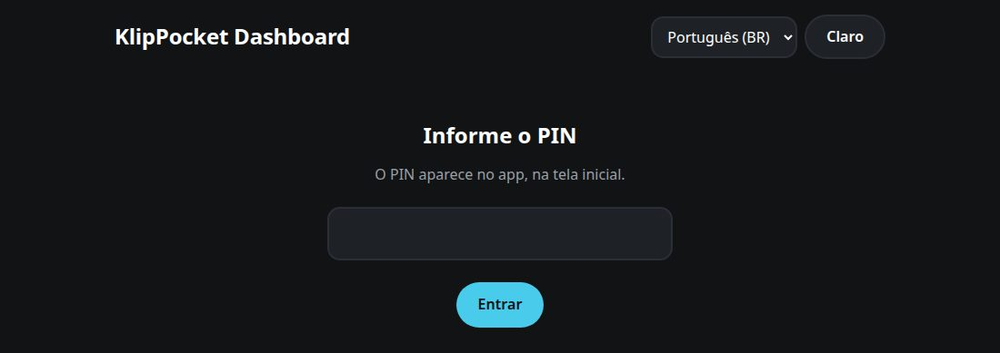
*A tela de PIN da página.*

No app, role a **tela inicial** até o fim, em **Dashboard**: ela mostra o endereço
(`http://<IP do celular>:4400`) e um **PIN** de seis dígitos. Abra o endereço num
navegador da mesma rede e digite o PIN. **Novo PIN** no app o substitui e fecha todas
as páginas abertas.

> **Por que um PIN?** A página mostra informações do celular e pode gravar uma placa
> ligada nele, então tudo, exceto os arquivos da própria página, exige o PIN; depois
> de cinco erros o endereço fica bloqueado por um minuto. A página usa HTTP simples,
> como as outras páginas do app: use numa rede de confiança.

A página tem quatro abas, mostradas como ícones abaixo do título (passe o mouse para ver o nome): **Dashboard**, **Câmera**, **Firmware** (veja a [página web de firmware](firmware-web.md)) e, por último, **Configurações**. A seção **Logs** fica no fim da aba Dashboard.
Idioma e tema seguem o app na primeira vez; o que você escolher na página fica
guardado no navegador.

## Uso em tempo real

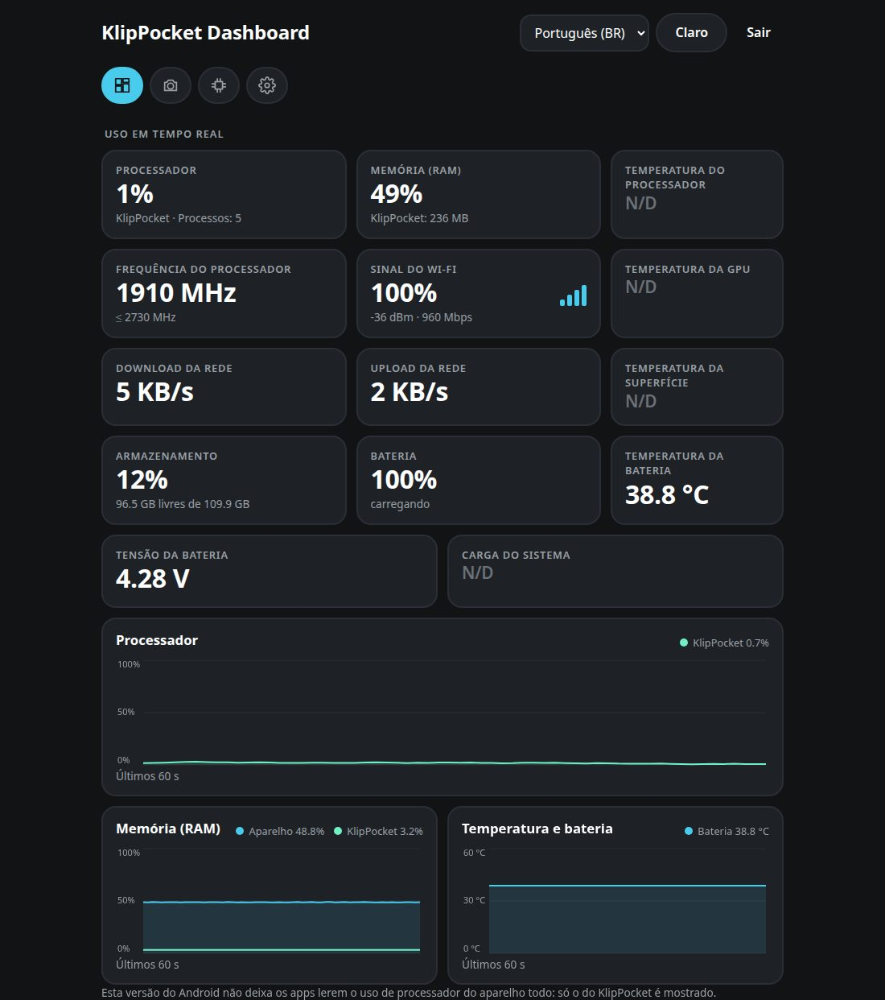
*Uso em tempo real num Galaxy S10+ (Android 12): cartões e gráficos. O que este celular não deixa o app ler mostra **N/D**.*

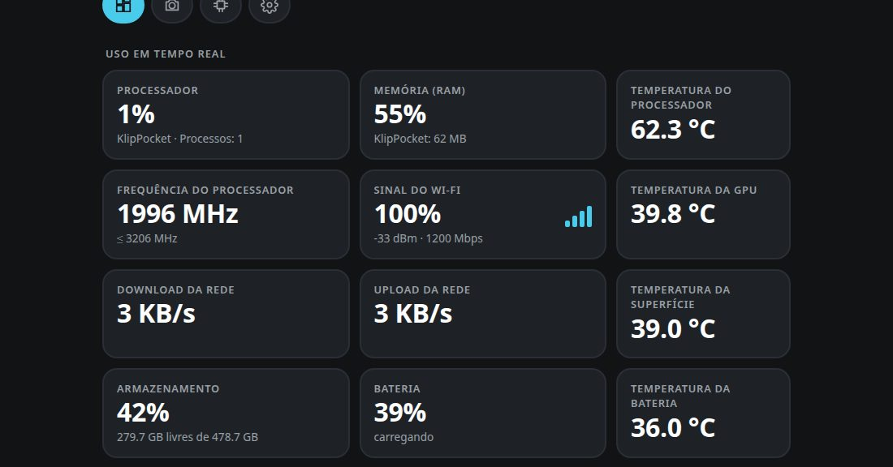
*Os mesmos cartões num POCO F7 (Android 16), que expõe mais sensores: temperaturas do processador, da GPU e da superfície.*

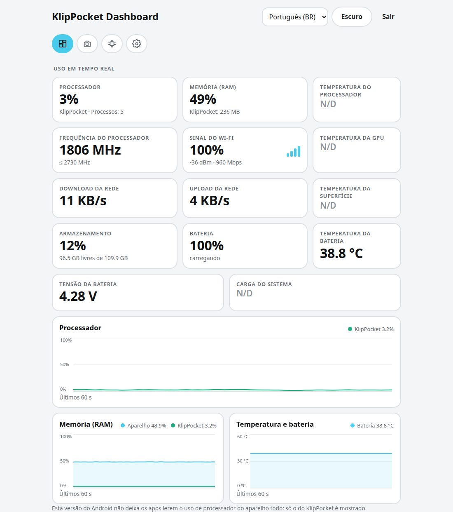
*O tema claro (o botão **Claro** / **Escuro** no topo).*

No topo ficam **cartões** atualizados a cada segundo, com **no máximo três por linha**: os cartões com mais informação (processador, memória, frequência, Wi-Fi, rede, armazenamento) são mais largos, os pequenos (temperaturas, bateria, tensão, carga) mais estreitos, e toda linha preenche a largura (um cartão sozinho ocupa a linha toda, dois dividem igualmente, e em três os dois mais largos ganham mais espaço).

| Cartão | O que mostra |
|---|---|
| **Processador** | Uso do aparelho todo e, abaixo, o uso do KlipPocket. O Android só deixa o app ler o próprio processo principal, então o valor do KlipPocket é o do app em si, não dos processos do Klipper e do Moonraker. |
| **Memória (RAM)** | Memória em uso pelo aparelho e memória usada por todos os processos do KlipPocket (app, Klipper, Moonraker, câmera…). |
| **Temperatura do processador, da GPU, da superfície e da bateria**, **Frequência do processador**, **Carga do sistema**, **Sinal do Wi-Fi** (um percentual com quatro barras de sinal, e abaixo os dBm e a velocidade do link), **Download / Upload da rede**, **Armazenamento** (usado e livre), **Bateria** (nível e carregando) e **Tensão da bateria** | Cada um está sempre na página. Um valor que o celular não deixa o app ler mostra **N/D** no lugar do número: os aparelhos diferem muito no que expõem. |

Abaixo, **gráficos** mostram os **últimos 60 segundos**, um ponto por segundo: o processador numa linha inteira, e a memória ao lado da temperatura (o gráfico de temperatura some quando o celular não expõe nenhuma). **Clique numa bolinha da legenda para ocultar aquela linha do gráfico, e clique de novo para mostrá-la.** Cada gráfico tem sua legenda com os valores
atuais. Os gráficos só andam enquanto a página está visível no navegador.

> **O uso do processador do aparelho não existe em todos os celulares.** Desde o
> Android 8 os apps não conseguem ler o uso do aparelho todo, então em muitos
> celulares só a linha do **KlipPocket** é desenhada, com um aviso. Memória, bateria
> e os números do KlipPocket estão sempre disponíveis.

## Armazenamento e aparelho (host)

Dois cartões de largura total abaixo dos gráficos:

- **Armazenamento** — espaço livre e total do armazenamento interno e, quando houver, do cartão SD. Atualiza sozinho, sem reconstruir a página.
- **Aparelho (host)** — modelo, chip, núcleos e frequência máxima, arquitetura,
  versão do Android, kernel, há quanto tempo está ligado, endereço de rede e a
  versão do KlipPocket.

## Impressoras e MCUs

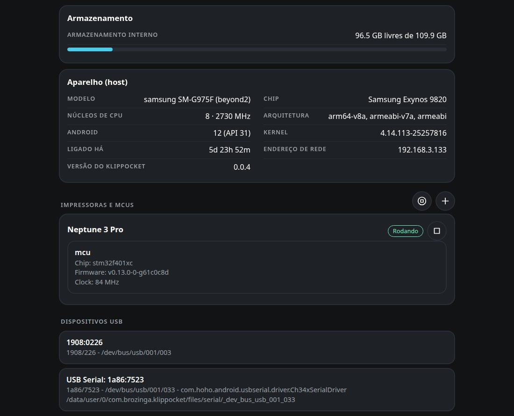
*Aparelho, memória e armazenamento, as impressoras com seu MCU e os ícones de iniciar/parar, e os dispositivos USB.*

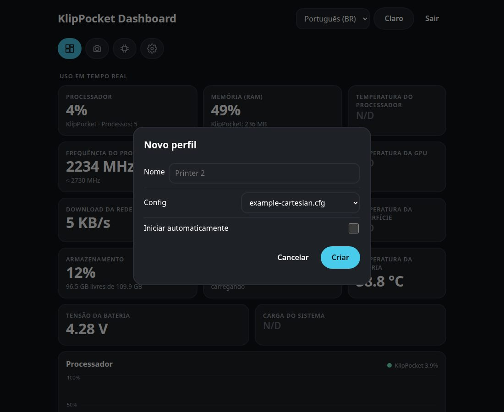
*O ícone **+** abre o formulário de uma nova impressora.*

Um cartão por perfil de impressora, com o estado (**Rodando**, **Parada**…). Com a
impressora rodando e o Klipper conectado, cada **MCU** aparece com o **chip** (por
exemplo `stm32f401xc` ou `rp2040`), a **versão do firmware** e o **clock**. Os dados
vêm do Moonraker da própria impressora no celular, então a placa principal e as
placas extras de uma configuração [multi-MCU](multi-mcu.md) aparecem. Com a impressora
parada, o cartão avisa que os dados aparecem quando ela rodar.

**Iniciar / Parar.** Cada cartão de impressora tem um ícone de **play** ou **stop** e o cabeçalho da seção tem ícones de **iniciar todos** / **parar todos**, como o botão de play do app: os servidores Klipper e Moonraker daquela impressora iniciam ou param. Se não houver vaga livre para iniciar outra impressora, a página avisa.

**Adicionar impressora.** O ícone **+** no cabeçalho da seção abre o mesmo formulário da folha **Novo perfil** do app: o nome (vazio = "Impressora N"), o `printer.cfg` inicial a copiar e **Iniciar automaticamente**. A nova impressora aparece na lista na hora; se não houver vaga livre, a página avisa.

**Dispositivos USB** lista tudo o que o celular enxerga na porta USB — nome, `VID:PID`,
caminho no barramento e, nas placas seriais, a porta usada no `printer.cfg` — a mesma
lista de *Listar dispositivos USB* do app.

## Configurações

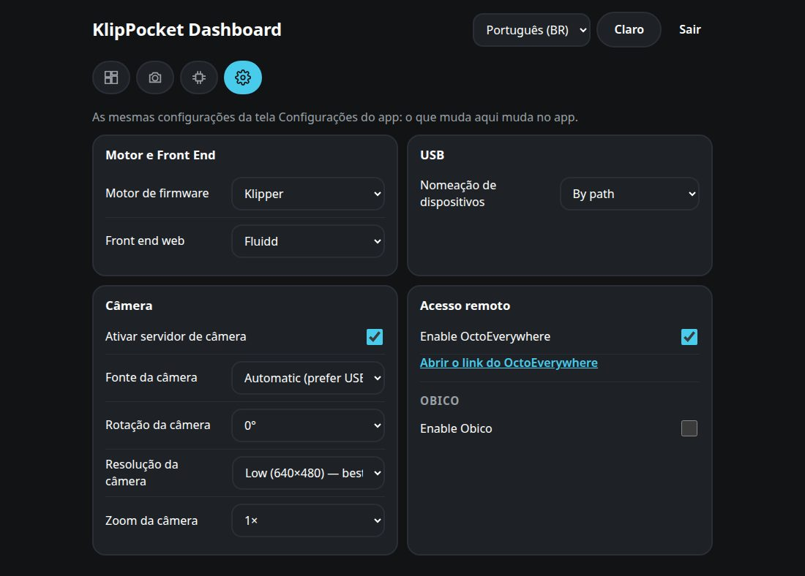
*A aba Configurações.*

A aba **Configurações** tem as mesmas configurações da tela Configurações do app; o que muda aqui muda no app (e é salvo na hora):

| Seção | O que você pode fazer |
|---|---|
| **Motor e front end** | Klipper ou Kalico (Kalico só quando instalado) e o front end web (Fluidd, Mainsail, Voyager UI). |
| **USB** | Como os dispositivos USB são nomeados (por caminho ou por VID/PID). |
| **Câmera** | Ligar ou desligar a câmera e escolher fonte, rotação, resolução e zoom (os passos de zoom dependem da câmera). O Android pede a permissão da câmera **no celular** na primeira vez. |
| **Acesso remoto** | **OctoEverywhere:** ligar e abrir o link dele; o link aparece alguns segundos depois de ativar. **Obico**, no mesmo cartão: ligar, escolher Obico Cloud ou servidor próprio (e salvar), ver se a impressora está vinculada, ler o código que o Obico gera (com o link) ou digitar um código do app Obico para vincular, e desvincular. |

## Câmera

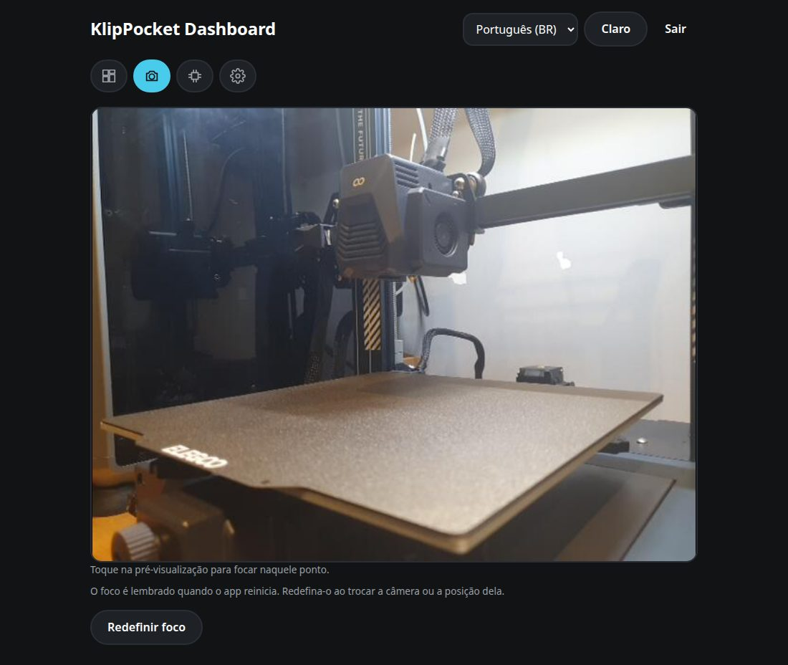
*A aba Câmera: toque na imagem para focar.*

A aba **Câmera** mostra a imagem ao vivo da câmera do celular, o mesmo fluxo que Fluidd e Mainsail usam (com a rotação, resolução e zoom escolhidos). **Toque na imagem para focar** naquele ponto, como no app: o foco fica guardado até você apertar **Redefinir foco**. A imagem aparece quando a câmera está ligada e uma impressora está rodando (a câmera inicia junto); se estiver desligada, a aba oferece ligar. Sair da aba fecha a conexão, então o celular não codifica imagens para ninguém.

## Logs

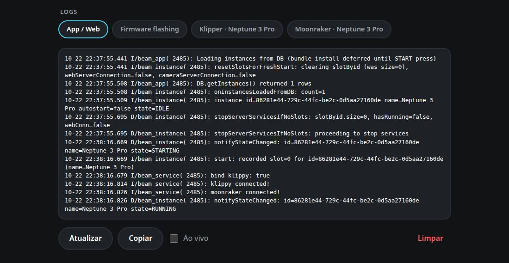
*Os logs, com uma aba por fonte e os botões Atualizar, Copiar, Ao vivo e Limpar.*

No fim, uma aba por log, as mesmas da tela **Logs** do app: **App / Web**, **Firmware**
(o log das gravações de firmware), **Klipper**, **Moonraker**, **OctoEverywhere** e
**Obico** de cada impressora, e **Última falha** quando houver.

| Botão | O que faz |
|---|---|
| **Atualizar** | Lê o log de novo. |
| **Copiar** | Copia o texto mostrado para a área de transferência. |
| **Ao vivo** | Lê o log de novo a cada 3 segundos. |
| **Limpar** | Depois de uma confirmação, **limpa os logs**: os arquivos do Klipper, Moonraker, OctoEverywhere, Obico e firmware são esvaziados, o relatório da última falha é apagado e as linhas antigas do log do app ficam ocultas. A visualização esvazia e, daí em diante, só mensagens novas são gravadas — o mesmo que **Limpar** no app. |

A seção **Logs** fica só na aba **Dashboard**. O log das gravações de firmware é a aba **Gravação de firmware** da lista; a página **Firmware** mostra o log da última gravação com o próprio botão **Registro**.

A aba **Firmware** (veja o [guia da página de firmware](firmware-web.md)). Na tela de um celular a página se reorganiza:

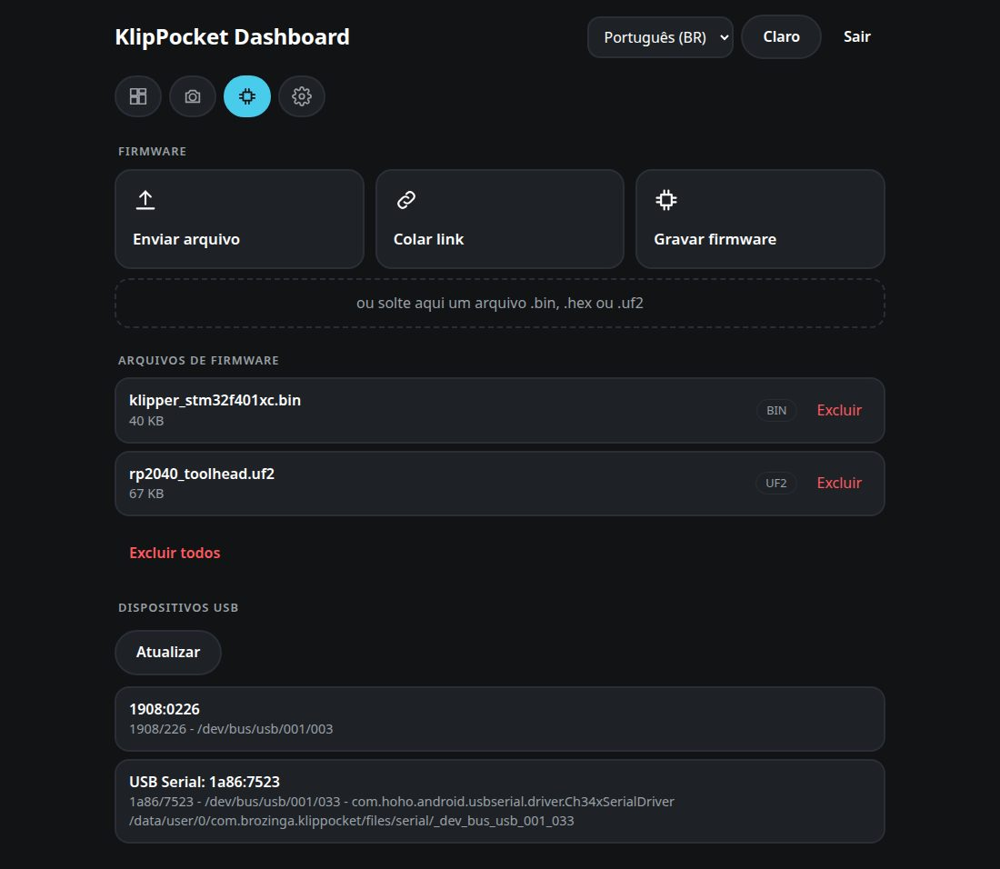

| | |
|---|---|
| 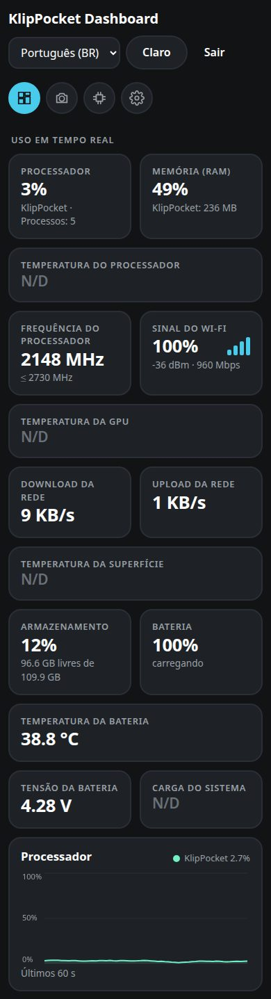 | 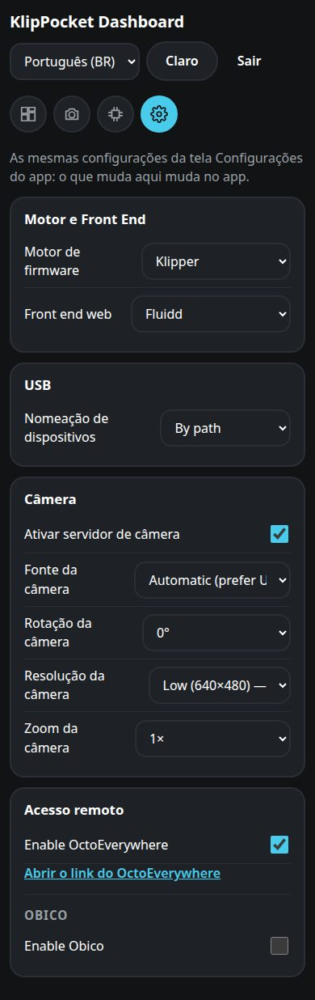 |

## Se algo der errado

| O que você vê | O que fazer |
|---|---|
| A página não abre | Celular e computador precisam estar no mesmo Wi-Fi sem *isolamento de clientes*; use o endereço mostrado no app. Se a porta 4400 estiver em uso por outro app, o cartão da tela inicial avisa que a página não está rodando. |
| *Muitas tentativas* | Espere os segundos mostrados ou use **Novo PIN** no app. |
| *Conexão com o app perdida* | O app foi fechado ou o celular dormiu: abra o app de novo. |
| Só a linha do KlipPocket no gráfico do processador | Normal no Android 8+: veja o aviso acima. |
| Cartão da impressora sem MCUs | A impressora está parada ou o Klipper ainda não conectou na placa. |

## Para desenvolvedores

Tudo em `/api` exige o cookie de sessão do login por PIN e, quando altera algo, o
cabeçalho `X-KlipPocket: 1`. Rotas do dashboard: `GET /api/dashboard` (aparelho,
armazenamento, impressoras, MCUs, USB; muda devagar), `GET /api/metrics` (números ao
vivo; a resposta é compartilhada se pedida mais de uma vez por segundo), `GET /api/logs`
(fontes), `GET /api/logs/read?id=…` e `POST /api/logs/clear`; `GET`/`POST /api/settings` (a configuração é `{"key": …, "value": …}`), `POST /api/control` (`{"id": …, "action": "start"|"stop"}`, sem `id` = todas as impressoras), `GET /api/printers/new` e `POST /api/printers` (`{"name", "config", "autostart"}`), `GET /api/camera`, `GET /api/camera/stream` (MJPEG multipart), `POST /api/camera/focus` (`{"x": 0..1, "y": 0..1}`) e `POST /api/camera/focus/reset`. As rotas de firmware estão
no [guia da página de firmware](firmware-web.md#para-desenvolvedores). O código fica em
`app/src/main/java/ru/ytkab0bp/beamklipper/firmwareweb/` (`DashboardCollector` lê os
números, `DashboardRules` tem as partes testadas na JVM) e a página em
`app/src/main/assets/firmware_web/`; os textos são gerados das strings do app com
`scripts/gen_firmware_web_i18n.py`.
