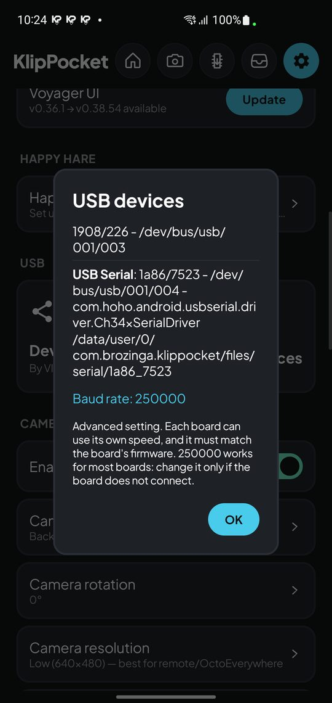
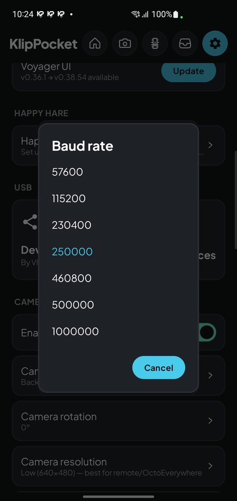
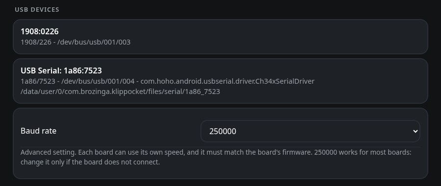

# Trocando a taxa de transmissão (baud) do USB

**Idiomas: [English](../usb-baud-rate.md) · [Português (BR)](usb-baud-rate.md) · [简体中文](../zh-Hans/usb-baud-rate.md)**

A **taxa de transmissão (baud rate)** é a velocidade do enlace serial entre o
KlipPocket e o microcontrolador (MCU) de uma placa. É uma **configuração
avançada**, escolhida **por placa**, e **na maioria dos casos o padrão, 250000,
já funciona**. Altere só se o KlipPocket não conseguir conectar ao MCU.

## Por que placas diferentes usam velocidades diferentes

A maioria das placas chega ao celular por um pequeno **adaptador USB-serial**
(um chip CH340, CP210x ou FTDI, por exemplo) ligado a uma UART do MCU. Uma UART
não tem linha de clock: cada lado só conta o tempo, então **os dois lados
precisam estar na mesma velocidade de antemão**, senão o que um envia parece
ruído para o outro. Não há negociação automática.

A velocidade do lado do MCU é definida quando o firmware é compilado
(`CONFIG_SERIAL_BAUD`, "Baud rate for serial port" no `make menuconfig` do
Klipper):

- **250000** é o padrão do Klipper: mais rápido que o clássico 115200, com mais
  folga para os dados que uma impressora envia (vários motores, sensores, input
  shaping), e uma velocidade que a maioria dos chips gera com precisão.
- **115200** é o padrão tradicional de vários outros firmwares e bootloaders,
  então algumas placas (ou firmwares compilados com outras ferramentas) a usam.
- Velocidades **menores** (57600) podem ajudar com fios longos ou ruidosos; as
  **maiores** (460800, 500000, 1000000) dão mais folga quando passa muito dado.

Placas que conectam pelo **USB nativo do próprio MCU** não usam baud rate: a
configuração não tem efeito nelas. Como cada placa pode ser compilada de um
jeito, a velocidade é escolhida **para cada placa** (cada MCU pode usar uma
diferente, mesmo com várias conectadas ao mesmo tempo).

> Quem decide é o firmware. O valor do app precisa ser **igual ao do firmware**.
> Confira o da sua placa (`CONFIG_SERIAL_BAUD`, ou o valor `SERIAL_BAUD=` na
> linha `MCU 'mcu' config:` do log do Klipper) antes de alterar qualquer coisa.

## Quando alterar

Deixe 250000, a menos que a placa não conecte; por exemplo, quando o Klipper
nunca sai de *Starting* e o log termina em `Unable to connect`, `Timeout on
connect` ou `Lost communication with MCU`, e o cabo, a permissão e o nome da
porta estão certos.

## No app

1. Abra **Configurações → USB → Listar dispositivos USB**.
2. Cada placa que o app abre como porta serial mostra a **Taxa de transmissão
   (baud)**. Toque nela e escolha a velocidade do firmware da sua placa.

 

*(As capturas estão com o app em inglês.)* A nova velocidade é salva para essa
placa e **aplicada na hora**, sem desconectar nada.

## No Dashboard

Na lista **Dispositivos USB** do [Dashboard](dashboard.md), cada placa que o app
abre como porta serial tem um seletor de **Taxa de transmissão (baud)**.
Escolher um valor faz o mesmo que no app.

## Bom saber

- **Nada muda até você alterar.** Cada placa começa em 250000; a velocidade só é
  salva para as placas que você altera, e escolher 250000 de novo a esquece.
- **É por placa**, identificada pelo mesmo nome da sua porta serial. Com a
  **Nomeação de dispositivos** em *Por caminho*, uma placa ligada em outra porta
  ou que reinicia ganha um novo caminho e volta a 250000; use **Por VID/PID**
  para manter a escolha (duas placas com o mesmo VID/PID dividem o nome e, por
  isso, a velocidade).
- **Os demais recursos USB não são afetados**: a gravação de firmware pelo app
  tem velocidades próprias.
- **Altere com a impressora ociosa.** Uma velocidade errada faz o Klipper perder
  o MCU, o que interrompe uma impressão. Se acontecer, volte a velocidade certa
  e envie `FIRMWARE_RESTART` (uma ou duas vezes); se o MCU continuar em
  *shutdown*, desligue e ligue a impressora.
