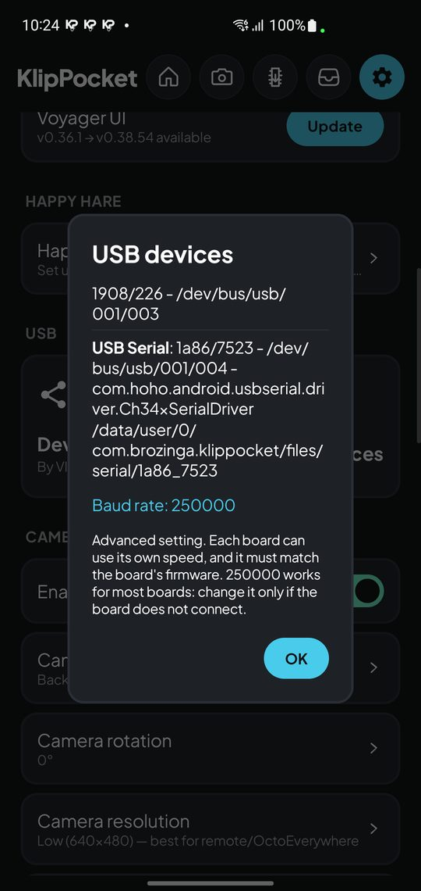
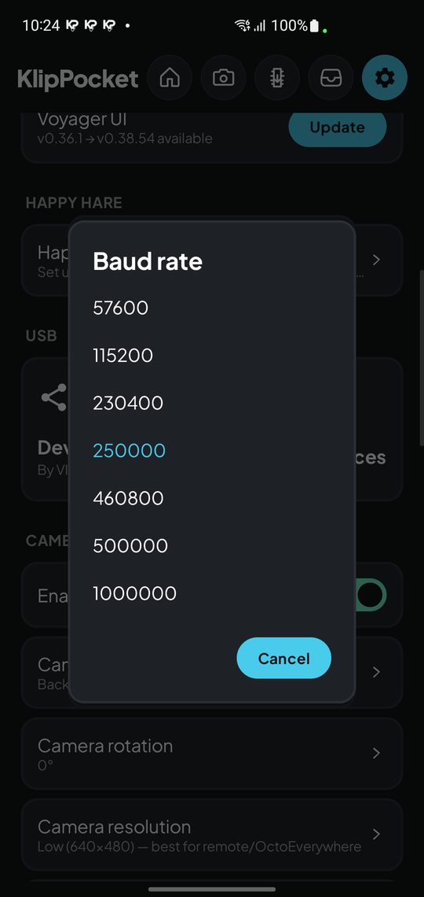
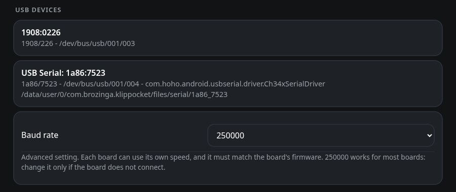

# Changing the USB baud rate

**Languages: [English](usb-baud-rate.md) · [Português (BR)](pt-br/usb-baud-rate.md) · [简体中文](zh-Hans/usb-baud-rate.md)**

The **baud rate** is the speed of the serial link between KlipPocket and a
board's microcontroller (MCU). It is an **advanced setting**, chosen **per
board**, and **in most cases the default, 250000, already works**. Change it
only if KlipPocket cannot connect to the MCU.

## Why different boards use different speeds

Most boards reach the phone through a small **USB-serial adapter** (a CH340,
CP210x or FTDI chip, for example) wired to a UART of the MCU. A UART has no
clock line: each side just counts time, so **both ends must be set to the same
speed in advance**, or what one sends looks like noise to the other. There is
no automatic negotiation.

The speed of the MCU side is fixed when its firmware is built
(`CONFIG_SERIAL_BAUD`, "Baud rate for serial port" in Klipper's
`make menuconfig`):

- **250000** is the Klipper default: faster than the classic 115200, so there is
  more room for the data a printer sends (many steppers, sensors, input
  shaping), and it is a speed most chips can generate precisely.
- **115200** is the traditional default of many other firmwares and bootloaders,
  so some boards (or firmwares built with other tools) use it.
- **Lower** speeds (57600) can help on long or noisy wires; **higher** ones
  (460800, 500000, 1000000) give more headroom when a lot of data flows.

Boards that connect with the **MCU's own native USB** do not use a baud rate at
all: the setting has no effect on them. Because every board can be built
differently, the speed is chosen **for each board** (each MCU can use a
different one, even when several are plugged in together).

> The firmware decides. The app's value must be **the same as the firmware's**.
> Check the one your board uses (`CONFIG_SERIAL_BAUD`, or the `SERIAL_BAUD=`
> value in the `MCU 'mcu' config:` line of the Klipper log) before changing
> anything.

## When to change it

Leave 250000 unless the board does not connect, for example when Klipper never
leaves *Starting* and the log ends in `Unable to connect`, `Timeout on connect`
or `Lost communication with MCU`, and the cable, the permission and the port
name are fine.

## In the app

1. Open **Settings → USB → List USB devices**.
2. Each board the app can open as a serial port shows its **Baud rate**. Tap
   it and pick the speed of your board's firmware.

 

The new speed is saved for that board and **applied right away**, without
unplugging anything.

## In the Dashboard

In the **USB devices** list of the [Dashboard](dashboard.md), each board that
the app opens as a serial port has a **Baud rate** selector. Picking a value
does the same as in the app.

## Good to know

- **Nothing changes until you change it.** Each board starts at 250000; a speed
  is saved only for the boards you change, and choosing 250000 again forgets it.
- **It is per board**, found by the same name as its serial port. With
  **Device naming** on *By path*, a board that is plugged into another port or
  restarts gets a new path, and goes back to 250000; use **By VID/PID** to keep
  the choice (two boards with the same VID/PID share a name, and so a speed).
- **The other USB features are not affected**: flashing firmware from the app
  has its own speeds.
- **Change it with the printer idle.** A wrong speed makes Klipper lose the
  MCU, which interrupts a print. If that happens, put the right speed back and
  send `FIRMWARE_RESTART` (once or twice); if the MCU stays in *shutdown*, power
  the printer off and on.
