# 构建 MCU 固件

**语言: [English](../build-firmware.md) · [Português (BR)](../pt-br/build-firmware.md) · [简体中文](build-firmware.md)**

KlipPocket 在 Android 上运行 Klipper/Kalico 主机。打印机主板仍然需要 MCU 固件，在 PC 上构建并烧录一次（Android 不能编译）。

**推荐的方式是本页介绍的交互式菜单。** 它会询问你要 Klipper 还是 Kalico，显示该引擎自己的 *Firmware Configuration* 界面，在 Docker 中构建，验证结果，烧录主板，并确认运行的确实是新固件。其他方式（预编译镜像、Docker/本地脚本）放在[页面末尾](#其他获取固件的方式)。

- [要求](#要求)
- [快速开始](#快速开始)
- [分步示例](#分步示例)
- [烧录主板](#烧录主板)
- [验证检查什么](#验证检查什么)
- [其他获取固件的方式](#其他获取固件的方式)

---

## 要求

| 内容 | 用途 |
|---|---|
| **仓库**，下载或克隆（`git clone https://github.com/Brozinga/KlipPocket.git`，或 GitHub 上的 *Code → Download ZIP*） | 菜单、Dockerfile 和所有辅助脚本都在 `scripts/` 和 `firmware/` 里。不需要手动再下载别的东西。 |
| **Docker** —— Windows 和 macOS 用 Docker Desktop，Linux 用 Docker Engine | 一切都在里面运行：编译器（ARM、AVR）、Klipper 和 Kalico 的源码以及烧录工具。 |
| **启动菜单的 shell** —— Linux 和 macOS 用 **Bash**；Windows 用 **PowerShell**（5.1 或 7）或 **Git Bash** | `scripts/firmware_menu.sh`（Bash / Git Bash）或 `scripts/firmware_menu.ps1`（PowerShell）。 |
| **首次需要联网** | Docker 会构建一次镜像（约 400 MB：编译器和两个引擎的源码）；之后会被缓存。 |

## 快速开始

在仓库目录下：

```bash
./scripts/firmware_menu.sh        # Linux、macOS、WSL、Git Bash
```
```powershell
.\scripts\firmware_menu.ps1       # Windows PowerShell / Windows Terminal
```

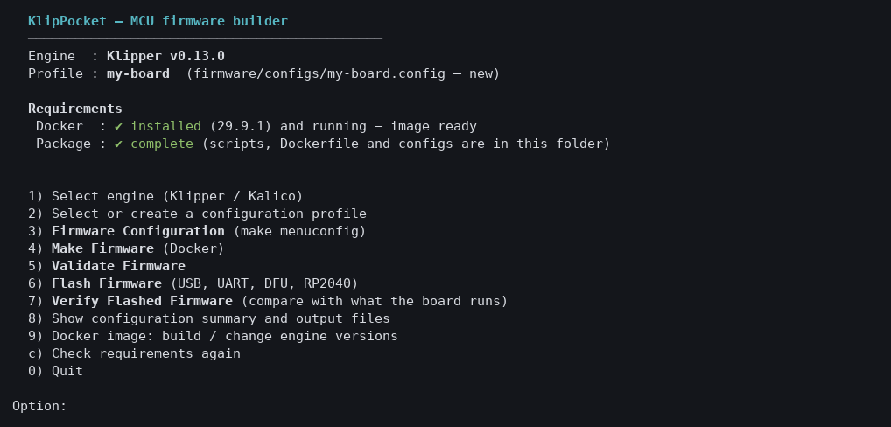

顶部显示正在使用的引擎和配置档，以及**所需条件**（Docker 是否已安装并在运行、下载是否完整）。选项：

| 选项 | 作用 |
|---|---|
| **1 Select engine** | Klipper（v0.13.0）或 Kalico（v2026.10.00）。 |
| **2 Select or create a profile** | 配置档就是一份保存的配置：`firmware/configs/<配置档>.config`。 |
| **3 Firmware Configuration** | 引擎真正的 `make menuconfig`。 |
| **4 Make Firmware** | 在 Docker 中编译并验证结果。 |
| **5 Validate Firmware** | 重新检查输出；可选的深度检查会从头重新编译并比对哈希。 |
| **6 Flash Firmware** | 列出已连接的设备并烧录主板（USB、UART、DFU 或 RP2040 模式）。 |
| **7 Verify Flashed Firmware** | 连接主板，检查它运行的正是你构建的固件。 |
| **8 Show summary** | 配置档的主要选项和上一次构建的文件。 |
| **9 Docker image** | 构建镜像，或更改其中 Klipper/Kalico 的版本。 |
| **c** | 重新检查所需条件（安装或启动 Docker 之后）。 |

结果保存在 `firmware/output/`，命名为 `<配置档>-<引擎>.*`：镜像（`.bin`，AVR 为 `.hex`，RP2040 为 `.uf2`）、主机读取的 `.dict`、实际使用的配置（`.config.used`），以及包含大小和 SHA-256 哈希的 `.manifest.json`。

---

## 分步示例

这个示例为一块 STM32F401 主板构建固件：32 KiB bootloader，通过串口（UART）与主机通信 —— 大多数原厂打印机用的就是这类主板。

### 我的打印机该用什么设置？

`make menuconfig` 的正确答案（芯片、bootloader 偏移、主板如何与主机通信）取决于你的主板。Klipper 项目为许多打印机提供了 `printer-*.cfg`，在这里：

**<https://github.com/Klipper3d/klipper/tree/master/config>**

打开你打印机对应的那个：**顶部的注释会说明如何生成它的固件。** 本示例所用主板的注释是：

```ini
# To use this config, during "make menuconfig" select the STM32F401 with a
# "32KiB bootloader" and serial (on USART1 PA10/PA9) communication.

# Note that the "make flash" command does not work with this board.
# After running "make", rename the out/klipper.bin file to out/<file name>.bin
# Copy the file out/<file name>.bin to an SD card formatted to FAT32
# and then restart the printer with the SD card inserted.
```

它告诉你三件事：**在菜单里选什么**（STM32F401、32 KiB bootloader、USART1 PA10/PA9 上的串口）、**固件如何进入主板**（这里是 SD 卡，不是 USB），以及**该 bootloader 要求的文件名**。请把这些说明留着，用于下面的步骤。

> 不确定主板是什么芯片？见 [1. 弄清主板芯片](#1-弄清主板芯片)。

### 1. 打开菜单

按[快速开始](#快速开始)运行脚本。如果顶部显示 Docker 已安装并在运行、软件包完整，就可以开始了。

### 2. 选择引擎（选项 1）

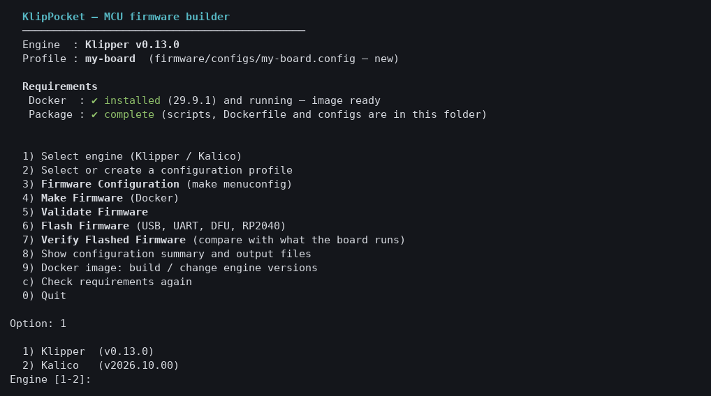

输入 `1` 选 Klipper，`2` 选 Kalico。Kalico 的构建方式与 Klipper 完全相同，配置界面也一样。

### 3. 创建配置档（选项 2）

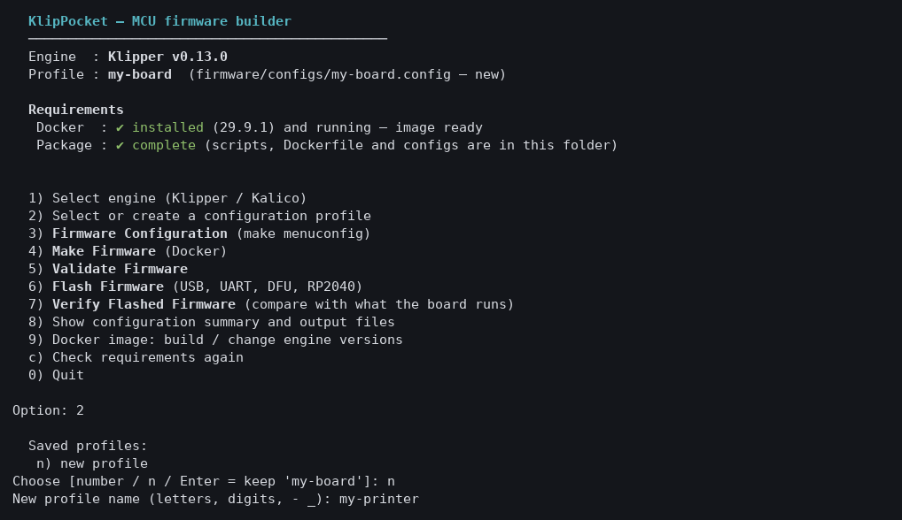

选择 `n`，给配置档起个名字（字母、数字、`-` 和 `_`）。它会保存为 `firmware/configs/<名称>.config`，所以你可以为每块主板保存一个配置档，以后再回来用。

### 4. Firmware Configuration（选项 3）

这会在 Docker 里打开引擎自己的配置界面。用**方向键**移动，**空格/回车**切换或打开条目，**Esc** 返回，**Q** 退出（会询问是否保存：按 **Y**）。

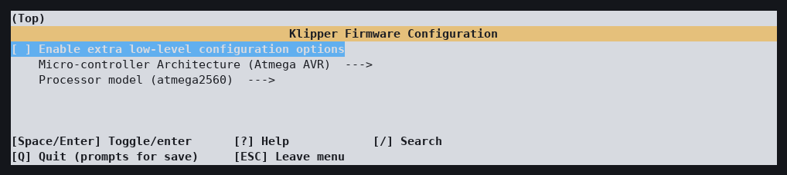

第一屏只显示 Atmega2560 的默认值。勾选 **Enable extra low-level configuration options**（空格）：你的芯片相关选项就会出现。

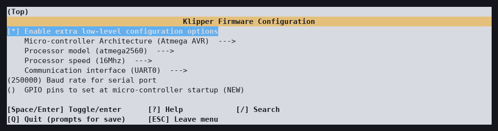

**Micro-controller Architecture** —— 选择芯片系列，这里是 *STMicroelectronics STM32*：

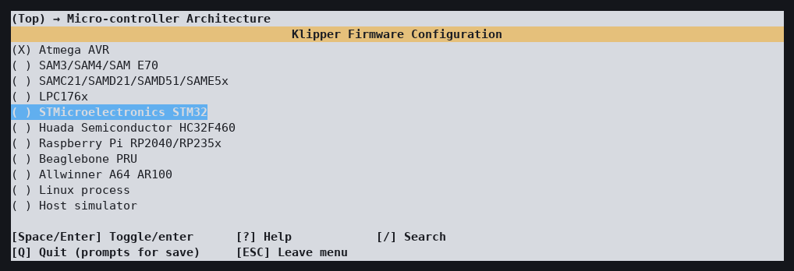

**Processor model** —— 具体芯片，这里是 *STM32F401*：

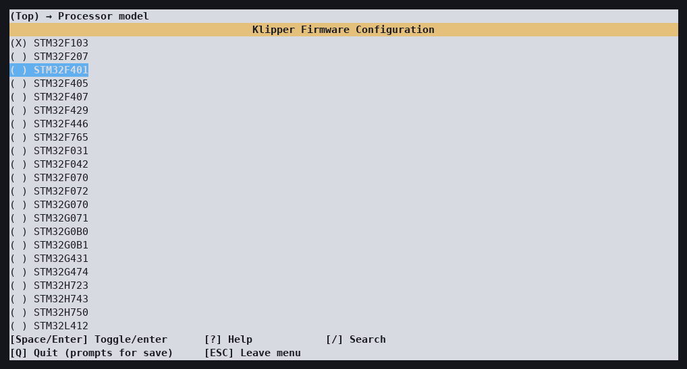

**Bootloader offset** —— 主板自己的 bootloader 占用、不能被覆盖的 flash 大小，这里是 *32KiB bootloader*。这是最重要、必须选对的设置：

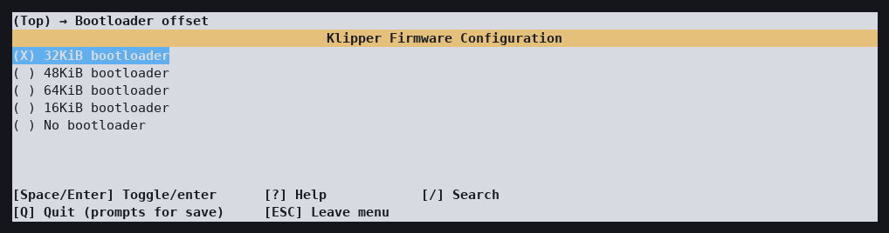

**Clock Reference** 保持默认（*8 MHz crystal*）。**Communication interface** 是主板与主机的通信方式，这里是 *Serial (on USART1 PA10/PA9)*；波特率保持 250000，这是 KlipPocket 唯一支持的：

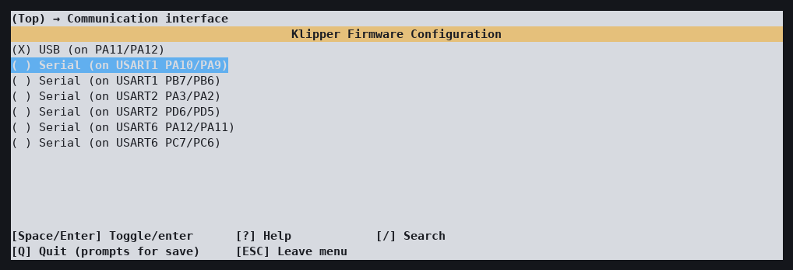

完成后的界面：

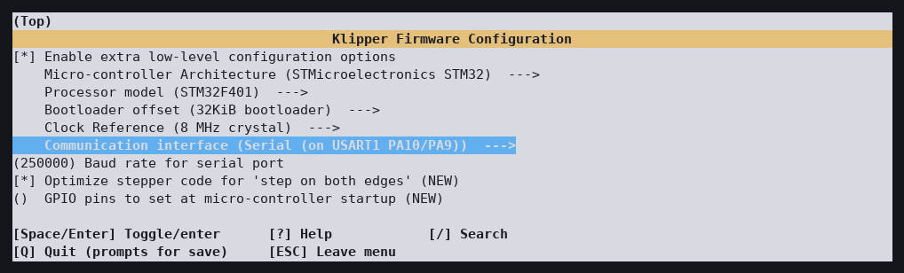

按 **Q**，再按 **Y** 保存配置档：

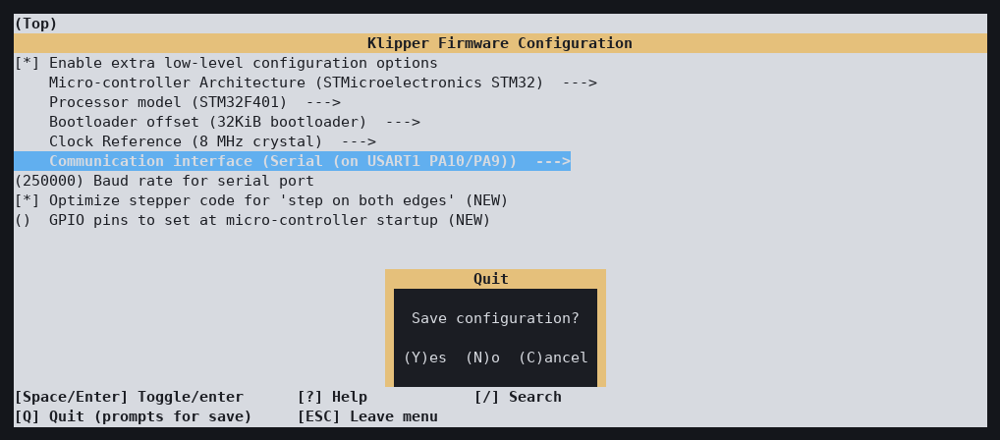

MCU 自带 USB 的主板（例如许多 STM32 和 RP2040 主板）会把通信接口选为 *USB* 而不是串口；其他界面的用法相同。

### 5. Make Firmware（选项 4）

菜单在 Docker 内编译并验证产物：

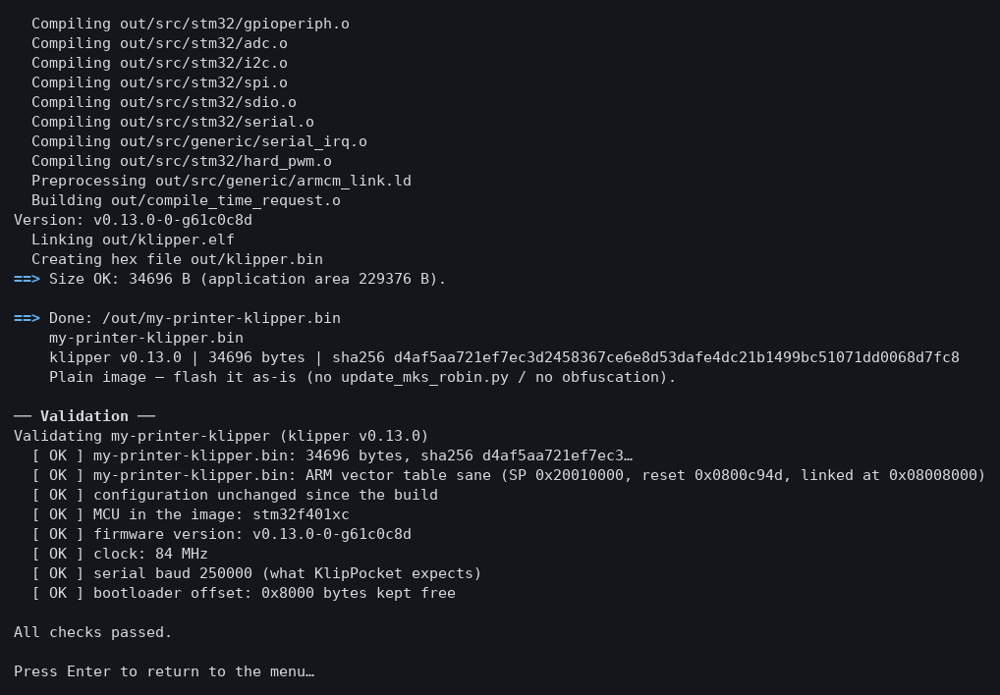

`All checks passed` 表示镜像合理：芯片正确、时钟正确、向量表位于 bootloader 偏移处、波特率 250000（见[验证检查什么](#验证检查什么)）。选项 **8** 会列出主要选项和文件：

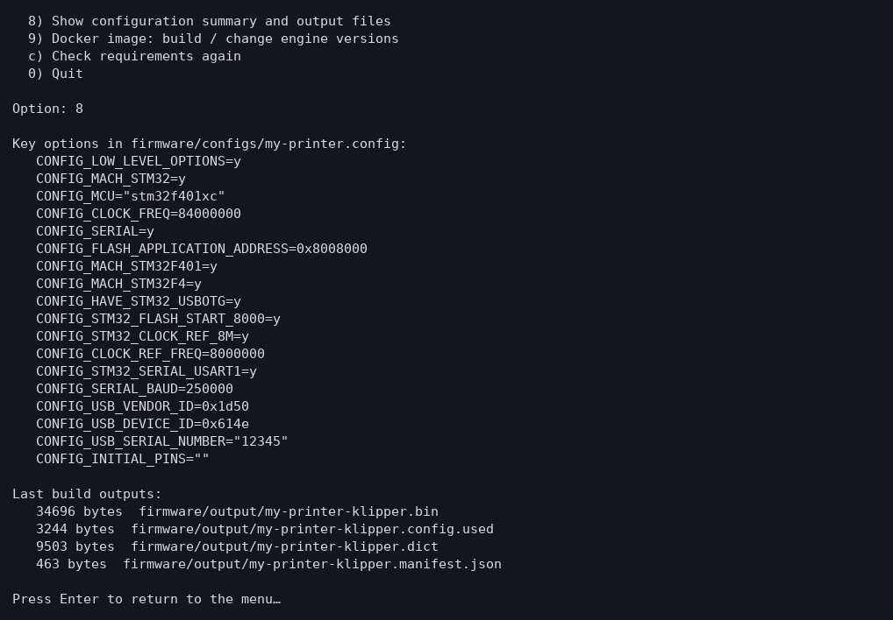

镜像是 `firmware/output/<配置档>-<引擎>.bin`。

### 6. 放到主板上

**这个示例主板从 SD 卡加载固件**，所以不通过菜单烧录：把 `.bin` 重命名为头部注释要求的名字，复制到 FAT32 的 SD 卡，插入卡并给主板重新上电（详见[烧录主板](#烧录主板)）。

可以通过 USB 烧录的主板使用选项 **6 Flash Firmware**，下面用 Raspberry Pi Pico 演示。

---

## 烧录主板

> **不在电脑旁？** 应用的[固件标签页](firmware-tab.md)可以下载固件（或导入你在这里生成的固件），并直接通过手机写入主板：RP2040 / RP2350、USB、STM32 DFU、UART、Katapult、HID-Flash、SAM-BA 和 CAN。只有 RP2040 经过完整测试，其余方式标为实验性。也可以在电脑浏览器中通过[固件网页](firmware-web.md)（端口 4400）完成。

*Flash Firmware*（选项 **6**）有自己的菜单。上半部分**列出已连接的设备**，不会写入任何内容，方便你在烧录前确认主板被识别；下半部分才是烧录。两部分都有四种模式：

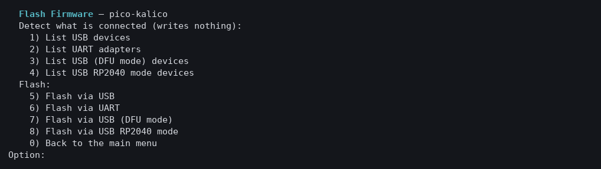

| 模式 | 适用于 | 列出 |
|---|---|---|
| **USB** | 通过 USB 运行 Klipper（或 Katapult）的主板，或 Arduino 风格的 USB 主板 | `/dev/serial/by-id/usb-…` 端口（CDC/ACM） |
| **UART** | 接到主板 UART bootloader 的 USB 串口适配器（CH340、FTDI、CP210x）；STM32 用 `stm32flash`，AVR 用 `avrdude` | USB 串口适配器 |
| **USB (DFU mode)** | 处于 DFU 模式的 STM32（BOOT0 后复位：`0483:df11`） | DFU 设备 |
| **USB RP2040 mode** | 按住 BOOTSEL 的 Raspberry Pi Pico / RP2040（`2e8a:0003`） | BOOTSEL 设备 |

### 示例：Raspberry Pi Pico

按上面的方法创建 Pico 的配置档（架构 *Raspberry Pi RP2040/RP235x*，通信 *USB*）。然后按住 **BOOTSEL** 插上 Pico。

**1. 先列出。** 选项 1–4 只是查看，不写入任何内容。Pico 处于 BOOTSEL 时，*USB RP2040 mode* 能找到它，而 *USB* 暂时没有可显示的内容（提示会说明这类主板的样子）：

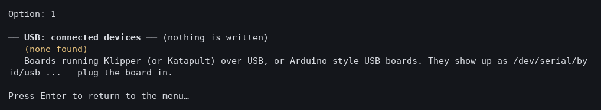
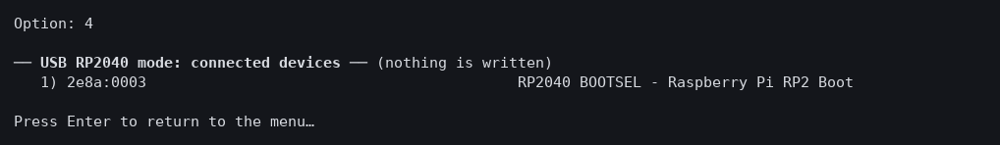

**2. 烧录。** 选项 8（*Flash via USB RP2040 mode*）会显示该类设备，询问烧录哪一个并请你确认：

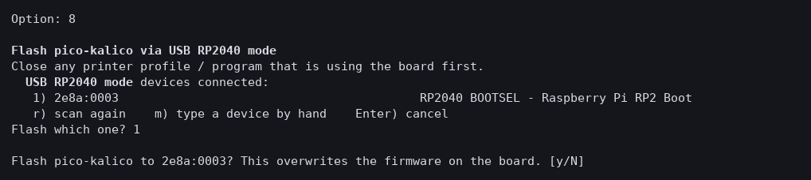

写入之前，菜单会再次验证构建、重新编译，并确认它与已验证的镜像**逐字节相同**，然后运行 Klipper 的烧录规则。成功时会提示，并提供检查主板当前运行内容的选项：

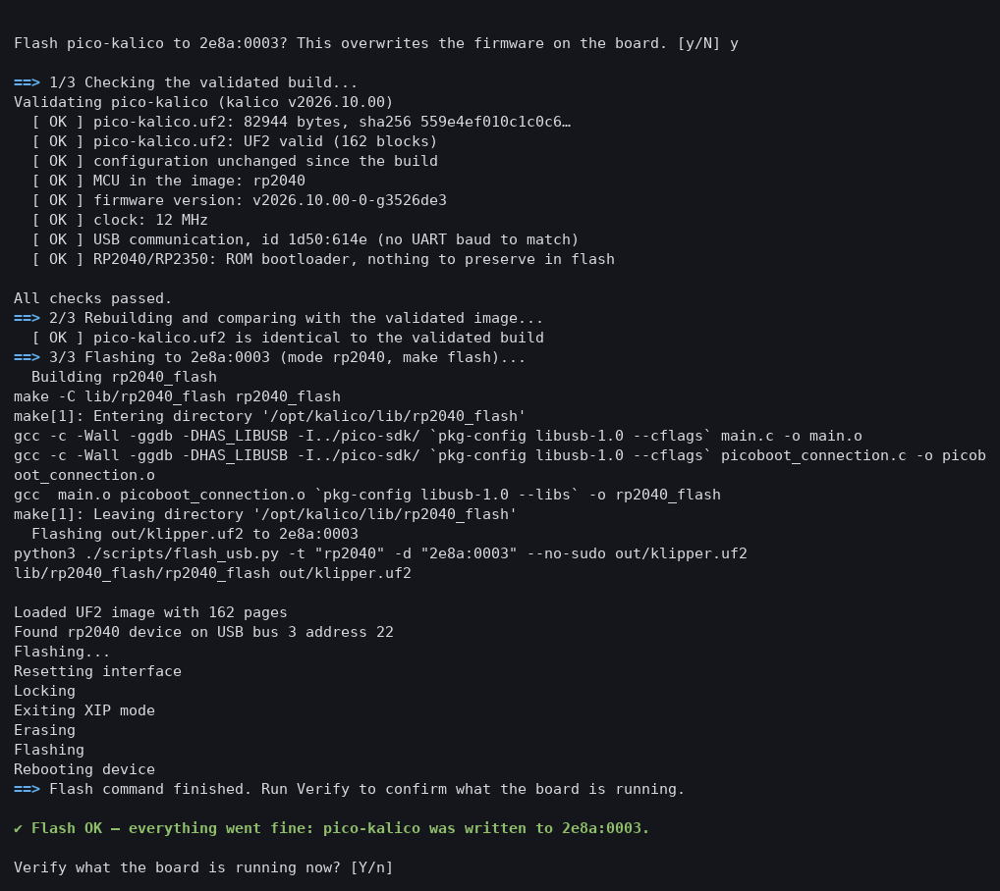

**3. 校验。** *Verify Flashed Firmware*（烧录后直接提供，或主菜单的选项 **7**）会打开主板的串口，像 Klipper 连接时那样请求数据字典，并与你的构建比对：

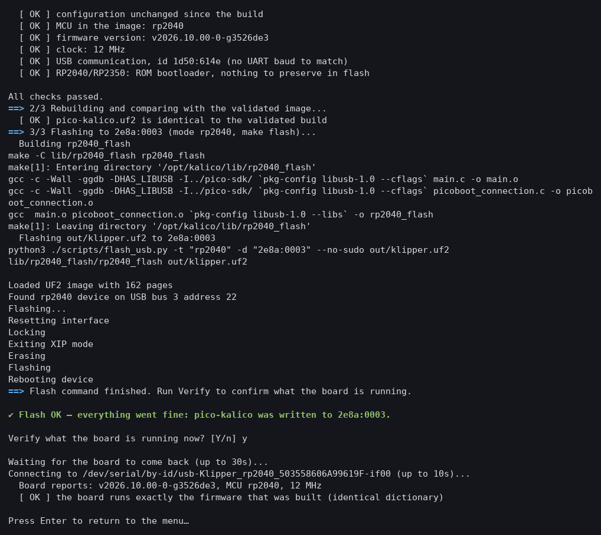

`the board runs exactly the firmware that was built` 才是真正的证明；版本或芯片不同会报告为失败，也能发现烧录没有生效的情况。Pico 现在通过 USB 运行 Klipper，所以 *USB* 能列出它：

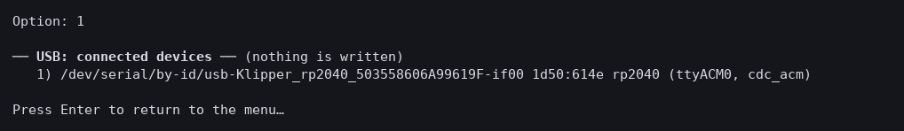

（在 USB 模式下无需再碰 BOOTSEL 就能再次烧录：菜单会让正在运行的固件重启进入 bootloader。）

### 出问题时

烧录失败时，菜单会提示并显示错误，然后等你按回车。例如，把 RP2040 的固件交给处于 STM32 DFU 模式的设备，会在写入任何内容之前被拒绝：

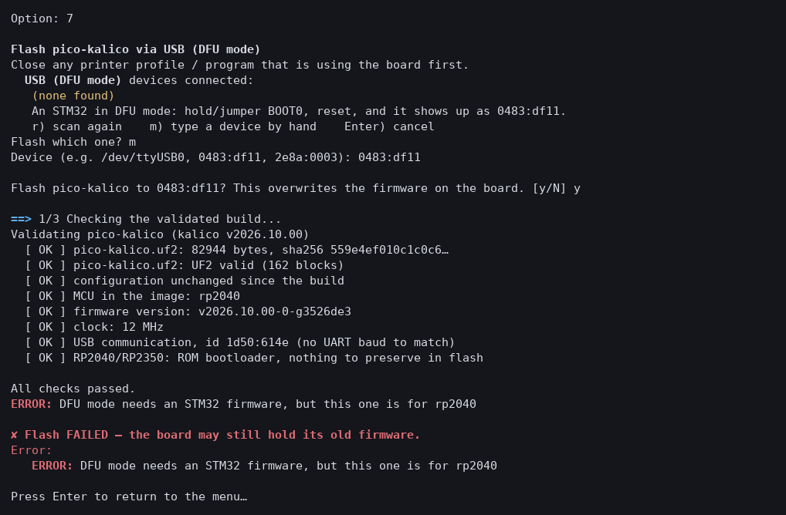

写入任何内容之前的检查：

1. 再次验证构建（哈希、格式、配置）。
2. 模式必须与固件匹配：DFU 需要 STM32 固件，RP2040 模式需要 RP2040/RP2350 固件（错误的镜像可能让主板变砖）。
3. 重新编译，结果必须与已验证的镜像**逐字节相同**。
4. 设备必须存在；写入超过四分钟会超时，而不是卡住。

烧录工具在可能时会边写边校验（`avrdude` 和 `stm32flash -v` 会回读）。菜单使用 Klipper 自带的烧录规则（`make flash`）和镜像里已有的工具（`dfu-util`、`stm32flash`、`avrdude`，以及 RP2040 和 SAM 的烧录器）。

### 限制

- **Linux** 开箱即用（容器启动时可访问 `/dev`）。**Windows** 上请用 [usbipd-win](https://learn.microsoft.com/windows/wsl/connect-usb) 把主板挂载到 WSL2；**macOS** 的 Docker Desktop 无法访问 USB，请用系统自带工具烧录 `firmware/output/`。
- 关闭正在使用该主板的应用或配置。
- bootloader 从 **SD 卡**读取固件的主板不在这里烧录：把 `firmware/output/` 里的镜像复制到卡上（按主板说明重命名）。之后仍可使用 *Verify Flashed Firmware*。
- 已在 Raspberry Pi Pico 上验证（BOOTSEL 模式和通过 USB 运行 Klipper 的模式）。其他模式使用相同的烧录规则，但尚未在硬件上运行过。

---

## 验证检查什么

由 *Make Firmware* 和选项 **5** 运行：

- 文件存在、非空，并与构建时记录的哈希一致。
- 镜像格式：Intel HEX 校验和（AVR）、UF2 块（RP2040），以及 ARM `.bin` 的向量表是否合理、是否链接在所配置的 bootloader 偏移处。
- 镜像是为配置中的 MCU 和时钟构建的，版本就是该引擎的版本。
- 波特率为 250000（KlipPocket 唯一支持的），或主板使用 USB。
- bootloader 偏移留有空间，镜像能放进应用区。
- 保存的配置档在构建之后没有被更改。

镜像包含 ARM（固定 gcc 10.3）、AVR 和主机编译器，因此 ARM Cortex-M 芯片（STM32、RP2040、LPC176x、SAM、HC32）、AVR 和 Linux process 都能构建。AR100 和 PRU 目标需要其他编译器，未包含。

---

## 故障排除

### Docker 未安装

如果 Docker 没有安装、没有运行，或你的用户无权使用，菜单会在顶部提示，并禁用依赖它的项目。选择引擎/配置档和查看摘要仍可使用。安装或启动 Docker 后按 `c`。

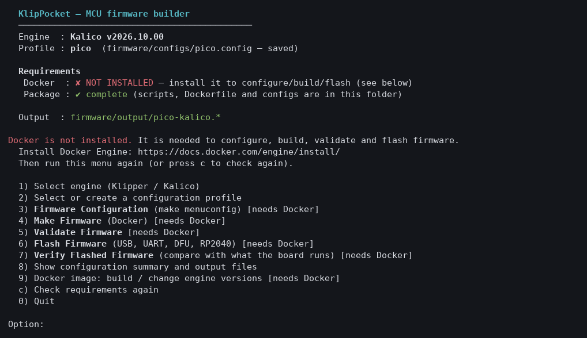

### PowerShell

PowerShell 菜单是一样的，只是符号更朴素。

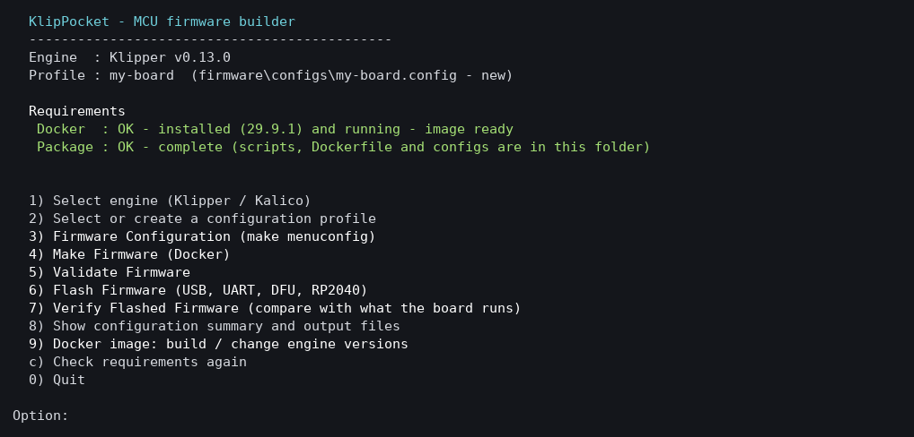

### 其他问题

- *我的主板是什么芯片？* 见 [1. 弄清主板芯片](#1-弄清主板芯片)。
- *可以使用现成的配置吗？* 把 `.config` 复制到 `firmware/configs/`：它会出现在选项 2 中。见[添加一块主板](#添加一块主板)。

---

## 其他获取固件的方式

上面的菜单是首选。这些替代方式留给特殊情况。

项目的两个构建器都会生成一个纯 `klipper.bin`，重命名为主板 bootloader 所期望的文件名。它们**不会**运行 `update_mks_robin.py`（那个 XOR 步骤只适用于 bootloader 会解密 SD 文件的 STM32F103 MKS Robin 主板；对按原样烧录的主板会损坏镜像）。它们还会拒绝生成会覆盖 bootloader 的镜像，并会把编译大小与 flash 应用区做对比检查。

Klipper 没有 MCU↔主机版本锁 —— MCU 在连接时把命令字典发给主机，主机自适应。固件不必与应用内置的 Klipper 完全一致。

| 方式 | 说明 |
|---|---|
| **预编译镜像** | Beam Klipper 项目为许多主板发布了固件：<https://github.com/utkabobr/klipper/releases>。更旧的镜像也能用于本应用；推荐 Klipper **0.13**。 |
| **Docker（命令行）** | 对 `firmware/configs/` 里有配置的主板，每块一条命令。 |
| **本地脚本** | 一条命令。自动下载固定版本的工具链。 |

### Docker（命令行）

在仓库根目录运行：

```bash
# 构建一次镜像（固定 Klipper v0.13.0 + Kalico v2026.10.00 + ARM gcc 10.3-2021.07）
docker compose -f firmware/docker-compose.yml build

# 为 firmware/configs/ 里有配置的主板构建固件
docker compose -f firmware/docker-compose.yml run --rm fw <主板>

# 列出可用的主板配置
docker compose -f firmware/docker-compose.yml run --rm fw
```

输出在 `firmware/output/`。在 `docker compose ... build` 上加 `--build-arg
KLIPPER_TAG=vX.Y.Z` 可换 Klipper 版本。

### 本地脚本

```bash
./scripts/build_firmware.sh <主板 | 路径/到/.config> [输出文件名] [klipper-tag]
```

`<主板>` 解析为 `firmware/configs/<主板>.config`，或传入用 `make menuconfig` 保存的任意 `.config` 的完整路径。首次运行会把 `gcc-arm-none-eabi 10.3-2021.07` 下载到 `firmware/toolchain/`，并把 Klipper 克隆到 `firmware/.klipper-build/`（两者都被 gitignore）。

可在 **Linux** 和 **macOS** 上运行（需要 `make`、`git`、`curl`、`tar`）。在 **Windows** 上使用 `scripts\build_firmware.ps1 <主板>`（封装 Docker 镜像），或在 WSL / Git Bash 中运行 `.sh`。

---

### 添加一块主板

#### 1. 弄清主板芯片

光有打印机型号不够 —— 同一型号常常出过不同的主板（STM32F103 / F401 / GD32 / …），每块的内存布局都不同。用可能写入 bootloader 的方式烧错芯片的固件可能变砖。检查主板丝印、贴纸或 OEM 固件文件名。

#### 2. 生成一个 `.config`

在有 Klipper 检出的 PC 上（或 `docker compose ... run --rm --entrypoint bash fw`）：

```bash
cd /opt/klipper        # 或你的 Klipper 克隆
make menuconfig
```

对 KlipPocket 重要的选项：

- **处理器型号** —— 与芯片完全一致。
- **Bootloader 偏移** —— 多数 OEM 主板有一个 8–32 KiB 的 bootloader 必须保留（例如 `CONFIG_FLASH_START_8000`）。这是主要的变砖风险。
- **通信接口** —— KlipPocket 通过设备的 OTG 口用 **USB 串口**。多数 OEM 主板上这是板载 USB-串口桥接芯片接到某个 UART，而非 MCU 的原生 USB。选 USB 口所接的那个 UART。
- **波特率** —— KlipPocket 只支持 **250000**。

社区里针对该主板的「known-good」配置是很好的起点：加载它，运行一次 `make menuconfig` 来调和，保存。

**在哪里找现成的主板 `.config`：**

| 来源 | 说明 |
|---|---|
| [`utkabobr/klipper` → `bin-templates/`](https://github.com/utkabobr/klipper/tree/master/bin-templates) | Beam Klipper 预编译固件所基于的 Kconfig `.config` 文件（约 90 块 OEM 主板）。与本应用最接近；旁边的 `.json` 文件标记 SD 卡（"robin"）主板。 |
| [`Klipper3d/klipper` → `config/`](https://github.com/Klipper3d/klipper/tree/master/config) | `printer-*.cfg` / `generic-*.cfg` —— 这些是 **printer.cfg** 模板，不是固件 `.config`，但其头部注释会说明 `make menuconfig` 需要的芯片、bootloader 偏移和通信接线。 |
| [Klipper 社区 Discourse](https://klipper.discourse.group/) | 按主板分享的固件配置。 |
| 主板厂商文档（BigTreeTech、MKS、Fysetc，STM32 见 TeamGloomy） | 按主板的 `make menuconfig` 选项。 |

#### 3. 放进 `firmware/configs/`

保存为 `firmware/configs/<主板>.config`。一个可选的指令头让构建器命名输出并保护变砖关键行：

```ini
#! board_name:      <可读名称>
#! flash_filename:  <bootloader 查找的名字，例如 firmware.bin>
#! klipper_tag:     v0.13.0
#! assert: CONFIG_MCU="<芯片>"
#! assert: <任何必须在 `make olddefconfig` 后存活的 CONFIG_ 行>
#! assert: CONFIG_SERIAL_BAUD=250000
```

`#! assert:` 行会在 `make olddefconfig` 之后重新检查；只要有一行丢失，构建就停止。`#! expect_sha256: <hash>` 还会在输出不匹配时让构建失败 —— 适合固定一个已验证的镜像。

#### 4. 烧录

- **SD 卡主板** —— 把输出复制到 FAT32 卡上，重命名为 bootloader 查找的名字，断电重启。bootloader 会重命名或删除该文件作为确认，且从不写入自身；最坏情况是「不开机」，用同样的方式烧回一个已知可用的镜像即可恢复。
- **DFU / `make flash` 主板** —— 在 PC 上按 Klipper 的常规流程操作。

#### 5. 连接

把打印机插到设备上（OTG）。KlipPocket 会自动检测串口；`printer.cfg` 里的 `[mcu] serial:` 行会被忽略（为可移植性保留一行有效的）。如果固件重启后设备路径会变，使用 VID/PID 命名。

---

### 可复现性

一个干净的 Klipper tag + 固定的工具链 + 相同的 `.config` 会产生逐字节相同的二进制文件（Klipper 对干净树的构建会省略构建时间和主机名）。项目自带的示例配置使用 `#! expect_sha256`，因此结果漂移时构建会失败。

### 临时目录

`firmware/output/`、`firmware/toolchain/`、`firmware/.klipper-build/` 是构建临时目录，已被 gitignore。只提交经过验证的 `.bin` 到 `firmware/<主板-slug>/`。
