# KlipPocket Dashboard — 在浏览器中查看手机、打印机和日志（端口 4400）

**Languages: [English](../dashboard.md) · [Português (BR)](../pt-br/dashboard.md) · [简体中文](dashboard.md)**

应用在 **4400 端口**提供一个名为 **KlipPocket Dashboard** 的网页。在同一网络的电脑或另一部手机的浏览器中，你可以查看运行 Klipper 的手机状态、打印机和 MCU，阅读（并清除）与应用 **日志** 页面相同的日志，并使用[固件](firmware-web.md)工具。页面沿用应用的风格（浅色/深色），在手机屏幕上也能使用。

只要应用打开，Dashboard **始终可用**（不需要打印机在运行），一条小通知可让它在应用转入后台时仍可访问。

## 打开 Dashboard

*应用主屏幕底部的地址和 PIN（此截图中的应用为葡萄牙语，PIN 已隐藏）。*

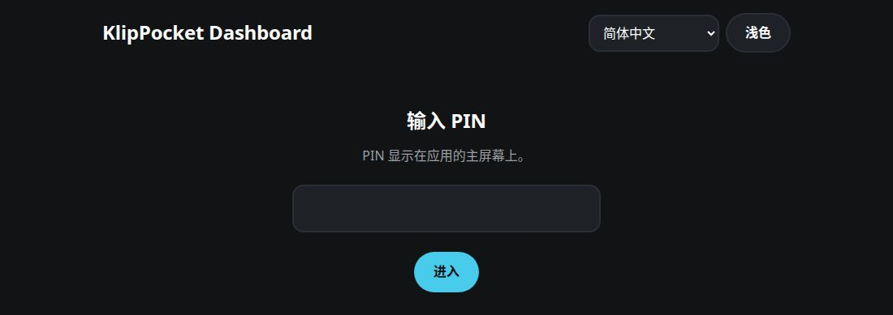
*页面的 PIN 界面。*

在应用的**主屏幕**滚动到底部的 **Dashboard**：这里显示地址（`http://<手机IP>:4400`）和六位 **PIN**。在同一网络的浏览器中打开该地址并输入 PIN。应用中的 **新 PIN** 会替换它并关闭所有已打开的页面。

> **为什么要 PIN？** 页面会显示手机信息，还能给插在手机上的主板写入固件，因此除页面自身文件外，一切都需要 PIN；输错五次后该地址会被锁定一分钟。页面使用普通 HTTP，和应用的其他页面一样：请在可信网络中使用。

页面有五个标签，以图标形式显示在标题下方（悬停可见名称）：**Dashboard**、**摄像头**、**固件**（见[固件网页](firmware-web.md)）、**Happy Hare**（见 [Happy Hare](happy-hare.md#在仪表盘里设置)）和最后的 **设置**。**日志** 部分在 Dashboard 标签的底部。语言和主题首次跟随应用；你在页面上的选择会保存在浏览器中。

## 实时使用情况

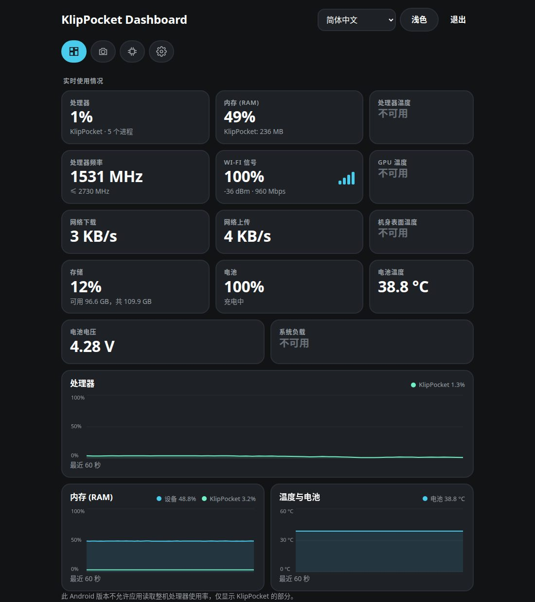
*Galaxy S10+（Android 12）上的实时使用情况：卡片和图表。此手机不允许应用读取的项目显示 **不可用**。*

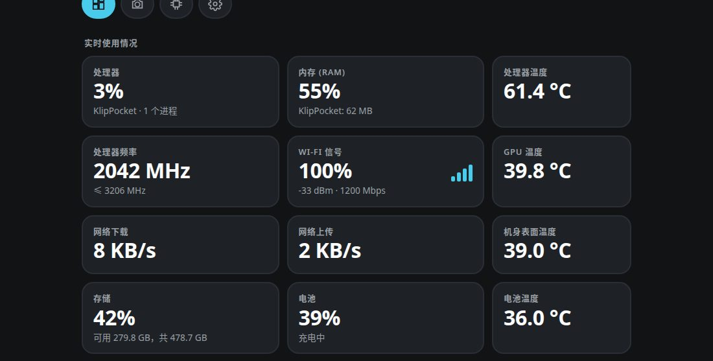
*POCO F7（Android 16）上的相同卡片，它开放更多传感器：处理器、GPU 和机身表面温度。*

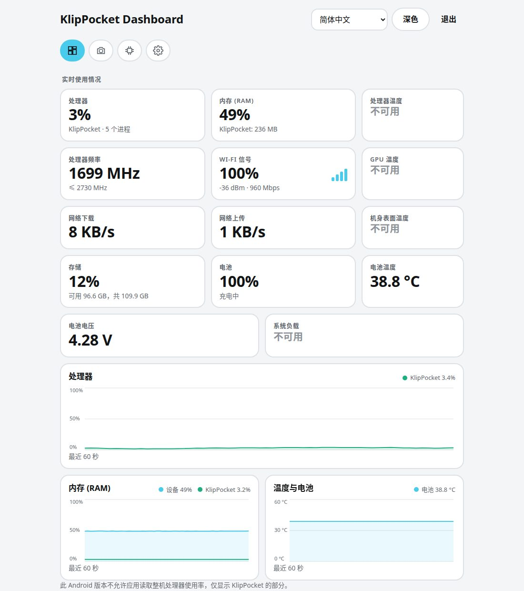
*浅色主题（顶部的 **浅色** / **深色** 按钮）。*

顶部是每秒更新的**卡片**，**每行最多三张**：信息较多的卡片（处理器、内存、频率、Wi-Fi、网络、存储）更宽，较小的（温度、电池、电压、负载）更窄，每一行都会占满整行（单独一张占满整行，两张平分，三张时较宽的两张获得更多空间）。

| 卡片 | 显示内容 |
|---|---|
| **处理器** | 整机使用率，下方是 KlipPocket 的使用率。Android 只允许应用读取自己的主进程，因此 KlipPocket 的数值是应用本身的，不包含 Klipper 和 Moonraker 进程。 |
| **内存 (RAM)** | 设备已用内存和 KlipPocket 所有进程（应用、Klipper、Moonraker、摄像头…）使用的内存。 |
| **处理器、GPU、机身表面和电池温度**、**处理器频率**、**系统负载**、**Wi-Fi 信号**（百分比和四格信号条，下方为 dBm 和链路速度）、**网络下载 / 上传**、**存储**（已用和可用）、**电池**（电量和充电状态）以及 **电池电压** | 每一项始终显示在页面上。手机不允许应用读取的数值会显示 **不可用** 而不是数字：各手机开放的信息差别很大。 |

下方**图表**显示**最近 60 秒**，每秒一个点：处理器占满一行，内存与温度并排（手机没有任何温度数据时，温度图表会隐藏）。每张图都有图例和当前值。只有页面在浏览器中可见时图表才会更新。

> **并非所有手机都能显示整机处理器使用率。** 自 Android 8 起，应用无法读取整机使用率，因此许多手机上只会绘制 **KlipPocket** 这条线，并附有说明。内存、电池和 KlipPocket 的数值始终可用。

## 主机设备与内存

- **主机设备** — 型号、芯片、CPU 核心数和最高频率、架构、Android 版本、内核、开机时长、网络地址和 KlipPocket 版本。
- **内存 (RAM)** — 总计、已用、可用和交换空间；**存储** — 内部存储以及（如有）SD 卡的可用和总空间。

## 打印机与 MCU

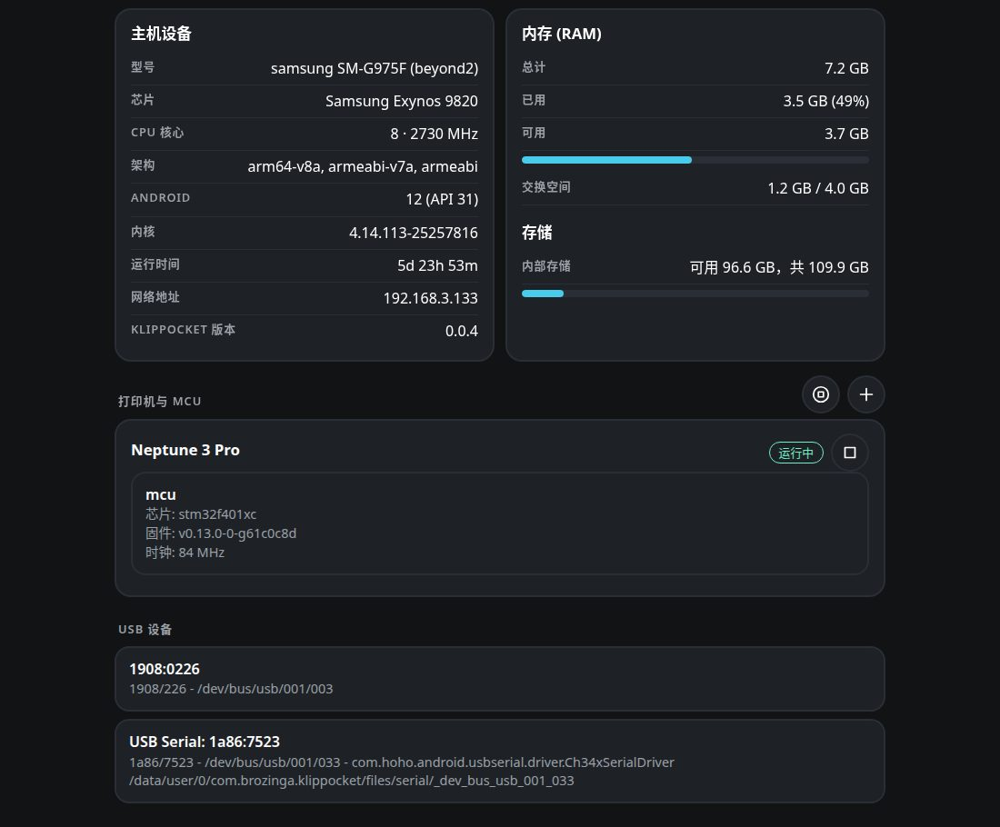
*主机设备、内存和存储，带 MCU 和启动/停止图标的打印机，以及 USB 设备。*

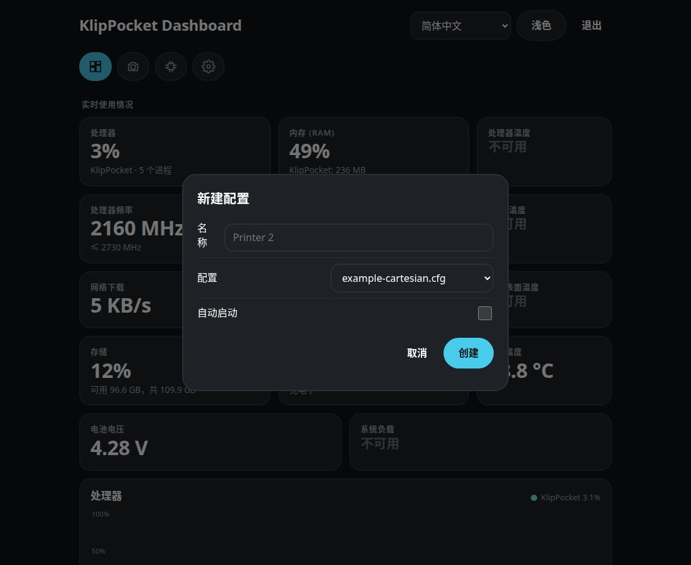
***+** 图标会打开新打印机的表单。*

每个打印机配置一张卡片，显示其状态（**运行中**、**已停止**…）。打印机运行且 Klipper 已连接时，每个 **MCU** 会列出**芯片**（例如 `stm32f401xc` 或 `rp2040`）、**固件版本**和**时钟**。数据来自手机上该打印机自己的 Moonraker，所以[多 MCU](multi-mcu.md) 配置中的主板和扩展板都会显示。打印机停止时，卡片会提示运行后才有数据。

**启动 / 停止。** 每个打印机卡片都有 **播放** 或 **停止** 图标，该部分标题处还有 **全部启动** / **全部停止** 图标，与应用的播放按钮相同：该打印机的 Klipper 和 Moonraker 服务器会启动或停止。如果没有空闲位置来启动另一台打印机，页面会提示。

**添加打印机。** 该部分标题处的 **+** 图标会打开与应用 **新配置** 页面相同的表单：名称（留空则为“打印机 N”）、要复制的初始 `printer.cfg` 以及 **自动启动**。新打印机会立即出现在列表中；如果没有空闲位置，页面会提示。

**USB 设备** 列出手机在 USB 端口上看到的一切 — 名称、`VID:PID`、总线路径，以及串口主板在 `printer.cfg` 中使用的端口 — 与应用中 *列出 USB 设备* 相同。

## 设置

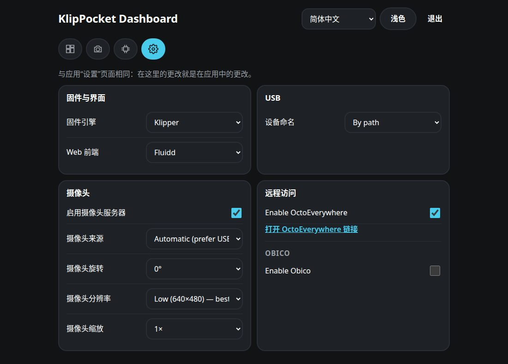
*设置标签页。*

**设置** 标签页与应用的设置页面内容相同；在这里更改就是在应用中更改（立即保存）：

| 部分 | 可以做什么 |
|---|---|
| **引擎和前端** | Klipper 或 Kalico（仅在已安装 Kalico 时），以及网页前端（Fluidd、Mainsail、Voyager UI）。 |
| **USB** | USB 设备的命名方式（按路径或按 VID/PID）。 |
| **摄像头** | 开启或关闭摄像头，选择来源、旋转、分辨率和缩放（缩放档位取决于摄像头）。首次使用时 Android 会**在手机上**请求摄像头权限。 |
| **远程访问** | **OctoEverywhere：** 开启并打开其链接；启用后几秒钟链接才会出现。**Obico**（在同一张卡片中）：开启，选择 Obico Cloud 或自建服务器（并保存），查看打印机是否已绑定，读取 Obico 生成的代码（含链接）或输入 Obico 应用中的代码来绑定，以及解除绑定。 |

## 摄像头

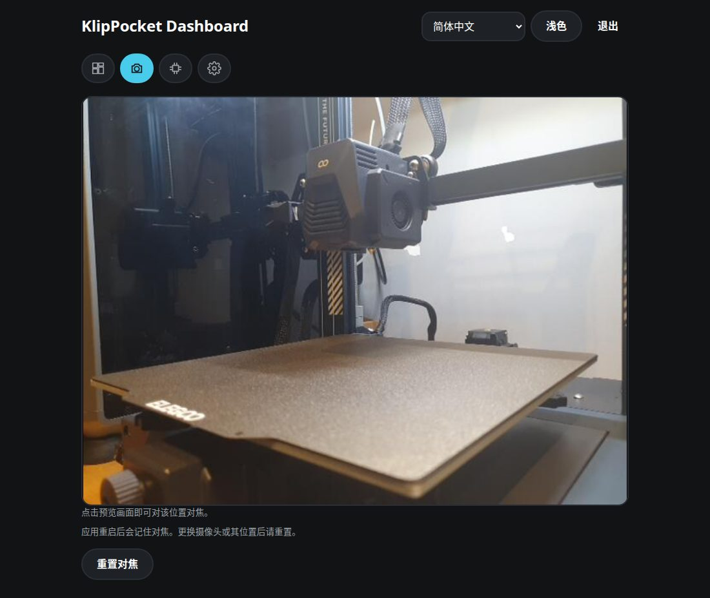
*摄像头标签页：点击画面即可对焦。*

**摄像头** 标签页显示手机摄像头的实时画面，与 Fluidd 和 Mainsail 使用的是同一视频流（含你选择的旋转、分辨率和缩放）。**点击画面即可对焦**到该点，与应用中相同：对焦会一直保留，直到你按 **重置对焦**。摄像头开启且有打印机在运行时才会出现画面（摄像头随打印机启动）；如果已关闭，标签页会提供开启按钮。离开该标签页会关闭连接，因此手机不会为无人观看而编码画面。

## 日志

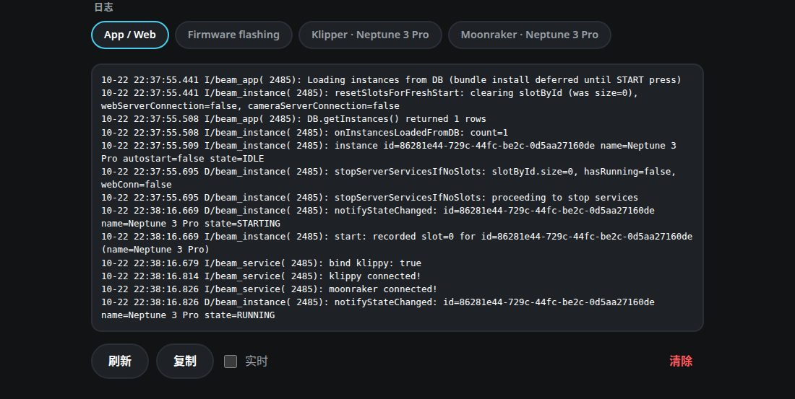
*日志：每个日志源一个标签，以及刷新、复制、实时和清除按钮。*

底部每个日志一个标签，与应用的 **日志** 页面相同：**App / Web**、**固件**（固件写入日志）、每台打印机的 **Klipper**、**Moonraker**、**OctoEverywhere** 和 **Obico**，以及有记录时的 **上次崩溃**。

| 按钮 | 作用 |
|---|---|
| **刷新** | 重新读取日志。 |
| **复制** | 将显示的文本复制到剪贴板。 |
| **实时** | 每 3 秒重新读取一次日志。 |
| **清除** | 确认后**清除日志**：清空 Klipper、Moonraker、OctoEverywhere、Obico 和固件日志文件，删除上次崩溃报告，并隐藏应用日志中较早的行。视图变空，此后只写入新消息 — 与应用中的 **清除** 相同。 |

**日志** 部分只在 **Dashboard** 标签中。固件写入日志是列表中的 **Firmware flashing** 标签；**固件** 页面用自己的 **日志** 按钮显示最近一次写入的日志。

**固件** 标签页（见[固件网页指南](firmware-web.md)）。在手机屏幕上页面会自动重新排列：

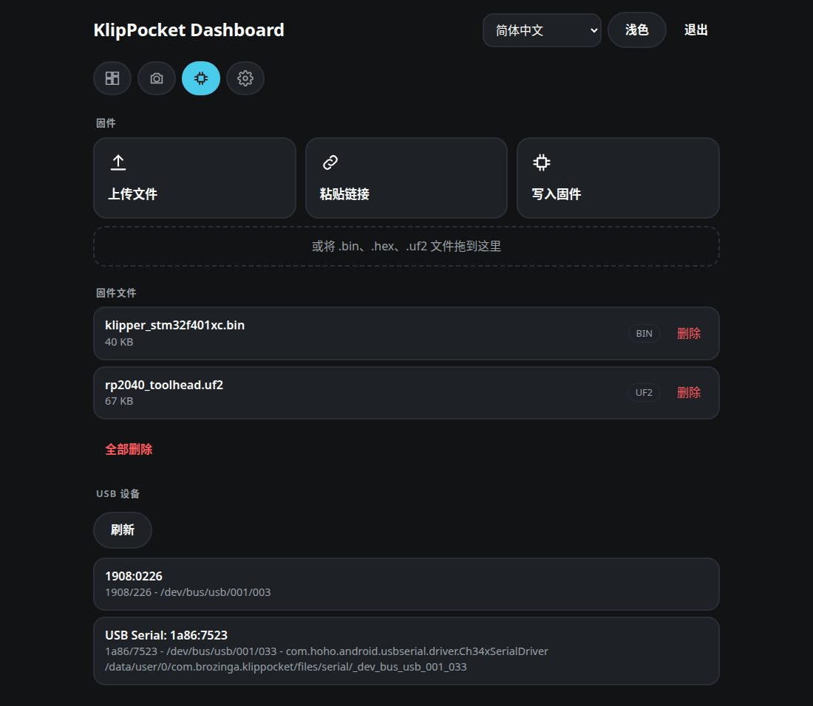

| | |
|---|---|
| 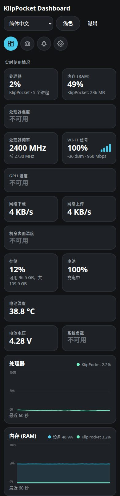 | 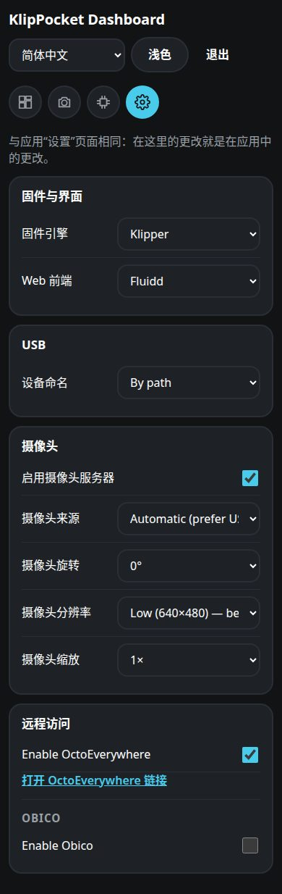 |

## 出现问题时

| 现象 | 处理方法 |
|---|---|
| 页面打不开 | 手机和电脑必须在同一 Wi-Fi 且未开启*客户端隔离*；使用应用中显示的地址。如果 4400 端口被其他应用占用，主屏幕上的卡片会提示页面未运行。 |
| *尝试次数过多* | 等待显示的秒数，或在应用中使用 **新 PIN**。 |
| *与应用的连接已断开* | 应用被关闭或手机休眠：重新打开应用。 |
| 处理器图表中只有 KlipPocket 一条线 | Android 8+ 上属正常现象：见上方说明。 |
| 打印机卡片没有 MCU | 打印机已停止，或 Klipper 尚未连接主板。 |

## 开发者

`/api` 下的所有路由都需要 PIN 登录的会话 cookie，修改数据时还需要请求头 `X-KlipPocket: 1`。Dashboard 路由：`GET /api/dashboard`（设备、存储、打印机、MCU、USB；变化较慢）、`GET /api/metrics`（实时数值；一秒内多次请求会共用同一结果）、`GET /api/logs`（日志源）、`GET /api/logs/read?id=…` 和 `POST /api/logs/clear`；`GET`/`POST /api/settings`（设置为 `{"key": …, "value": …}`）、`POST /api/control`（`{"id": …, "action": "start"|"stop"}`，省略 `id` 表示所有打印机）、`GET /api/printers/new` 和 `POST /api/printers`（`{"name", "config", "autostart"}`）、`GET /api/camera`、`GET /api/camera/stream`（multipart MJPEG）、`POST /api/camera/focus`（`{"x": 0..1, "y": 0..1}`）和 `POST /api/camera/focus/reset`。固件路由见[固件网页指南](firmware-web.md#开发者)。代码位于 `app/src/main/java/ru/ytkab0bp/beamklipper/firmwareweb/`（`DashboardCollector` 读取数值，`DashboardRules` 是在 JVM 上测试的部分），页面位于 `app/src/main/assets/firmware_web/`；其文本由 `scripts/gen_firmware_web_i18n.py` 根据应用字符串生成。
