# 固件标签页 —— 在应用内下载并安装 MCU 固件

**语言：[English](../firmware-tab.md) · [Português (BR)](../pt-br/firmware-tab.md) · [简体中文](firmware-tab.md)**

**固件**标签页（顶部栏的芯片图标）可以获取固件文件，并写入连接到手机/平板的主板，无需电脑。
它相当于 [PC 菜单](build-firmware.md)中选项 **6 Flash Firmware** 在设备上的版本：
固件本身仍需在**电脑上编译**（Android 无法编译），这里只负责获取和写入。

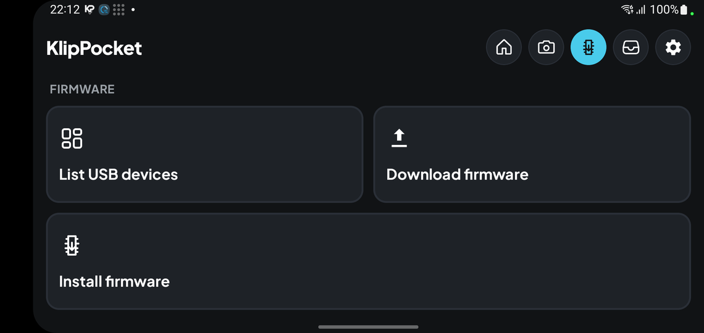

## 方式：哪些可用，哪些是实验性的

| 方式 | 主板 | 状态 |
|---|---|---|
| **RP2040 / RP2350** | 已处于 BOOTSEL 的树莓派 Pico / Pico 2（`2e8a:0003` / `2e8a:000f`） | 已在 Pico（RP2040）上**测试**。**RP2350 为实验性**（没有 Pico 2 可测试） |
| **USB** | 通过 USB 运行 Klipper 的主板。应用发送 1200 bps 引导程序请求（与 Klipper 的 `make flash` 相同），并通过出现的引导程序写入：RP2040 BOOTSEL、STM32 DFU 或 AVR109（ATmega32U4 / Caterina） | RP2040 配合 `.uf2` 已**测试**；其他引导程序（以及 RP2350）为**实验性** |
| **DFU** | 处于 DFU 模式的 STM32（`0483:df11`），DfuSe 协议：擦除扇区、写入、读回、退出 | **实验性** |
| **UART** | 连接到主板串口引导程序的 USB 串口适配器：STM32（ST AN3155，会擦除整个闪存）或 AVR（STK500v1 "arduino"、STK500v2 "wiring"） | **实验性** |
| **Katapult** | Klipper 的 [Katapult](https://github.com/Arksine/katapult) 引导程序（`1d50:6177`），通过 USB，或通过连接到其 UART 的 USB 串口适配器（250000 波特）。通过 USB 的 Klipper 主板会先被送入 Katapult（1200 bps）。原始 `.bin` | **实验性** |
| **HID-Flash** | 带 HID 引导程序（`1209:beba`）的 STM32F1/F4，协议与 Klipper 的 `hid-flash` 相同。通过 USB 的 Klipper 主板会先被送入该引导程序（1200 bps）。原始 `.bin` | **实验性** |
| **SAM-BA** | 处于 ROM 引导程序（`03eb:6124`）的 Atmel SAM3 / SAM4 / SAME70（Arduino Due、SAM4E 主板等）：擦除整个闪存、写入、读回、设为从闪存启动并复位，与 `bossac` 相同。通过 USB 的 Klipper 主板会先被送入该引导程序（1200 bps）。原始 `.bin` | **实验性** |
| **CAN** | 通过 CAN 总线使用 Katapult，经由 gs_usb / candlelight 适配器或 Klipper 的 USB 转 CAN 桥（`1d50:606f`）。需要填写节点的 **UUID**（`canbus_query.py`）和总线速度；应用会把节点送入 Katapult、分配 ID 并写入，与 `flash_can.py` 相同。原始 `.bin` | **实验性** |

> **实验性方式**已完整实现，但**没有在真实主板上的确凿测试**（只有针对模拟引导程序的单元测试）。
> 应用会在方式列表中标出，并在写入前再次警告。**使用风险自负。**

另外**不**支持：通过 SD 卡加载固件的主板（例如 Neptune 3 Pro：请把 `.bin` 复制到 SD 卡）、
SAM-BA 系列中的 SAMD / SAME5x 主板（闪存控制器不同），以及上述之外的引导程序。应用会拒绝与所选方式不匹配的文件或设备：
`.uf2` 必须为该芯片构建，用于 Pico 的原始 `.bin` 必须以有效的 RP2040 boot2 块（或 RP2350 IMAGE_DEF 块）开头，
因此 STM32 的 `.bin` 绝不会写入 Pico，DFU / UART 需要 `.bin` 或 `.hex`，Katapult / HID-Flash / SAM-BA / CAN 需要 `.bin`。Klipper 对 RP2040 和 RP2350 写入相同的 UF2 家族 ID，
所以应用通过查看镜像内容来区分它们；属于另一种芯片的文件会在写入任何内容之前被拒绝。

> **写入固件可能使主板无法使用。** 只写入为该主板构建的文件，保持线缆连接并保持界面打开，
> 并记住写入期间 Klipper 会失去与该主板的连接。

## 三个按钮

- **列出 USB 设备** —— 与 *设置 → USB → 列出 USB 设备* 相同的列表。

  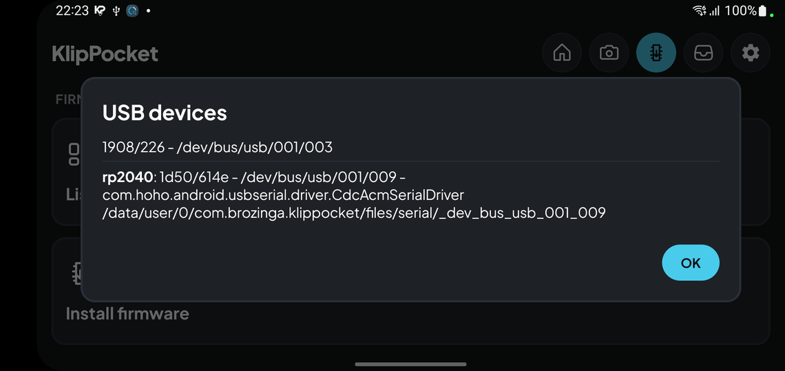

- **下载固件** —— 粘贴链接，应用会保存文件。
- **安装固件** —— 下面的分步向导。

按钮下方的**固件文件**列出应用中保存的文件（名称、类型、大小），可**删除**；
**从设备导入**通过系统文件选择器复制你已有的文件（例如在电脑上编译的）。
接受 `.bin`、`.hex`、`.uf2` 和 `.zip`（会提取其中的固件文件）。

### 删除文件

点按列表中的文件即可选中，*固件文件*旁会出现**垃圾桶图标**，用于删除该文件。**全部删除**会删除所有已保存的固件。两者都会先要求确认。

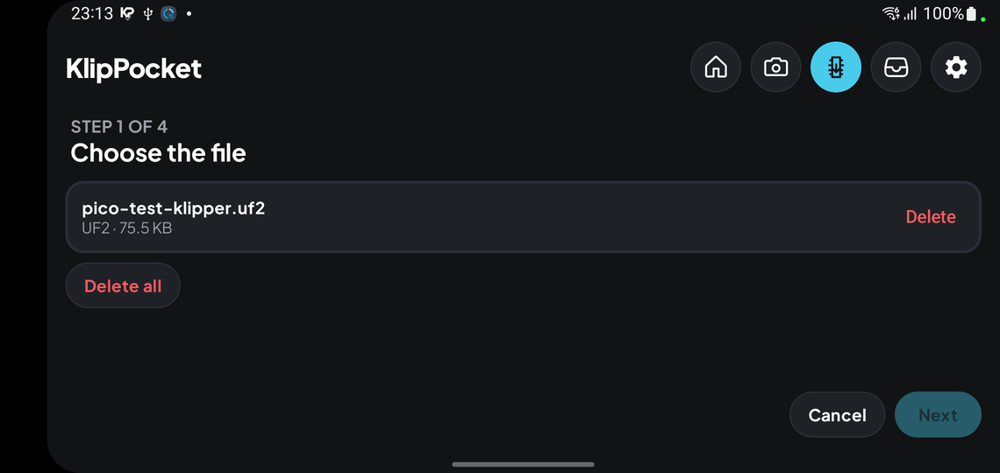

## 下载固件

点按**下载固件**，粘贴 **https** 链接并点按**下载**，例如
`https://github.com/utkabobr/klipper/releases/download/prebuilt-v0.12.0/stm32f401.bin`。
大小限制：16 MB。

| | |
|---|---|
| 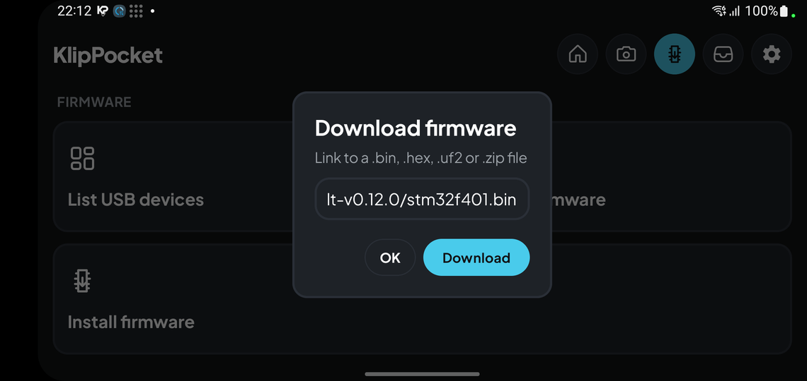 | 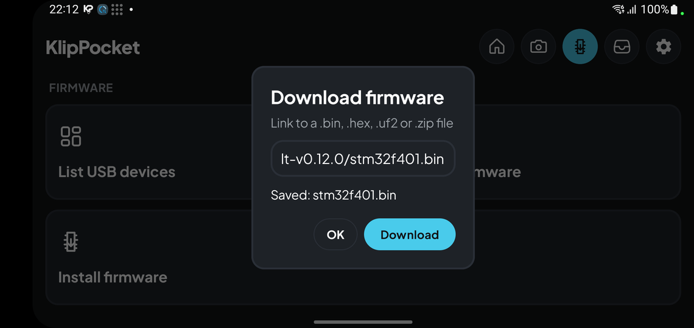 |

## 安装固件

点按**安装固件**。每一步都有**下一步** / **返回**；手机的返回键也会返回一步。

**1 —— 选择文件。** 选择已保存的文件之一。

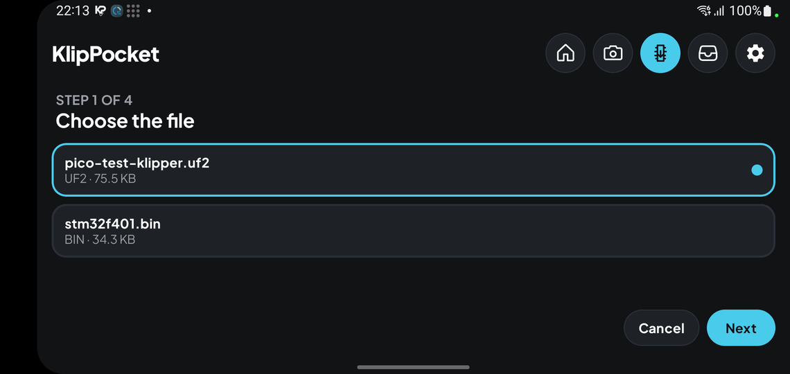

**2 —— 选择设备。** 列出手机看到的所有 USB 设备；**刷新**会更新列表（也会自动刷新）。
处于 BOOTSEL 的主板显示为 *RP2 Boot · 2e8a:0003*，运行 Klipper 的 Pico 显示为 *rp2040 · 1d50:614e*。
需要时 Android 会请求 USB 权限。

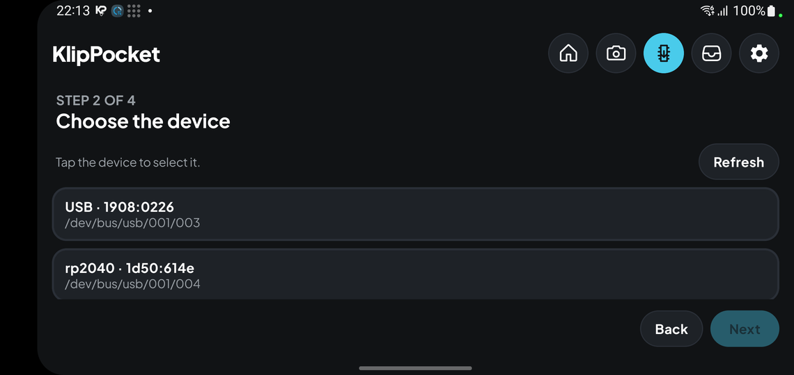

**3 —— 选择写入方式。** 应用会根据设备给出建议（Klipper 主板用 *USB*，BOOTSEL 用 *RP2040*，`0483:df11` 用 *DFU*）。
没有确凿测试的方式会显示**实验性**提示。

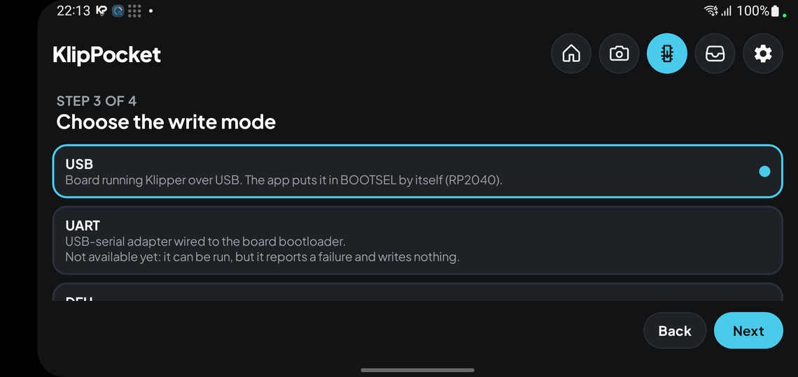

对于写入 **STM32** 的原始 **`.bin`**（DFU、UART 或 USB 方式），会出现**闪存起始地址**输入框：文件写入的位置
（除非下方有你自己的引导程序，否则为 `0x08000000`；Klipper 的 *Bootloader offset* 即该大小）。
`.hex` 和 `.uf2` 文件自带地址。

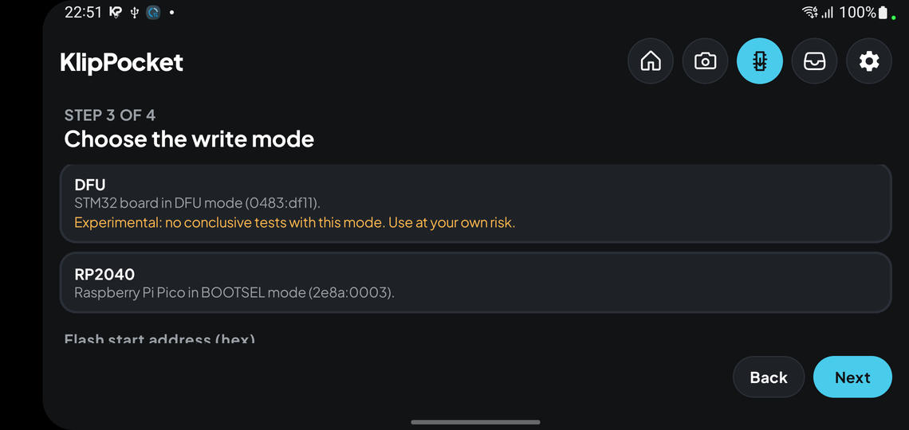

在 **CAN** 方式下会出现另外两个字段：节点的 **CAN UUID**（12 位十六进制，与 `canbus_query.py` 输出一致）和
**总线速度**（bit/s，默认 1000000，即 Klipper 配置中的 `canbus_frequency`）。第 2 步请选择适配器本身（gs_usb 设备），而不是它后面的主板。

**4 —— 确认。** 警告页显示文件、设备和方式；实验性方式还会再给出一条“风险自负”的警告。**取消/返回**不会改变任何内容；**确认**开始写入。

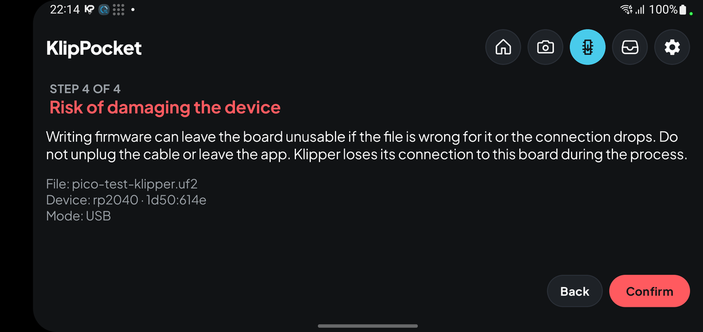

**进度。** 屏幕保持常亮。一条进度条覆盖整个过程（逐阶段推进，从不倒退），平滑填充，并在应用工作时有一道光扫过；
下方显示当前阶段和总百分比：准备、使主板进入 BOOTSEL、等待、USB 权限、与引导程序通信、擦除、写入、校验（读回并比对）、重启、等待主板。
如果失败，进度条会消失并显示错误。

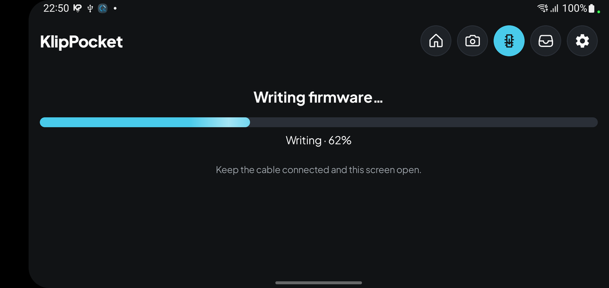

**结果。** 成功（进度条已满）表示已写入、校验，并且（使用 USB 时）主板已作为 Klipper 设备重新出现在总线上。
如果数据已校验但主板没有重新出现在 USB 上，应用会提示。失败时会用你的语言说明原因。

| | |
|---|---|
| 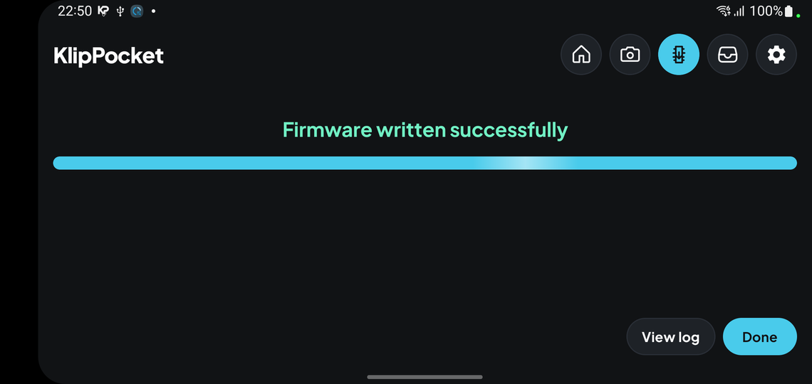 | 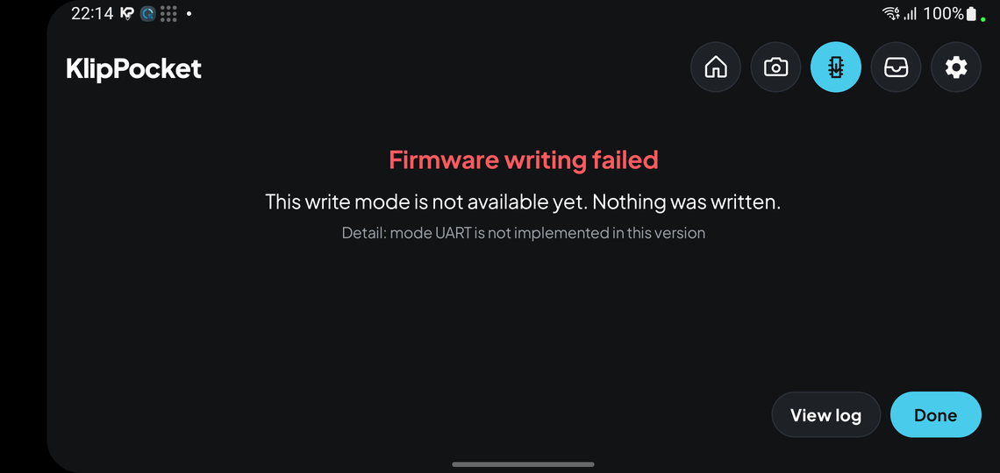 |
| 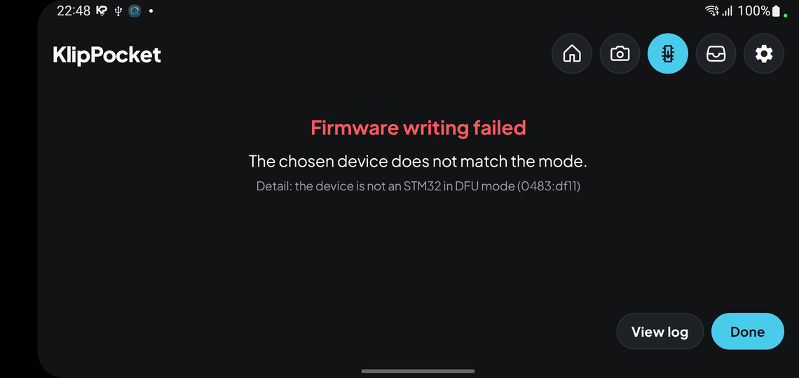 | |

**查看日志**会打开日志标签页中新的**固件写入**来源。

## 日志

每次写入都会被记录（文件、sha256、设备、方式、各阶段、结果）：

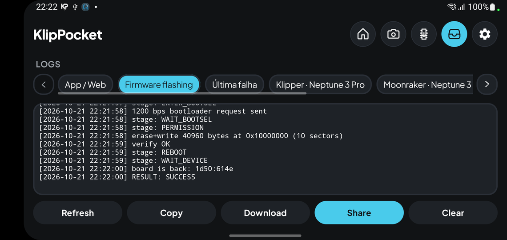

## 主题与语言

该标签页遵循应用的主题和语言（English、Português、简体中文、繁體中文、Русский）。

| | |
|---|---|
| 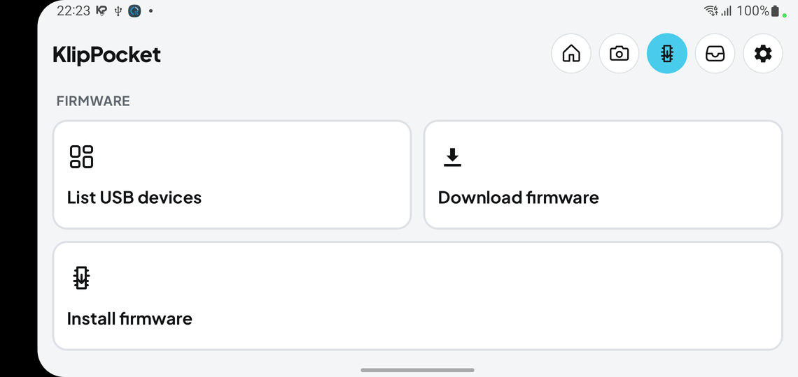 | 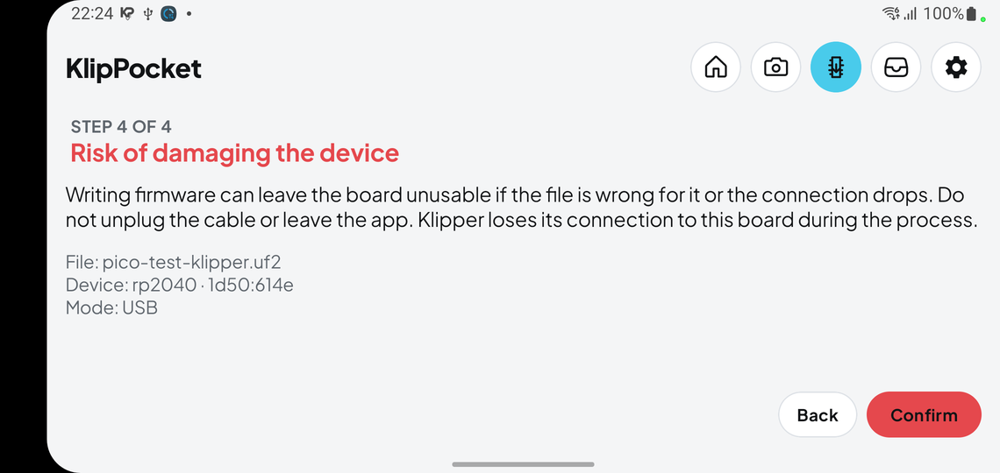 |
| 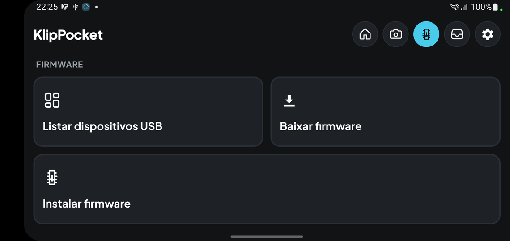 | 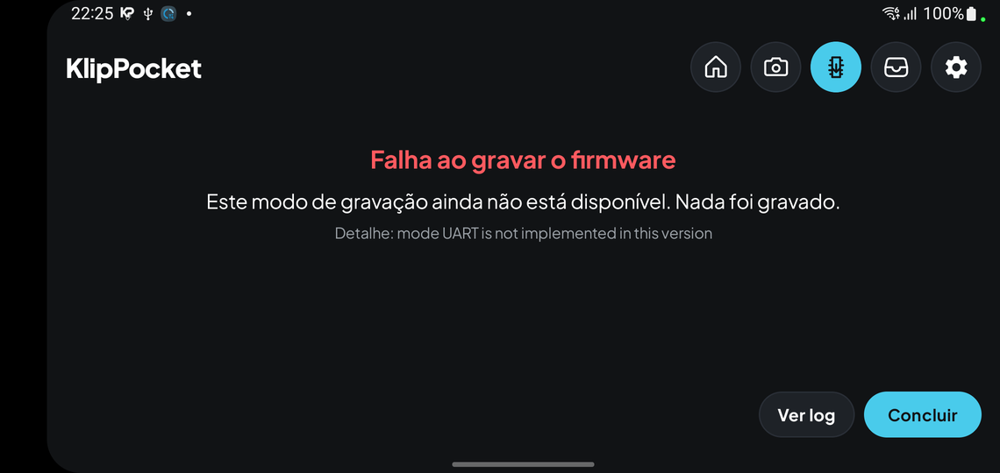 |

## 出问题时

| 提示 | 处理方法 |
|---|---|
| 未出现受支持的引导程序 | 发送 1200 bps 请求后主板没有进入 RP2040 BOOTSEL、STM32 DFU、Katapult、HID、SAM-BA 或 AVR109。请手动使其进入引导程序（BOOTSEL / BOOT0 / 引导程序按钮），并使用对应引导程序的方式。 |
| 所选设备与方式不匹配 | 为该方式选择正确的设备（*DFU* 需要 `0483:df11`，*RP2040* 需要 `2e8a:0003`）。未写入任何内容。 |
| 引导程序没有响应 | UART：检查 BOOT0 和复位（STM32）或复位线（AVR）、接线和波特率。未写入任何内容。 |
| 该设备不是 USB 串口适配器 | UART 方式需要 CDC / CH34x / CP210x / FTDI 适配器。 |
| 此文件类型不适用于所选方式 | RP2040：`.uf2` 或 `.bin`；STM32 / AVR：`.bin` 或 `.hex`；Katapult、HID-Flash、SAM-BA 和 CAN：`.bin`。 |
| CAN UUID 缺失或无效 | 12 位十六进制，与 `canbus_query.py` 显示的完全一致。 |
| 该设备不是 CAN 适配器 | CAN 方式下，请在第 2 步选择 gs_usb / candlelight 适配器（或 Klipper USB 转 CAN 桥）。 |
| 闪存起始地址无效 | STM32 的 `.bin` 文件地址应在 `0x08000000` 到 `0x0FFFFFFF` 之间。 |
| 未授予 USB 权限 | 重试并接受 Android 的提示。 |
| 该文件不适用于此芯片 | RP2040 和 RP2350 各自需要自己的固件：请为你拥有的芯片构建（见 [build-firmware.md](build-firmware.md)）。 |
| 写入后闪存与文件不一致 | 不要拔线，重新运行。RP2040 会停留在 BOOTSEL，随时可以重新写入。 |

## 没有主板时如何测试实验性方式

作者只有一块树莓派 Pico，因此其他方式都是针对**模拟主板**测试的，而这些模拟主板本身又用**真实工具**核对过：

- 模拟器在 [`app/src/test/python/fake_bootloaders.py`](../../app/src/test/python/fake_bootloaders.py)：
  Katapult 节点（USB/UART 与 CAN 总线）、STM32 HID 引导程序（1 KiB 与 2 KiB 页）、
  以及带 EEFC 闪存控制器、处于 SAM-BA ROM 的 SAM3X8E / SAM4E8E。
- `test_bootloader_fakes.py` 用 Klipper **自带的**工具去运行它们：`flash_can.py`（串口与 CAN 路径）、
  `hid-flash` 和 `bossac`（由源码树中的源码编译）。真实工具能写出正确的闪存，说明模拟器的行为与主板一致。
- 随后 Kotlin 测试（`OtherBootloadersTest`）用同样的模拟器运行应用代码，包括错误应答、无应答、写入错误和读回失败。
  变异检查（跳过 SAM-BA 的擦除）会使测试失败，符合预期。
- 这**不能**证明的内容：USB 时序、电气部分、与参考版本不同的引导程序版本，以及真实 CAN 适配器的 `gs_usb` 帧格式
  （遵循 Linux `gs_usb` 驱动，但从未接触过真实设备）。因此这些方式仍标为**实验性**。

Pico 始终保留其 BOOTSEL 引导程序，因此写入失败时按住 BOOTSEL 重新写入即可恢复。
