# 使用 Happy Hare（多耗材 / MMU）

**语言：[English](../happy-hare.md) · [Português (BR)](../pt-br/happy-hare.md) · [简体中文](happy-hare.md)**

[Happy Hare](https://github.com/moggieuk/Happy-Hare) 是 Klipper 上用于多材料单元（MMU）的驱动：ERCF、Tradrack、BoxTurtle、3MS、3D Chameleon、HTLF、KMS、MMX 等。KlipPocket 内置 **Happy Hare v4.1.0** 及其 Moonraker 组件，同时支持 Klipper 和 [Kalico](kalico.md)。只有配置文件里要求时才会启用，没有 MMU 的打印机不受影响。

您可以**在应用里**（或在[仪表盘](dashboard.md)里）设置 Happy Hare：回答与 Happy Hare 自带安装菜单相同的问题，由 KlipPocket 写出文件，不需要电脑。

## 您需要

- 一块刷了 Klipper **USB** 固件的 MMU 主板，连接到手机/平板（最好通过带供电的集线器）。电机和舵机需要单独供电。
- 已在 KlipPocket 中创建好的打印机配置。

## 在应用里设置

1. 打开**设置 → Happy Hare**，选择打印机（只有一台时会直接打开）。点 **Set up Happy Hare**（设置 Happy Hare）。

   <p align="center">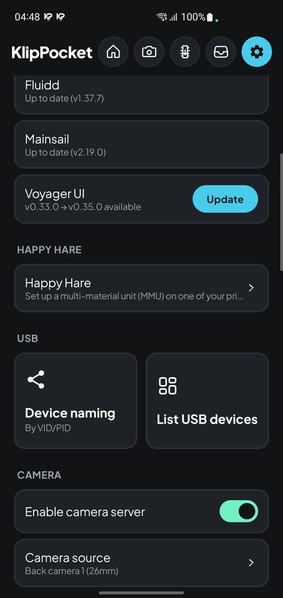 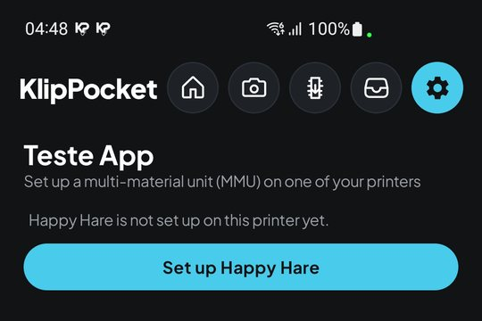</p>

2. 选择您的 MMU。Happy Hare 会填入其设计者推荐的默认值。

   <p align="center">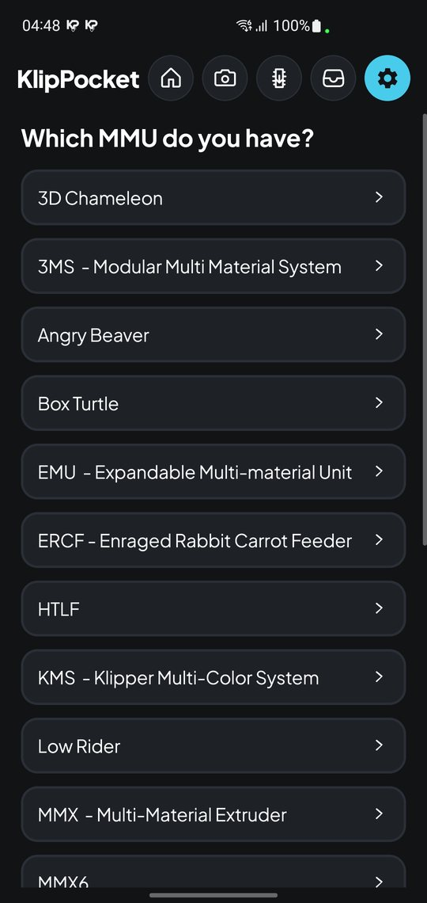</p>

3. 依次回答问题。它们就是 Happy Hare 自己的菜单，所以显示为英文。打开一个分区查看其中的问题；点某个问题即可修改，在其窗口中用**恢复默认值**撤销修改。变灰的开关由您的其他回答决定。依赖某个回答的问题会直接显示在它下面（例如 MMU 类型下面的 Turtle Neck 版本）。

   <p align="center">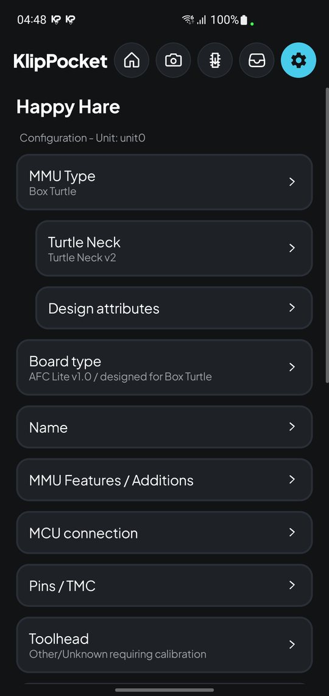</p>

4. 打开 **MCU connection**，设置 MMU 主板的设备。在 **Enter serial device path** 中，从列表里选择已连接的主板，或输入它的路径（见**设置 → USB → 列出 USB 设备**）。

   <p align="center">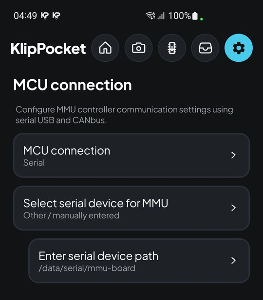 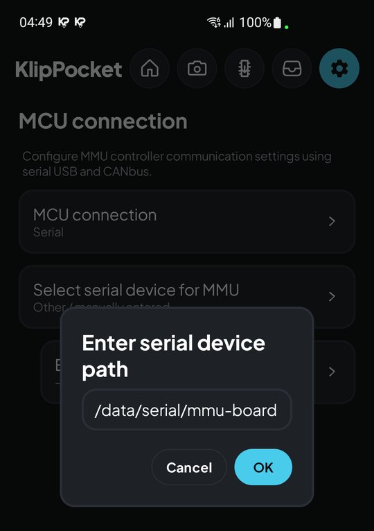</p>

5. 回到第一页，点**检查并创建**。如果列出了**仍缺少的回答**，请返回补全。然后选择：

   - **把 Happy Hare 添加到 printer.cfg 和 moonraker.conf**：开启时 KlipPocket 会替您添加这些行（并各保留一份备份）。关闭时由您自己添加，见[自行添加这些行](#自行添加这些行)。
   - **同时重置校准和通道状态**：换了另一种 MMU 时开启。只改了设置时请保持关闭，以保留 `mmu/mmu_vars.cfg` 中的校准。

   这台打印机的 `mmu` 文件夹会被删除并重新创建，所以手动在其中做的修改会丢失。点**创建配置**。

   <p align="center">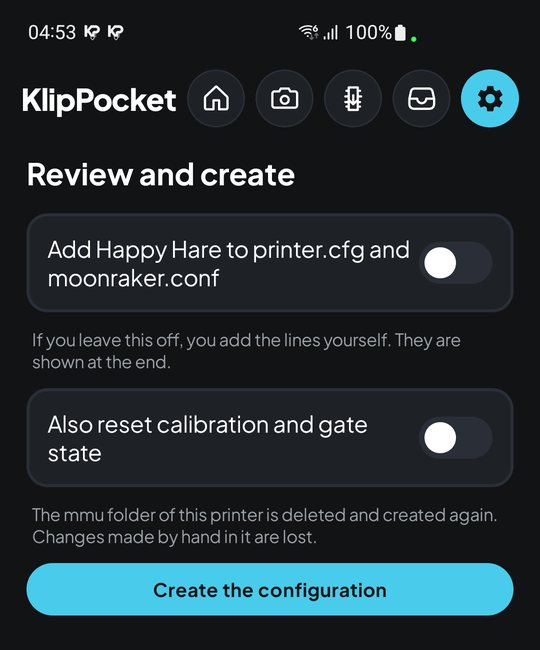 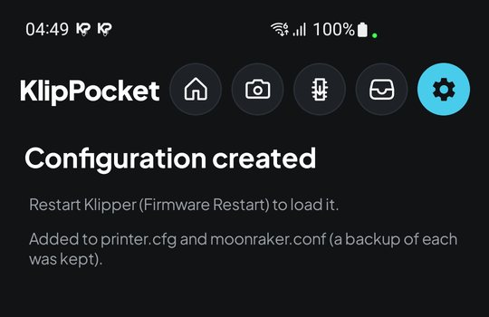</p>

6. 重启打印机配置（或发送 **Firmware Restart**），让 Klipper 加载 Happy Hare。

## 在仪表盘里设置

[仪表盘](dashboard.md)在设置旁边的 **Happy Hare** 标签页中有同样的步骤：选择打印机、**设置 Happy Hare**、您的 MMU、问题、**检查并创建**。在 **MCU connection** 中，列表会提供手机看到的 USB 设备。

<p align="center">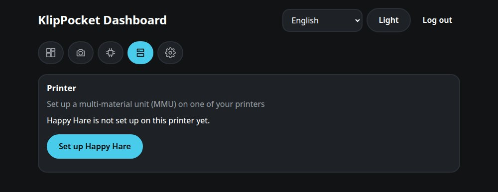 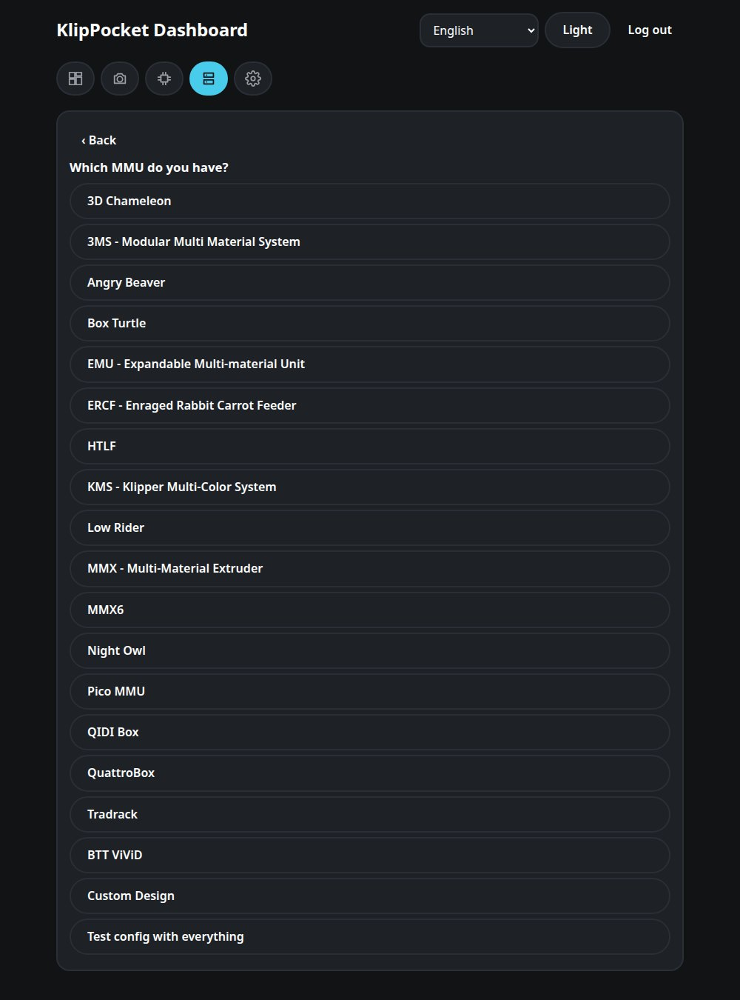</p>
<p align="center">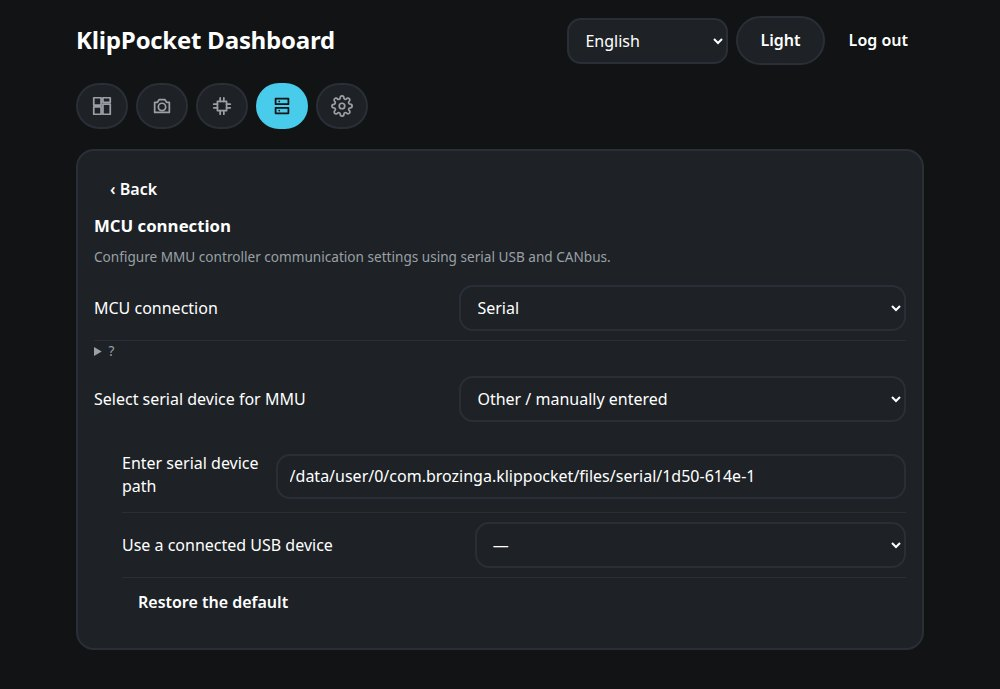 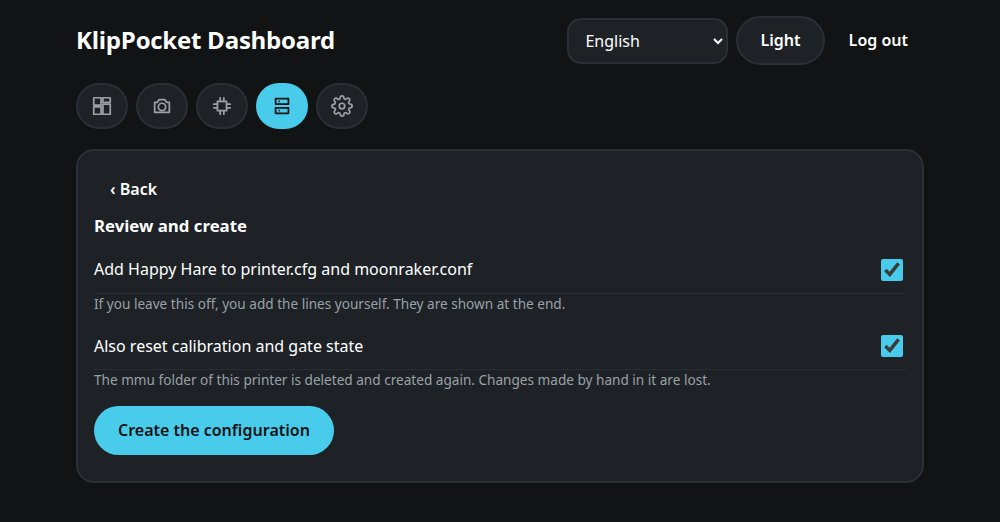</p>

## 自行添加这些行

如果您关闭了**把 Happy Hare 添加到 printer.cfg 和 moonraker.conf**，最后一个界面会显示要添加的行（也可以点**现在添加**让 KlipPocket 来做）。

<p align="center">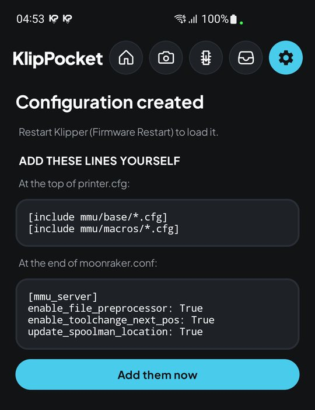 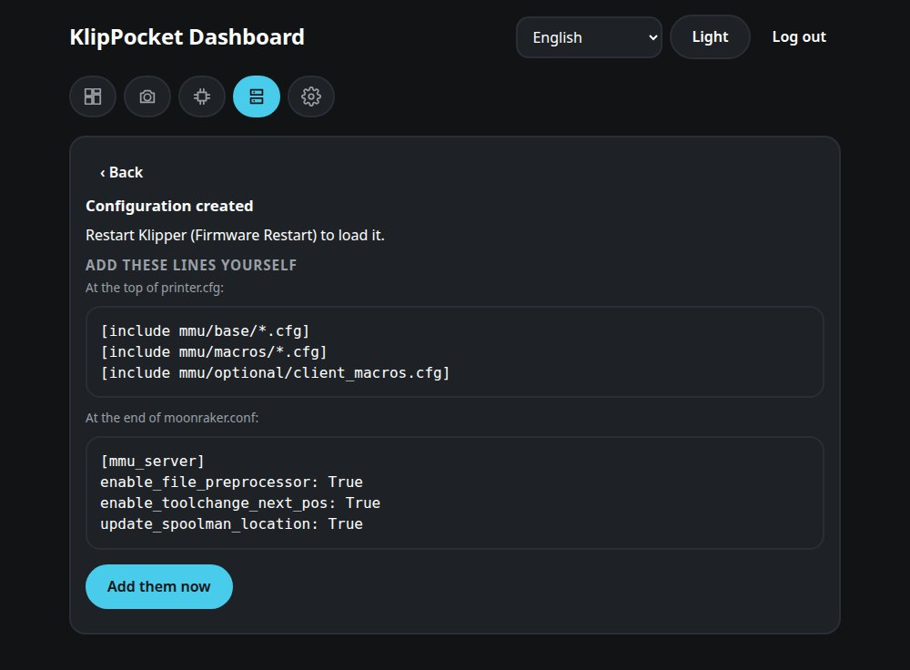</p>

打开打印机配置的配置文件夹，也就是放着 `printer.cfg` 的那个（Fluidd/Mainsail 的配置文件管理器，或 Android“文件”应用中的 KlipPocket 入口），然后：

1. 把显示的 `[include …]` 行加到 `printer.cfg` 的**开头**。通常是：

   ```ini
   [include mmu/base/*.cfg]
   [include mmu/macros/*.cfg]
   ```

   开启了相应选项时还有 `[include mmu/optional/client_macros.cfg]`（以及 `mmu_menu.cfg`）；界面会准确显示是哪些。
2. 把下面内容加到 `moonraker.conf` 的**末尾**：

   ```ini
   [mmu_server]
   enable_file_preprocessor: True
   enable_toolchange_next_pos: True
   update_spoolman_location: True
   ```

   不要添加 `[update_manager happy-hare]` 段：应用会随应用本身一起更新 Happy Hare。
3. 确认 `printer.cfg` 中有 `[pause_resume]` 段，并且没有自己定义 `PAUSE`、`RESUME` 或 `CANCEL_PRINT`（Happy Hare 已提供）。重复定义会让 Klipper 以 `gcode command … already registered` 停止。
4. 重启打印机配置。

## 以后更换 MMU 或修改设置

再次打开**设置 → Happy Hare** 和这台打印机。

<p align="center">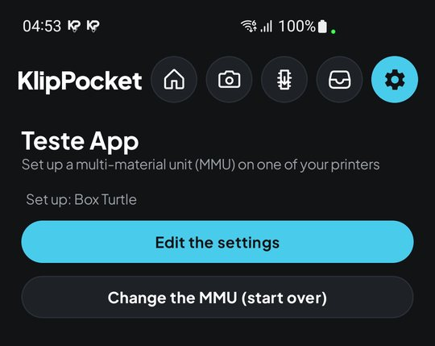</p>

- **修改设置**会打开您保存的回答；改动需要的内容后重新创建配置。
- **更换 MMU（重新开始）**从您选择的 MMU 的默认值开始。创建配置时会删除旧的 `mmu` 文件夹并写入新的（请保持**同时重置校准和通道状态**开启）。之前使用的 USB 主板会再次被提供，无需重复选择。

## 在网页界面中查看 MMU

Klipper 加载 Happy Hare 之后，应用自带的 Fluidd 和 Mainsail 会在它们的**仪表盘**页面显示 MMU，无需开启任何选项：Fluidd 有一个 **MMU** 卡片，Mainsail 有一个 **MMU** 面板，显示各通道、当前工具、耗材状态，以及预装载、退出和恢复按钮。可以通过各界面的仪表盘布局选项移动或隐藏。

在 Fluidd 或 Mainsail 的控制台中，`MMU_STATUS` 输出 MMU 摘要，`MMU_HELP` 列出所有命令。Happy Hare 自己的日志写在 `klippy.log` 旁边，名为 `mmu.log`。

[KlipperScreen for Happy Hare](https://github.com/moggieuk/KlipperScreen-Happy-Hare-Edition) 是面向触摸屏的独立项目。

## 快速排错

| 信息 | 可能原因 |
|---|---|
| `MMU_STATUS` 回答 `Unknown command` | `printer.cfg` 缺少 `[include mmu/base/*.cfg]` 行，或没有 `mmu` 文件夹。 |
| `gcode command … already registered` | `printer.cfg` 中的某个宏与 Happy Hare 提供的重复（例如 `PAUSE`、`RESUME` 或 `CANCEL_PRINT`）。删除您自己的。 |
| `mcu 'unit0': Unable to connect` / `Unable to open serial port` | 主板没有 USB 固件，或重新刷写后路径变了：在 **MCU connection** 中重新选择，并再次创建配置。 |
| `Happy Hare's Klipper modules failed to load` | 请反馈。该信息中关于 `install.sh` 的建议不适用于本应用。 |
