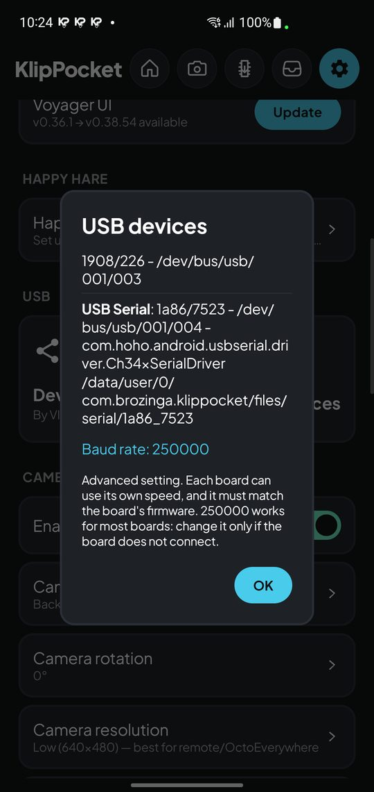
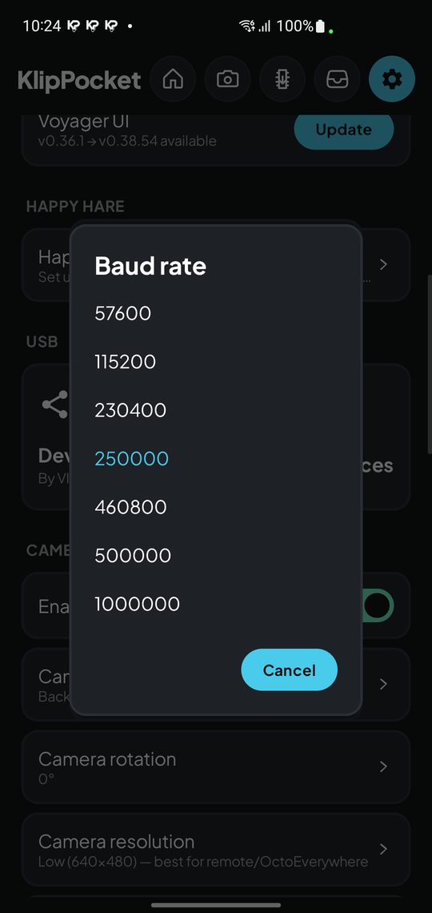
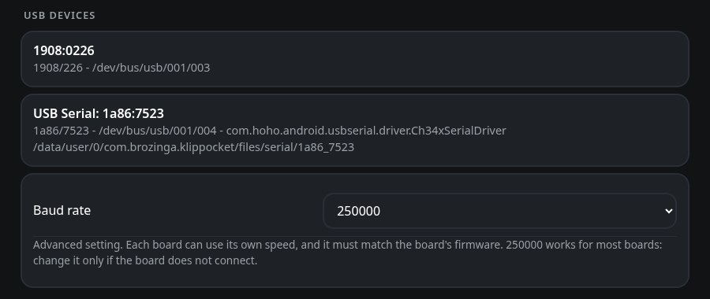

# 更改 USB 波特率

**语言: [English](../usb-baud-rate.md) · [Português (BR)](../pt-br/usb-baud-rate.md) · [Español](../es/usb-baud-rate.md) · [简体中文](usb-baud-rate.md)**

**波特率**是 KlipPocket 与主板微控制器（MCU）之间串口链路的速度。它是**高级设置**，**按主板分别选择**，
**大多数情况下默认的 250000 就能正常工作**。仅在 KlipPocket 无法连接 MCU 时才修改。

## 为什么不同的主板使用不同的速率

大多数主板通过一个小型 **USB 转串口适配器**（例如 CH340、CP210x 或 FTDI 芯片）连接到 MCU 的 UART 与手机相连。
UART 没有时钟线：双方只是各自计时，所以**两端必须事先设为相同的速率**，否则一方发送的数据在另一方看来就是噪声。
这里没有自动协商。

MCU 一侧的速率在编译固件时确定（`CONFIG_SERIAL_BAUD`，即 Klipper `make menuconfig` 中的
"Baud rate for serial port"）：

- **250000** 是 Klipper 的默认值：比经典的 115200 更快，为打印机发送的数据（多个步进电机、传感器、
  输入整形）留出更多余量，而且大多数芯片都能精确产生这个速率。
- **115200** 是许多其他固件和引导程序的传统默认值，因此一些主板（或用其他工具编译的固件）使用它。
- **较低**的速率（57600）有助于较长或有干扰的线缆；**较高**的速率（460800、500000、1000000）
  在数据量很大时留出更多余量。

通过 **MCU 自带的原生 USB** 连接的主板完全不使用波特率：该设置对它们没有影响。由于每块主板的编译方式可能不同，
速率是**按每块主板**选择的（即使同时连接了多块主板，每个 MCU 也可以使用不同的速率）。

> 由固件决定。应用中的值必须与**固件中的值相同**。修改之前，请先确认你的主板使用的值
> （`CONFIG_SERIAL_BAUD`，或 Klipper 日志中 `MCU 'mcu' config:` 行里的 `SERIAL_BAUD=`）。

## 何时需要修改

保持 250000，除非主板无法连接；例如 Klipper 一直停在 *Starting*，日志以 `Unable to connect`、
`Timeout on connect` 或 `Lost communication with MCU` 结尾，而线缆、权限和端口名称都没有问题。

## 在应用中

1. 打开 **设置 → USB → 列出 USB 设备**。
2. 应用能作为串口打开的每块主板都会显示其**波特率**。点按它，选择你的主板固件所使用的速率。

 

*（截图中的应用为英文界面。）* 新的速率会为该主板保存，并**立即生效**，无需拔插任何设备。

## 在 Dashboard 中

在 [Dashboard](dashboard.md) 的 **USB 设备**列表中，应用能作为串口打开的每块主板都有一个**波特率**选择器。
选择某个值的效果与在应用中相同。

## 须知

- **在你修改之前不会有任何变化。** 每块主板默认为 250000；只有你修改过的主板才会保存速率，再次选择 250000 会清除记录。
- **按主板区分**，使用与其串口相同的名称识别。当**设备命名**为*按路径*时，插到另一个端口或重启的主板会得到新的路径，
  并回到 250000；请使用**按 VID/PID**来保留选择（两块 VID/PID 相同的主板共用一个名称，因此也共用一个速率）。
- **其他 USB 功能不受影响**：应用中的固件烧录有自己的速率。
- **请在打印机空闲时修改。** 错误的速率会让 Klipper 丢失 MCU，从而中断打印。如果发生这种情况，请改回正确的速率并发送
  `FIRMWARE_RESTART`（一到两次）；如果 MCU 仍处于 *shutdown*，请给打印机断电再通电。
